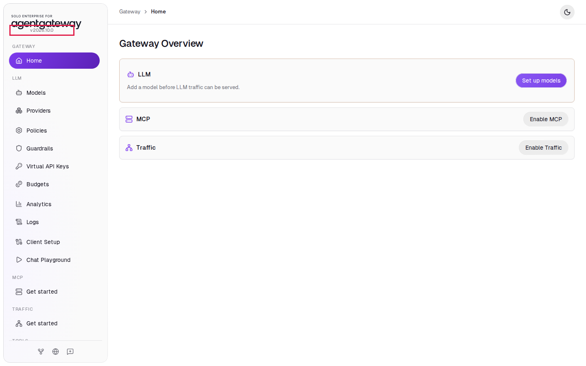
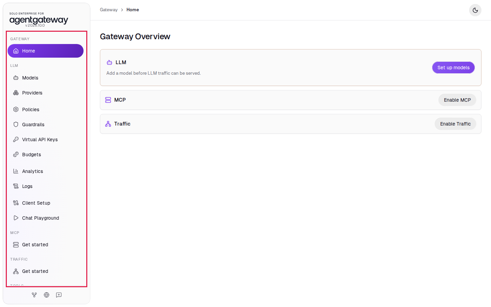
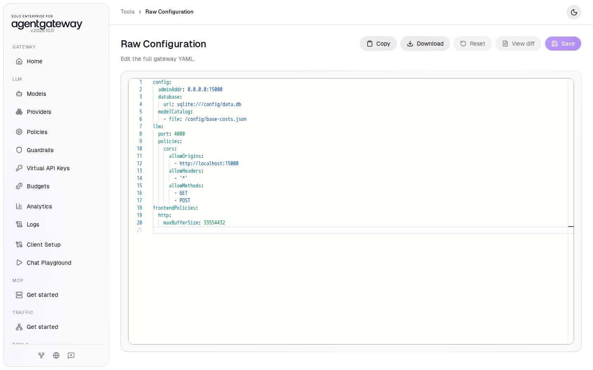

# Set Up Standalone Enterprise Agentgateway

## Before you start

You need:

- [Docker Desktop](https://www.docker.com/products/docker-desktop/) (macOS or Windows) or Docker Engine with the Compose plugin (Linux). On Windows, run the commands in a WSL terminal.
- Git, to clone this repo.
- A Solo Enterprise for agentgateway license key. Ask your Solo.io contact for a trial key.
- An OpenAI API key.
- Optional: an Anthropic API key. Labs mark the Anthropic steps as optional.

## What you'll do

- Start Enterprise agentgateway and its UI with Docker Compose
- Open the UI and find your way around it
- Learn where the UI saves your changes

## Why this matters

The standalone build runs as one container. You configure it from the built-in UI, and the UI saves every change to one file, `setup/config.yaml`. Every other lab in this workshop builds on the gateway you start here.

## Step 1: Get the workshop files

1. Open a terminal.
2. Clone the repo and go to the `setup` folder:

   ```bash
   git clone https://github.com/solo-io/fe-enterprise-standalone-agentgateway-workshop.git
   cd fe-enterprise-standalone-agentgateway-workshop/setup
   ```

## Step 2: Add your keys

1. Copy the example settings file:

   ```bash
   cp .env.example .env
   chmod 600 .env
   ```

2. Open `.env` in a text editor and paste your keys after the `=` signs:

   ```
   ENTERPRISE_AGENTGATEWAY_LICENSE_KEY=<your license key>
   OPENAI_API_KEY=<your OpenAI key>
   ANTHROPIC_API_KEY=<optional, leave empty to skip>
   ```

3. Save the file.

The gateway reads the keys from `.env`. The keys never appear in `config.yaml` or in the UI.

## Step 3: Free the gateway ports

The gateway uses ports `15000`, `4000`, `4001`, `8080`, `8180` and `6274` on your computer. If another agentgateway already runs there, stop it first. For example, if you used the `agentgateway-standalone` repo:

```bash
(cd <path to agentgateway-standalone>/docker && docker compose down)
```

If a port is still in use, Step 4 fails with an error like this:

```
Bind for 0.0.0.0:15000 failed: port is already allocated
```

## Step 4: Start the gateway

From the `setup` folder, run:

```bash
env UID=$(id -u) GID=$(id -g) docker compose up -d
```

The `UID` and `GID` values run the container as your user, so the UI can save changes to `config.yaml`.

Check that it runs:

```bash
docker compose ps
```

Expected output:

```
NAME                                  IMAGE                                                                                       ...   STATUS
agentgateway-workshop-agentgateway-1  us-docker.pkg.dev/solo-public/enterprise-agentgateway/agentgateway-enterprise:2026.10.0   ...   Up 10 seconds
```

## Step 5: Open the UI

1. Open [http://localhost:15000/ui](http://localhost:15000/ui) in your browser.
2. Check the version under the logo reads **v2026.10.0**.



The **Gateway Overview** page shows three areas of the gateway:

- **LLM**: models and the policies for traffic to LLM providers. The LLM track starts here.
- **MCP**: MCP servers and their tools. The MCP track turns it on.
- **Traffic**: general HTTP gateways and routes.

## Step 6: Tour the sidebar



| Sidebar item | What you do there |
|---|---|
| **Models**, **Providers** | Choose which LLMs callers can use and which credentials the gateway sends |
| **Policies** | Authentication, authorization, rate limits, transformations |
| **Guardrails** | Inspect prompts and responses, block or mask content |
| **Virtual API Keys**, **Budgets** | Issue keys to callers, cap their usage |
| **Analytics**, **Logs** | See traffic, tokens and cost |
| **Client Setup**, **Chat Playground** | Get connection snippets, send test prompts |
| **Raw Configuration** | See and edit the YAML behind everything above |

## Check it

1. In the sidebar, scroll down to **Tools** and click **Raw Configuration**.
2. Find `port: 4000` in the `llm` section. This is the port your applications send LLM requests to.



This page shows `setup/config.yaml`. When you save a change anywhere in the UI, the UI writes it to this file and the gateway loads it within a second.

<details>
<summary>Optional: check with curl</summary>

```bash
curl -s http://localhost:15000/api/runtime | grep -o '"state":"[a-z]*"'
```

Expected output:

```
"state":"running"
```

</details>

## Stop or start over

- Stop the gateway and keep your changes: `docker compose down`. Start it again with the command from Step 4.
- Start over from the starting config:

  ```bash
  docker compose down
  git checkout -- config.yaml
  rm -f data.db data.db-shm data.db-wal
  ```

  `data.db` holds request logs and analytics.

## Next

- LLM track: [Connect LLM Providers](labs/llm/connect-llm-providers.md)
- MCP track: complete [Connect LLM Providers](labs/llm/connect-llm-providers.md) first, then [Connect a Remote MCP Server](labs/mcp/connect-remote-mcp-server.md)
