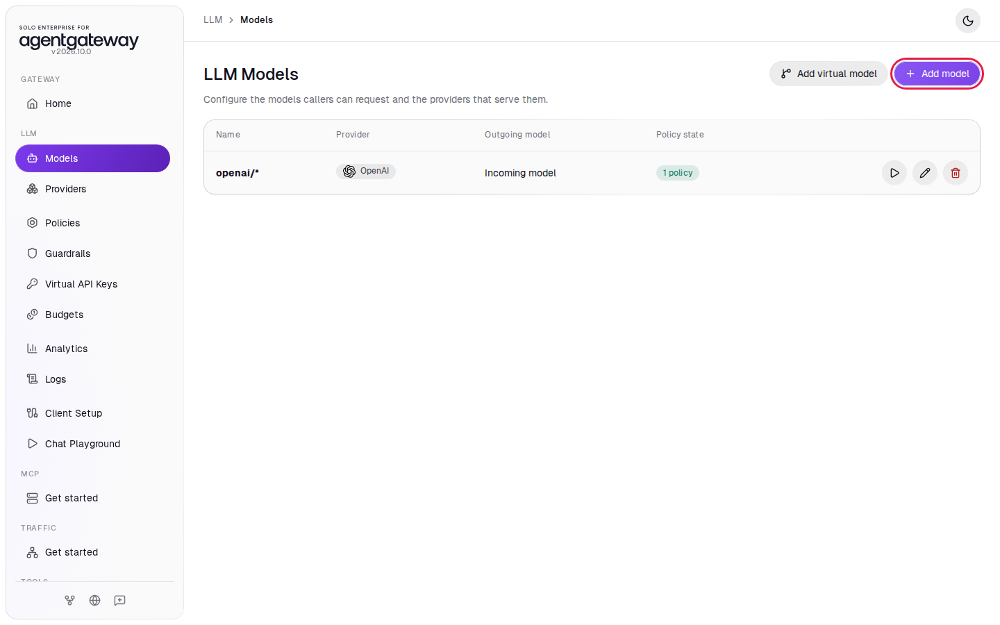
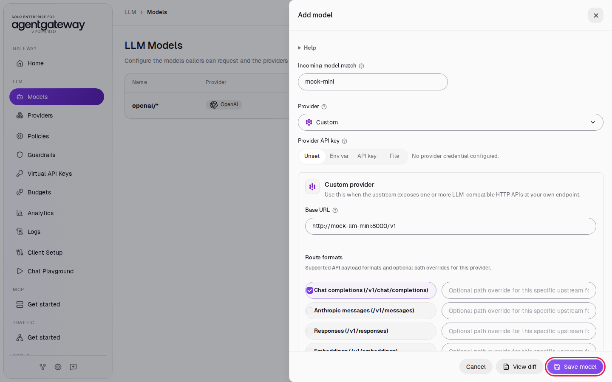
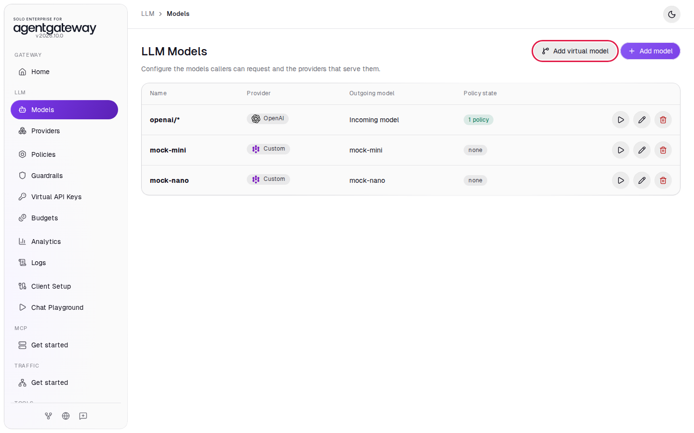
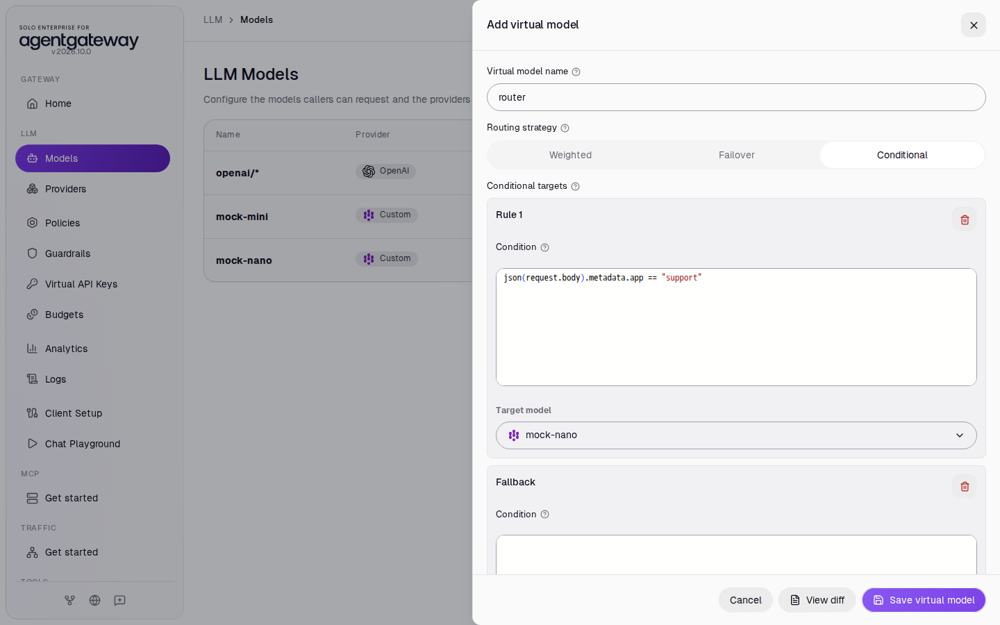
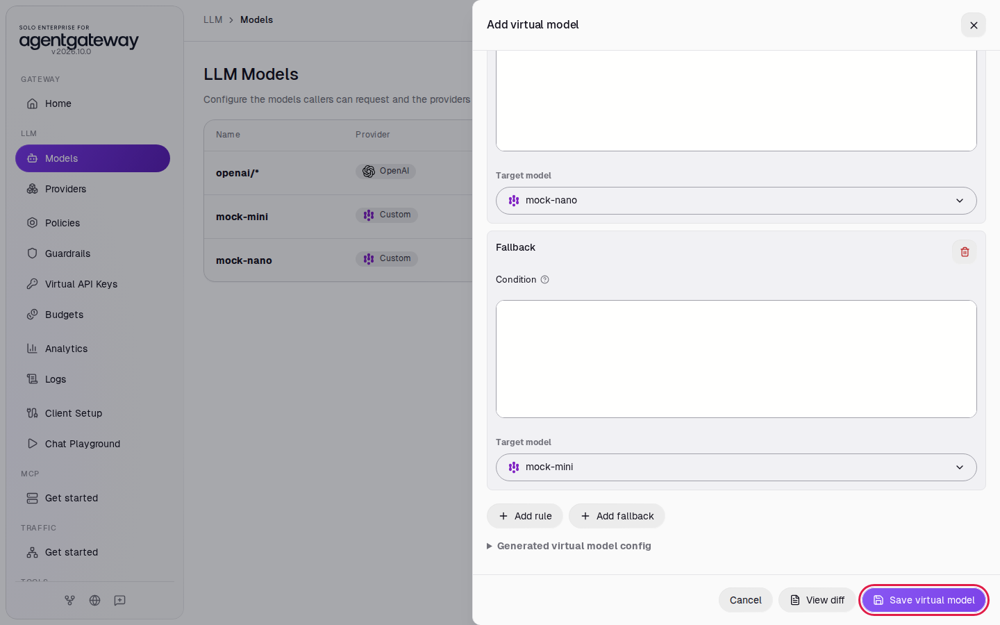
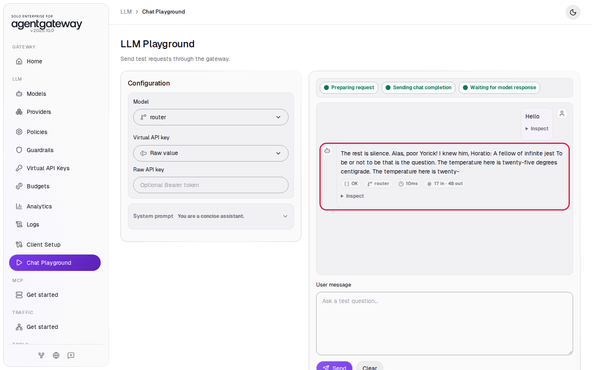
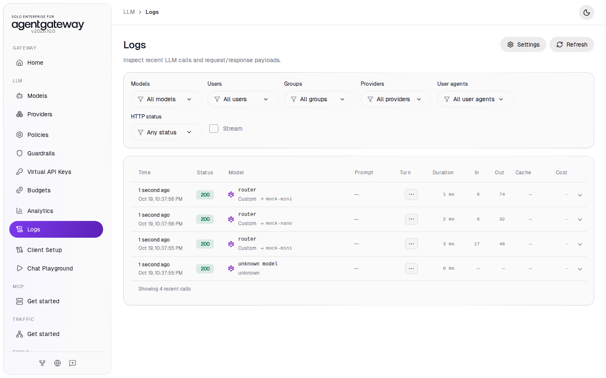

# Route Requests by a Field in the Request Body

## Before you start

- Complete [Connect LLM Providers](../llm/connect-llm-providers.md).
- Start the two mock LLM servers this lab uses. From the `setup/` folder, run:

  ```bash
  env UID=$(id -u) GID=$(id -g) docker compose --profile mock-llm-routing up -d
  ```

  This starts `mock-llm-mini` and `mock-llm-nano` on the gateway's Docker network, both on port `8000`. `mock-llm-mini` serves a model named `mock-mini` and `mock-llm-nano` serves `mock-nano`. Each reply has a `model` field with that name, so you can see which server answered. They cost nothing to call.

## What you'll do

- Add a model for each mock server
- Add a virtual model with the **Conditional** routing strategy that reads a field from the request body
- Send requests with and without that field and see which model answers in Logs

## Why this matters

The gateway already routes on one body field: `model`. Every model you add on the **Models** page matches the `model` value that clients send. The **Conditional** routing strategy routes on any other field in the body. In this lab, requests tagged `"metadata": {"app": "support"}` go to the small `mock-nano` model, and all other requests go to `mock-mini`. Your support chatbot uses the cheaper model, and clients keep calling one model name.

## Step 1: Add the two mock models

1. In the sidebar, click **Models**.
2. Click **Add model**.

   

3. In **Provider**, select **Custom**.
4. In **Incoming model match**, enter `mock-mini`.
5. Leave **Provider API key** on **Unset**. The mock accepts requests with no key.
6. In **Base URL**, enter `http://mock-llm-mini:8000/v1`.
7. Under **Outgoing model**, click **Explicit**.
8. In **Explicit outgoing model**, enter `mock-mini`. Click the **Add model** title at the top of the panel to close the suggestion list. Do not press Escape, because Escape closes the whole panel.
9. Click **Save model**.

   

10. Repeat steps 2 to 9 with `mock-nano` in **Incoming model match** and **Explicit outgoing model**, and `http://mock-llm-nano:8000/v1` in **Base URL**.

The models list now shows `mock-mini` and `mock-nano`:



A request to the virtual model arrives with `"model": "router"`, and each mock server rejects any model name except its own. **Explicit** replaces `router` with the name the server expects.

## Step 2: Add the conditional virtual model

1. Click **Add virtual model**.
2. In **Virtual model name**, enter `router`.
3. Under **Routing strategy**, click **Conditional**. The panel shows **Rule 1** and **Fallback**.
4. Under **Rule 1**, click in **Condition**. It holds an example, `json(request.body).route == "default"`. Select all of it (Ctrl+A, or Cmd+A on a Mac) and type:

   ```
   json(request.body).metadata.app == "support"
   ```

5. Under **Rule 1**, in **Target model**, select **mock-nano**.

   

6. Under **Fallback**, leave **Condition** empty. In **Target model**, select **mock-mini**.
7. Click **Save virtual model**.

   

The condition is a CEL expression. `json(request.body)` reads the request body as JSON, and `.metadata.app` picks the field. The gateway checks the rules in order and uses the first one that is true. The fallback has no condition, so it catches every request that no rule matched, including requests with no `metadata` field.

## Step 3: Send a request from the Chat Playground

1. Wait two seconds, then in the sidebar click **Chat Playground**.
2. In **Model**, select **router**.
3. In **User message**, enter `Hello` and click **Send**.

The reply appears with the status **OK** and the model **router**. The mock's reply is placeholder text. The playground sends only `model` and `messages`, so this request goes to the fallback, `mock-mini`.



## Check it

Send a request with the support tag in the body. The command prints only the `model` field of the reply:

```bash
curl -s http://localhost:4000/v1/chat/completions -H 'Content-Type: application/json' \
  -d '{"model":"router","metadata":{"app":"support"},"messages":[{"role":"user","content":"Hello"}]}' | grep -o '"model":"[^"]*"'
```

Expected output:

```
"model":"mock-nano"
```

Send the same request without `metadata`:

```bash
curl -s http://localhost:4000/v1/chat/completions -H 'Content-Type: application/json' \
  -d '{"model":"router","messages":[{"role":"user","content":"Hello"}]}' | grep -o '"model":"[^"]*"'
```

Expected output:

```
"model":"mock-mini"
```

In the sidebar, click **Logs**. Each `router` row shows the model the gateway picked after the arrow: `mock-mini` for the request without `metadata`, `mock-nano` for the request with the support tag, and `mock-mini` for the Chat Playground request.



You may also see a row named `unknown model`. That is the browser's preflight check from the Chat Playground; you can ignore it.

## What the UI wrote

In the sidebar, scroll down to **Tools** and click **Raw Configuration**. The UI added two models and a `virtualModels` section to `llm`:

```yaml
llm:
  models:
    - name: mock-mini
      provider:
        custom:
          formats:
            - type: completions
      params:
        model: mock-mini
        baseUrl: http://mock-llm-mini:8000/v1
    - name: mock-nano
      provider:
        custom:
          formats:
            - type: completions
      params:
        model: mock-nano
        baseUrl: http://mock-llm-nano:8000/v1
  virtualModels:
    - name: router
      routing:
        conditional:
          targets:
            - model: mock-nano
              when: json(request.body).metadata.app == "support"
            - model: mock-mini
```

## Clean up

1. In the sidebar, click **Models**.
2. In the `router` row, click the trash icon, then click **Delete virtual model**.
3. In the `mock-mini` row, click the trash icon, then click **Delete model**.
4. In the `mock-nano` row, click the trash icon, then click **Delete model**.
5. Stop the mock servers. From the `setup/` folder, run:

   ```bash
   docker compose --profile mock-llm-routing stop mock-llm-mini mock-llm-nano
   ```

The gateway is back to the state [Connect LLM Providers](../llm/connect-llm-providers.md) left it in.
