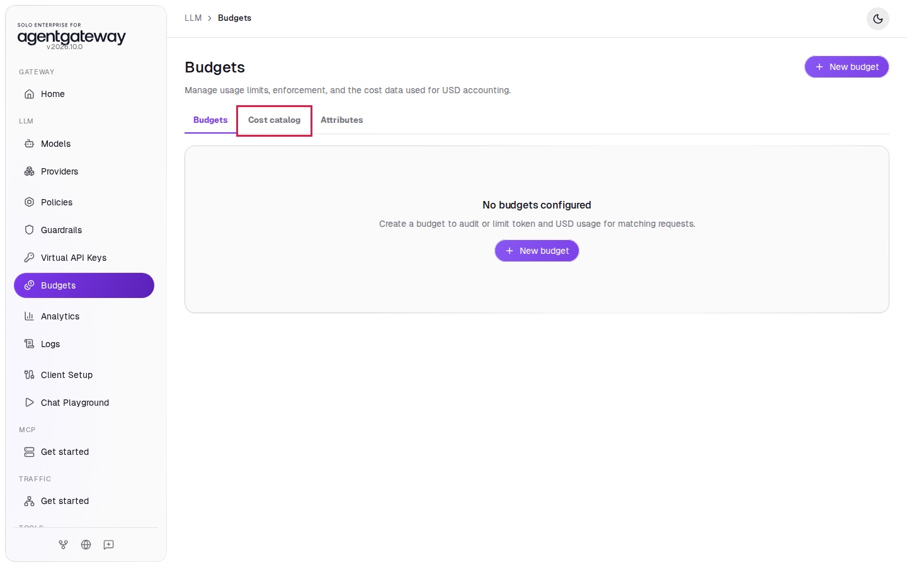
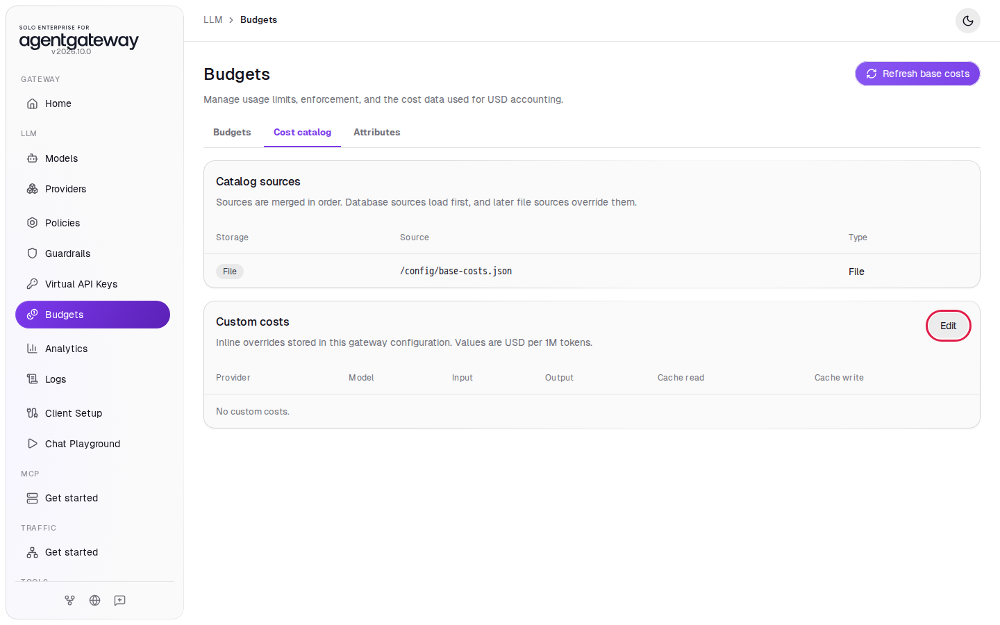
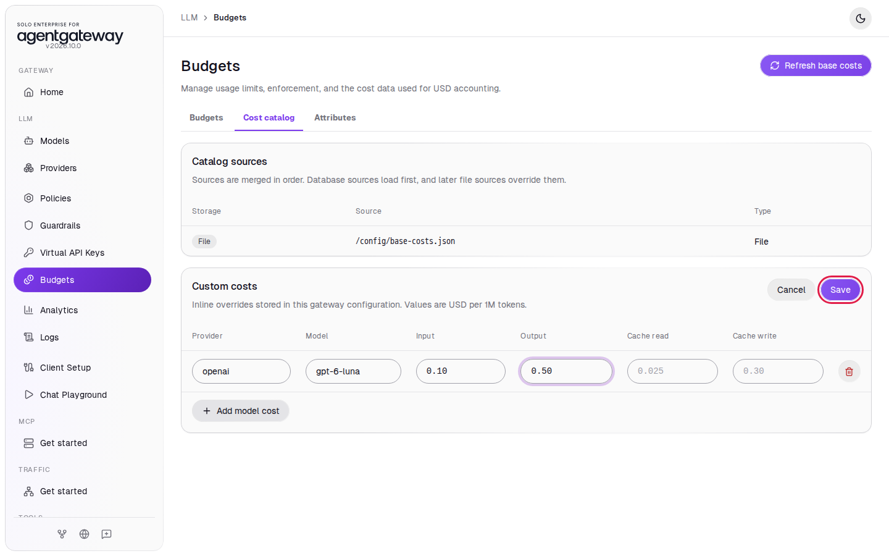
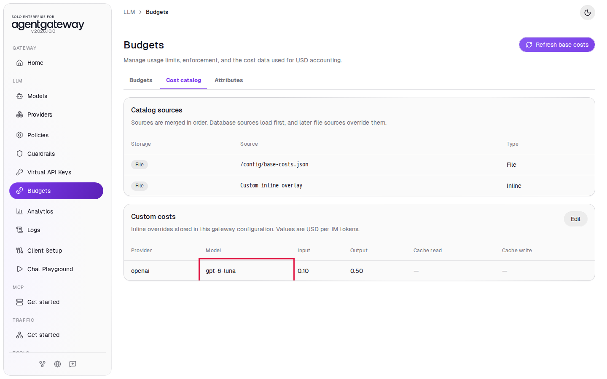
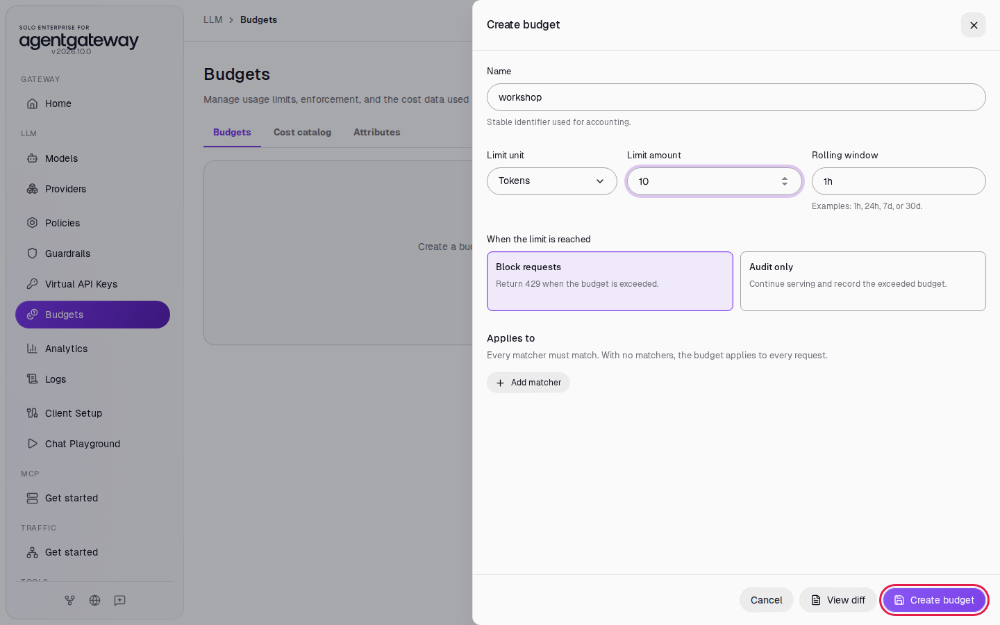
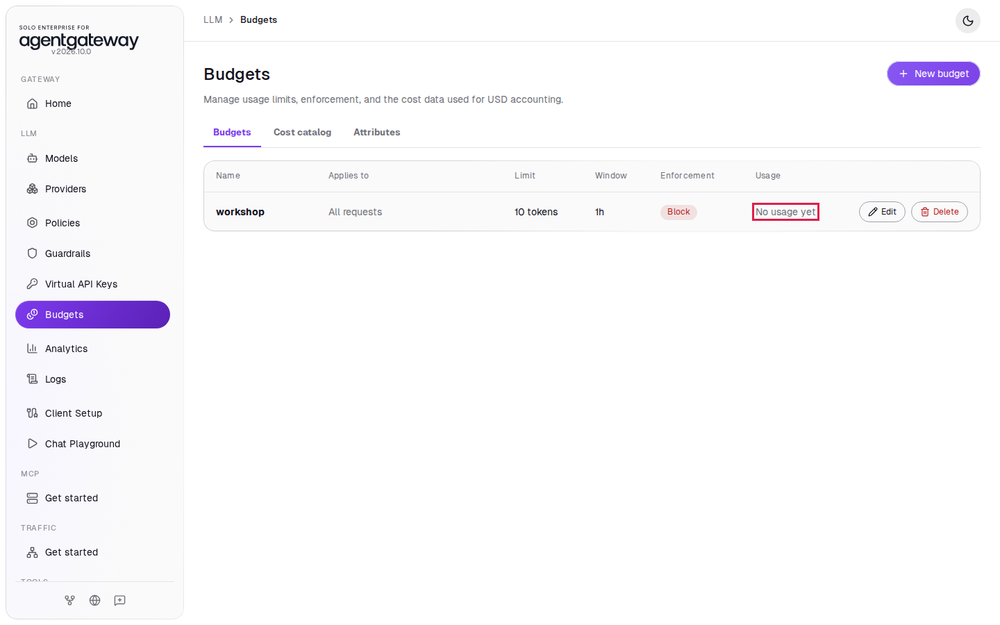
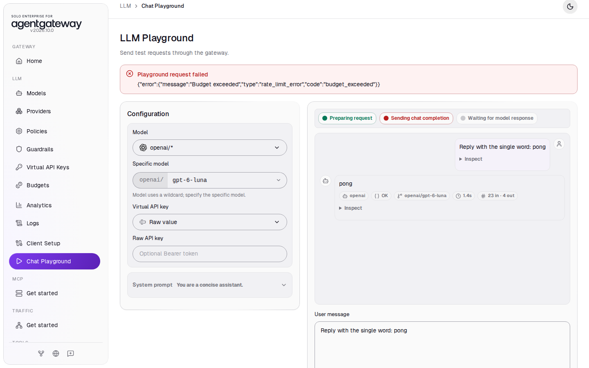
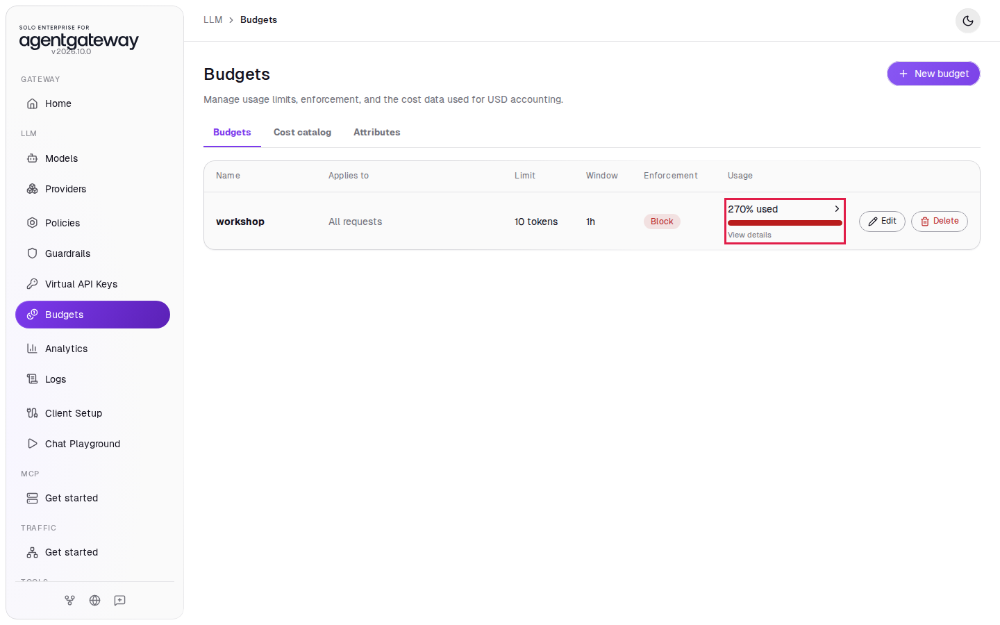
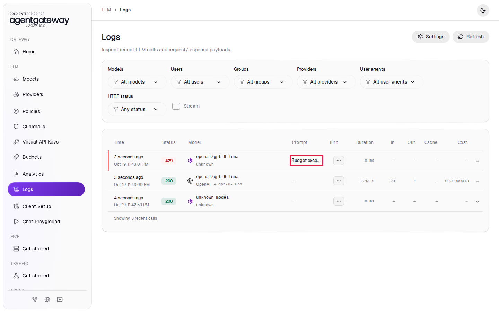
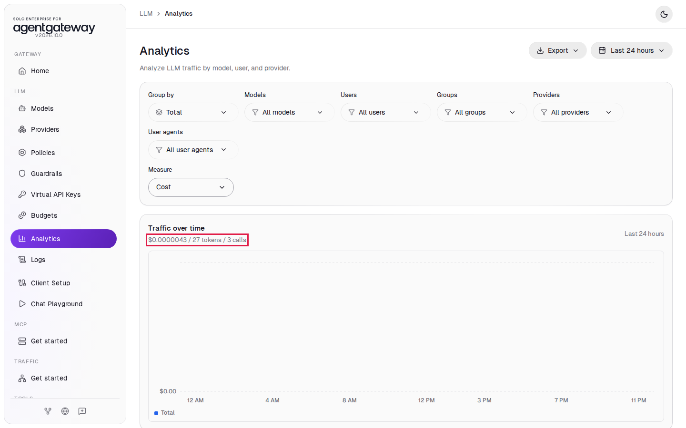

# Track LLM Cost and Enforce a Budget

## Before you start

- Complete [Connect LLM Providers](../llm/connect-llm-providers.md). The gateway has the `openai/*` model.

## What you'll do

- Set your own price for `gpt-6-luna` in the cost catalog
- Create a 10-token budget that blocks requests when it runs out
- Send one request that passes and one that gets HTTP `429`
- See the budget usage, the blocked request in Logs, and the spend in Analytics

## Why this matters

The gateway counts the tokens of every LLM request and turns them into US dollars with a cost catalog. A budget sets a limit on tokens or dollars over a time window. In **Block requests** mode, the gateway stops requests that go over the limit, so a runaway script or a heavy user cannot run up a large bill.

## Step 1: Set a price in the cost catalog

The gateway already knows the published prices of common models from the file `/config/base-costs.json`. You add your own price when you pay a different rate, for example a negotiated discount. Here you enter the published `gpt-6-luna` price, so the costs you see stay the same.

1. In the sidebar, click **Budgets**. The page opens on the **Budgets** tab, which shows **No budgets configured**.
2. Click the **Cost catalog** tab.

   

3. **Catalog sources** lists `/config/base-costs.json`. **Custom costs** is empty. Next to **Custom costs**, click **Edit**.

   

4. Click **Add model cost**.
5. In **Provider**, enter `openai`.
6. In **Model**, enter `gpt-6-luna`.
7. In **Input**, enter `0.10`.
8. In **Output**, enter `0.50`.
9. Click **Save**.

   

Prices are US dollars per 1 million tokens. **Custom costs** now shows the `gpt-6-luna` row, and **Catalog sources** has a second source, **Custom inline overlay**. Later sources override earlier ones, so your price wins.



## Step 2: Create a budget

1. Click the **Budgets** tab.
2. Click **New budget**.
3. In **Name**, enter `workshop`.
4. Leave **Limit unit** on **Tokens**.
5. In **Limit amount**, enter `10`.
6. Leave **Rolling window** on `1h`.
7. Leave **When the limit is reached** on **Block requests**.
8. Leave **Applies to** empty.
9. Click **Create budget**.

   

With no matchers in **Applies to**, the budget counts every request to the gateway. The list shows the budget with **No usage yet**:



Ten tokens is far less than one request uses. That is on purpose, so you hit the limit after one request.

## Step 3: Use up the budget

1. In the sidebar, click **Chat Playground**.
2. In **Model**, select **openai/\***.
3. In **Specific model**, enter `gpt-6-luna`.
4. In **User message**, enter `Reply with the single word: pong` and click **Send**. The reply comes back with the status **OK**.
5. In **User message**, enter `Reply with the single word: pong` again and click **Send**.

The second request does not reach OpenAI. A red box shows **Playground request failed** with the gateway's answer:

```
{"error":{"message":"Budget exceeded","type":"rate_limit_error","code":"budget_exceeded"}}
```



The gateway checks the budget before it sends a request. The first request started with nothing used, so it went through and used about 26 tokens. After that, the budget was over its limit, so the gateway blocked the second request with HTTP `429`. Requests stay blocked until old usage moves out of the 1 hour window.

## Check it

1. In the sidebar, click **Budgets**. The **Usage** column of `workshop` shows more than `100% used`.

   

2. In the sidebar, click **Logs**. The newest row has status `429` and the message **Budget exceeded**. Below it is the request that passed, with status `200` and its cost.

   

   You may also see a row named `unknown model`. That is the browser's preflight check from the Chat Playground; you can ignore it.

3. In the sidebar, click **Analytics**.
4. In **Measure**, select **Cost**.

Under **Traffic over time**, the summary shows the total spend, tokens and calls in the form `$<spend> / <tokens> tokens / <calls> calls`. Your numbers depend on the reply. The chart bar is very small because one short request costs a fraction of a cent.



The call count includes the blocked request and the browser's preflight check. Only the request that reached OpenAI has tokens and cost.

<details>
<summary>Optional: check with curl</summary>

While the budget is used up:

```bash
curl -s -w '\n%{http_code}\n' http://localhost:4000/v1/chat/completions \
  -H "Content-Type: application/json" \
  -d '{"model":"openai/gpt-6-luna","messages":[{"role":"user","content":"Hello from agentgateway"}]}'
```

Expected output:

```
{"error":{"message":"Budget exceeded","type":"rate_limit_error","code":"budget_exceeded"}}
429
```

</details>

## Going further

This budget applies to everyone. To give each user their own budget, combine it with [virtual API keys](virtual-api-keys.md): the **Create virtual key** panel has a **Budgets** section for a limit on that key alone. On the **Budgets** page, **Add matcher** limits a budget to the requests whose attribute, such as `user`, has a given value. **Audit only** mode records the overage without blocking, which is useful for reporting.

## What the UI wrote

In the sidebar, scroll down to **Tools** and click **Raw Configuration**. The custom price went into the `config` section, as an inline source after the base file:

```yaml
config:
  modelCatalog:
  - file: /config/base-costs.json
  - inline:
      providers:
        openai:
          models:
            gpt-6-luna:
              rates:
                input: '0.10'
                output: '0.50'
```

The budget went into the `llm` section:

```yaml
llm:
  budgets:
  - name: workshop
    limit:
      unit: Tokens
      amount: 10
    window:
      rolling: 1h
    onBudgetExceeded: Block
```

## Clean up

1. In the sidebar, click **Budgets**.
2. In the `workshop` row, click **Delete**, then click **Delete budget** to confirm.
3. Click the **Cost catalog** tab.
4. Next to **Custom costs**, click **Edit**.
5. In the `gpt-6-luna` row, click the trash icon.
6. Click **Save**. **Custom costs** shows **No custom costs.**
