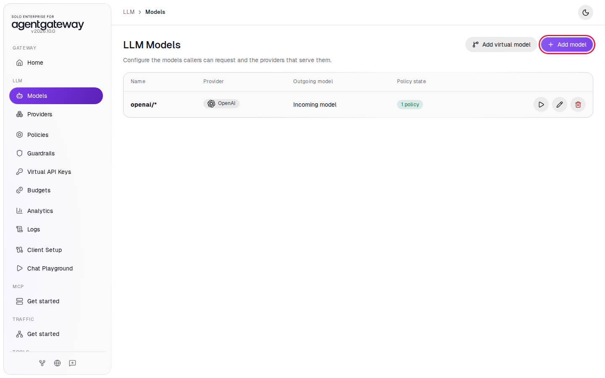
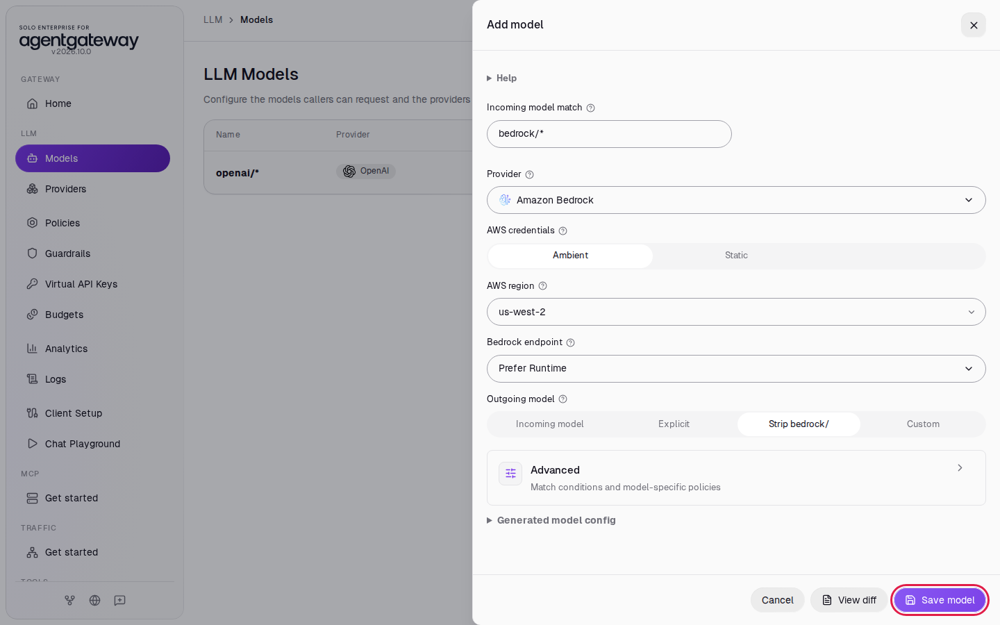
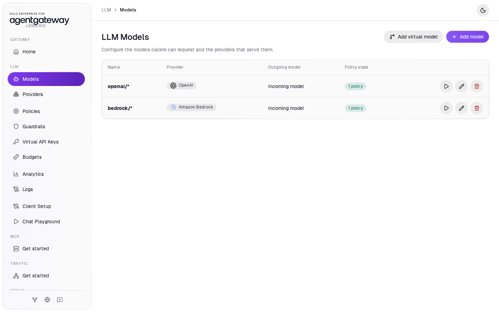
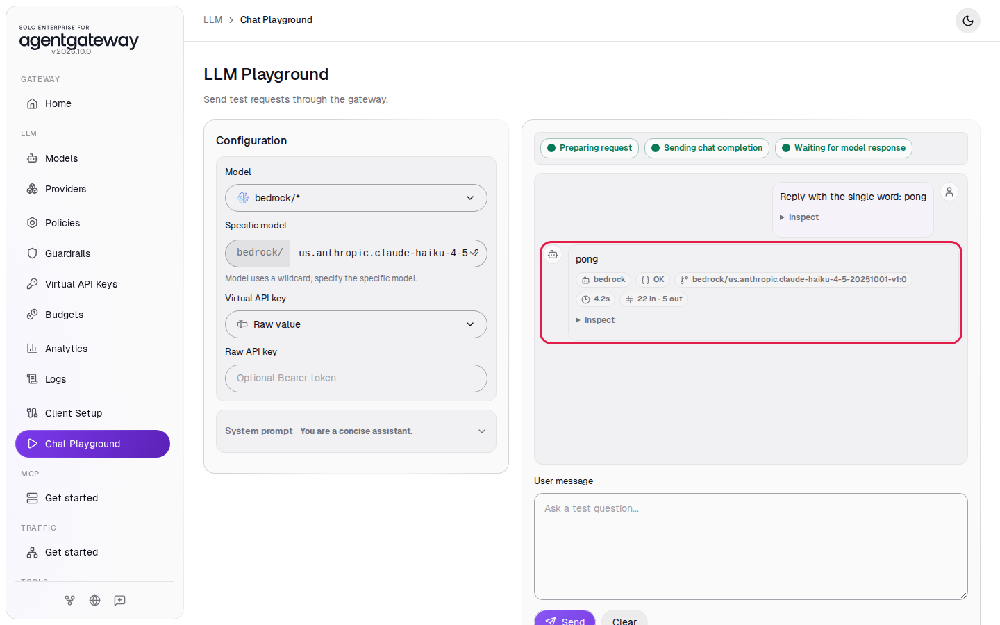
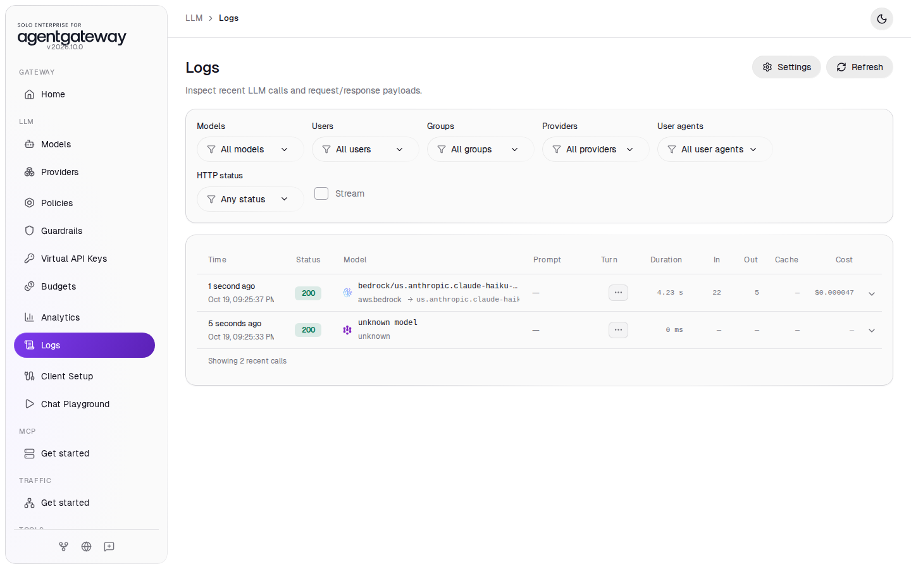
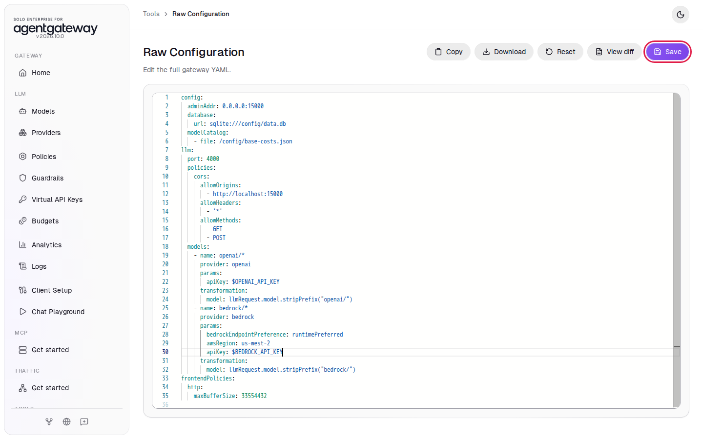
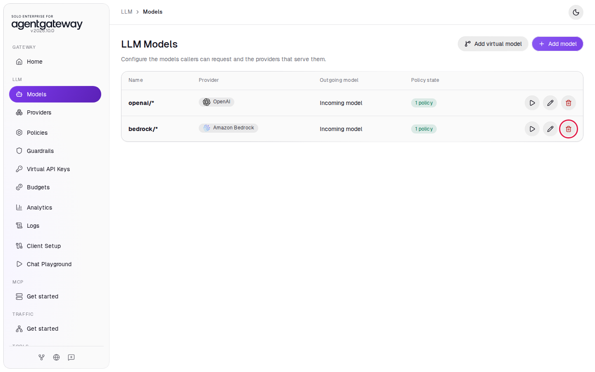

# Connect Amazon Bedrock

## Before you start

- Complete [Connect LLM Providers](../llm/connect-llm-providers.md). The gateway has the `openai/*` model.
- An AWS account with Amazon Bedrock access to Claude Haiku 4.5 and Claude Sonnet 4.6 in `us-west-2`.
- AWS credentials for that account: an access key ID and a secret access key, plus a session token if the credentials are temporary (for example, from AWS SSO).

## What you'll do

- Give the gateway your AWS credentials through `setup/.env`
- Add a Bedrock model that signs requests with those credentials
- Chat with Claude Haiku on Bedrock in the Chat Playground and find the request in Logs
- Optional: switch the model to a Bedrock API key

## Why this matters

Applications call Bedrock models through the gateway in the same OpenAI format they use for OpenAI. The gateway signs each request for AWS, and the AWS credentials stay in the gateway. Logs and Analytics show Bedrock tokens and cost next to your other providers.

## Step 1: Give the gateway your AWS credentials

1. Open `setup/.env` and add your credentials:

   ```bash
   AWS_ACCESS_KEY_ID=<access key ID>
   AWS_SECRET_ACCESS_KEY=<secret access key>
   AWS_SESSION_TOKEN=<session token, or leave empty>
   ```

2. Restart the gateway so it reads them. From the `setup/` folder, run:

   ```bash
   env UID=$(id -u) GID=$(id -g) docker compose up -d
   ```

If you exported these variables in your shell instead, Docker Compose passes the shell values to the gateway and you can skip editing `setup/.env`.

Temporary credentials expire. When they do, Bedrock rejects requests through the gateway. Put fresh values in `setup/.env` (or export them again) and rerun the command.

## Step 2: Add the Bedrock model

1. In the sidebar, click **Models**.
2. Click **Add model**.

   

3. In **Provider**, select **Amazon Bedrock**. The UI fills **Incoming model match** with `bedrock/*`.
4. Under **AWS credentials**, click **Ambient**.
5. In **AWS region**, enter `us-west-2`.
6. In **Bedrock endpoint**, select **Prefer Runtime**.
7. Under **Outgoing model**, click **Strip bedrock/**.
8. Click **Save model**.

   

**Ambient** tells the gateway to use the AWS credentials in its environment, the ones from Step 1. **Static** would write the keys into `config.yaml`.

Bedrock has two endpoints: Runtime and Mantle. This lab uses model IDs with a `us.` prefix, such as `us.anthropic.claude-haiku-4-5-20251001-v1:0`. These are cross-region inference profiles, and Runtime accepts them. With the default, **Prefer Mantle**, the gateway sends Claude Haiku 4.5 to Mantle, which answers `404 The model ... does not exist`.

The model now appears in the list:



## Step 3: Chat with Claude Haiku on Bedrock

1. In the sidebar, click **Chat Playground**.
2. In **Model**, select **bedrock/\***.
3. In **Specific model**, enter `us.anthropic.claude-haiku-4-5-20251001-v1:0`.
4. In **User message**, enter `Reply with the single word: pong` and click **Send**.

The reply shows the provider `bedrock`, the status **OK** and the token counts:



## Check it

1. In the sidebar, click **Logs**.
2. Find the row for `bedrock/us.anthropic.claude-haiku-4-5-20251001-v1:0` with status `200`. Under the model name, the row shows the provider `aws.bedrock` and the model Bedrock received. The **Cost** column shows the price of the request.



You may also see a row named `unknown model`. That is the browser's preflight check from the Chat Playground; you can ignore it.

| You see | Cause |
|---|---|
| `500` and `backend authentication failed: the credential provider was not enabled` | The gateway has no AWS credentials. Repeat Step 1. |
| `403` and `... is not authorized to perform: bedrock:InvokeModel` | Your AWS role has no access to that model in `us-west-2`. |
| `404` and `The model ... does not exist` | **Bedrock endpoint** is not **Prefer Runtime**. Edit the model and change it. |

<details>
<summary>Optional: check with curl</summary>

The same `bedrock/*` model serves other Bedrock models too. This request asks Claude Sonnet 4.6:

```bash
curl "http://localhost:4000/v1/chat/completions" \
  -H "Content-Type: application/json" \
  -d '{
    "model": "bedrock/us.anthropic.claude-sonnet-4-6",
    "messages": [
      { "role": "user", "content": "Hello from agentgateway" }
    ]
  }'
```

Expected output:

```
{"model":"us.anthropic.claude-sonnet-4-6","usage":{"prompt_tokens":11,"completion_tokens":18,...},"choices":[{"message":{"content":"Hello! How can I help you today?","role":"assistant"},"index":0,"finish_reason":"stop"}],"id":"bedrock-...","object":"chat.completion",...}
```

</details>

## Step 4 (optional): Use a Bedrock API key

A Bedrock API key replaces AWS credentials for Bedrock calls. The gateway sends it as a bearer token. The **Add model** panel has no field for it, so you add it in Raw Configuration.

1. In the [Amazon Bedrock console](https://console.aws.amazon.com/bedrock/), in the left navigation, click **API keys** and generate a key. A short-term key lasts up to 12 hours and works only in the region you create it in, so create it in `us-west-2`.
2. Add the key to `setup/.env`:

   ```bash
   BEDROCK_API_KEY=<your Bedrock API key>
   ```

3. From the `setup/` folder, restart the gateway:

   ```bash
   env UID=$(id -u) GID=$(id -g) docker compose up -d
   ```

4. In the sidebar, scroll down to **Tools** and click **Raw Configuration**.
5. Under `name: bedrock/*`, click at the end of the line `awsRegion: us-west-2` and press **Enter**. The editor keeps the indentation.
6. Type the line below and click **Save**.

   ```yaml
   apiKey: $BEDROCK_API_KEY
   ```

   

7. Repeat Step 3. The reply comes back as before.

When a Bedrock model has `apiKey`, the gateway uses the key and ignores the AWS credentials. You can remove the `AWS_*` values from `setup/.env`.

## What the UI wrote

In the sidebar, scroll down to **Tools** and click **Raw Configuration**. The UI added this model to the `llm` section:

```yaml
llm:
  models:
    - name: bedrock/*
      provider: bedrock
      params:
        bedrockEndpointPreference: runtimePreferred
        awsRegion: us-west-2
      transformation:
        model: llmRequest.model.stripPrefix("bedrock/")
```

With **Ambient**, the gateway reads `AWS_ACCESS_KEY_ID`, `AWS_SECRET_ACCESS_KEY` and `AWS_SESSION_TOKEN` from its environment, so the keys stay in `setup/.env`. If you did Step 4, `params` also has `apiKey: $BEDROCK_API_KEY`.

## Clean up

1. In the sidebar, click **Models**.
2. In the `bedrock/*` row, click the trash icon, then click **Delete model**.

   

The gateway is back to the state [Connect LLM Providers](../llm/connect-llm-providers.md) left it in. The AWS values in `setup/.env` stay in the gateway's environment until you remove them and restart the gateway.
