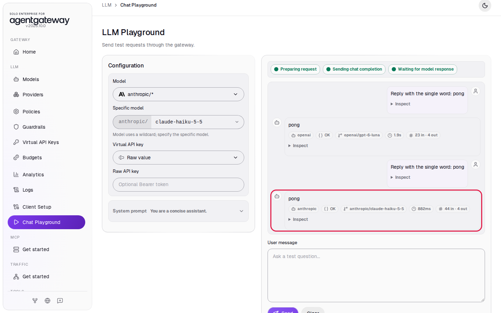
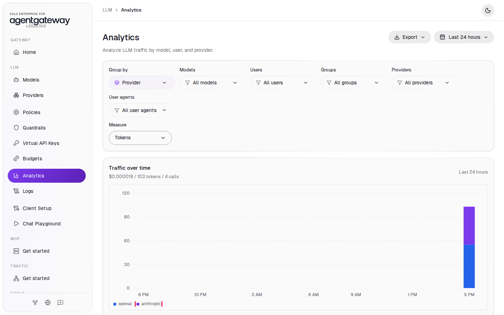

# Connect Anthropic

## Before you start

- Complete [001: Set Up Standalone Agentgateway](../../001-set-up-standalone-agentgateway.md). You can do this lab with or without [Connect LLM Providers](connect-llm-providers.md). If the gateway also has the `openai/*` model, do the optional comparison at the end.
- Put your Anthropic API key in `setup/.env` as `ANTHROPIC_API_KEY`, then restart the gateway so it reads the key: from the `setup/` folder, run `env UID=$(id -u) GID=$(id -g) docker compose up -d`. You can get a key from the [Anthropic Console](https://console.anthropic.com/).

## What you'll do

- Add Anthropic as a shared provider
- Add an `anthropic/*` model
- Chat with Claude in the Chat Playground
- Call Claude in OpenAI format and in Anthropic format
- Find the requests, tokens and cost in Logs and Analytics
- Optional: ask GPT and Claude the same question and compare the providers

## Why this matters

Clients reach Claude through port `4000` in OpenAI format or in Anthropic format. The gateway translates the request, adds the Anthropic key, and records tokens and cost. When the gateway also has OpenAI, a client switches providers by changing the model name.

## Step 1: Add the Anthropic provider

A shared provider holds a credential once. Every model that references it uses that credential.

1. In the sidebar, click **Providers**.
2. Click **Add provider**.

   

3. In **Provider name**, enter `anthropic`.
4. In **Provider**, select **Anthropic**.
5. Next to **Provider API key**, click **Env var** and enter `ANTHROPIC_API_KEY`.
6. Click **Save provider**.

   

## Step 2: Add the Claude model

1. In the sidebar, click **Models**.
2. Click **Add model**.
3. In **Provider**, select **anthropic** (marked **configured**). This is the shared provider from Step 1. The UI fills **Incoming model match** with `anthropic/*`.
4. Under **Outgoing model**, click **Strip anthropic/**.
5. Click **Save model**.

   

The model matches any name that starts with `anthropic/`, for example `anthropic/claude-haiku-5-5`, and **Strip anthropic/** sends `claude-haiku-5-5` to Anthropic.

The Models page now lists `anthropic/*`:


## Step 3: Chat with Claude

1. In the sidebar, click **Chat Playground**.
2. In **Model**, select **anthropic/\***. In **Specific model**, enter `claude-haiku-5-5`.
3. In **User message**, enter `Reply with the single word: pong` and click **Send**.

The chips under the reply name the provider, `anthropic`, and the model:


## Step 4: Call Claude in OpenAI format

Clients built for OpenAI send the OpenAI Chat Completions format to `/v1/chat/completions`. Send that format with a Claude model name:

```bash
curl -s http://localhost:4000/v1/chat/completions \
  -H 'Content-Type: application/json' \
  -d '{"model":"anthropic/claude-haiku-5-5","messages":[{"role":"user","content":"Reply with the single word: pong"}]}'
```

Expected output:

```
{"model":"claude-haiku-5-5",...,"usage":{"prompt_tokens":18,"completion_tokens":4,...},"choices":[{"message":{"content":"pong","role":"assistant"},"index":0,"finish_reason":"stop"}],"id":"msg_...","object":"chat.completion",...}
```

The answer is a `chat.completion` object. The gateway translated the request to the Anthropic Messages API and translated Claude's answer back to OpenAI format. The `msg_` ID shows that Anthropic answered.

## Step 5: Call Claude in Anthropic format

Clients built for Anthropic, such as the Anthropic SDKs and Claude Code, send the Anthropic Messages API format to `/v1/messages`. The gateway accepts that format too:

```bash
curl -s http://localhost:4000/v1/messages \
  -H 'Content-Type: application/json' \
  -H 'anthropic-version: 2023-06-01' \
  -d '{"model":"anthropic/claude-haiku-5-5","max_tokens":1024,"messages":[{"role":"user","content":"Reply with the single word: pong"}]}'
```

Expected output:

```
{"id":"msg_...","type":"message","role":"assistant","model":"claude-haiku-5-5",...,"content":[{"text":"pong","type":"text"}],...}
```

Neither request carries an Anthropic key. The gateway adds it from the `anthropic` provider.

## Check it

1. In the sidebar, click **Logs**.
2. Find the rows for `anthropic/claude-haiku-5-5`, all with status `200`. Each row shows the provider, the model Anthropic received, the tokens and the cost.


You may also see a row named `unknown model`. That is the browser's preflight check from the Chat Playground; you can ignore it.

3. In the sidebar, click **Analytics**.
4. In **Group by**, select **Provider**, then click outside the list to close it.

The chart shows the tokens for `anthropic`. The line above the chart shows the total cost, tokens and calls:


## Optional: compare Claude with GPT

Do this part if the gateway has the `openai/*` model from [Connect LLM Providers](connect-llm-providers.md).

1. In the sidebar, click **Chat Playground**.
2. In **Model**, select **openai/\***. In **Specific model**, enter `gpt-6-luna`.
3. In **User message**, enter `Reply with the single word: pong` and click **Send**.
4. In **Model**, select **anthropic/\***. In **Specific model**, enter `claude-haiku-5-5`.
5. In **User message**, enter `Reply with the single word: pong` and click **Send**.

Both replies are in the same conversation. The chips under each reply name the provider (`openai` or `anthropic`) and the model:



Send the OpenAI-format request from Step 4 with the GPT model name. Only the model name changes:

```bash
curl -s http://localhost:4000/v1/chat/completions \
  -H 'Content-Type: application/json' \
  -d '{"model":"openai/gpt-6-luna","messages":[{"role":"user","content":"Reply with the single word: pong"}]}'
```

The answer is also a `chat.completion` object, with `"model":"gpt-6-luna"`.

6. In the sidebar, click **Analytics**.
7. In **Group by**, select **Provider**, then click outside the list to close it.

The chart splits the tokens between `anthropic` and `openai`. The line above the chart shows the total cost, tokens and calls for both providers:



## What the UI wrote

In the sidebar, scroll down to **Tools** and click **Raw Configuration**. The UI added this to the `llm` section:

```yaml
llm:
  providers:
    - name: anthropic
      provider: anthropic
      params:
        apiKey: $ANTHROPIC_API_KEY
  models:
    - name: anthropic/*
      provider:
        reference: anthropic
      transformation:
        model: llmRequest.model.stripPrefix("anthropic/")
```

The model points at the provider with `reference`. A second Claude model, for example one with its own policies, can reference the same provider and use the same key.

## Next

To run Claude Code through the gateway with this model, go to [Connect Coding Agents](connect-coding-agents.md) before you clean up.

## Clean up

1. In the sidebar, click **Models**.
2. In the `anthropic/*` row, click **Delete model**, then click **Delete model** in the dialog.
3. In the sidebar, click **Providers**.
4. In the `anthropic` row, click **Delete provider**, then click **Delete provider** in the dialog.
