# Run Claude Code on Developer Subscriptions with Okta Using agentdesktop

This lab is the Okta version of [Run Claude Code on Developer Subscriptions with Your Identity Provider Using agentdesktop](connect-claude-subscription-sso-using-agentdesktop.md). The gateway steps match that lab, but Okta replaces Keycloak, so you set up Okta first.

## Before you start

- Complete [001: Set Up Standalone Agentgateway](../../001-set-up-standalone-agentgateway.md).
- [Claude Code](https://docs.claude.com/en/docs/claude-code/overview) on your machine.
- A Claude Pro, Max, Team or Enterprise subscription. Check that your plan's terms allow its use through your own gateway.
- An Okta org where you are an administrator, such as an Okta Integrator account. Step 1 helps you choose an Okta authorization server.
- macOS or Linux. agentdesktop also runs on Windows, but this lab gives the commands for macOS and Linux only.

## What you'll do

- Set up Okta: two groups, a `groups` claim, and a native app for agentdesktop
- Add a Claude model with no provider API key
- Make the gateway check an Okta token and send only the Claude token to Anthropic
- Sign in with agentdesktop twice: to Okta, and to your Claude account
- Run Claude Code through the gateway on your subscription, and find your requests in Logs
- Allow only one Okta group to use the models

## Why this matters

Developers who already pay for Claude plans can keep using them, and the company needs no Anthropic API key. The gateway still has to know who each developer is, so that it can log their requests and allow or block them by group. A Claude subscription token does not tell the gateway who the developer is.

agentdesktop signs the developer in twice: to Okta, and to their Claude account. It gives Claude Code one credential that holds both tokens:

```
agentdesktop:<Claude token>:<Okta token>
```

The gateway checks the Okta token and sends only the Claude token to Anthropic. When someone leaves the company, you deactivate them in Okta, and the gateway stops their requests even though their Claude plan still works.

## Step 1: Set up Okta

In the Okta Admin Console you make groups to allow by, a claim that puts the user's groups in the token, an app that agentdesktop signs in with, and a policy that lets the app get tokens.

### Create the groups

1. In the Admin Console, click **Directory**, then **Groups**.
2. Click **Add group**, enter the name `platform-team`, and click **Save**.
3. Click **Add group** again, enter the name `auditors`, and click **Save**.

   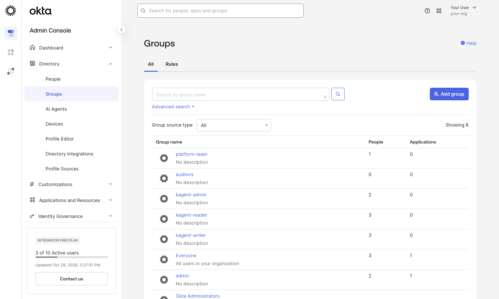

4. Open `platform-team`, click **Assign people**, click **+** next to your own user, and click **Done**. Do not add your user to `auditors`. Step 8 uses the difference.

   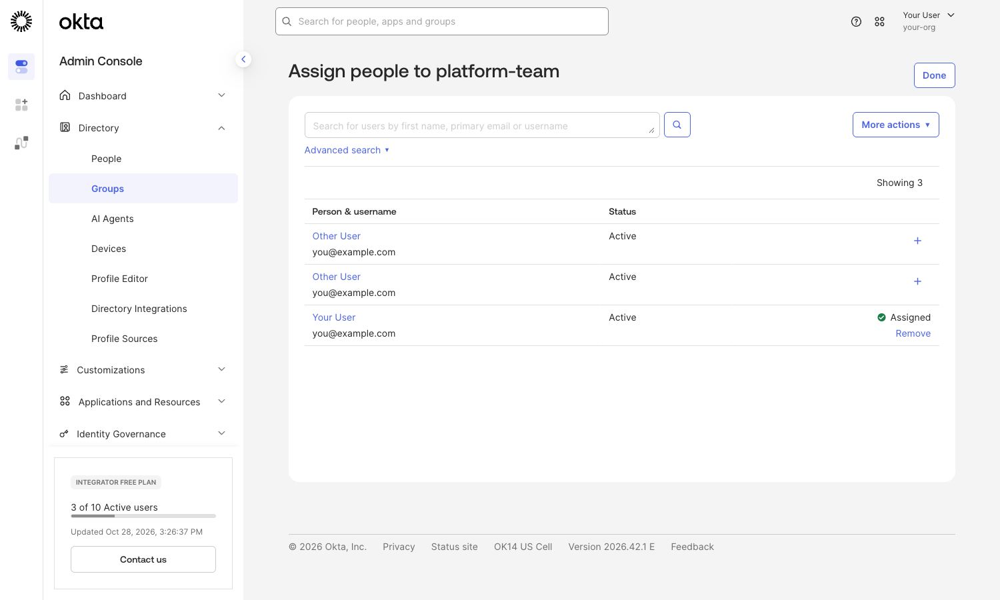

### Choose an authorization server

1. Click **Security**, then **API**.
2. Under **Authorization Servers**, click the **Active** server you want to use. This lab uses a custom server named `solo`. The `default` server that Okta creates works the same way if it is **Active**.
3. On the **Settings** tab, copy the **Audience** and the **Issuer** URL. The Issuer ends in `/oauth2/<server id>`, or in `/oauth2/default`. Step 3 and Step 5 use both values.

   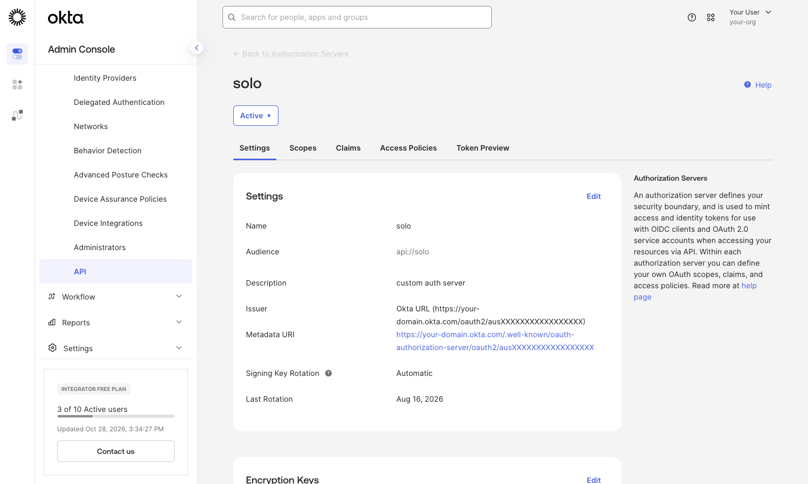

### Add a groups claim to the access token

The gateway reads the user's groups from a claim named `groups`. JWT claim names are case sensitive. If the server already has an access token claim named `Groups`, `jwt.groups` will not match it, so add the lowercase claim.

1. Click the **Claims** tab, then **Add Claim**.
2. Enter these values:

   | Field | Value |
   |---|---|
   | Name | `groups` |
   | Include in token type | **Access Token**, **Always** |
   | Value type | **Groups** |
   | Filter | **Matches regex**, `.*` |
   | Include in | **Any scope** |

3. Click **Create**.

   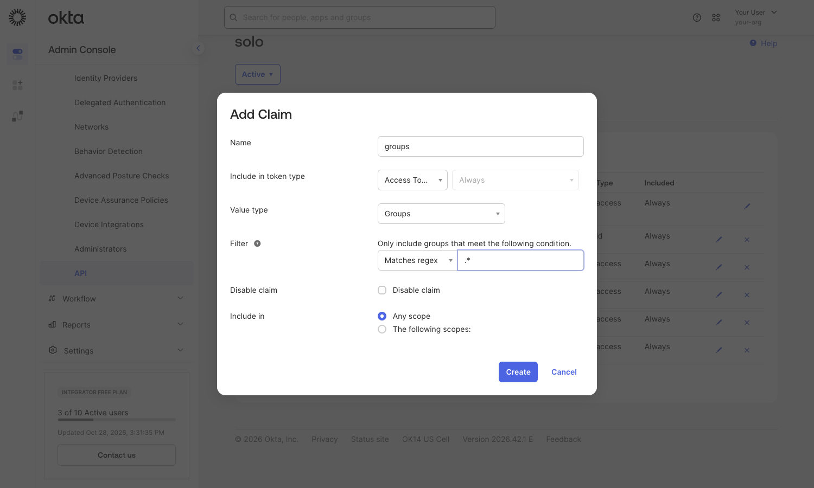

### Create the app for agentdesktop

1. Click **Applications**, then **Applications**, then **Create App Integration**.
2. Select **OIDC - OpenID Connect** as the sign-in method and **Native Application** as the application type. Click **Next**.

   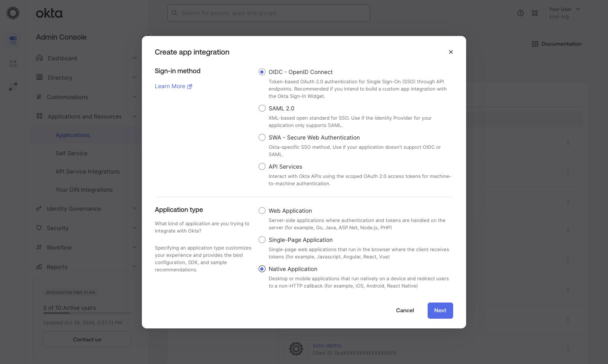

3. In **App integration name**, enter `agentdesktop`.
4. Under **Client definition**, select **Use Okta-generated client ID**.
5. Under **Grant type**, check **Refresh Token**. **Authorization Code** is already checked. agentdesktop uses the refresh token to stay signed in.

   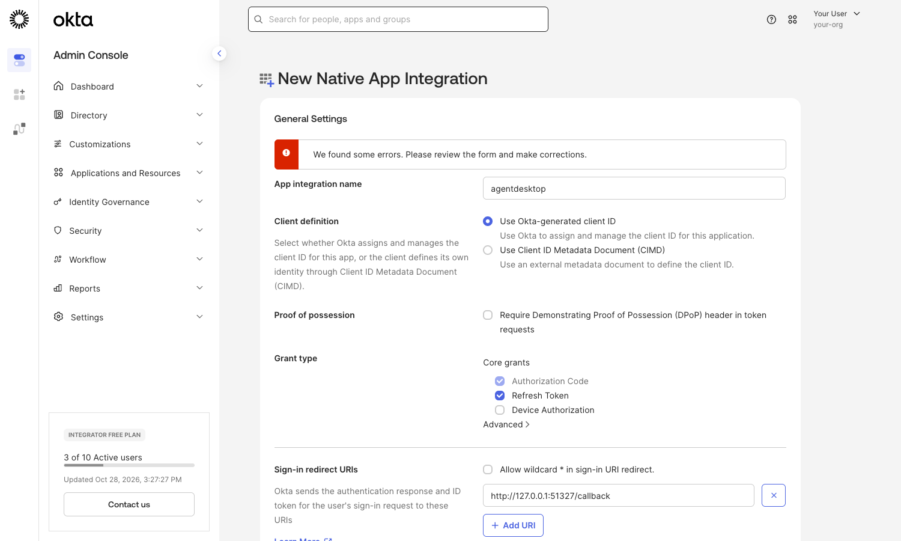

6. In **Sign-in redirect URIs**, replace the default entry with `http://127.0.0.1:51327/callback`.
7. Under **Assignments**, select **Allow everyone in your organization to access**.

   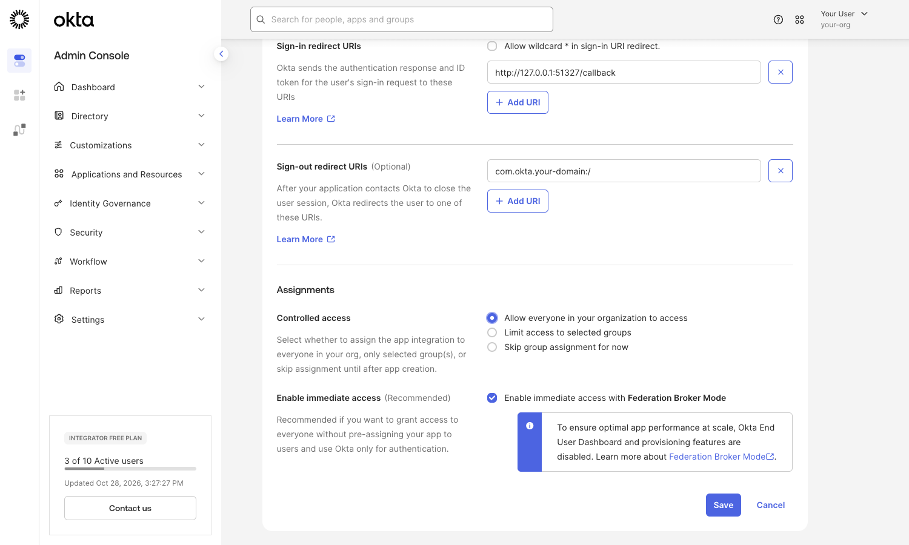

8. Click **Save**.

The **General** tab shows the app's **Client ID**. Copy it for Step 5. **Client authentication** is **None** and **PKCE** is required, which is what a desktop app needs.

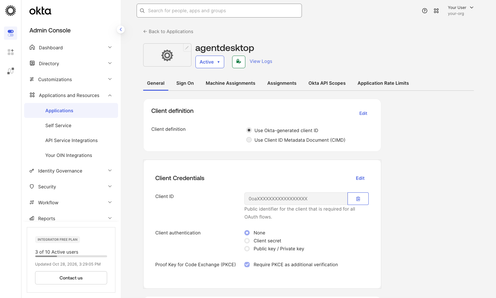

### Let the app get tokens

An authorization server issues tokens only to apps that one of its access policies covers.

1. Click **Security**, **API**, your authorization server, then the **Access Policies** tab.
2. Click **Add New Access Policy**.
3. Enter the name `agentdesktop` and a description such as `Allow agentdesktop to get tokens`. Okta requires the description.
4. Select **The following clients**, enter `agentdesktop`, and select the app.

   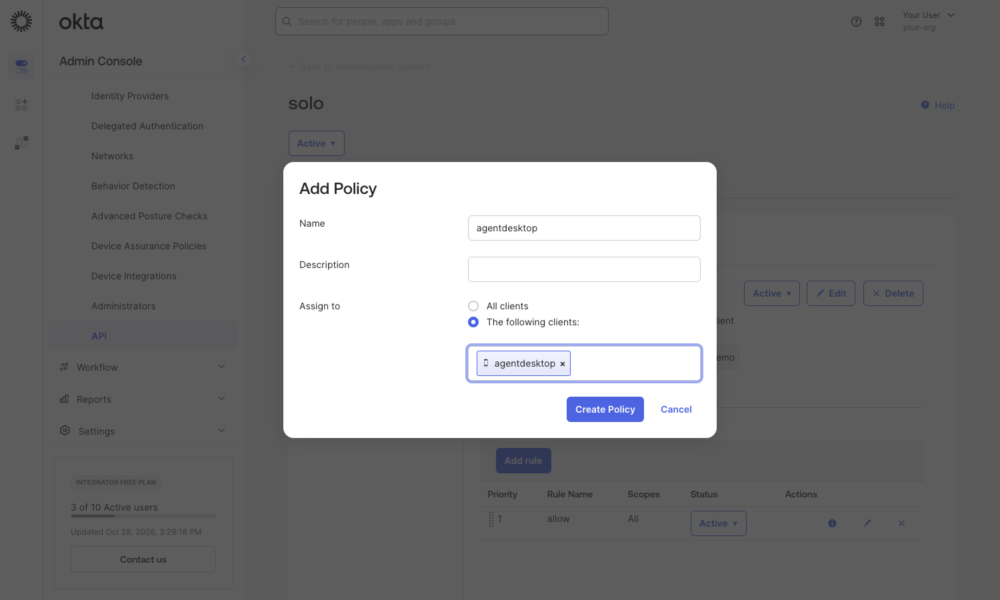

5. Click **Create Policy**, then **Add rule**.
6. Enter the rule name `allow-agentdesktop`. Clear **Client Credentials** and **Device Authorization**, and keep **Authorization Code** checked. Leave the other values.

   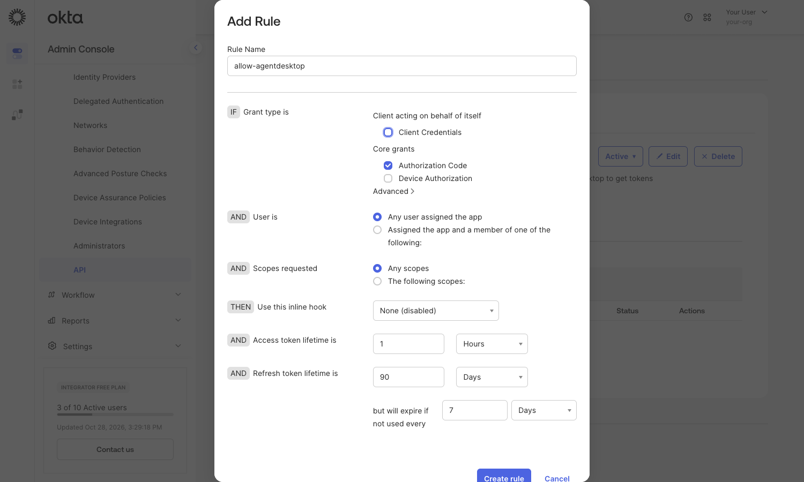

7. Click **Create rule**.

## Step 2: Add a Claude model with no provider key

1. In the sidebar, click **Models**.
2. Click **Add model**.

   

3. In **Provider**, select **Anthropic**.
4. In **Incoming model match**, select all the text and enter `claude-*`.
5. Leave **Provider API key** at **Unset**.
6. Under **Outgoing model**, click **Incoming model**.
7. Click **Save model**.

   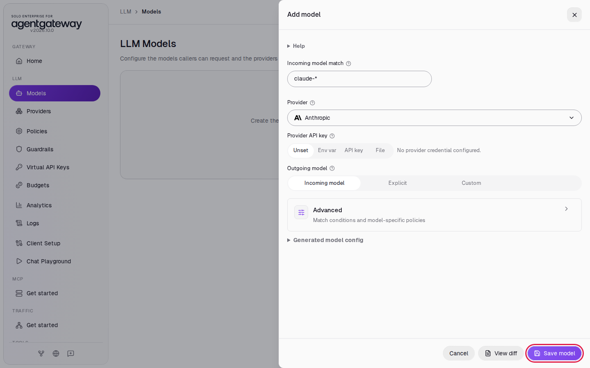

`claude-*` matches the model names Claude Code sends, such as `claude-haiku-5-5`, and the gateway passes each name to Anthropic as it is. With no provider key, the gateway forwards the `Authorization` header from the request. Step 4 sets that header to the Claude token.

## Step 3: Require an Okta token

The JWT auth policy reads the Okta token from the third part of the credential.

1. In the sidebar, click **Policies**.
2. Click the **JWT auth** card.

   

3. Under **Validation mode**, click **Strict**.
4. Under **JWKS source**, click **Remote URL**.
5. In **JWKS URL**, enter your Issuer followed by `/v1/keys`, for example `https://<your-okta-domain>/oauth2/<server id>/v1/keys`.
6. In **Issuer**, enter the Issuer you copied in Step 1.
7. Under **Audiences**, enter the Audience you copied in Step 1, for example `api://solo`, and click **Add**.
8. Under **Credential location**, click **Customize**.
9. In **Location type**, select **CEL expression**.
10. Click in the **CEL expression** box and enter:

    ```
    request.headers["authorization"].split(":")[2]
    ```

11. Click **Save policy**.

Claude Code sends the credential as `Authorization: Bearer agentdesktop:<Claude token>:<Okta token>`. Split at `:`, the third part is the Okta token. The gateway checks its signature with Okta's public keys, and accepts it only if Okta signed it for your audience.

Check that a request without a credential fails:

```bash
curl -si http://localhost:4000/v1/messages \
  -H 'Content-Type: application/json' \
  -H 'anthropic-version: 2023-06-01' \
  -d '{"model":"claude-haiku-5-5","max_tokens":50,"messages":[{"role":"user","content":"Reply with the single word: ready"}]}'
```

Expected output:

```
HTTP/1.1 401 Unauthorized
...

authentication failure: no bearer token found
```

## Step 4: Send only the Claude token to Anthropic

1. In the sidebar, click **Policies**.
2. Click the **Transformations** card.

   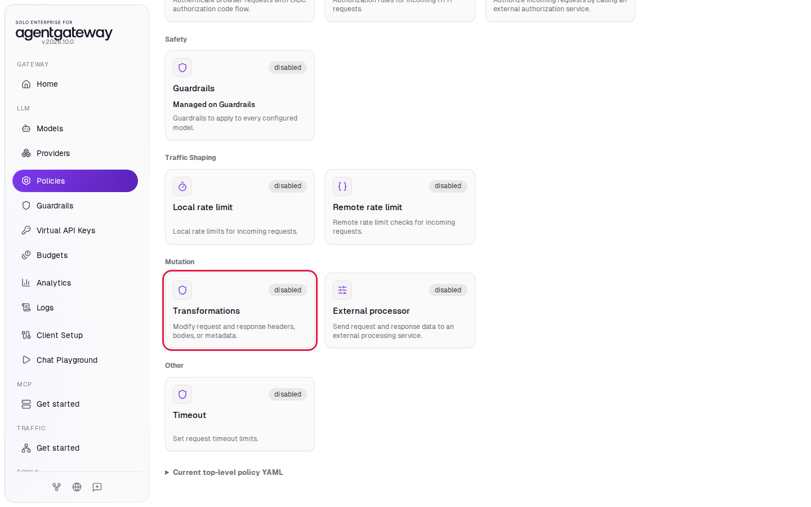

3. Click **Request transformations**.
4. Under **Set headers**, in **header name**, enter `authorization`.
5. In **CEL expression** next to it, enter:

   ```
   "Bearer " + request.headers["authorization"].split(":")[1]
   ```

6. Click **Add**.
7. Click **Save policy**.

   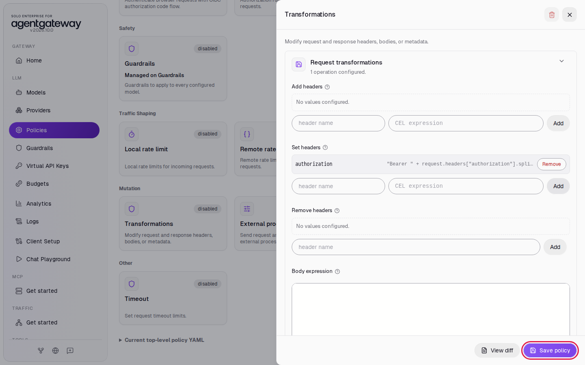

The gateway checks the Okta token first, then replaces the `Authorization` header with `Bearer <Claude token>` before it calls Anthropic. Anthropic never sees the Okta token.

## Step 5: Install agentdesktop

[agentdesktop](https://agentdesktop.dev/) is an open-source tool from Solo.io. It signs you in and writes the gateway URL and a credential command into each coding agent's own settings.

Download version `v0.5.0` for your computer. On a Mac with Apple silicon:

```bash
curl -fL -o /tmp/agentdesktop https://github.com/agentdesktop-dev/agentdesktop/releases/download/v0.5.0/agentdesktop-darwin-arm64
chmod +x /tmp/agentdesktop
/tmp/agentdesktop --version
```

On an Intel Mac, use `agentdesktop-darwin-amd64`. On Linux, use `agentdesktop-linux-amd64` or `agentdesktop-linux-arm64`. The [releases page](https://github.com/agentdesktop-dev/agentdesktop/releases/tag/v0.5.0) lists every file.

agentdesktop changes `~/.claude/settings.json`. It records your earlier values and puts them back when you clean up, but make your own copy first:

```bash
cp ~/.claude/settings.json ~/.claude/settings.json.before-agentdesktop 2>/dev/null || true
```

The workshop's agentdesktop configuration for this lab is `setup/agentdesktop/claude-subscription-okta.yaml`:

```yaml
llmGateway:
  url: http://localhost:4000
  authentication:
    type: oidc
    issuer: <issuer>
    clientId: <client-id>
    scopes: [openid, email, offline_access]

programs:
  claudeCode:
    auth: subscription
    companyAnnouncements: ["Signed in to agentgateway with Okta and your Claude subscription through agentdesktop"]
```

Open the file and replace `<issuer>` with the Issuer and `<client-id>` with the Client ID you copied in Step 1. Don't commit your own values.

`llmGateway.authentication` names the identity provider and the client to sign in with. `auth: subscription` sends Claude Code through the gateway and adds the Claude sign-in.

## Step 6: Sign in to Okta and to Claude

1. From the `setup/` folder, start the daemon. Leave this terminal open:

   ```bash
   /tmp/agentdesktop daemon --config agentdesktop/claude-subscription-okta.yaml --user
   ```

   The daemon writes the Claude Code settings and prints:

   ```
   Open this URL to connect Agentdesktop:
   http://127.0.0.1:51327/
   ```

   On a computer with a desktop, it also opens that URL in your browser.

2. In your browser, open http://127.0.0.1:51327/ and click **Continue to sign in**.

   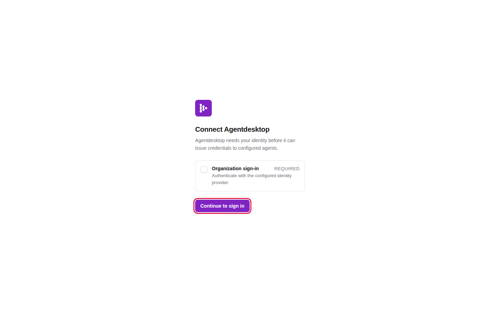

3. On the Okta page, sign in with your Okta user, the one you added to `platform-team`.
4. agentdesktop shows **Organization sign-in** checked and offers the **Model provider subscription**. Click **Connect subscription**.

   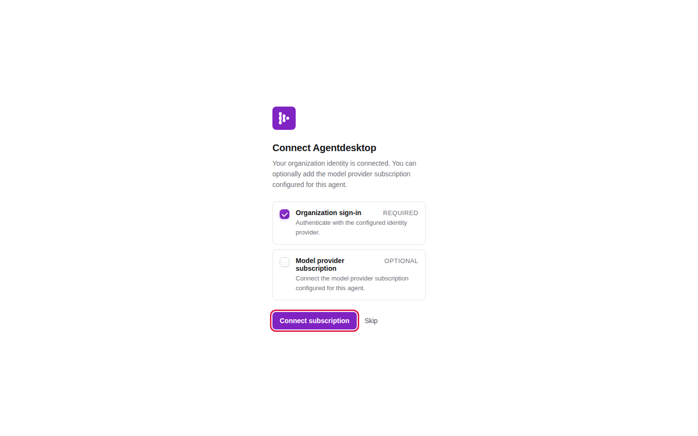

5. Sign in to Claude with your subscription account and approve the request. The browser returns to agentdesktop, and both items are checked.

The daemon log shows `LLM gateway OIDC authentication ready` and then `starting Anthropic subscription authentication`. agentdesktop keeps both refresh tokens and renews each access token before it expires.

## Step 7: Run Claude Code through the gateway

1. Open a new terminal. Remove any Anthropic credential from the shell, so Claude Code uses the credential from agentdesktop:

   ```bash
   unset ANTHROPIC_API_KEY ANTHROPIC_AUTH_TOKEN CLAUDE_CODE_OAUTH_TOKEN
   claude -p "Reply with exactly: hello from agentgateway"
   ```

   Expected output:

   ```
   hello from agentgateway
   ```

2. Optional: run `claude` without `-p`. Claude Code shows `Signed in to agentgateway with Okta and your Claude subscription through agentdesktop` when it starts. Its header says **API Usage Billing**, because Claude Code treats any credential from `apiKeyHelper` as an API key. Anthropic receives your subscription token, so the requests count against your plan. Your Claude account's usage page shows them.

In the sidebar, click **Logs**. You should see a `claude-` row with status `200` for each Claude Code request, with its input and output tokens. The two `unknown model` rows with status `401` are the curl command from Step 3 and Claude Code's connection check (`HEAD /api/hello`), which carries no credential. You can ignore them.

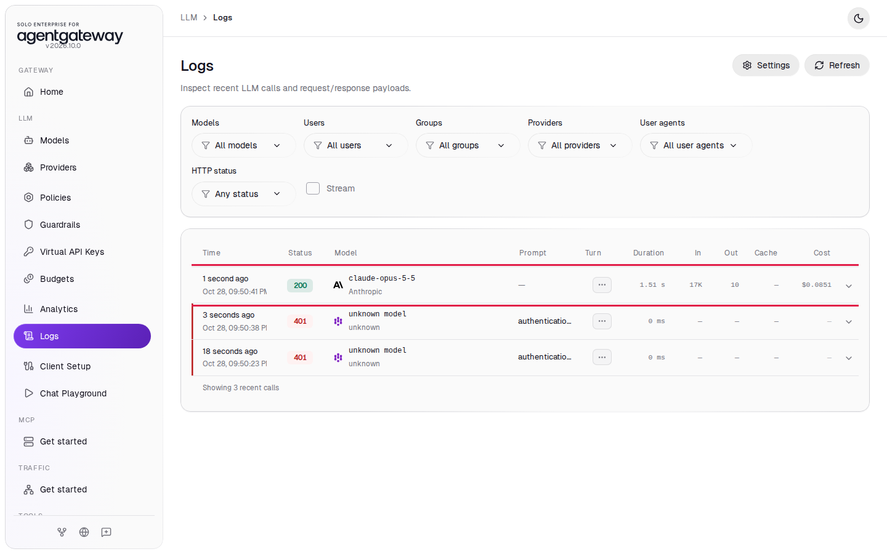

**Cost** shows what the request would cost at Anthropic's API prices. Your subscription pays for it under your plan's limits.

## Step 8: Allow only one group

The Okta token carries your groups in the `groups` claim, so the gateway can decide who may use the models. First allow only the `auditors` group, which your user is not in.

1. In the sidebar, click **Policies**.
2. Click the **Authorization** card.

   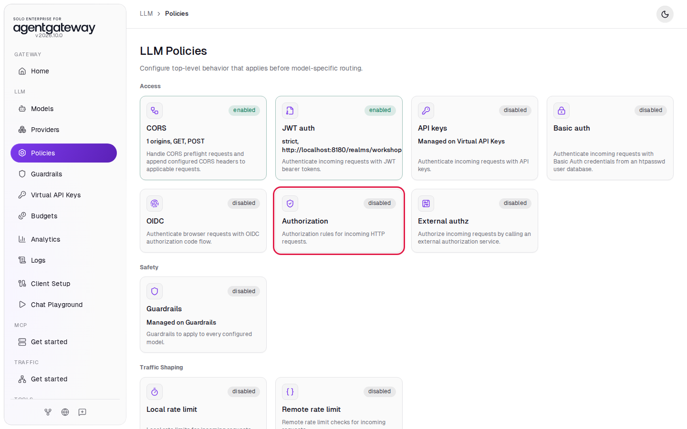

3. Click **Add rule**. The new rule has the effect **Allow**.
4. Click in the rule's expression box, select all the text, and enter:

   ```
   "auditors" in jwt.groups
   ```

5. Click **Save policy**.

   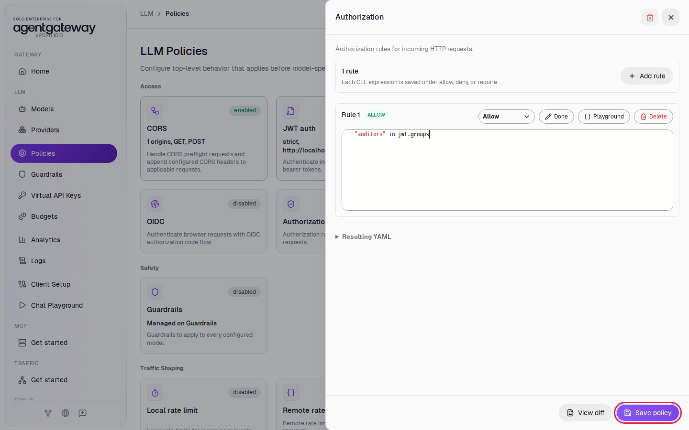

6. Wait two seconds, then send a request with the credential agentdesktop gives Claude Code:

   ```bash
   curl -si http://localhost:4000/v1/messages \
     -H "Authorization: Bearer $(/tmp/agentdesktop credential --client-id claude-code)" \
     -H 'Content-Type: application/json' \
     -H 'anthropic-version: 2023-06-01' \
     -d '{"model":"claude-haiku-5-5","max_tokens":50,"messages":[{"role":"user","content":"Reply with the single word: ready"}]}'
   ```

   Expected output:

   ```
   HTTP/1.1 403 Forbidden
   ...

   authorization failed
   ```

   You signed in, but you are not in `auditors`. If you run `claude -p` now, Claude Code retries the `403` for several minutes before it gives up. Press `Ctrl+C` to stop it.

Now allow your group:

7. Click the **Authorization** card.
8. Click in the rule's expression box, select all the text, and enter:

   ```
   "platform-team" in jwt.groups
   ```

9. Click **Save policy**.

   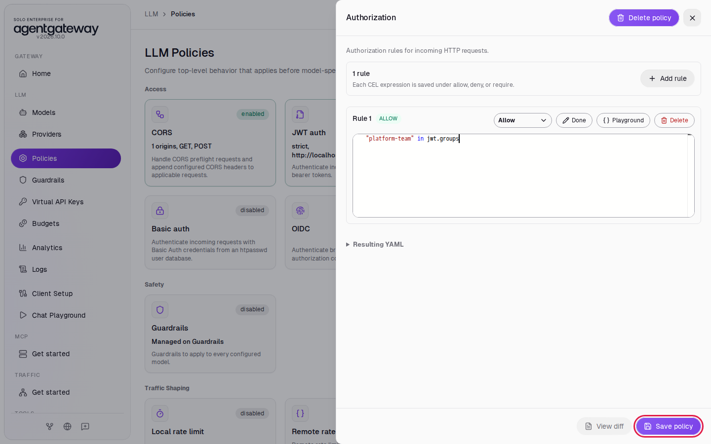

10. Wait two seconds, then run Claude Code again:

    ```bash
    claude -p "Reply with exactly: hello from agentgateway"
    ```

    It prints `hello from agentgateway`. Use Claude Code to check, not curl: Anthropic accepts a subscription token only from Claude Code, so the curl command returns `429` from Anthropic once the gateway lets it through.

To give someone access, you add them to the group in Okta. The gateway configuration stays the same.

If the `403` appears for `platform-team` too, your token has no `groups` claim. Decode the token's payload at [jwt.io](https://jwt.io) or check the claim in the **Token Preview** tab of your authorization server. Then check that the claim is in the **Access Token** and that your user is in the group.

## What the UI wrote

In the sidebar, scroll down to **Tools** and click **Raw Configuration**. The UI added three policies and a model to the `llm` section:

```yaml
llm:
  policies:
    jwtAuth:
      mode: strict
      location:
        expression: request.headers["authorization"].split(":")[2]
      issuer: <issuer>
      audiences:
      - <audience>
      jwks:
        url: <issuer>/v1/keys
      jwtValidationOptions:
        requiredClaims:
        - exp
    transformations:
      request:
        set:
          authorization: '"Bearer " + request.headers["authorization"].split(":")[1]'
      response: {}
    authorization:
      rules:
      - allow: '"platform-team" in jwt.groups'
  models:
  - name: claude-*
    provider: anthropic
    params: {}
```

`params` has no `apiKey`, so the gateway sends the `authorization` header that the transformation set.

agentdesktop wrote these keys to `~/.claude/settings.json`:

```json
{
  "apiKeyHelper": "'/tmp/agentdesktop' '--socket' '...agentdesktop.sock' 'credential' '--client-id' 'claude-code'",
  "companyAnnouncements": ["Signed in to agentgateway with Okta and your Claude subscription through agentdesktop"],
  "env": {
    "ANTHROPIC_BASE_URL": "http://localhost:4000/",
    "CLAUDE_CODE_API_KEY_HELPER_TTL_MS": "60000"
  }
}
```

## Clean up

1. In the terminal that runs the daemon, press `Ctrl+C`.
2. From the `setup/` folder, put your Claude Code settings back. agentdesktop removes the keys it added when you run it once with an empty configuration:

   ```bash
   printf '{}\n' > /tmp/agentdesktop-cleanup.yaml
   /tmp/agentdesktop daemon --config /tmp/agentdesktop-cleanup.yaml --user --once
   rm -f /tmp/agentdesktop /tmp/agentdesktop-cleanup.yaml
   ```

   Compare `~/.claude/settings.json` with `~/.claude/settings.json.before-agentdesktop`. If they match, delete the copy.

3. In the sidebar, click **Policies**.
4. Click the **Authorization** card, click **Delete policy**, then click **Delete policy** to confirm.
5. Do the same for the **Transformations** card and the **JWT auth** card. All three cards show **disabled**.
6. In the sidebar, click **Models**.
7. In the `claude-*` row, click the trash icon, then click **Delete model**.
8. Put `setup/agentdesktop/claude-subscription-okta.yaml` back to its placeholders, if you edited it.
9. Optional: in the Okta Admin Console, delete the `agentdesktop` app and its access policy, the `groups` claim you added, and the `platform-team` and `auditors` groups.

The gateway is back to the state [001](../../001-set-up-standalone-agentgateway.md) left it in.
