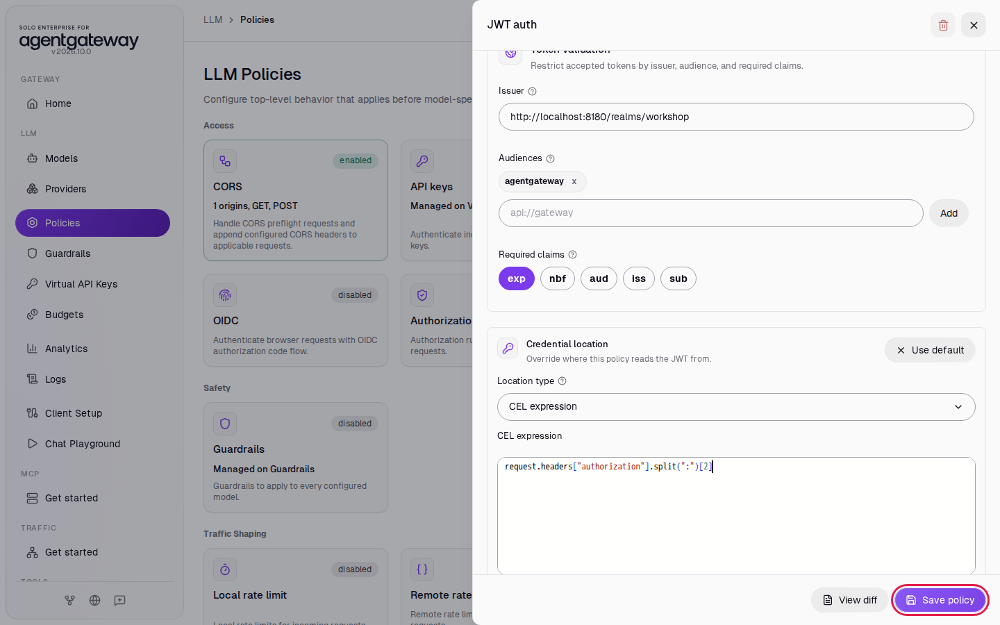

# Run Claude Code on Developer Subscriptions with Your Identity Provider Using agentdesktop

## Before you start

- Complete [001: Set Up Standalone Agentgateway](../../001-set-up-standalone-agentgateway.md).
- [Claude Code](https://docs.claude.com/en/docs/claude-code/overview) on your machine.
- A Claude Pro, Max, Team or Enterprise subscription. Check that your plan's terms allow its use through your own gateway.
- macOS or Linux. agentdesktop also runs on Windows, but this lab gives the commands for macOS and Linux only.
- Start Keycloak, the workshop's identity provider. From the `setup/` folder, run:

  ```bash
  env UID=$(id -u) GID=$(id -g) docker compose --profile keycloak up -d --force-recreate keycloak
  ```

  `--force-recreate` gives you a fresh Keycloak with the workshop realm, including the `agentdesktop` client this lab uses, even if an earlier lab started Keycloak. Keycloak takes up to a minute to start. It is ready when http://localhost:8180/realms/workshop opens in your browser.

Keycloak has these test users, all with password `workshop`:

| User | Group |
|---|---|
| alice | `platform-team` |
| bob | `auditors` |
| carol | `developers` |

## What you'll do

- Add a Claude model with no provider API key
- Make the gateway check a Keycloak token and send only the Claude token to Anthropic
- Sign in with agentdesktop twice: to Keycloak as alice, and to your Claude account
- Run Claude Code through the gateway on your subscription, and find alice's requests in Logs
- Allow only one Keycloak group to use the models

## Why this matters

Developers who already pay for Claude plans can keep using them, and the company needs no Anthropic API key. The gateway still has to know who each developer is, so that it can log their requests and allow or block them by group. A Claude subscription token does not tell the gateway who the developer is.

agentdesktop signs the developer in twice: to the company identity provider, and to their Claude account. It gives Claude Code one credential that holds both tokens:

```
agentdesktop:<Claude token>:<identity provider token>
```

The gateway checks the identity provider token, as in [Sign In Coding Agents with Your Identity Provider Using agentdesktop](connect-coding-agents-sso-using-agentdesktop.md), and sends only the Claude token to Anthropic. When someone leaves the company, you disable them in the identity provider, and the gateway stops their requests even though their Claude plan still works.

This lab uses Keycloak. For Okta, follow [Run Claude Code on Developer Subscriptions with Okta Using agentdesktop](connect-claude-subscription-okta-using-agentdesktop.md).

## Step 1: Add a Claude model with no provider key

1. In the sidebar, click **Models**.
2. Click **Add model**.

   

3. In **Provider**, select **Anthropic**.
4. In **Incoming model match**, select all the text and enter `claude-*`.
5. Leave **Provider API key** at **Unset**.
6. Under **Outgoing model**, click **Incoming model**.
7. Click **Save model**.

   

`claude-*` matches the model names Claude Code sends, such as `claude-haiku-5-5`, and the gateway passes each name to Anthropic as it is. With no provider key, the gateway forwards the `Authorization` header from the request. Step 3 sets that header to the Claude token.

## Step 2: Require a Keycloak token

The JWT auth policy reads the Keycloak token from the third part of the credential.

1. In the sidebar, click **Policies**.
2. Click the **JWT auth** card.

   

3. Under **Validation mode**, click **Strict**.
4. Under **JWKS source**, click **Remote URL**.
5. In **JWKS URL**, enter `http://localhost:8180/realms/workshop/protocol/openid-connect/certs`.
6. In **Issuer**, enter `http://localhost:8180/realms/workshop`.
7. Under **Audiences**, enter `agentgateway` and click **Add**.
8. Under **Credential location**, click **Customize**.
9. In **Location type**, select **CEL expression**.
10. Click in the **CEL expression** box and enter:

    ```
    request.headers["authorization"].split(":")[2]
    ```

11. Click **Save policy**.

    

Claude Code sends the credential as `Authorization: Bearer agentdesktop:<Claude token>:<Keycloak token>`. Split at `:`, the third part is the Keycloak token. The gateway checks its signature with Keycloak's public keys, and accepts it only if Keycloak signed it for the audience `agentgateway`.

Check that a request without a credential fails:

```bash
curl -si http://localhost:4000/v1/messages \
  -H 'Content-Type: application/json' \
  -H 'anthropic-version: 2023-06-01' \
  -d '{"model":"claude-haiku-5-5","max_tokens":50,"messages":[{"role":"user","content":"Reply with the single word: ready"}]}'
```

Expected output:

```
HTTP/1.1 401 Unauthorized
...

authentication failure: no bearer token found
```

## Step 3: Send only the Claude token to Anthropic

1. In the sidebar, click **Policies**.
2. Click the **Transformations** card.

   

3. Click **Request transformations**.
4. Under **Set headers**, in **header name**, enter `authorization`.
5. In **CEL expression** next to it, enter:

   ```
   "Bearer " + request.headers["authorization"].split(":")[1]
   ```

6. Click **Add**.
7. Click **Save policy**.

   

The gateway checks the Keycloak token first, then replaces the `Authorization` header with `Bearer <Claude token>` before it calls Anthropic. Anthropic never sees the Keycloak token.

## Step 4: Install agentdesktop

[agentdesktop](https://agentdesktop.dev/) is an open-source tool from Solo.io. It signs you in and writes the gateway URL and a credential command into each coding agent's own settings.

Download version `v0.5.0` for your computer. On a Mac with Apple silicon:

```bash
curl -fL -o /tmp/agentdesktop https://github.com/agentdesktop-dev/agentdesktop/releases/download/v0.5.0/agentdesktop-darwin-arm64
chmod +x /tmp/agentdesktop
/tmp/agentdesktop --version
```

On an Intel Mac, use `agentdesktop-darwin-amd64`. On Linux, use `agentdesktop-linux-amd64` or `agentdesktop-linux-arm64`. The [releases page](https://github.com/agentdesktop-dev/agentdesktop/releases/tag/v0.5.0) lists every file.

agentdesktop changes `~/.claude/settings.json`. It records your earlier values and puts them back when you clean up, but make your own copy first:

```bash
cp ~/.claude/settings.json ~/.claude/settings.json.before-agentdesktop 2>/dev/null || true
```

The workshop's agentdesktop configuration for this lab is `setup/agentdesktop/claude-subscription.yaml`:

```yaml
llmGateway:
  url: http://localhost:4000
  authentication:
    type: oidc
    issuer: http://localhost:8180/realms/workshop
    clientId: agentdesktop
    scopes: [openid, email, offline_access]
    # Workshop only: Keycloak and the gateway use plain HTTP on localhost.
    allowInsecure: true

programs:
  claudeCode:
    auth: subscription
    companyAnnouncements: ["Signed in to agentgateway with Keycloak and your Claude subscription through agentdesktop"]
```

`llmGateway.authentication` names the identity provider and the client to sign in with. `auth: subscription` sends Claude Code through the gateway and adds the Claude sign-in. For Okta, see [the Okta version of this lab](connect-claude-subscription-okta-using-agentdesktop.md).

## Step 5: Sign in to Keycloak and to Claude

1. From the `setup/` folder, start the daemon. Leave this terminal open:

   ```bash
   /tmp/agentdesktop daemon --config agentdesktop/claude-subscription.yaml --user
   ```

   The daemon writes the Claude Code settings and prints:

   ```
   Open this URL to connect Agentdesktop:
   http://127.0.0.1:51327/
   ```

   On a computer with a desktop, it also opens that URL in your browser.

2. In your browser, open http://127.0.0.1:51327/ and click **Continue to sign in**.

   

3. On the Keycloak page, sign in with username `alice` and password `workshop`.

   

4. agentdesktop shows **Organization sign-in** checked and offers the **Model provider subscription**. Click **Connect subscription**.

   

5. Sign in to Claude with your subscription account and approve the request. The browser returns to agentdesktop, and both items are checked.

The daemon log shows `LLM gateway OIDC authentication ready` and then `starting Anthropic subscription authentication`. agentdesktop keeps both refresh tokens and renews each access token before it expires.

## Step 6: Run Claude Code through the gateway

The workshop's automated check does not run agentdesktop, because it cannot sign in to Claude. It signs in to Keycloak with the `agentdesktop` client as the daemon does, builds the same credential from a token that `claude setup-token` created, and runs Claude Code with the settings agentdesktop writes.

1. Open a new terminal. Remove any Anthropic credential from the shell, so Claude Code uses the credential from agentdesktop:

   ```bash
   unset ANTHROPIC_API_KEY ANTHROPIC_AUTH_TOKEN CLAUDE_CODE_OAUTH_TOKEN
   claude -p "Reply with exactly: hello from agentgateway"
   ```

   Expected output:

   ```
   hello from agentgateway
   ```

2. Optional: run `claude` without `-p`. Claude Code shows `Signed in to agentgateway with Keycloak and your Claude subscription through agentdesktop` when it starts. Its header says **API Usage Billing**, because Claude Code treats any credential from `apiKeyHelper` as an API key. Anthropic receives your subscription token, so the requests count against your plan. Your Claude account's usage page shows them.

In the sidebar, click **Logs**. You should see a `claude-` row with status `200` for each Claude Code request, with its input and output tokens. The two `unknown model` rows with status `401` are the curl command from Step 2 and Claude Code's connection check (`HEAD /api/hello`), which carries no credential. You can ignore them.


**Cost** shows what the request would cost at Anthropic's API prices. Your subscription pays for it under your plan's limits.

## Step 7: Allow only one group

The Keycloak token carries alice's groups, so the gateway can decide who may use the models. First allow only the `auditors` group, which alice is not in.

1. In the sidebar, click **Policies**.
2. Click the **Authorization** card.

   

3. Click **Add rule**. The new rule has the effect **Allow**.
4. Click in the rule's expression box, select all the text, and enter:

   ```
   "auditors" in jwt.groups
   ```

5. Click **Save policy**.

   

6. Wait two seconds, then send a request with the credential agentdesktop gives Claude Code:

   ```bash
   curl -si http://localhost:4000/v1/messages \
     -H "Authorization: Bearer $(/tmp/agentdesktop credential --client-id claude-code)" \
     -H 'Content-Type: application/json' \
     -H 'anthropic-version: 2023-06-01' \
     -d '{"model":"claude-haiku-5-5","max_tokens":50,"messages":[{"role":"user","content":"Reply with the single word: ready"}]}'
   ```

   Expected output:

   ```
   HTTP/1.1 403 Forbidden
   ...

   authorization failed
   ```

   alice signed in, but she is not in `auditors`. If you run `claude -p` now, Claude Code retries the `403` for several minutes before it gives up. Press `Ctrl+C` to stop it.

Now allow alice's group:

7. Click the **Authorization** card.
8. Click in the rule's expression box, select all the text, and enter:

   ```
   "platform-team" in jwt.groups
   ```

9. Click **Save policy**.

   

10. Wait two seconds, then run Claude Code again:

    ```bash
    claude -p "Reply with exactly: hello from agentgateway"
    ```

    It prints `hello from agentgateway`. Use Claude Code to check, not curl: Anthropic accepts a subscription token only from Claude Code, so the curl command returns `429` from Anthropic once the gateway lets it through.

To give someone access, you add them to the group in the identity provider. The gateway configuration stays the same.

## What the UI wrote

In the sidebar, scroll down to **Tools** and click **Raw Configuration**. The UI added three policies and a model to the `llm` section:

```yaml
llm:
  policies:
    jwtAuth:
      mode: strict
      location:
        expression: request.headers["authorization"].split(":")[2]
      issuer: http://localhost:8180/realms/workshop
      audiences:
      - agentgateway
      jwks:
        url: http://localhost:8180/realms/workshop/protocol/openid-connect/certs
      jwtValidationOptions:
        requiredClaims:
        - exp
    transformations:
      request:
        set:
          authorization: '"Bearer " + request.headers["authorization"].split(":")[1]'
      response: {}
    authorization:
      rules:
      - allow: '"platform-team" in jwt.groups'
  models:
  - name: claude-*
    provider: anthropic
    params: {}
```

`params` has no `apiKey`, so the gateway sends the `authorization` header that the transformation set.

agentdesktop wrote these keys to `~/.claude/settings.json`:

```json
{
  "apiKeyHelper": "'/tmp/agentdesktop' '--socket' '...agentdesktop.sock' 'credential' '--client-id' 'claude-code'",
  "companyAnnouncements": ["Signed in to agentgateway with Keycloak and your Claude subscription through agentdesktop"],
  "env": {
    "ANTHROPIC_BASE_URL": "http://localhost:4000/",
    "CLAUDE_CODE_API_KEY_HELPER_TTL_MS": "60000"
  }
}
```

## Clean up

1. In the terminal that runs the daemon, press `Ctrl+C`.
2. From the `setup/` folder, put your Claude Code settings back. agentdesktop removes the keys it added when you run it once with an empty configuration:

   ```bash
   printf '{}\n' > /tmp/agentdesktop-cleanup.yaml
   /tmp/agentdesktop daemon --config /tmp/agentdesktop-cleanup.yaml --user --once
   rm -f /tmp/agentdesktop /tmp/agentdesktop-cleanup.yaml
   ```

   Compare `~/.claude/settings.json` with `~/.claude/settings.json.before-agentdesktop`. If they match, delete the copy.

3. In the sidebar, click **Policies**.
4. Click the **Authorization** card, click **Delete policy**, then click **Delete policy** to confirm.
5. Do the same for the **Transformations** card and the **JWT auth** card. All three cards show **disabled**.
6. In the sidebar, click **Models**.
7. In the `claude-*` row, click the trash icon, then click **Delete model**.
8. Stop Keycloak. From the `setup/` folder, run:

   ```bash
   docker compose --profile keycloak stop keycloak
   ```

The gateway is back to the state [001](../../001-set-up-standalone-agentgateway.md) left it in.
