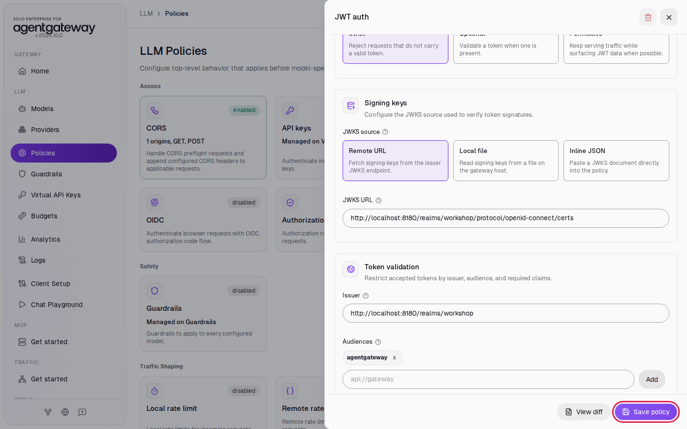
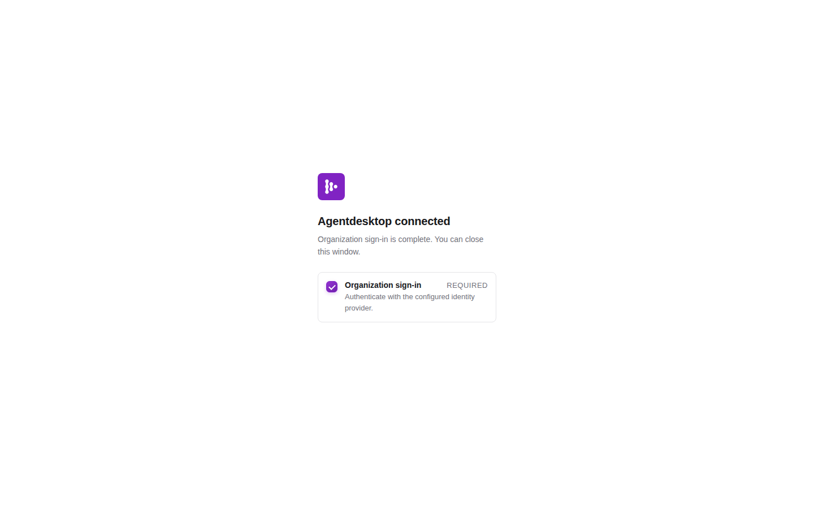
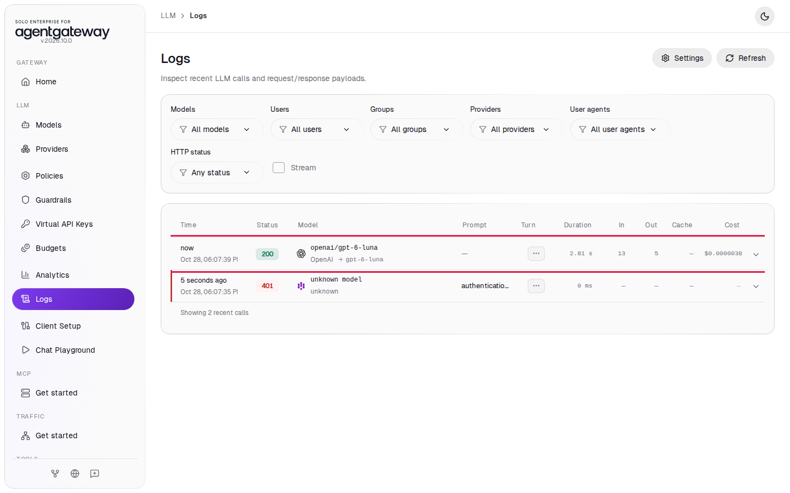

# Sign In Coding Agents with Your Identity Provider Using agentdesktop

## Before you start

- Complete [001: Set Up Standalone Agentgateway](../../001-set-up-standalone-agentgateway.md).
- [Claude Code](https://docs.claude.com/en/docs/claude-code/overview) on your machine.
- macOS or Linux. agentdesktop also runs on Windows, but this lab gives the commands for macOS and Linux only.
- Start Keycloak, the workshop's identity provider. From the `setup/` folder, run:

  ```bash
  env UID=$(id -u) GID=$(id -g) docker compose --profile keycloak up -d --force-recreate keycloak
  ```

  `--force-recreate` gives you a fresh Keycloak with the workshop realm, including the `agentdesktop` client this lab uses, even if an earlier lab started Keycloak. Keycloak takes up to a minute to start. It is ready when http://localhost:8180/realms/workshop opens in your browser.

Keycloak has these test users, all with password `workshop`:

| User | Group |
|---|---|
| alice | `platform-team` |
| bob | `auditors` |
| carol | `developers` |

## What you'll do

- Make the gateway accept only requests that carry a Keycloak token
- Install agentdesktop and sign in to Keycloak once as alice
- Run Claude Code through the gateway with no API key on your machine
- Find alice's requests in Logs
- Allow only one Keycloak group to use the models

## Why this matters

In [Connect Coding Agents](connect-coding-agents.md), every developer uses the same placeholder key, so the gateway cannot tell who sent a request. Virtual keys fix that, but someone has to issue, hand out, rotate and revoke a key for each developer.

With agentdesktop, developers sign in with the identity provider the company already uses, such as Okta, Entra ID or Keycloak. agentdesktop runs on the developer's computer, gets a short-lived token from the identity provider, and writes Claude Code settings that fetch a fresh token before each request expires. The gateway checks the token's signature and claims, so it knows the user and their groups. When someone leaves the company, you disable them in the identity provider, and their coding agents stop working.

This lab uses Keycloak. For Okta, you change the issuer URL and client ID in the agentdesktop configuration and the gateway's JWT auth policy.

## Set up

This lab uses the `openai/*` model, so Claude Code runs on `gpt-6-luna` and you need no Anthropic key. The gateway turns Claude Code's Anthropic Messages requests into OpenAI requests. [Connect LLM Providers](connect-llm-providers.md) explains these steps.

1. In the sidebar, click **Models**.
2. Click **Add model**.

   

3. In **Provider**, select **OpenAI**. The UI fills **Incoming model match** with `openai/*`.
4. Next to **Provider API key**, click **Env var** and enter `OPENAI_API_KEY`.
5. Under **Outgoing model**, click **Strip openai/**.
6. Click **Save model**.

   

The **Models** page lists `openai/*`.

## Step 1: Require a Keycloak token

1. In the sidebar, click **Policies**.
2. Click the **JWT auth** card.

   

3. Under **Validation mode**, click **Strict**.
4. Under **JWKS source**, click **Remote URL**.
5. In **JWKS URL**, enter `http://localhost:8180/realms/workshop/protocol/openid-connect/certs`.
6. In **Issuer**, enter `http://localhost:8180/realms/workshop`.
7. Under **Audiences**, enter `agentgateway` and click **Add**.
8. Click **Save policy**.

   

The gateway downloads Keycloak's public keys from the JWKS URL and accepts only tokens that Keycloak signed for the audience `agentgateway`. The `agentdesktop` client in the workshop realm adds that audience to its tokens.

Check that a request without a token fails:

```bash
curl -si http://localhost:4000/v1/messages \
  -H 'Content-Type: application/json' \
  -H 'anthropic-version: 2023-06-01' \
  -d '{"model":"openai/gpt-6-luna","max_tokens":50,"messages":[{"role":"user","content":"Reply with the single word: ready"}]}'
```

Expected output:

```
HTTP/1.1 401 Unauthorized
...

authentication failure: no bearer token found
```

## Step 2: Install agentdesktop

[agentdesktop](https://agentdesktop.dev/) is an open-source tool from Solo.io. It signs you in to the identity provider and writes the gateway URL and a credential command into each coding agent's own settings.

Download version `v0.5.0` for your computer. On a Mac with Apple silicon:

```bash
curl -fL -o /tmp/agentdesktop https://github.com/agentdesktop-dev/agentdesktop/releases/download/v0.5.0/agentdesktop-darwin-arm64
chmod +x /tmp/agentdesktop
/tmp/agentdesktop --version
```

On an Intel Mac, use `agentdesktop-darwin-amd64`. On Linux, use `agentdesktop-linux-amd64` or `agentdesktop-linux-arm64`. The [releases page](https://github.com/agentdesktop-dev/agentdesktop/releases/tag/v0.5.0) lists every file.

agentdesktop changes `~/.claude/settings.json`. It records your earlier values and puts them back when you clean up, but make your own copy first:

```bash
cp ~/.claude/settings.json ~/.claude/settings.json.before-agentdesktop 2>/dev/null || true
```

The workshop's agentdesktop configuration is `setup/agentdesktop/config.yaml`:

```yaml
llmGateway:
  url: http://localhost:4000
  authentication:
    type: oidc
    issuer: http://localhost:8180/realms/workshop
    clientId: agentdesktop
    scopes: [openid, email, offline_access]
    # Workshop only: Keycloak and the gateway use plain HTTP on localhost.
    allowInsecure: true

programs:
  claudeCode:
    useLlmGateway: true
    model: openai/gpt-6-luna
    companyAnnouncements: ["Signed in to agentgateway with Keycloak through agentdesktop"]
```

`llmGateway.authentication` names the identity provider and the client to sign in with. For Okta, `issuer` is your Okta authorization server, for example `https://example.okta.com/oauth2/default`, and `clientId` is a native app with the redirect URI `http://127.0.0.1:51327/callback`. `programs.claudeCode` tells agentdesktop to send Claude Code through the gateway, with `openai/gpt-6-luna` as its model.

From the `setup/` folder, preview the changes without writing any files:

```bash
/tmp/agentdesktop daemon --config agentdesktop/config.yaml --user --dry-run
```

Expected output:

```
CREATE  Claude Code settings
        /Users/<you>/.claude/settings.json
...
+  "apiKeyHelper": "'/tmp/agentdesktop' '--socket' '...agentdesktop.sock' 'credential' '--client-id' 'claude-code'",
...
+  "env": {
+    "ANTHROPIC_BASE_URL": "http://localhost:4000/",
+    "CLAUDE_CODE_API_KEY_HELPER_TTL_MS": "60000"
+  },
+  "model": "openai/gpt-6-luna"
...
```

If you already have a `settings.json`, the first line says `UPDATE` and the diff shows only the added keys. `apiKeyHelper` is the command Claude Code runs to get its API key. Here it asks the agentdesktop daemon for alice's current token. `CLAUDE_CODE_API_KEY_HELPER_TTL_MS` makes Claude Code ask again every minute, so it always sends a token that has not expired.

## Step 3: Sign in once as alice

1. From the `setup/` folder, start the daemon. Leave this terminal open:

   ```bash
   /tmp/agentdesktop daemon --config agentdesktop/config.yaml --user
   ```

   The daemon writes the Claude Code settings and prints:

   ```
   Open this URL to connect Agentdesktop:
   http://127.0.0.1:51327/
   ```

   On a computer with a desktop, it also opens that URL in your browser.

2. In your browser, open http://127.0.0.1:51327/ and click **Continue to sign in**.

   

3. On the Keycloak page, sign in with username `alice` and password `workshop`.

   

The browser shows **Agentdesktop connected**:



The daemon log shows `LLM gateway OIDC authentication ready`. agentdesktop keeps alice's refresh token and gets a new access token from Keycloak when the old one expires. Keycloak access tokens in this realm last five minutes.

## Step 4: Run Claude Code through the gateway

The workshop's automated check does not run agentdesktop or Claude Code. It signs in to Keycloak with the `agentdesktop` client as the daemon does, and sends alice's token in a Messages API request as Claude Code does.

1. Open a new terminal. Remove any Anthropic key from the shell, so Claude Code uses the key from agentdesktop:

   ```bash
   unset ANTHROPIC_API_KEY ANTHROPIC_AUTH_TOKEN
   ```

2. Run Claude Code with one prompt:

   ```bash
   claude -p "Reply with exactly: hello from agentgateway"
   ```

   Expected output:

   ```
   hello from agentgateway
   ```

   Claude Code may first print that it does not recognize the model `openai/gpt-6-luna`. That warning is about the context window size, and you can ignore it.

3. Optional: run `claude` without `-p`. Claude Code shows `Signed in to agentgateway with Keycloak through agentdesktop` when it starts. Enter `/status` to see the base URL `http://localhost:4000/` and `apiKeyHelper` as the API key source.

4. Optional: see the token Claude Code sends. In the new terminal, run:

   ```bash
   /tmp/agentdesktop credential --client-id claude-code | cut -d. -f2 | base64 -d 2>/dev/null; echo
   ```

   The output includes `"iss":"http://localhost:8180/realms/workshop"`, `"aud":"agentgateway"`, `"azp":"agentdesktop"`, `"groups":["platform-team"]` and `"email":"alice@example.com"`.

To check that the request went through the gateway, in the sidebar, click **Logs**. You should see `openai/gpt-6-luna` rows with status `200` for the Claude Code requests, and a `401` row for the curl command in Step 1:



## Step 5: Allow only one group

The token carries alice's Keycloak groups, so the gateway can decide who may use the models. First allow only the `auditors` group, which alice is not in.

1. In the sidebar, click **Policies**.
2. Click the **Authorization** card.

   

3. Click **Add rule**. The new rule has the effect **Allow**.
4. Click in the rule's expression box, select all the text, and enter:

   ```
   "auditors" in jwt.groups
   ```

5. Click **Save policy**.

   

6. Wait two seconds, then send a request with the token agentdesktop gives Claude Code:

   ```bash
   curl -si http://localhost:4000/v1/messages \
     -H "Authorization: Bearer $(/tmp/agentdesktop credential --client-id claude-code)" \
     -H 'Content-Type: application/json' \
     -H 'anthropic-version: 2023-06-01' \
     -d '{"model":"openai/gpt-6-luna","max_tokens":50,"messages":[{"role":"user","content":"Reply with the single word: ready"}]}'
   ```

   Expected output:

   ```
   HTTP/1.1 403 Forbidden
   ...

   authorization failed
   ```

   alice signed in, but she is not in `auditors`. If you run `claude -p` now, Claude Code retries the `403` for several minutes before it gives up, and **Logs** shows a row with status `403` for each try. Press `Ctrl+C` to stop it.

Now allow alice's group:

7. Click the **Authorization** card.
8. Click in the rule's expression box, select all the text, and enter:

   ```
   "platform-team" in jwt.groups
   ```

9. Click **Save policy**.

   

10. Wait two seconds and run the same `curl` command. It returns `HTTP/1.1 200 OK` with `ready` in the reply, and `claude -p "Reply with exactly: hello from agentgateway"` works again.

To give someone access, you add them to the group in the identity provider. The gateway configuration stays the same.

## What the UI wrote

In the sidebar, scroll down to **Tools** and click **Raw Configuration**. The UI added a `jwtAuth` policy and an `authorization` policy to the `llm` section:

```yaml
llm:
  policies:
    jwtAuth:
      mode: strict
      issuer: http://localhost:8180/realms/workshop
      audiences:
      - agentgateway
      jwks:
        url: http://localhost:8180/realms/workshop/protocol/openid-connect/certs
      jwtValidationOptions:
        requiredClaims:
        - exp
    authorization:
      rules:
      - allow: '"platform-team" in jwt.groups'
```

agentdesktop wrote these keys to `~/.claude/settings.json`:

```json
{
  "apiKeyHelper": "'/tmp/agentdesktop' '--socket' '...agentdesktop.sock' 'credential' '--client-id' 'claude-code'",
  "companyAnnouncements": ["Signed in to agentgateway with Keycloak through agentdesktop"],
  "env": {
    "ANTHROPIC_BASE_URL": "http://localhost:4000/",
    "CLAUDE_CODE_API_KEY_HELPER_TTL_MS": "60000"
  },
  "model": "openai/gpt-6-luna"
}
```

## Clean up

1. In the terminal that runs the daemon, press `Ctrl+C`.
2. From the `setup/` folder, put your Claude Code settings back. agentdesktop removes the keys it added when you run it once with an empty configuration:

   ```bash
   printf '{}\n' > /tmp/agentdesktop-cleanup.yaml
   /tmp/agentdesktop daemon --config /tmp/agentdesktop-cleanup.yaml --user --once
   rm -f /tmp/agentdesktop /tmp/agentdesktop-cleanup.yaml
   ```

   Compare `~/.claude/settings.json` with `~/.claude/settings.json.before-agentdesktop`. If they match, delete the copy.

3. In the sidebar, click **Policies**.
4. Click the **Authorization** card, click **Delete policy**, then click **Delete policy** to confirm.
5. Click the **JWT auth** card, click **Delete policy**, then click **Delete policy** to confirm. Both cards show **disabled**.
6. In the sidebar, click **Models**.
7. In the `openai/*` row, click the trash icon, then click **Delete model**.
8. Stop Keycloak. From the `setup/` folder, run:

   ```bash
   docker compose --profile keycloak stop keycloak
   ```

The gateway is back to the state [001](../../001-set-up-standalone-agentgateway.md) left it in.

## Codex and other coding agents

agentdesktop also configures Codex, OpenCode, Claude Desktop, GitHub Copilot and others. Codex reads its gateway settings from `/etc/codex/managed_config.toml`, so agentdesktop must run as a system daemon (`sudo`, without `--user`) to manage it. The [agentdesktop documentation](https://agentdesktop.dev/docs/) covers system mode and fleet mode, where a central controller hands out the configuration to every developer's computer.
