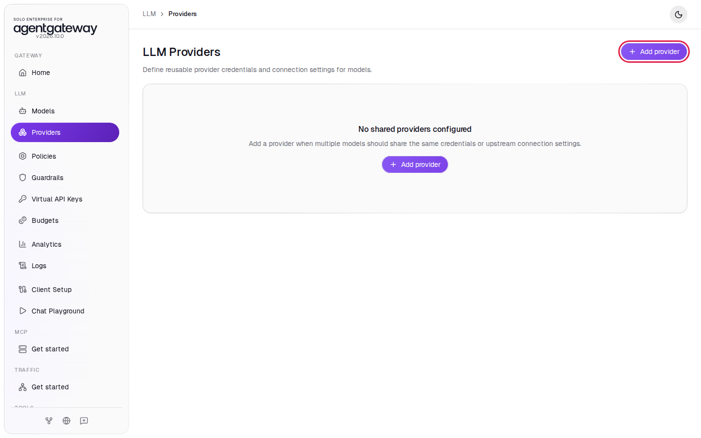
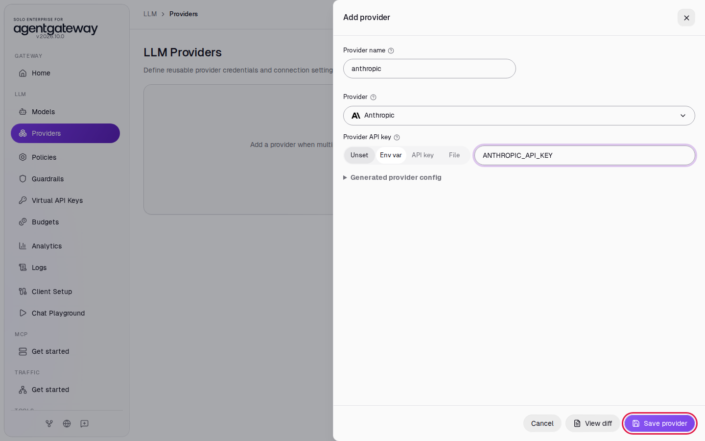
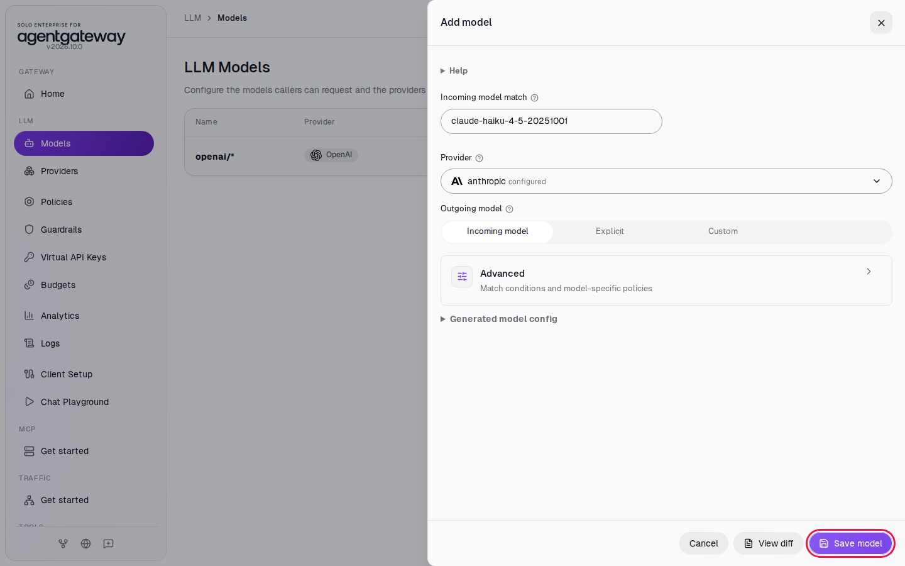
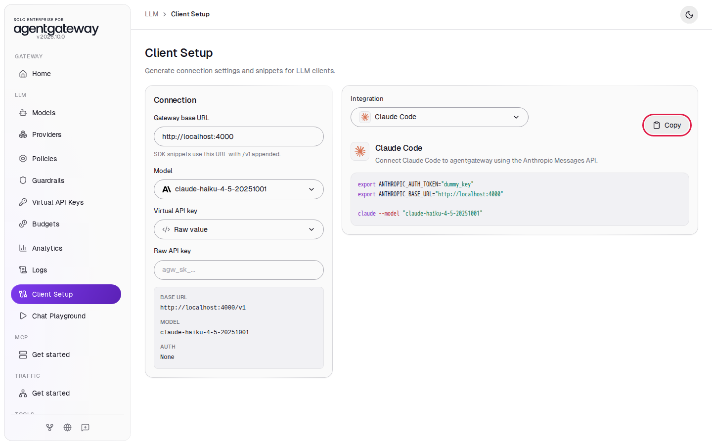
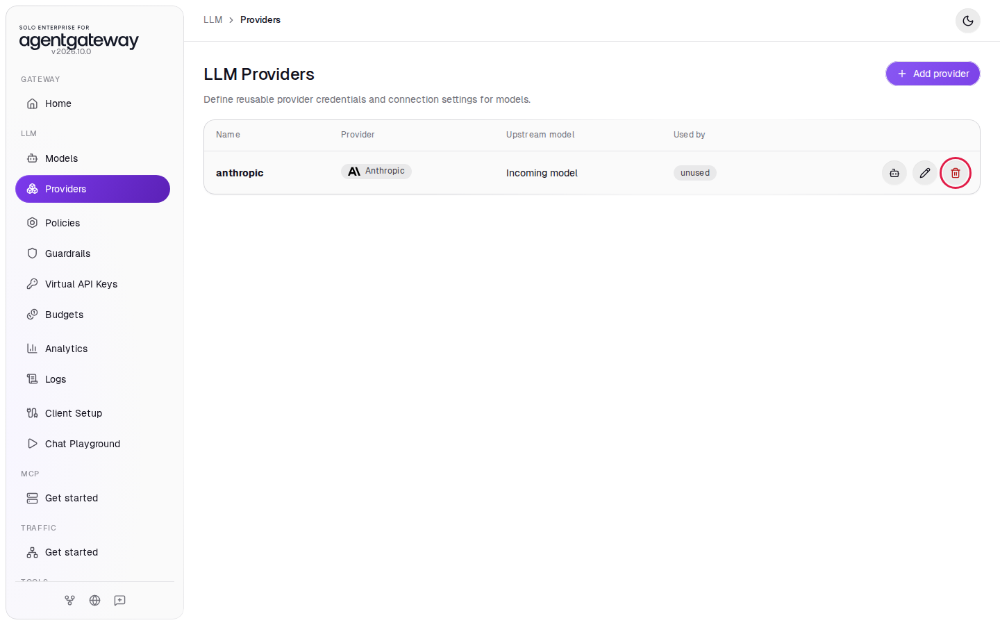

# Connect Coding Agents

## Before you start

- Complete [Connect LLM Providers](../llm/connect-llm-providers.md). The gateway has the `openai/*` model.
- For Codex: the [Codex CLI](https://github.com/openai/codex) on your machine.
- Optional, for Claude Code: an `ANTHROPIC_API_KEY` in `setup/.env` and [Claude Code](https://docs.claude.com/en/docs/claude-code/overview) on your machine. If you add the key now, restart the gateway so it reads the key: from the `setup/` folder, run `env UID=$(id -u) GID=$(id -g) docker compose up -d`. Skip the Claude Code steps if you have no Anthropic key.

## What you'll do

- Get a Codex setup snippet from Client Setup and check the OpenAI Responses API through the gateway
- Optional: add Anthropic as a shared provider and add a Claude model
- Optional: get a Claude Code setup snippet and check the Anthropic Messages API through the gateway
- Run Codex and Claude Code through the gateway

## Why this matters

Coding agents send a lot of LLM traffic. When they go through the gateway, the gateway holds the provider keys, and you see every request, its tokens and its cost in Logs and Analytics. Developers use a placeholder key on their machines. The gateway speaks each agent's own API: Codex uses the OpenAI Responses API (`/v1/responses`), and Claude Code uses the Anthropic Messages API (`/v1/messages`).

## Step 1: Get the Codex snippet

1. In the sidebar, click **Client Setup**.
2. In **Specific model**, enter `gpt-6-luna`.
3. In **Integration**, select **Codex CLI**.

   

4. Click **Copy**.

   

The snippet is:

```bash
export OPENAI_API_KEY="dummy_key"
# If Codex has an existing login it can impact functionality. Better if it's logged out.
# If you don't want to override your Codex configuration, you can set up a new dedicated configuration file.
export CODEX_HOME=/tmp/codex-gateway-home && mkdir -p $CODEX_HOME # optional
codex login --with-api-key <<<"$OPENAI_API_KEY"

codex --model "openai/gpt-6-luna" \
  -c 'model_provider="gateway"' \
  -c 'model_providers.gateway.name="Local gateway"' \
  -c 'model_providers.gateway.base_url="http://localhost:4000/v1"'
```

`dummy_key` is a placeholder. The gateway replaces it with the real OpenAI key from `setup/.env`. The `-c` options add a model provider named `gateway` that points Codex at `http://localhost:4000/v1`. Keep the `CODEX_HOME` line: it gives this Codex session its own settings folder, so the `codex login` with the placeholder key does not replace your usual Codex login.

You can pick any OpenAI model your key can use in **Specific model**. The snippet changes to match.

## Check the Responses API

Codex sends its requests in the OpenAI Responses format. Check that the gateway answers in that format:

```bash
curl -s http://localhost:4000/v1/responses \
  -H 'Content-Type: application/json' \
  -d '{"model":"openai/gpt-6-luna","input":"Reply with the single word: ready"}'
```

Expected output:

```
{"id":"resp_...","status":"completed","output":[{"type":"message","content":[{"type":"output_text",...,"text":"Ready"}],...}],"model":"gpt-6-luna",...,"object":"response",...}
```

## Step 2: Run Codex through the gateway

The workshop's automated check does not cover this step. It checks only the Responses API call above.

Paste the snippet from Step 1 into a terminal. You should see Codex start with `openai/gpt-6-luna`. Give it a task, for example `Reply with exactly: hello from agentgateway`.

To check that the request went through the gateway, in the sidebar, click **Logs**. You should see `openai/gpt-6-luna` rows for the Codex requests.

## Step 3 (optional): Add the Anthropic provider

Skip Steps 3 to 6 if you have no Anthropic key.

A shared provider holds a credential once. Models that reference it use that credential.

1. In the sidebar, click **Providers**.
2. Click **Add provider**.

   

3. In **Provider name**, enter `anthropic`.
4. In **Provider**, select **Anthropic**.
5. Next to **Provider API key**, click **Env var** and enter `ANTHROPIC_API_KEY`.
6. Click **Save provider**.

   

## Step 4 (optional): Add the Claude model

1. In the sidebar, click **Models**.
2. Click **Add model**.
3. In **Provider**, select **anthropic** (marked **configured**). This is the shared provider from Step 3.
4. In **Incoming model match**, enter `claude-haiku-4-5-20251001`.
5. Under **Outgoing model**, leave **Incoming model** selected. The gateway sends the model name as the caller wrote it.
6. Click **Save model**.

   

## Check the Messages API (optional)

Claude Code sends its requests in the Anthropic Messages format. Wait a second after saving, then check that the gateway answers in that format:

```bash
curl -s http://localhost:4000/v1/messages \
  -H 'Content-Type: application/json' \
  -H 'anthropic-version: 2023-06-01' \
  -d '{"model":"claude-haiku-4-5-20251001","max_tokens":64,"messages":[{"role":"user","content":"Reply with the single word: ready"}]}'
```

Expected output:

```
{"id":"msg_...","type":"message","role":"assistant","model":"claude-haiku-4-5-20251001",...,"content":[{"text":"ready","type":"text"}],...}
```

The request carries no Anthropic key. The gateway adds it from the shared provider.

## Step 5 (optional): Get the Claude Code snippet

1. In the sidebar, click **Client Setup**.
2. In **Model**, select **claude-haiku-4-5-20251001**.
3. In **Integration**, select **Claude Code**.
4. Click **Copy**.

   

The snippet is:

```bash
export ANTHROPIC_AUTH_TOKEN="dummy_key"
export ANTHROPIC_BASE_URL="http://localhost:4000"

claude --model "claude-haiku-4-5-20251001"
```

`ANTHROPIC_BASE_URL` sends Claude Code to the gateway instead of to Anthropic. `dummy_key` is a placeholder; the gateway uses the key from the `anthropic` provider.

## Step 6 (optional): Run Claude Code through the gateway

The workshop's automated check does not cover this step. It checks only the Messages API call above.

Paste the snippet from Step 5 into a terminal. You should see Claude Code start with `claude-haiku-4-5-20251001`. The gateway serves only the models you added, so start Claude Code with `--model` as the snippet does.

In the sidebar, click **Logs**. You should see `claude-haiku-4-5-20251001` rows for the Claude Code requests.

## What the UI wrote

In the sidebar, scroll down to **Tools** and click **Raw Configuration**. Step 1 and Step 2 change nothing: Client Setup only builds snippets. The optional steps added a `providers` section and a model to `llm`:

```yaml
llm:
  providers:
    - name: anthropic
      provider: anthropic
      params:
        apiKey: $ANTHROPIC_API_KEY
  models:
    - name: claude-haiku-4-5-20251001
      provider:
        reference: anthropic
```

## Clean up

1. Close Codex and Claude Code. If you used the `CODEX_HOME` line, delete that folder: `rm -rf /tmp/codex-gateway-home`.

If you did the optional steps:

2. In the sidebar, click **Models**.
3. In the `claude-haiku-4-5-20251001` row, click the trash icon, then click **Delete model**.
4. In the sidebar, click **Providers**.
5. In the `anthropic` row, click the trash icon.

   

6. In **Delete provider?**, click **Delete provider**.

The gateway is back to the state [Connect LLM Providers](../llm/connect-llm-providers.md) left it in.
