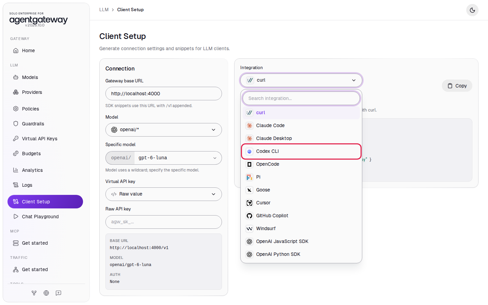
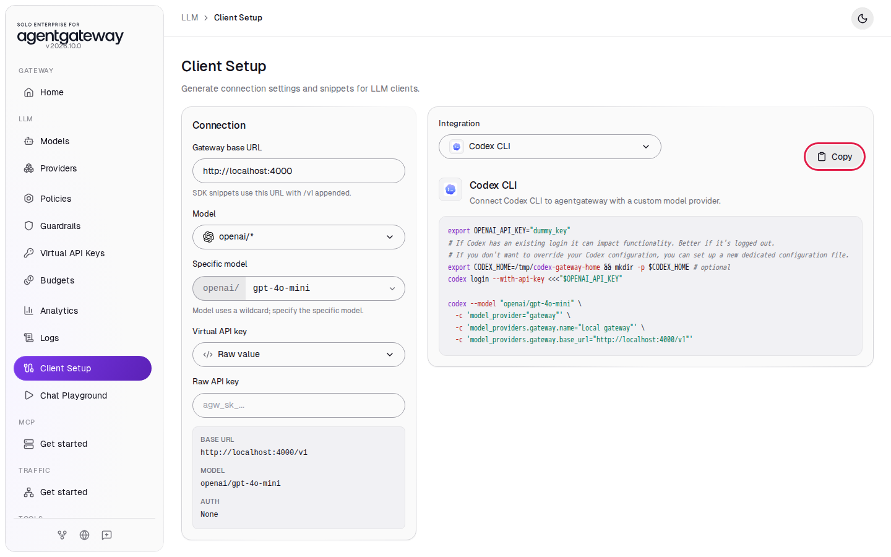
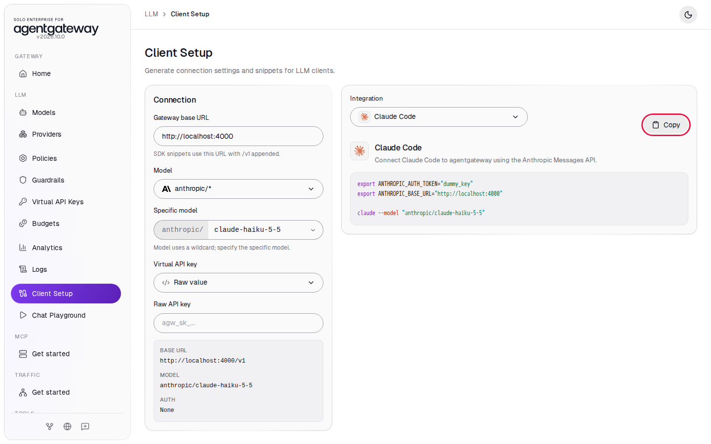

# Connect Coding Agents

## Before you start

- Complete [Connect LLM Providers](../llm/connect-llm-providers.md). The gateway has the `openai/*` model.
- For Codex: the [Codex CLI](https://github.com/openai/codex) on your machine.
- Optional, for Claude Code: complete Steps 1 and 2 of [Connect Anthropic](connect-anthropic.md) and skip its cleanup, so the gateway has the `anthropic/*` model. You also need [Claude Code](https://docs.claude.com/en/docs/claude-code/overview) on your machine. Skip the Claude Code steps if you have no Anthropic key.

## What you'll do

- Get a Codex setup snippet from Client Setup and check the OpenAI Responses API through the gateway
- Optional: get a Claude Code setup snippet and check the Anthropic Messages API through the gateway
- Run Codex and Claude Code through the gateway

## Why this matters

Coding agents send a lot of LLM traffic. When they go through the gateway, the gateway holds the provider keys, and you see every request, its tokens and its cost in Logs and Analytics. Developers use a placeholder key on their machines. The gateway speaks each agent's own API: Codex uses the OpenAI Responses API (`/v1/responses`), and Claude Code uses the Anthropic Messages API (`/v1/messages`).

## Step 1: Get the Codex snippet

1. In the sidebar, click **Client Setup**.
2. In **Specific model**, enter `gpt-6-luna`.
3. In **Integration**, select **Codex CLI**.

   

4. Click **Copy**.

   

The snippet is:

```bash
export OPENAI_API_KEY="dummy_key"
# If Codex has an existing login it can impact functionality. Better if it's logged out.
# If you don't want to override your Codex configuration, you can set up a new dedicated configuration file.
export CODEX_HOME=/tmp/codex-gateway-home && mkdir -p $CODEX_HOME # optional
codex login --with-api-key <<<"$OPENAI_API_KEY"

codex --model "openai/gpt-6-luna" \
  -c 'model_provider="gateway"' \
  -c 'model_providers.gateway.name="Local gateway"' \
  -c 'model_providers.gateway.base_url="http://localhost:4000/v1"'
```

`dummy_key` is a placeholder. The gateway replaces it with the real OpenAI key from `setup/.env`. The `-c` options add a model provider named `gateway` that points Codex at `http://localhost:4000/v1`. Keep the `CODEX_HOME` line: it gives this Codex session its own settings folder, so the `codex login` with the placeholder key does not replace your usual Codex login.

You can pick any OpenAI model your key can use in **Specific model**. The snippet changes to match.

## Check the Responses API

Codex sends its requests in the OpenAI Responses format. Check that the gateway answers in that format:

```bash
curl -s http://localhost:4000/v1/responses \
  -H 'Content-Type: application/json' \
  -d '{"model":"openai/gpt-6-luna","input":"Reply with the single word: ready"}'
```

Expected output:

```
{"id":"resp_...","status":"completed","output":[{"type":"message","content":[{"type":"output_text",...,"text":"Ready"}],...}],"model":"gpt-6-luna",...,"object":"response",...}
```

## Step 2: Run Codex through the gateway

The workshop's automated check does not cover this step. It checks only the Responses API call above.

Paste the snippet from Step 1 into a terminal. You should see Codex start with `openai/gpt-6-luna`. Give it a task, for example `Reply with exactly: hello from agentgateway`.

To check that the request went through the gateway, in the sidebar, click **Logs**. You should see `openai/gpt-6-luna` rows for the Codex requests.

## Step 3 (optional): Get the Claude Code snippet

1. In the sidebar, click **Client Setup**.
2. In **Model**, select **anthropic/\***.
3. In **Specific model**, enter `claude-haiku-5-5`.
4. In **Integration**, select **Claude Code**.
5. Click **Copy**.

   

The snippet is:

```bash
export ANTHROPIC_AUTH_TOKEN="dummy_key"
export ANTHROPIC_BASE_URL="http://localhost:4000"

claude --model "anthropic/claude-haiku-5-5"
```

`ANTHROPIC_BASE_URL` sends Claude Code to the gateway instead of to Anthropic. `dummy_key` is a placeholder; the gateway uses the key from the `anthropic` provider. Claude Code sends the model name as written, and the gateway strips the `anthropic/` prefix before it calls Anthropic.

## Check the Messages API (optional)

Claude Code sends its requests in the Anthropic Messages format. Check that the gateway answers in that format:

```bash
curl -s http://localhost:4000/v1/messages \
  -H 'Content-Type: application/json' \
  -H 'anthropic-version: 2023-06-01' \
  -d '{"model":"anthropic/claude-haiku-5-5","max_tokens":1024,"messages":[{"role":"user","content":"Reply with the single word: ready"}]}'
```

Expected output:

```
{"id":"msg_...","type":"message","role":"assistant","model":"claude-haiku-5-5",...,"content":[{"text":"ready","type":"text"}],...}
```

## Step 4 (optional): Run Claude Code through the gateway

The workshop's automated check does not cover this step. It checks only the Messages API call above.

Paste the snippet from Step 3 into a terminal. You should see Claude Code start with `anthropic/claude-haiku-5-5`. The gateway serves only the models you added, so start Claude Code with `--model` as the snippet does.

In the sidebar, click **Logs**. You should see `anthropic/claude-haiku-5-5` rows for the Claude Code requests. A row named `unknown model` with status `400` is Claude Code's connection check (`HEAD /api/hello`); you can ignore it.

## What the UI wrote

Client Setup only builds snippets, so `config.yaml` stays the same. The `anthropic` provider and the `anthropic/*` model come from [Connect Anthropic](connect-anthropic.md).

## Clean up

1. Close Codex and Claude Code. If you used the `CODEX_HOME` line, delete that folder: `rm -rf /tmp/codex-gateway-home`.
2. If you did the Claude Code steps, follow the Clean up section of [Connect Anthropic](connect-anthropic.md).

The gateway is back to the state [Connect LLM Providers](../llm/connect-llm-providers.md) left it in.
