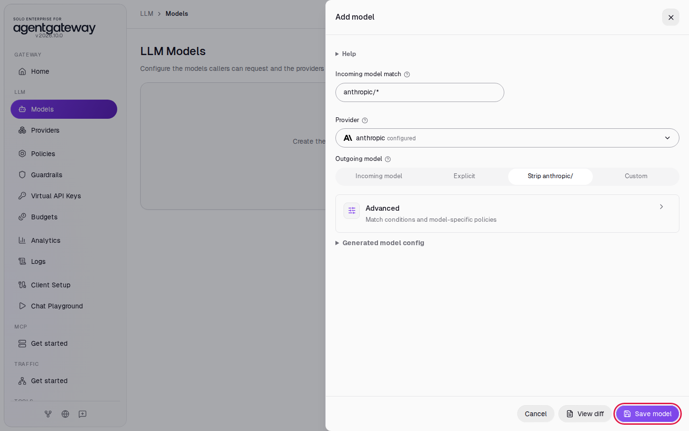
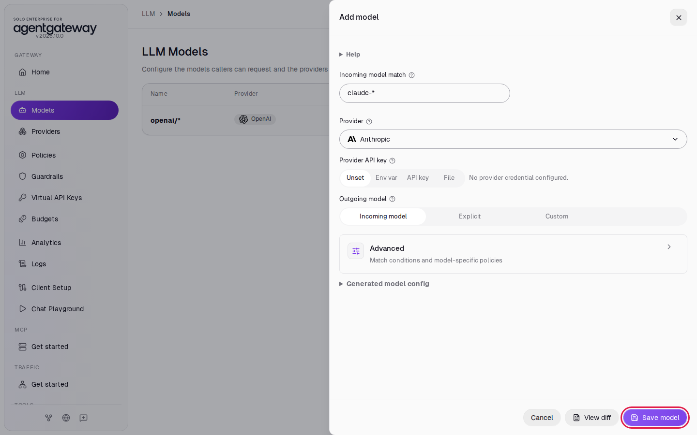
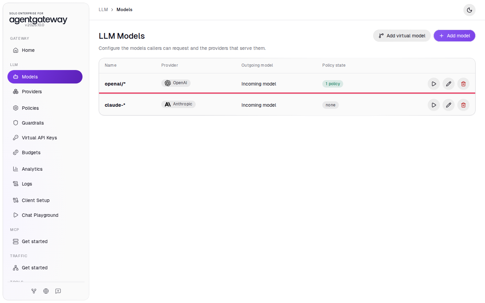
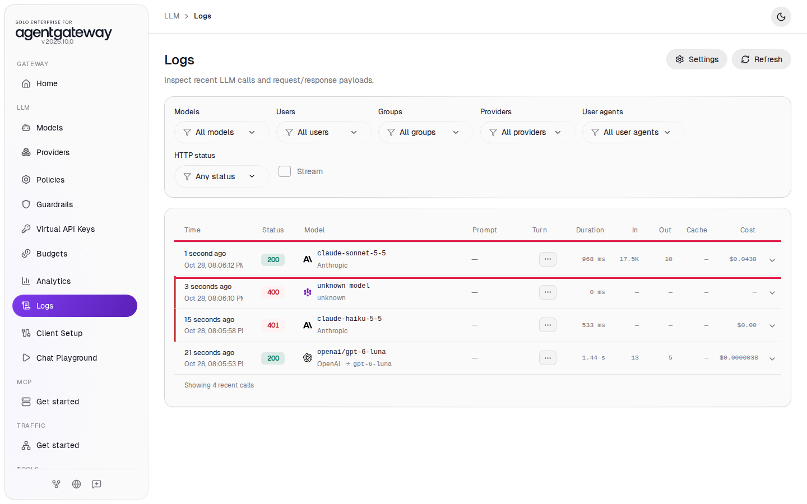

# Connect Coding Agents

## Before you start

- Complete [001: Set Up Standalone Agentgateway](../../001-set-up-standalone-agentgateway.md).
- For Codex: the [Codex CLI](https://github.com/openai/codex) on your machine.
- Optional, for Claude Code: [Claude Code](https://docs.claude.com/en/docs/claude-code/overview) on your machine, and your Anthropic API key in `setup/.env` as `ANTHROPIC_API_KEY`. After you add the key, restart the gateway so it reads the key: from the `setup/` folder, run `env UID=$(id -u) GID=$(id -g) docker compose up -d`. Skip the Claude Code steps if you have no Anthropic key.
- Optional, for Step 5: Claude Code and a Claude Pro, Max, Team or Enterprise subscription. Check that your plan's terms allow its use through your own gateway. Step 5 needs no Anthropic API key.

## What you'll do

- Get a Codex setup snippet from Client Setup and check the OpenAI Responses API through the gateway
- Optional: get a Claude Code setup snippet and check the Anthropic Messages API through the gateway
- Run Codex and Claude Code through the gateway
- Optional: run Claude Code on your own Claude subscription, with no API key on the gateway

## Why this matters

Coding agents send a lot of LLM traffic. When they go through the gateway, the gateway holds the provider keys, and you see every request, its tokens and its cost in Logs and Analytics. Developers use a placeholder key on their machines. The gateway speaks each agent's own API: Codex uses the OpenAI Responses API (`/v1/responses`), and Claude Code uses the Anthropic Messages API (`/v1/messages`).

## Set up

Codex uses the `openai/*` model, and Claude Code uses the `anthropic/*` model. [Connect LLM Providers](connect-llm-providers.md) and [Connect Anthropic](connect-anthropic.md) explain these steps.

Add the OpenAI model:

1. In the sidebar, click **Models**.
2. Click **Add model**.

   

3. In **Provider**, select **OpenAI**. The UI fills **Incoming model match** with `openai/*`.
4. Next to **Provider API key**, click **Env var** and enter `OPENAI_API_KEY`.
5. Under **Outgoing model**, click **Strip openai/**.
6. Click **Save model**.

   

The **Models** page lists `openai/*`.

Optional, for Claude Code: add the Anthropic provider and model:

1. In the sidebar, click **Providers**.
2. Click **Add provider**.
3. In **Provider name**, enter `anthropic`.
4. In **Provider**, select **Anthropic**.
5. Next to **Provider API key**, click **Env var** and enter `ANTHROPIC_API_KEY`.
6. Click **Save provider**.

   

7. In the sidebar, click **Models**.
8. Click **Add model**.
9. In **Provider**, select **anthropic** (marked **configured**). The UI fills **Incoming model match** with `anthropic/*`.
10. Under **Outgoing model**, click **Strip anthropic/**.
11. Click **Save model**.

    

The **Models** page lists `openai/*` and `anthropic/*`.

## Step 1: Get the Codex snippet

1. In the sidebar, click **Client Setup**.
2. In **Specific model**, enter `gpt-6-luna`.
3. In **Integration**, select **Codex CLI**.

   

4. Click **Copy**.

   

The snippet is:

```bash
export OPENAI_API_KEY="dummy_key"
# If Codex has an existing login it can impact functionality. Better if it's logged out.
# If you don't want to override your Codex configuration, you can set up a new dedicated configuration file.
export CODEX_HOME=/tmp/codex-gateway-home && mkdir -p $CODEX_HOME # optional
codex login --with-api-key <<<"$OPENAI_API_KEY"

codex --model "openai/gpt-6-luna" \
  -c 'model_provider="gateway"' \
  -c 'model_providers.gateway.name="Local gateway"' \
  -c 'model_providers.gateway.base_url="http://localhost:4000/v1"'
```

`dummy_key` is a placeholder. The gateway replaces it with the real OpenAI key from `setup/.env`. The `-c` options add a model provider named `gateway` that points Codex at `http://localhost:4000/v1`. Keep the `CODEX_HOME` line: it gives this Codex session its own settings folder, so the `codex login` with the placeholder key does not replace your usual Codex login.

You can pick any OpenAI model your key can use in **Specific model**. The snippet changes to match.

## Check the Responses API

Codex sends its requests in the OpenAI Responses format. Check that the gateway answers in that format:

```bash
curl -s http://localhost:4000/v1/responses \
  -H 'Content-Type: application/json' \
  -d '{"model":"openai/gpt-6-luna","input":"Reply with the single word: ready"}'
```

Expected output:

```
{"id":"resp_...","status":"completed","output":[{"type":"message","content":[{"type":"output_text",...,"text":"Ready"}],...}],"model":"gpt-6-luna",...,"object":"response",...}
```

## Step 2: Run Codex through the gateway

The workshop's automated check does not cover this step. It checks only the Responses API call above.

Paste the snippet from Step 1 into a terminal. You should see Codex start with `openai/gpt-6-luna`. Give it a task, for example `Reply with exactly: hello from agentgateway`.

To check that the request went through the gateway, in the sidebar, click **Logs**. You should see `openai/gpt-6-luna` rows for the Codex requests.

## Step 3 (optional): Get the Claude Code snippet

1. In the sidebar, click **Client Setup**.
2. In **Model**, select **anthropic/\***.
3. In **Specific model**, enter `claude-haiku-5-5`.
4. In **Integration**, select **Claude Code**.
5. Click **Copy**.

   

The snippet is:

```bash
export ANTHROPIC_AUTH_TOKEN="dummy_key"
export ANTHROPIC_BASE_URL="http://localhost:4000"

claude --model "anthropic/claude-haiku-5-5"
```

`ANTHROPIC_BASE_URL` sends Claude Code to the gateway instead of to Anthropic. `dummy_key` is a placeholder; the gateway uses the key from the `anthropic` provider. Claude Code sends the model name as written, and the gateway strips the `anthropic/` prefix before it calls Anthropic.

## Check the Messages API (optional)

Claude Code sends its requests in the Anthropic Messages format. Check that the gateway answers in that format:

```bash
curl -s http://localhost:4000/v1/messages \
  -H 'Content-Type: application/json' \
  -H 'anthropic-version: 2023-06-01' \
  -d '{"model":"anthropic/claude-haiku-5-5","max_tokens":1024,"messages":[{"role":"user","content":"Reply with the single word: ready"}]}'
```

Expected output:

```
{"id":"msg_...","type":"message","role":"assistant","model":"claude-haiku-5-5",...,"content":[{"text":"ready","type":"text"}],...}
```

## Step 4 (optional): Run Claude Code through the gateway

The workshop's automated check does not cover this step. It checks only the Messages API call above.

Paste the snippet from Step 3 into a terminal. You should see Claude Code start with `anthropic/claude-haiku-5-5`. The gateway serves only the models you added, so start Claude Code with `--model` as the snippet does.

In the sidebar, click **Logs**. You should see `anthropic/claude-haiku-5-5` rows for the Claude Code requests. A row named `unknown model` with status `400` is Claude Code's connection check (`HEAD /api/hello`); you can ignore it.

## Step 5 (optional): Use a Claude subscription instead of an API key

In Steps 3 and 4 the gateway sends its own Anthropic API key, and the company pays per token. Developers who already pay for a Claude plan can use that plan instead. The gateway then holds no Anthropic key: it forwards the token each developer sends, and Anthropic checks it. You still see every request in Logs.

The gateway cannot read who the developer is from a subscription token. To know the user, and to allow or block them by group, see [Sign In Coding Agents with Your Identity Provider Using agentdesktop](connect-coding-agents-sso-using-agentdesktop.md).

### Add a Claude model with no provider key

1. In the sidebar, click **Models**.
2. Click **Add model**.
3. In **Provider**, select **Anthropic**.
4. In **Incoming model match**, select all the text and enter `claude-*`.
5. Leave **Provider API key** at **Unset**.
6. Under **Outgoing model**, click **Incoming model**.
7. Click **Save model**.

   

The **Models** page lists `claude-*`:



`claude-*` matches the model names Claude Code sends, such as `claude-haiku-5-5`, and the gateway passes each name to Anthropic as it is. With no provider key, the gateway forwards the credential from the request.

Check that a request without a credential fails:

```bash
curl -s http://localhost:4000/v1/messages \
  -H 'Content-Type: application/json' \
  -H 'anthropic-version: 2023-06-01' \
  -d '{"model":"claude-haiku-5-5","max_tokens":50,"messages":[{"role":"user","content":"Reply with the single word: ready"}]}'
```

Expected output:

```
{"type":"error","error":{"type":"authentication_error","message":"x-api-key header is required"},"request_id":"req_..."}
```

Anthropic sent this error. The gateway forwarded the request with no credential, because the request had none.

### Create a Claude Code token

Run:

```bash
claude setup-token
```

Claude Code opens your browser. Sign in to Claude and approve the request. The terminal then prints a token that starts with `sk-ant-oat01-` and is valid for one year. Export it in the terminal you use next:

```bash
export CLAUDE_CODE_OAUTH_TOKEN=sk-ant-oat01-...
```

Treat the token as a password. Anyone who has it can use your subscription.

### Run Claude Code on your subscription

If you ran Step 4 in this terminal, first run `unset ANTHROPIC_AUTH_TOKEN`, so Claude Code sends your subscription token instead of `dummy_key`. Then run:

```bash
export ANTHROPIC_BASE_URL=http://localhost:4000
claude -p "Reply with exactly: hello from agentgateway"
```

Expected output:

```
hello from agentgateway
```

In the sidebar, click **Logs**. You should see a `claude-` row with status `200` for each Claude Code request, with its input and output tokens:



The `claude-haiku-5-5` row with status `401` is the curl command above, and the `unknown model` row with status `400` is Claude Code's connection check. **Cost** in Logs and Analytics shows what the request would cost at Anthropic's API prices. Your subscription pays for it under your plan's limits.

## What the UI wrote

Client Setup only builds snippets. The only changes to `config.yaml` are the models and the provider from **Set up**. [Connect Anthropic](connect-anthropic.md) shows the YAML for the `anthropic` provider and model.

If you did Step 5, the UI also added this model. `params` has no `apiKey`, so the gateway forwards the credential from each request:

```yaml
llm:
  models:
  - name: claude-*
    provider: anthropic
    params: {}
```

## Clean up

1. Close Codex and Claude Code. If you used the `CODEX_HOME` line, delete that folder: `rm -rf /tmp/codex-gateway-home`. If you did Step 5, run `unset CLAUDE_CODE_OAUTH_TOKEN ANTHROPIC_BASE_URL`.
2. In the sidebar, click **Models**. If you did Step 5, in the `claude-*` row, click the trash icon, then click **Delete model**.
3. If you did the Claude Code steps, in the `anthropic/*` row, click **Delete model**, then click **Delete model** in the dialog.
4. In the `openai/*` row, click the trash icon, then click **Delete model**.
5. If you did the Claude Code steps, in the sidebar, click **Providers**. In the `anthropic` row, click **Delete provider**, then click **Delete provider** in the dialog.

The gateway is back to the state [001](../../001-set-up-standalone-agentgateway.md) left it in.
