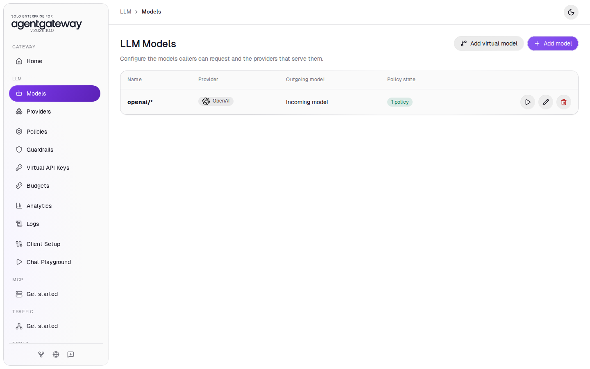
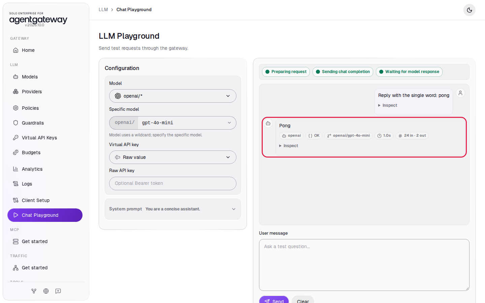
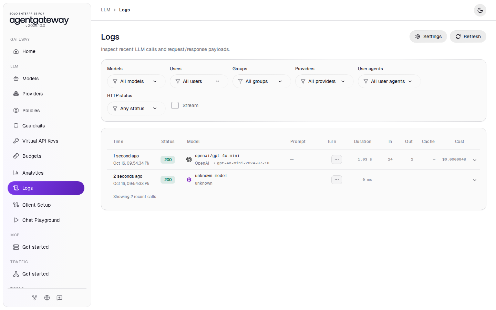
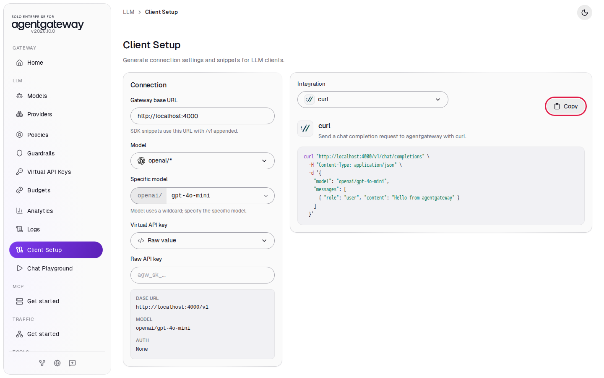

# Connect LLM Providers

## Before you start

- Complete [001: Set Up Standalone Agentgateway](../../001-set-up-standalone-agentgateway.md).
- Your `OPENAI_API_KEY` is in `setup/.env`.

Every other LLM lab, and the MCP track, starts from the state this lab leaves behind. This lab has no cleanup section.

## What you'll do

- Add an OpenAI model to the gateway
- Send a prompt from the Chat Playground
- Find the request in Logs
- Copy a ready-made curl command from Client Setup

## Why this matters

Applications send LLM requests to the gateway on port `4000`, in OpenAI format. The gateway adds the provider credential, forwards the request, and records tokens and cost. Your applications never hold the OpenAI key.

## Step 1: Add the OpenAI model

1. In the sidebar, click **Models**.
2. Click **Add model**.

   

3. In **Provider**, select **OpenAI**. The UI fills **Incoming model match** with `openai/*`.
4. Next to **Provider API key**, click **Env var** and enter `OPENAI_API_KEY`.
5. Under **Outgoing model**, click **Strip openai/**.
6. Click **Save model**.

   

The `openai/*` model matches any model name that starts with `openai/`, for example `openai/gpt-4o-mini`. **Strip openai/** removes the prefix before the gateway calls OpenAI, so OpenAI receives `gpt-4o-mini`. **Env var** tells the gateway to read the key from the `OPENAI_API_KEY` environment variable, which Docker Compose loads from `setup/.env`.

The model now appears in the list:



## Step 2: Chat through the gateway

1. In the sidebar, click **Chat Playground**.
2. In **Model**, select **openai/\***.
3. In **Specific model**, enter `gpt-4o-mini`.
4. In **User message**, enter `Reply with the single word: pong` and click **Send**.

The reply appears with the provider, the status **OK**, the model and the token counts:



## Check it

1. In the sidebar, click **Logs**.
2. Find the row for `openai/gpt-4o-mini` with status `200`. The row shows the upstream model OpenAI used, the duration, the input and output tokens, and the cost.



You may also see a row named `unknown model`. That is the browser's preflight check from the Chat Playground; you can ignore it.

## Step 3: Get a curl command from Client Setup

1. In the sidebar, click **Client Setup**.
2. In **Specific model**, enter `gpt-4o-mini`.
3. Click **Copy** to copy the curl command.



Client Setup also has snippets for the OpenAI SDKs and other clients. Pick one in **Integration**.

<details>
<summary>Optional: check with curl</summary>

Paste the command into a terminal:

```bash
curl "http://localhost:4000/v1/chat/completions" \
  -H "Content-Type: application/json" \
  -d '{
    "model": "openai/gpt-4o-mini",
    "messages": [
      { "role": "user", "content": "Hello from agentgateway" }
    ]
  }'
```

Expected output:

```
{"id":"chatcmpl-...","object":"chat.completion","model":"gpt-4o-mini-2024-07-18","choices":[{"index":0,"message":{"role":"assistant","content":"Hello! How can I assist you today?",...}}],"usage":{"prompt_tokens":11,"completion_tokens":9,...}}
```

</details>

## What the UI wrote

In the sidebar, scroll down to **Tools** and click **Raw Configuration**. The UI added this to the `llm` section:

```yaml
llm:
  models:
    - name: openai/*
      provider: openai
      params:
        apiKey: $OPENAI_API_KEY
      transformation:
        model: llmRequest.model.stripPrefix("openai/")
```

## Next

- Pick any lab in the LLM track. Each one starts from the state you have now and returns to it in its cleanup.
- MCP track: [Connect a Remote MCP Server](../mcp/connect-remote-mcp-server.md)
