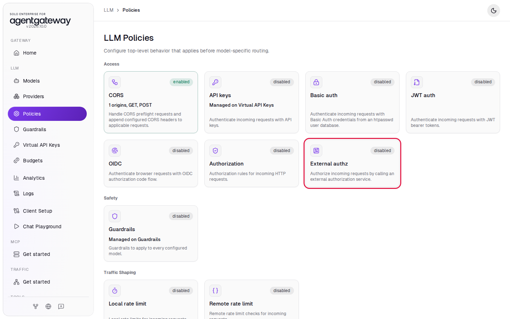
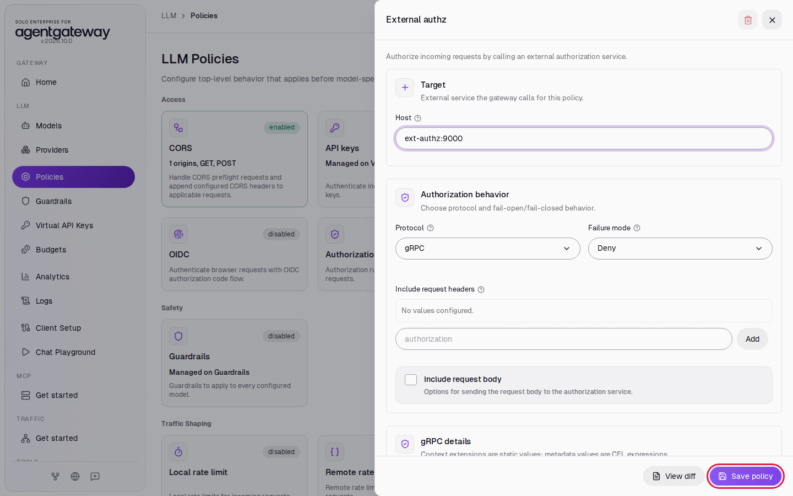
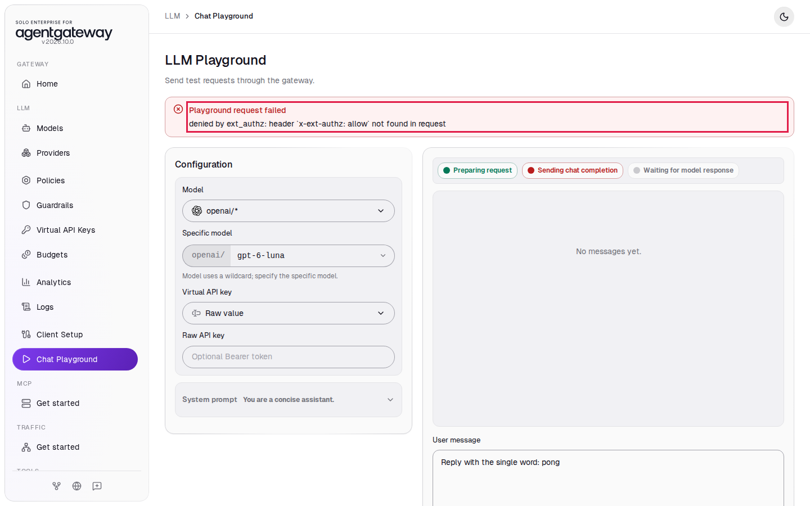
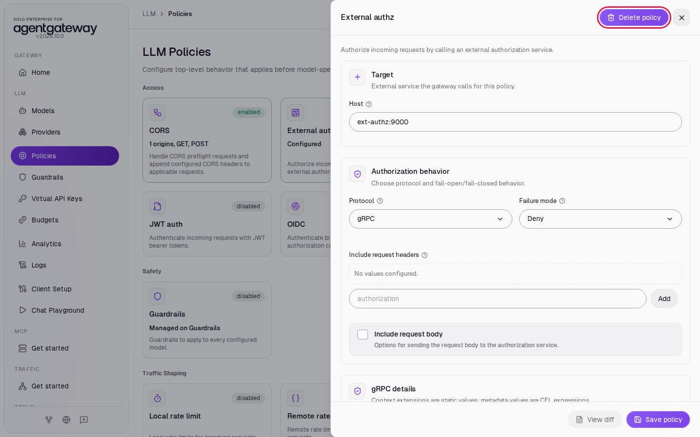

# Let Your Own Service Approve Each Request

## Before you start

- Complete [Connect LLM Providers](../llm/connect-llm-providers.md). The gateway has the `openai/*` model.
- Start the workshop's authorization service. From the `setup/` folder, run:

  ```bash
  env UID=$(id -u) GID=$(id -g) docker compose --profile ext-authz up -d
  ```

  This starts the `ext-authz` container next to the gateway. It listens for gRPC on port `9000`.

## What you'll do

- Point the gateway at an external authorization service
- See a request from the Chat Playground denied
- Send a request with the header the service expects, and see it allowed

## Why this matters

Some access rules live outside the gateway: an entitlement system, a license check, a per-customer allow list. External authorization lets the gateway ask your own service about every request before it calls the LLM. The service answers allow or deny, and the gateway enforces the answer.

The service in this lab is a small example. It allows a request only when the request has the header `x-ext-authz: allow`. Your real service can check anything in the request: headers, tokens, the path, or the body.

## Step 1: Add the External authz policy

1. In the sidebar, click **Policies**.
2. Click the **External authz** card.

   

3. In **Host**, replace `127.0.0.1:9000` with `ext-authz:9000`.
4. Leave **Protocol** as **gRPC** and **Failure mode** as **Deny**.
5. Click **Save policy**.

   

`ext-authz` is the name of the service container. Docker Compose puts the gateway and the service on the same network, so the gateway reaches the service by that name. **Failure mode** **Deny** means that the gateway rejects requests when it cannot reach the service.

## Step 2: Send a request from the Chat Playground

1. In the sidebar, click **Chat Playground**.
2. In **Model**, select **openai/\***.
3. In **Specific model**, enter `gpt-6-luna`.
4. In **User message**, enter `Reply with the single word: pong` and click **Send**.

The playground does not send the `x-ext-authz` header, so the service denies the request. The playground shows **Playground request failed** with the service's reason:



If you see a reply instead, the gateway has not loaded the policy yet. Wait two seconds and click **Send** again.

## Check it

The Chat Playground cannot add custom headers, so use curl to send a request with the header.

1. Send a request without the header:

   ```bash
   curl -si http://localhost:4000/v1/chat/completions \
     -H "Content-Type: application/json" \
     -d '{"model":"openai/gpt-6-luna","messages":[{"role":"user","content":"Reply with the single word: pong"}]}'
   ```

   Expected output:

   ```
   HTTP/1.1 403 Forbidden
   x-ext-authz-check-result: denied
   ...

   denied by ext_authz: header `x-ext-authz: allow` not found in request
   ```

   The service wrote this whole response, including the `x-ext-authz-check-result` header. The gateway returned it to you and did not call OpenAI.

2. Send the same request with the header `x-ext-authz: allow`:

   ```bash
   curl -si http://localhost:4000/v1/chat/completions \
     -H "Content-Type: application/json" \
     -H "x-ext-authz: allow" \
     -d '{"model":"openai/gpt-6-luna","messages":[{"role":"user","content":"Reply with the single word: pong"}]}'
   ```

   Expected output:

   ```
   HTTP/1.1 200 OK
   content-type: application/json
   ...

   {"model":"gpt-6-luna",...,"choices":[{"index":0,"message":{"role":"assistant","content":"Pong"},...}],...}
   ```

   The service allowed the request, so the gateway sent it on to OpenAI.

## What the UI wrote

In the sidebar, scroll down to **Tools** and click **Raw Configuration**. The UI added an `extAuthz` policy to the `llm` section:

```yaml
llm:
  policies:
    extAuthz:
      host: ext-authz:9000
      failureMode: deny
      protocol:
        grpc:
          context: {}
          metadata: {}
```

## Clean up

1. In the sidebar, click **Policies**.
2. Click the **External authz** card.
3. Click **Delete policy** (the trash icon at the top of the panel).

   

4. Click **Delete policy** to confirm. The card shows **disabled**.
5. From the `setup/` folder, stop the authorization service:

   ```bash
   docker compose --profile ext-authz stop ext-authz
   ```
