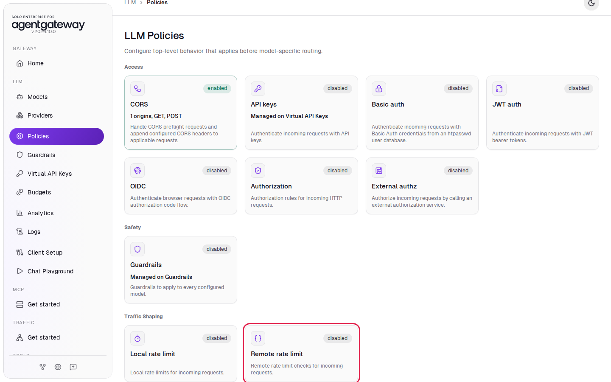
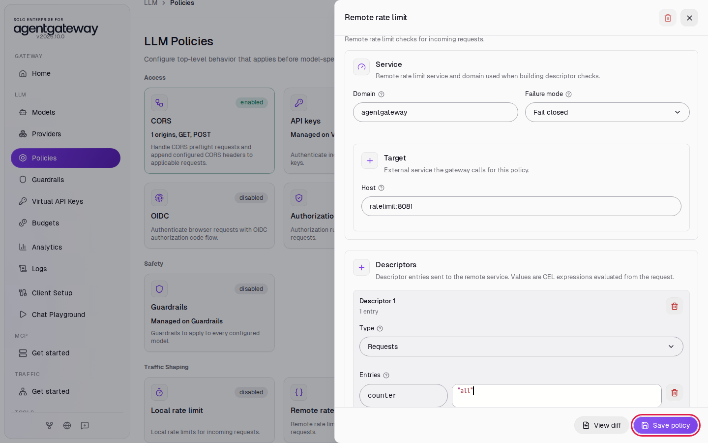
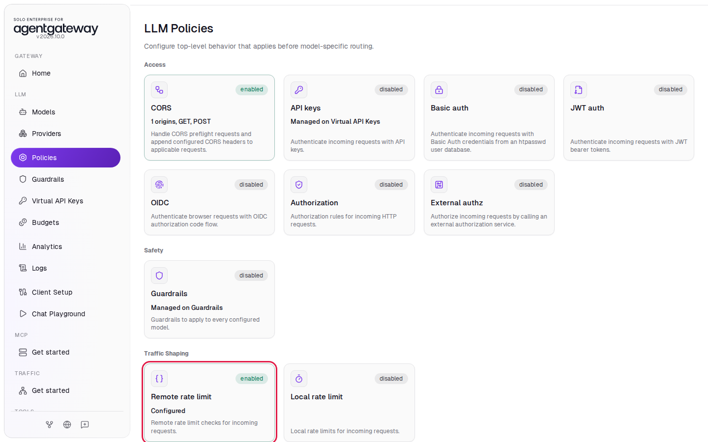
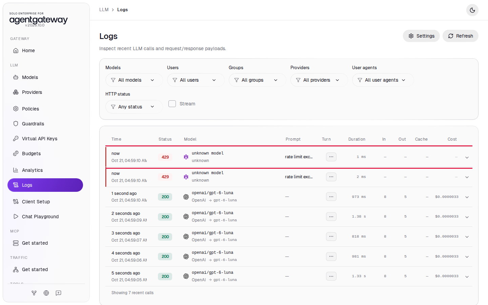
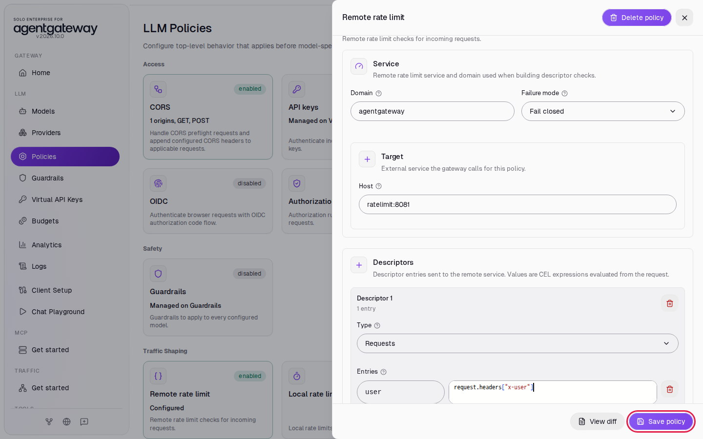
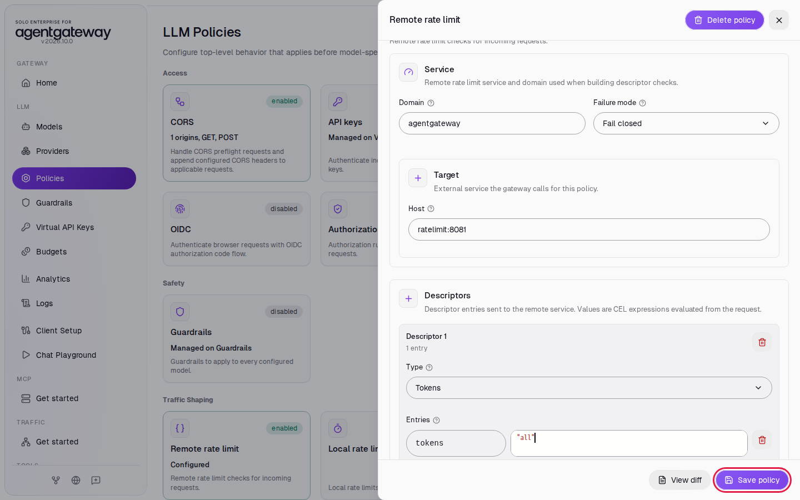

# Share a Rate Limit Across Gateways with a Rate Limit Service

## Before you start

- Complete [001: Set Up Standalone Agentgateway](../../001-set-up-standalone-agentgateway.md).
- Start the rate limit service and its Redis database. From the `setup/` folder, run:

  ```bash
  env UID=$(id -u) GID=$(id -g) docker compose --profile ratelimit up -d
  ```

  This starts two containers next to the gateway: `ratelimit` (the open source Envoy rate limit service, listening for gRPC on port `8081`) and `redis` (where it keeps the counts). The service reads its rules from `setup/ratelimit/config.yaml`.

## What you'll do

- Add a **Remote rate limit** policy that sends each request to the rate limit service
- Share one counter of 5 requests per minute, and see the sixth request get HTTP `429`
- Give each user their own counter with the `x-user` header
- Count tokens instead of requests
- Compare **Fail closed** with **Fail open** when the service is down

## Why this matters

The [local rate limit](local-rate-limiting.md) lives inside one gateway. Run two gateways, and each one has its own counter. A remote rate limit moves the counter into a separate service with a shared database, so every gateway that points at the service shares one limit. The same service can also keep a separate counter for each user, team or API key.

## How it works

For each request, the gateway builds a **descriptor**: one or more key and value pairs. It sends the descriptor to the rate limit service, and the service answers allow or deny. The value is a CEL expression, so it can read the request: a header, a JWT claim, the path. The service rules decide how many requests each descriptor gets. This workshop's rules are in `setup/ratelimit/config.yaml`:

```yaml
domain: agentgateway
descriptors:
  - key: counter
    value: all          # the descriptor counter=all: one shared counter
    rate_limit:
      unit: minute
      requests_per_unit: 5
  - key: user           # any value: one counter per user
    rate_limit:
      unit: minute
      requests_per_unit: 3
  - key: tokens
    value: all          # the descriptor tokens=all: one shared token counter
    rate_limit:
      unit: minute
      requests_per_unit: 60
```

The `domain` in the file must match **Domain** in the policy. Counts reset at the start of each minute.

## Set up

This lab uses the `openai/*` model. [Connect LLM Providers](connect-llm-providers.md) explains these steps.

1. In the sidebar, click **Models**.
2. Click **Add model**.

   

3. In **Provider**, select **OpenAI**. The UI fills **Incoming model match** with `openai/*`.
4. Next to **Provider API key**, click **Env var** and enter `OPENAI_API_KEY`.
5. Under **Outgoing model**, click **Strip openai/**.
6. Click **Save model**.

   

The **Models** page lists `openai/*`.

## Step 1: Add a shared request counter

1. In the sidebar, click **Policies**.
2. Under **Traffic Shaping**, click the **Remote rate limit** card. It shows **disabled**.

   

3. In **Domain**, enter `agentgateway`.
4. Leave **Failure mode** on **Fail closed**.
5. In **Host**, enter `ratelimit:8081`. This is the service name and port Docker Compose gives the `ratelimit` container.
6. Under **Descriptors**, leave **Type** on **Requests**.
7. Under **Entries**, in the first box, replace `user` with `counter`.
8. In the second box, select the text and replace it with `"all"` (with the quotes). The box is a CEL expression, and `"all"` is a fixed string.
9. Click **Save policy**.

   

The card shows **enabled**:



Every request now sends the descriptor `counter=all`, and the service allows 5 of them per minute.

## Step 2: Go over the limit

Wait two seconds for the gateway to reload. Then send six requests, one after the other:

```bash
for i in 1 2 3 4 5 6; do
  curl -s -o /dev/null -w "request $i: HTTP %{http_code}\n" http://localhost:4000/v1/chat/completions \
    -H "Content-Type: application/json" \
    -d '{"model":"openai/gpt-6-luna","messages":[{"role":"user","content":"Say hi"}],"max_tokens":5}'
done
```

Expected output:

```
request 1: HTTP 200
request 2: HTTP 200
request 3: HTTP 200
request 4: HTTP 200
request 5: HTTP 200
request 6: HTTP 429
```

If all six pass, the minute rolled over during the loop. Run it again.

## Check it

1. In the sidebar, click **Logs**.
2. The newest row has status `429` and the message **rate limit exceeded**. It shows `unknown model` and no tokens or cost, because the request never reached OpenAI. Below it are the five requests that went through.



## Step 3: Give each user a counter

1. In the sidebar, click **Policies**, then click the **Remote rate limit** card.
2. Under **Entries**, in the first box, replace `counter` with `user`.
3. In the second box, select the text and paste this expression:

   ```
   request.headers["x-user"]
   ```

   The editor adds closing quotes and brackets when you type, so paste instead of typing.
4. Click **Save policy**.

   

Each request now sends `user=<the x-user header>`, and the service keeps a counter of 3 requests per minute for each value. Wait two seconds, then send four requests as `alice`, then one as `bob`:

```bash
for user in alice alice alice alice bob; do
  curl -s -o /dev/null -w "$user: HTTP %{http_code}\n" http://localhost:4000/v1/chat/completions \
    -H "Content-Type: application/json" -H "x-user: $user" \
    -d '{"model":"openai/gpt-6-luna","messages":[{"role":"user","content":"Say hi"}],"max_tokens":5}'
done
```

Expected output:

```
alice: HTTP 200
alice: HTTP 200
alice: HTTP 200
alice: HTTP 429
bob: HTTP 200
```

Alice used her 3 requests. Bob has his own counter, so his request goes through.

A request without an `x-user` header sends no `user` value, and the service lets it through. Pair this policy with an authentication policy such as [JWT Auth](jwt-auth-and-authorization.md), and use a claim like `jwt.sub` instead of a header the caller can set.

## Step 4: Count tokens

1. In the sidebar, click **Policies**, then click the **Remote rate limit** card.
2. Under **Descriptors**, in **Type**, select **Tokens**. The description says it evaluates the descriptors after the LLM response completes.
3. Under **Entries**, in the first box, replace `user` with `tokens`.
4. In the second box, select the text and replace it with `"all"`.
5. Click **Save policy**.

   

The service allows 60 tokens per minute for `tokens=all`. Wait two seconds, then send ten requests:

```bash
for i in $(seq 1 10); do
  curl -s -o /dev/null -w "request $i: HTTP %{http_code}\n" http://localhost:4000/v1/chat/completions \
    -H "Content-Type: application/json" \
    -d '{"model":"openai/gpt-6-luna","messages":[{"role":"user","content":"Say hi"}],"max_tokens":5}'
done
```

Expected output:

```
request 1: HTTP 200
request 2: HTTP 200
request 3: HTTP 200
request 4: HTTP 200
request 5: HTTP 200
request 6: HTTP 429
...
request 10: HTTP 429
```

Each request uses 13 tokens (8 in and 5 out in **Logs**). The gateway reports the tokens after the response, so the fifth request takes the count to 65 and still goes through. The sixth is blocked. A token limit charges a long prompt more than a short one. A request limit charges both the same.

## Step 5: Compare Fail closed and Fail open

**Failure mode** sets what the gateway does when it cannot reach the rate limit service. Start with a simple counter again:

1. In the sidebar, click **Policies**, then click the **Remote rate limit** card.
2. In **Type**, select **Requests**.
3. Under **Entries**, replace `tokens` with `counter`, and set the second box to `"all"`.
4. Click **Save policy**.

Stop the rate limit service. From the `setup/` folder, run:

```bash
docker compose --profile ratelimit stop ratelimit
```

Send a request:

```bash
curl -s -w '\nHTTP %{http_code}\n' http://localhost:4000/v1/chat/completions \
  -H "Content-Type: application/json" \
  -d '{"model":"openai/gpt-6-luna","messages":[{"role":"user","content":"Say hi"}],"max_tokens":5}'
```

Expected output:

```
rate limit failed
HTTP 500
```

With **Fail closed**, the gateway denies every request while the service is down. Now allow requests instead:

1. In the sidebar, click **Policies**, then click the **Remote rate limit** card.
2. In **Failure mode**, select **Fail open**.
3. Click **Save policy**.

   

Wait two seconds and send the same request. It returns the model's reply with HTTP `200`. The gateway skips the limit while the service is down.

Choose **Fail closed** when the limit protects something you must not overspend, such as a provider budget. Choose **Fail open** when availability matters more than the limit.

Start the service again:

```bash
docker compose --profile ratelimit start ratelimit
```

## What the UI wrote

In the sidebar, scroll down to **Tools** and click **Raw Configuration**. The UI added `remoteRateLimit` to the `llm` section. After Step 1 it looks like this:

```yaml
llm:
  policies:
    remoteRateLimit:
      host: ratelimit:8081
      domain: agentgateway
      descriptors:
        - entries:
            - key: counter
              value: '"all"'
```

Step 4 adds `type: tokens` to the descriptor, and Step 5 adds `failureMode: failOpen` under `remoteRateLimit`.

## Clean up

1. In the sidebar, click **Policies**.
2. Click the **Remote rate limit** card.
3. In the top right of the panel, click the trash icon (**Delete policy**).
4. Click **Delete policy** to confirm. The card shows **disabled** again.
5. In the sidebar, click **Models**.
6. In the `openai/*` row, click the trash icon, then click **Delete model**.
7. From the `setup/` folder, stop the helpers:

   ```bash
   docker compose --profile ratelimit stop ratelimit redis
   ```

The gateway is back to the state [001](../../001-set-up-standalone-agentgateway.md) left it in.
