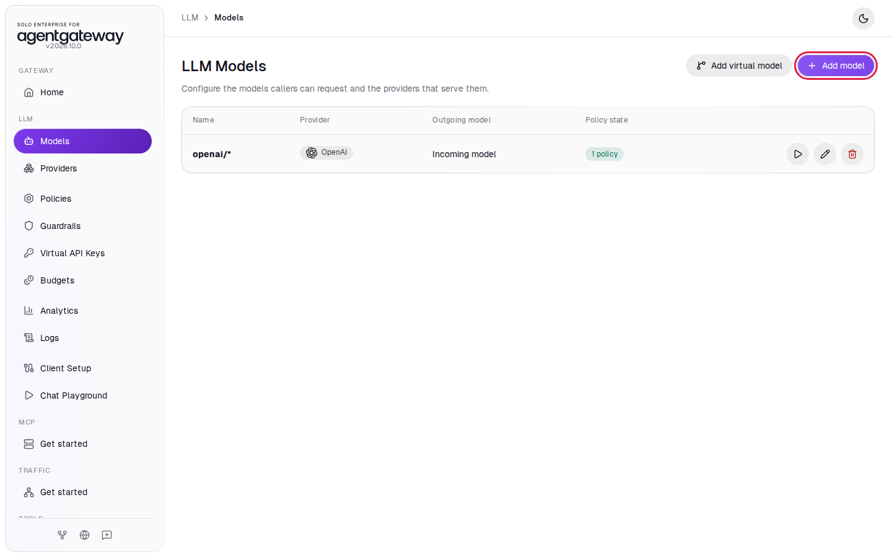
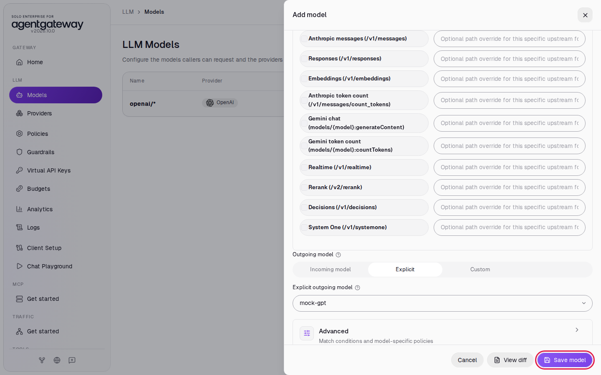
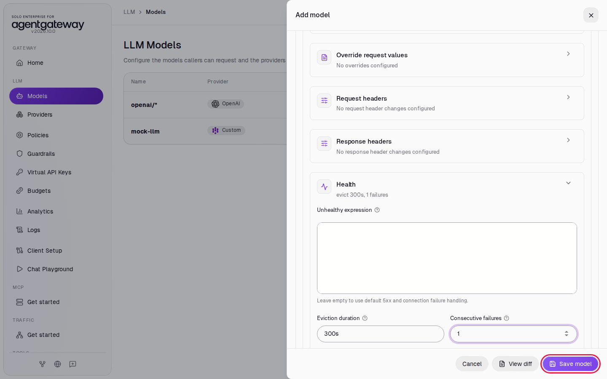
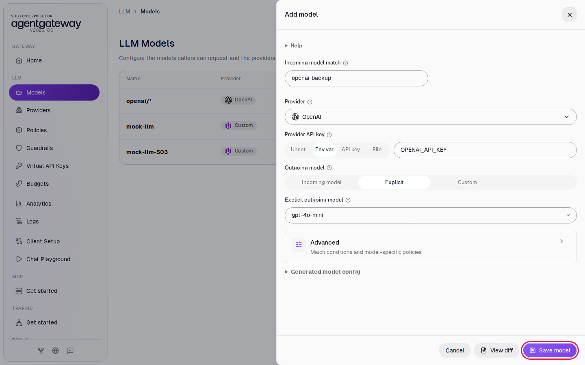
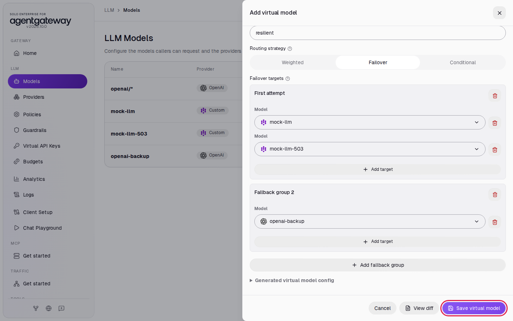
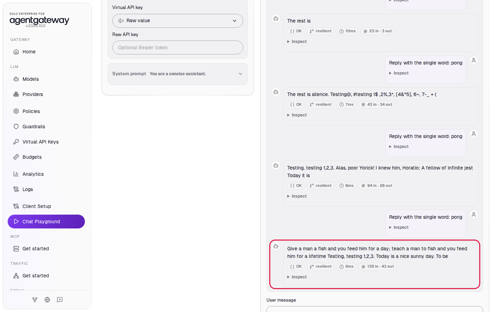
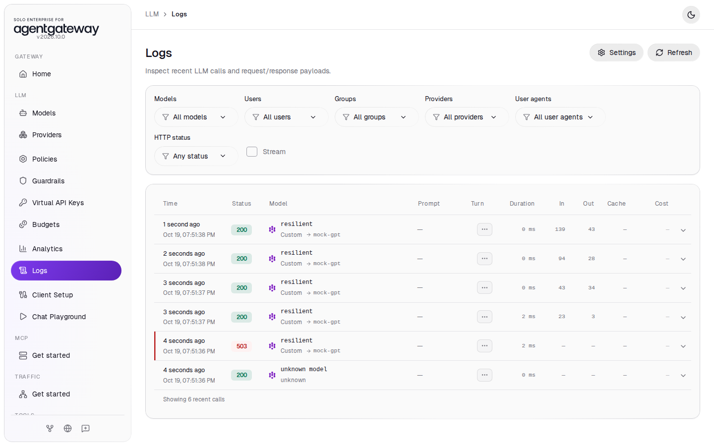
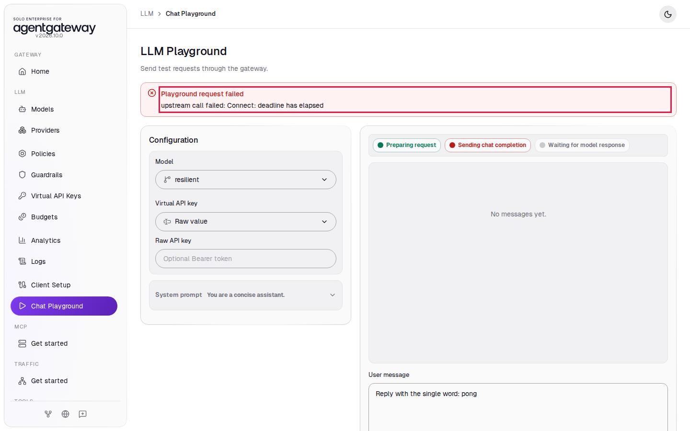
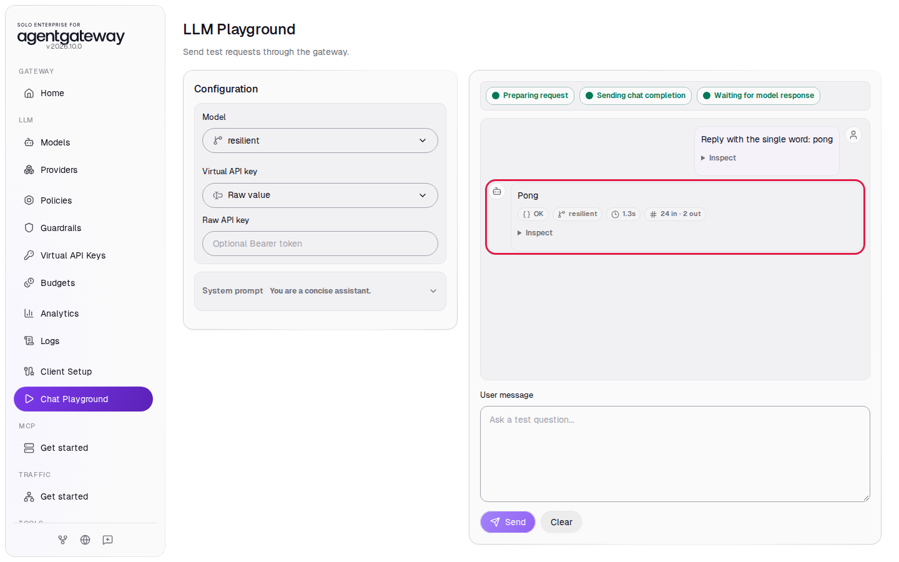
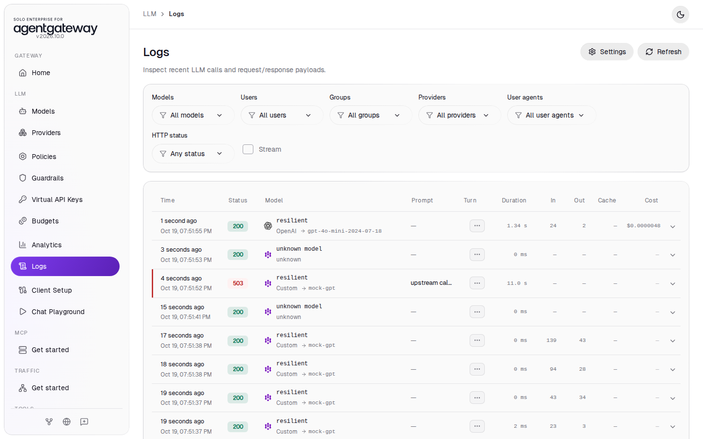

# Load Balance Models and Fail Over to a Backup

## Before you start

- Complete [Connect LLM Providers](../llm/connect-llm-providers.md). This lab uses your OpenAI key for the backup model.
- Do [Fail Over Between Models](model-failover.md) first if you are new to virtual models.
- Start the mock LLM servers that this lab uses. From the `setup/` folder, run:

  ```bash
  env UID=$(id -u) GID=$(id -g) docker compose --profile mock-llm --profile mock-llm-faults up -d mock-llm mock-llm-503
  ```

  This starts two mock LLM servers on the gateway's Docker network. `mock-llm` answers every chat request. `mock-llm-503` answers every request with `503 Service Unavailable`, like a provider that is down. Both serve a model named `mock-gpt` on port `8000` and cost nothing to call.

## What you'll do

- Put two models in the first group of a Failover virtual model, and OpenAI in a fallback group
- See the gateway take the failing model out of the first group and keep serving from the healthy one
- Stop the healthy model and see the gateway move to OpenAI
- Read in Logs which provider served each request

## Why this matters

In [Fail Over Between Models](model-failover.md), each group has one model, so one failure moves traffic to the next group. In production, you often run several equal backends: two regions of the same provider, or two copies of a self-hosted model. You put them in one group. The gateway spreads requests across the group, takes a failing backend out of rotation, and moves to the next group only when no model in the current group is healthy.

## Step 1: Add the healthy mock model

1. In the sidebar, click **Models**.
2. Click **Add model**.

   

3. In **Provider**, select **Custom**.
4. In **Incoming model match**, enter `mock-llm`.
5. In **Base URL**, enter `http://mock-llm:8000/v1`.
6. Under **Outgoing model**, click **Explicit**, enter `mock-gpt` in **Explicit outgoing model**, and click the **Add model** title to close the suggestion list.
7. Click **Save model**.

   

## Step 2: Add the failing mock model

1. Click **Add model**.
2. In **Provider**, select **Custom**.
3. In **Incoming model match**, enter `mock-llm-503`.
4. In **Base URL**, enter `http://mock-llm-503:8000/v1`.
5. Under **Outgoing model**, click **Explicit**, enter `mock-gpt` in **Explicit outgoing model**, and click the **Add model** title to close the suggestion list.
6. Click **Advanced** to open it, then click **Model policies**, then click **Health**.
7. Leave **Unhealthy expression** empty.
8. In **Eviction duration**, enter `300s`.
9. In **Consecutive failures**, enter `1`.
10. Click **Save model**.

    

With **Unhealthy expression** empty, the gateway uses its default: a `5xx` response or a failed connection marks the model unhealthy. With **Consecutive failures** at `1`, one `503` takes `mock-llm-503` out of rotation for 5 minutes. The long eviction keeps it out for the rest of the lab.

## Step 3: Add the OpenAI backup model

1. Click **Add model**.
2. In **Provider**, select **OpenAI**.
3. In **Incoming model match**, replace `openai/*` with `openai-backup`.
4. Next to **Provider API key**, click **Env var** and enter `OPENAI_API_KEY`.
5. Under **Outgoing model**, click **Explicit**, enter `gpt-4o-mini` in **Explicit outgoing model**, and click the **Add model** title to close the suggestion list.
6. Click **Save model**.

   

The virtual model needs a model that always sends `gpt-4o-mini` to OpenAI. The `openai/*` model sends whatever model name the caller used, which here would be the virtual model's name.

## Step 4: Add the virtual model

1. Click **Add virtual model**.
2. In **Virtual model name**, enter `resilient`.
3. Under **Routing strategy**, click **Failover**.
4. Under **First attempt**, in **Model**, select **mock-llm**.
5. Under **First attempt**, click **Add target**. In the new **Model** list, select **mock-llm-503**.
6. Click **Add fallback group**.
7. Under **Fallback group 2**, in **Model**, select **openai-backup**.
8. Click **Save virtual model**.

   

The first group has two models. The gateway picks between them for each request and prefers the healthier one. It moves to **Fallback group 2** only when every model in the first group is out of rotation.

## Check it: the first group serves the requests

1. Wait two seconds, then in the sidebar click **Chat Playground**.
2. In **Model**, select **resilient**.
3. In **User message**, enter `Reply with the single word: pong` and click **Send**.
4. Click **Send** four more times. After a failed request, your message stays in **User message**, so you can click **Send** again.

One of the first requests may fail with **Playground request failed** and a `503`: the gateway sent it to `mock-llm-503`, and the health policy took that model out of rotation. The other requests get the mock's placeholder text from `mock-llm`.



5. In the sidebar, click **Logs**.

Every `resilient` row shows the provider **Custom** and the model `mock-gpt`. The gateway stayed in the first group, because `mock-llm` stayed healthy. No request went to OpenAI.



You may also see rows named `unknown model`. Those are the browser's preflight checks from the Chat Playground; you can ignore them.

## Step 5: Take down the first group

1. Stop the healthy mock. From the `setup/` folder, run:

   ```bash
   docker compose --profile mock-llm stop mock-llm
   ```

2. In the sidebar, click **Chat Playground**.
3. In **Model**, select **resilient**.
4. In **User message**, enter `Reply with the single word: pong` and click **Send**.

After about 10 seconds, the playground shows **Playground request failed** with `upstream call failed: Connect: deadline has elapsed`. The gateway could not connect to `mock-llm`, and the default health check took it out of rotation. Now both models in the first group are out.



5. Click **Send** again.

The reply is `Pong`, from OpenAI.



6. In the sidebar, click **Logs**.

The newest `resilient` row shows the provider **OpenAI** and the model `gpt-4o-mini-2024-07-18`. Further down, a `503` row with a duration of about 11 seconds is the request that tried `mock-llm`.



The gateway tracks health per model. A request fails only while the gateway finds out that a model is down. After that, requests go to the first group that still has a healthy model.

## What the UI wrote

In the sidebar, scroll down to **Tools** and click **Raw Configuration**. The UI added three models and a `virtualModels` section to `llm`:

```yaml
llm:
  models:
    ...
    - name: mock-llm
      provider:
        custom:
          formats:
            - type: completions
      params:
        model: mock-gpt
        baseUrl: http://mock-llm:8000/v1
    - name: mock-llm-503
      provider:
        custom:
          formats:
            - type: completions
      params:
        model: mock-gpt
        baseUrl: http://mock-llm-503:8000/v1
      health:
        eviction:
          duration: 300s
          consecutiveFailures: 1
    - name: openai-backup
      provider: openai
      params:
        model: gpt-4o-mini
        apiKey: $OPENAI_API_KEY
  virtualModels:
    - name: resilient
      routing:
        failover:
          targets:
            - model: mock-llm
              priority: 0
            - model: mock-llm-503
              priority: 0
            - model: openai-backup
              priority: 1
```

Targets with the same `priority` form one group. Lower `priority` values are tried first.

## Clean up

1. In the sidebar, click **Models**.
2. In the `resilient` row, click the trash icon, then click **Delete virtual model**.
3. In the `mock-llm`, `mock-llm-503` and `openai-backup` rows, click the trash icon, then click **Delete model**.
4. Stop the mock servers. From the `setup/` folder, run:

   ```bash
   docker compose --profile mock-llm --profile mock-llm-faults stop mock-llm mock-llm-503
   ```

The gateway is back to the state [Connect LLM Providers](../llm/connect-llm-providers.md) left it in.
