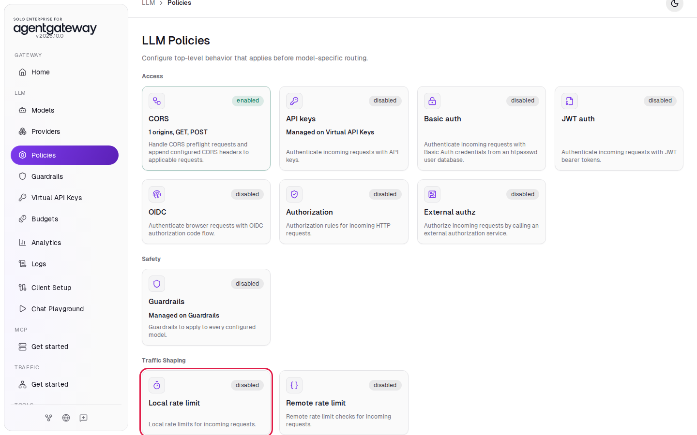
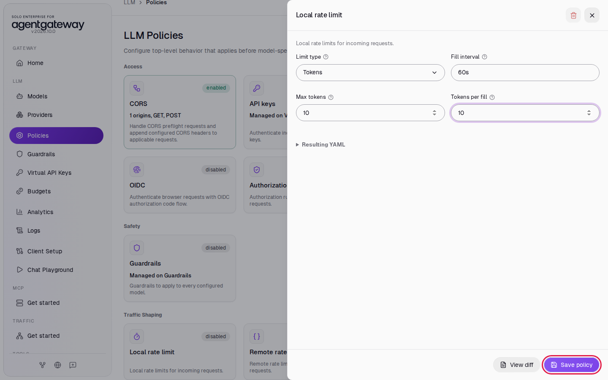
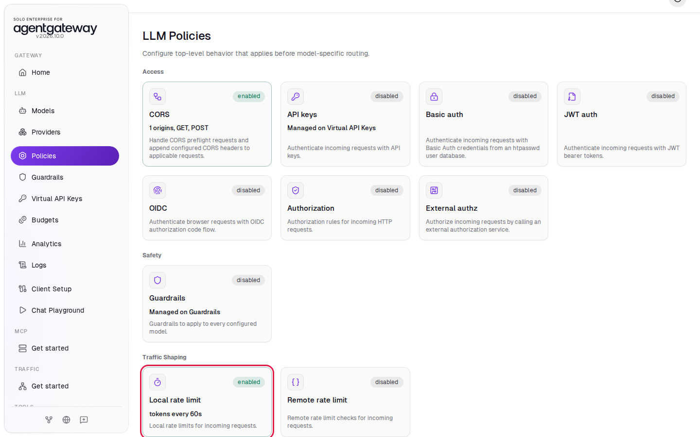
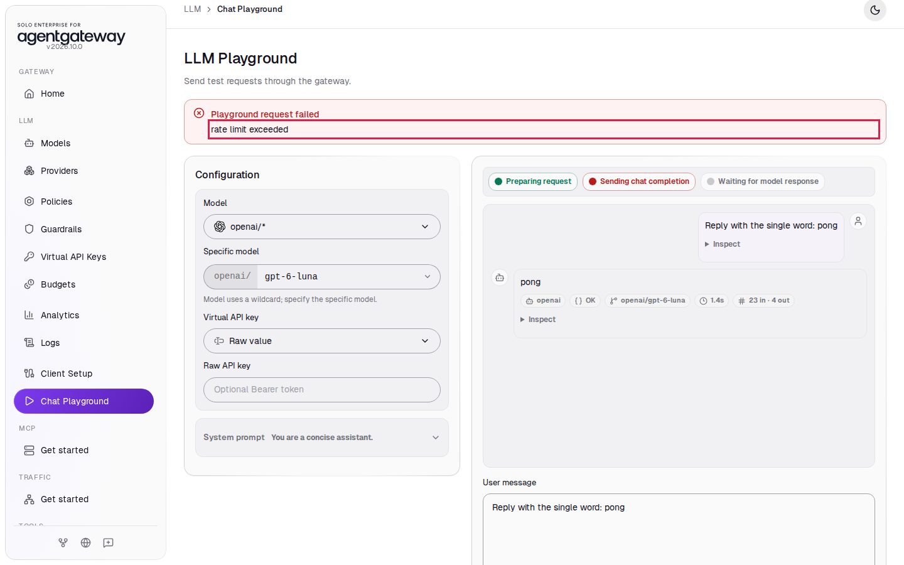
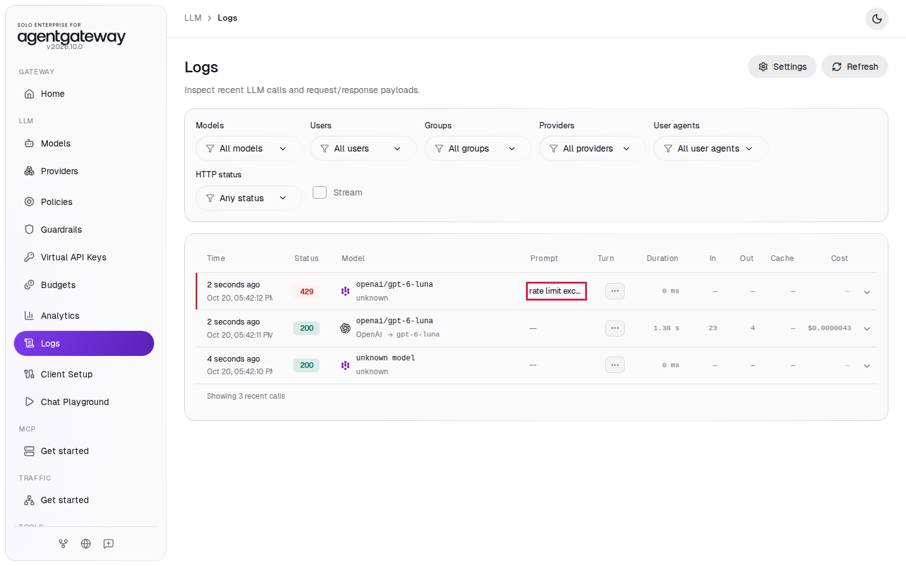

# Limit LLM Tokens with a Local Rate Limit

## Before you start

- Complete [001: Set Up Standalone Agentgateway](../../001-set-up-standalone-agentgateway.md).

## What you'll do

- Add a local rate limit that allows 10 tokens per minute
- Send one request that passes and one that gets HTTP `429`
- Find the blocked request in Logs

## Why this matters

LLM providers charge per token, and one busy client can use up your provider quota for everyone. A token-based rate limit caps how many tokens pass through the gateway in a time period. The gateway enforces a local rate limit by itself, with no extra service, so it is a simple first line of defense.

## Set up

This lab uses the `openai/*` model. [Connect LLM Providers](connect-llm-providers.md) explains these steps.

1. In the sidebar, click **Models**.
2. Click **Add model**.

   

3. In **Provider**, select **OpenAI**. The UI fills **Incoming model match** with `openai/*`.
4. Next to **Provider API key**, click **Env var** and enter `OPENAI_API_KEY`.
5. Under **Outgoing model**, click **Strip openai/**.
6. Click **Save model**.

   

The **Models** page lists `openai/*`.

## Step 1: Add the rate limit

1. In the sidebar, click **Policies**.
2. Under **Traffic Shaping**, click the **Local rate limit** card. It shows **disabled**.

   

3. In **Limit type**, select **Tokens**.
4. Leave **Fill interval** on `60s`.
5. In **Max tokens**, enter `10`.
6. In **Tokens per fill**, enter `10`.
7. Click **Save policy**.

   

The limit works like a bucket. The bucket holds at most 10 tokens (**Max tokens**), and the gateway adds 10 tokens to it every 60 seconds (**Tokens per fill** and **Fill interval**). LLM requests take tokens out of the bucket. When the bucket is empty, the gateway answers HTTP `429` without calling OpenAI.

The card now shows **enabled** and **tokens every 60s**:



To limit the number of requests instead of tokens, select **Requests** in **Limit type**.

## Step 2: Go over the limit

1. In the sidebar, click **Chat Playground**.
2. In **Model**, select **openai/\***.
3. In **Specific model**, enter `gpt-6-luna`.
4. In **User message**, enter `Reply with the single word: pong` and click **Send**. The reply comes back with the status **OK**.
5. In **User message**, enter `Reply with the single word: pong` again and click **Send**.

The second request is blocked. A red box shows **Playground request failed** with `rate limit exceeded`:



The first request started with a full bucket, so it went through. It used about 26 tokens, more than the 10 in the bucket, so the bucket is now empty. Requests are blocked until the bucket refills.

## Check it

1. In the sidebar, click **Logs**.
2. The newest row has status `429` and the message **rate limit exceeded**. It has no tokens and no cost, because the request never reached OpenAI. Below it is the first request, with status `200`.

You may also see a row named `unknown model`. That is the browser's preflight check from the Chat Playground; you can ignore it.



<details>
<summary>Optional: check with curl</summary>

Within a minute of Step 2:

```bash
curl -s -w '\n%{http_code}\n' http://localhost:4000/v1/chat/completions \
  -H "Content-Type: application/json" \
  -d '{"model":"openai/gpt-6-luna","messages":[{"role":"user","content":"Hello from agentgateway"}]}'
```

Expected output:

```
rate limit exceeded
429
```

</details>

## Local or remote rate limits

Each gateway keeps its own local counter. If you run two gateways, each one allows 10 tokens per minute. To share one limit across gateways, the **Remote rate limit** policy asks a separate rate limit service, which this workshop does not cover. For a token or dollar limit over a longer period, see [Track LLM Cost and Enforce a Budget](budgets-and-cost-tracking.md).

## What the UI wrote

In the sidebar, scroll down to **Tools** and click **Raw Configuration**. The UI added a `localRateLimit` policy to the `llm` section:

```yaml
llm:
  policies:
    localRateLimit:
      - type: tokens
        fillInterval: 60s
        maxTokens: 10
        tokensPerFill: 10
```

## Clean up

1. In the sidebar, click **Policies**.
2. Click the **Local rate limit** card.
3. In the top right of the panel, click the trash icon (**Delete policy**).
4. Click **Delete policy** to confirm. The **Local rate limit** card shows **disabled** again.
5. In the sidebar, click **Models**.
6. In the `openai/*` row, click the trash icon, then click **Delete model**.

The gateway is back to the state [001](../../001-set-up-standalone-agentgateway.md) left it in.
