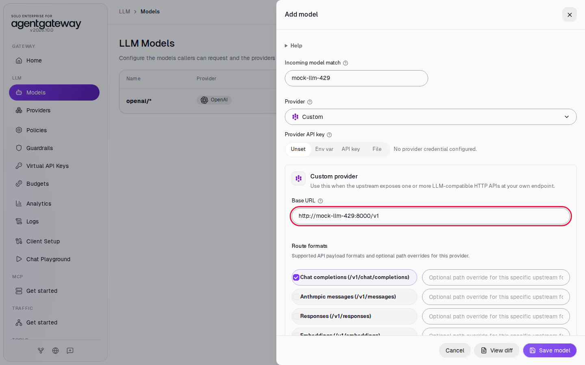
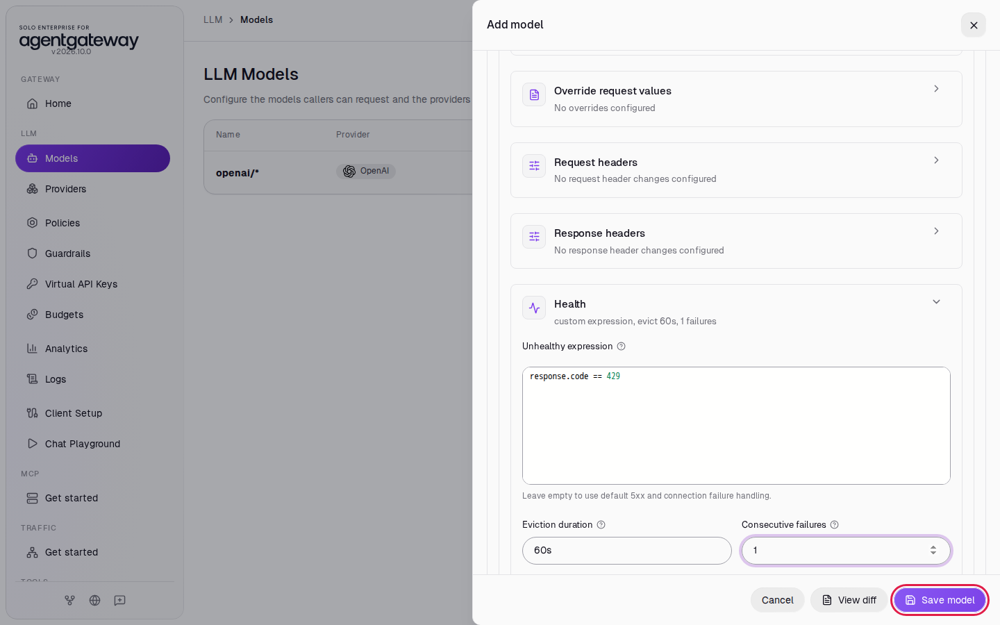
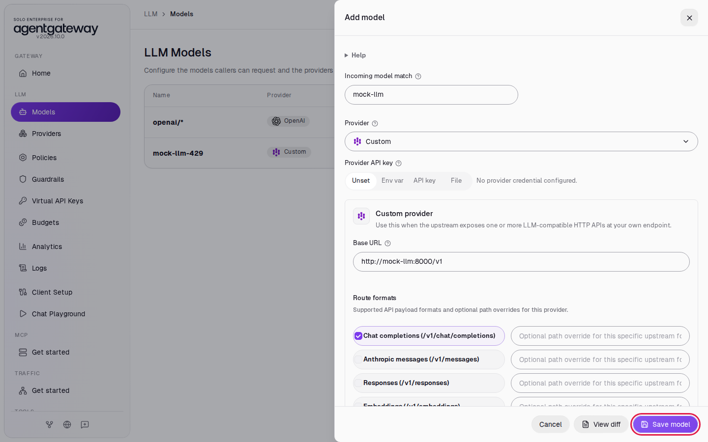
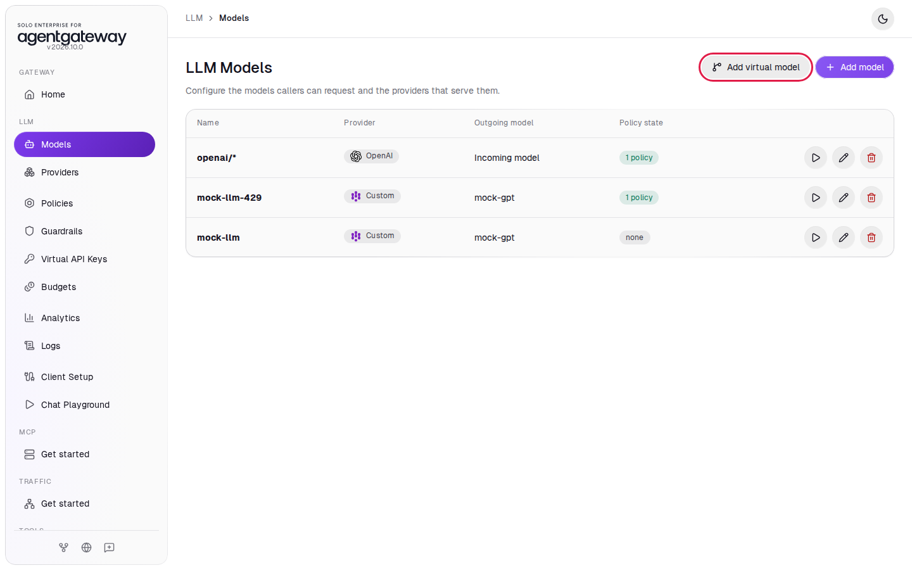
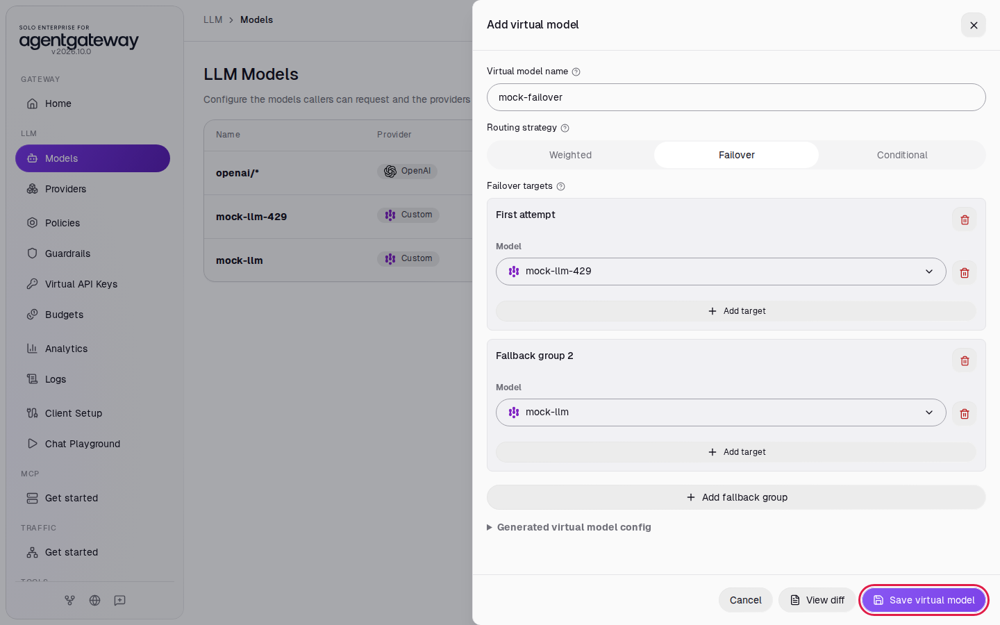
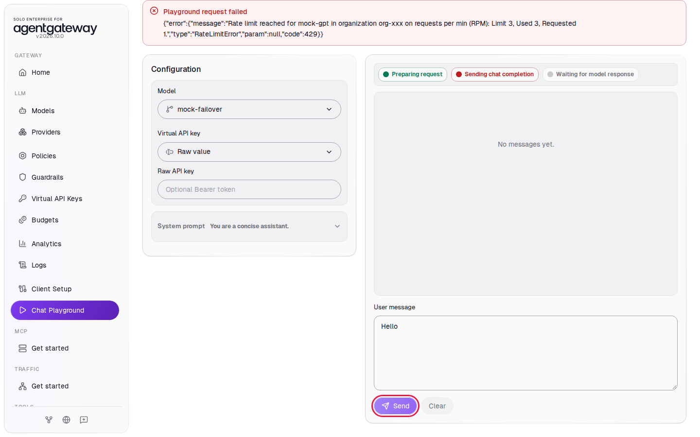
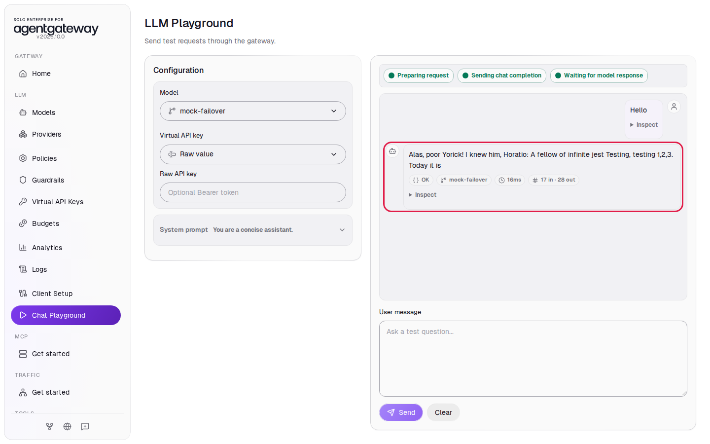
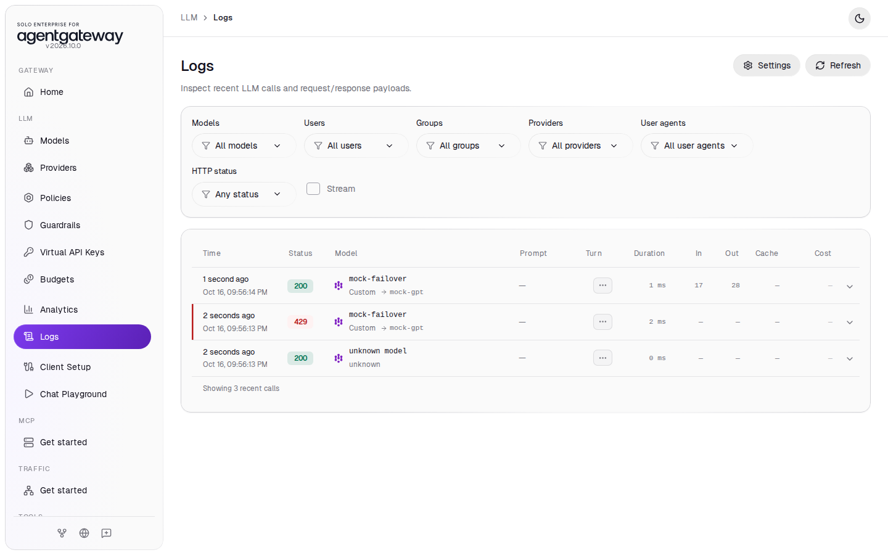
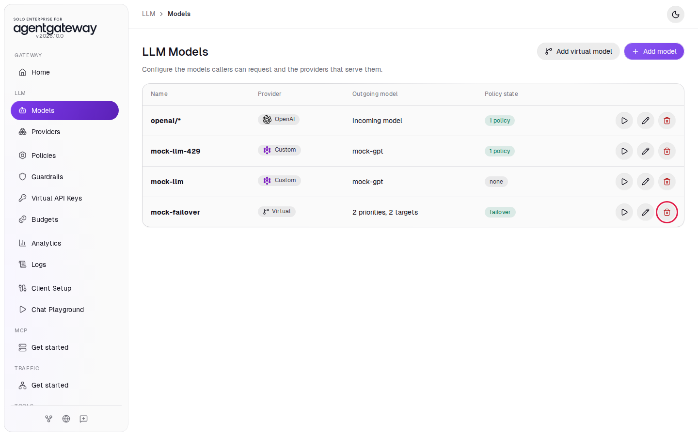

# Fail Over Between Models

## Before you start

- Complete [Connect LLM Providers](../llm/connect-llm-providers.md).
- Start the two mock LLM servers. From the `setup/` folder, run:

  ```bash
  env UID=$(id -u) GID=$(id -g) docker compose --profile mock-llm up -d
  ```

  This starts two services on the gateway's Docker network. `mock-llm` answers every chat request. `mock-llm-429` answers every request with `429 Too Many Requests`, like a provider that hit its rate limit. Both serve a model named `mock-gpt` on port `8000`. They cost nothing to call.

## What you'll do

- Add a model for each mock server
- Add a health policy that takes a model out of rotation after a `429`
- Add a virtual model that tries the rate-limited mock first and fails over to the healthy one
- Watch the failover in the Chat Playground and in Logs

## Why this matters

Providers return rate-limit and server errors. A virtual model gives your applications one model name and lets the gateway pick a backend that works. When the preferred backend fails, the gateway moves traffic to the next group without a change in your applications.

## Step 1: Add the rate-limited mock model

1. In the sidebar, click **Models**.
2. Click **Add model**.

   

3. In **Provider**, select **Custom**.
4. In **Incoming model match**, enter `mock-llm-429`.
5. Leave **Provider API key** on **Unset**. The mock needs no key.
6. In **Base URL**, enter `http://mock-llm-429:8000/v1`.

   

7. Under **Outgoing model**, click **Explicit**.
8. In **Explicit outgoing model**, enter `mock-gpt`. The list says `No catalog matches. Custom model names are allowed.` Click the **Add model** title at the top of the panel to close the list. Do not press Escape, because Escape closes the whole panel.
9. Click **Advanced** to open it, then click **Model policies**, then click **Health**.
10. Click in **Unhealthy expression** and type `response.code == 429`.
11. In **Eviction duration**, enter `60s`.
12. In **Consecutive failures**, enter `1`.
13. Click **Save model**.

    

The base URL uses the Docker service name, `mock-llm-429`, because the gateway reaches the mock over the Docker network. **Explicit** sends `mock-gpt` to the mock, the model name it serves, whatever name the caller used.

The health policy is what makes failover happen. By default the gateway treats only `5xx` responses and connection failures as unhealthy. `response.code == 429` adds rate-limit errors. With **Consecutive failures** at `1`, one `429` takes the model out of rotation for `60s`.

## Step 2: Add the healthy mock model

1. Click **Add model**.
2. In **Provider**, select **Custom**.
3. In **Incoming model match**, enter `mock-llm`.
4. In **Base URL**, enter `http://mock-llm:8000/v1`.
5. Under **Outgoing model**, click **Explicit**, enter `mock-gpt` in **Explicit outgoing model**, and click the **Add model** title to close the list.
6. Click **Save model**.

   

The models list now shows `mock-llm-429` and `mock-llm`:



## Step 3: Add the failover virtual model

1. Click **Add virtual model**.
2. In **Virtual model name**, enter `mock-failover`.
3. Under **Routing strategy**, click **Failover**.
4. Under **First attempt**, in **Model**, select **mock-llm-429**.
5. Click **Add fallback group**.
6. Under **Fallback group 2**, in **Model**, select **mock-llm**.
7. Click **Save virtual model**.

   

Callers now ask for `mock-failover`. The gateway sends the request to the first group that has a healthy model.

## Check it

1. Wait a second after saving, then in the sidebar, click **Chat Playground**.
2. In **Model**, select **mock-failover**.
3. In **User message**, enter `Hello` and click **Send**.

   The first request goes to `mock-llm-429`. The playground shows **Playground request failed** with the mock's `429` error. The health policy now takes `mock-llm-429` out of rotation. Your message stays in **User message**.

   

4. Click **Send** again.

   The gateway skips `mock-llm-429` and sends the request to `mock-llm`. The reply appears with the status **OK** and the model **mock-failover**. The mock's reply is placeholder text.

   

5. In the sidebar, click **Logs**.

   You see a `mock-failover` row with status `429`, and a newer `mock-failover` row with status `200`. Failover works across requests: the request that hit the rate limit fails, and the requests after it go to the fallback group. After `60s`, the gateway tries `mock-llm-429` again.

   

   You may also see a row named `unknown model`. That is the browser's preflight check from the Chat Playground; you can ignore it.

<details>
<summary>Optional: check with curl</summary>

Send a request to the virtual model within `60s` of the failed one:

```bash
curl -s -w '\nHTTP %{http_code}\n' http://localhost:4000/v1/chat/completions \
  -H 'Content-Type: application/json' \
  -d '{"model":"mock-failover","messages":[{"role":"user","content":"Hello from curl"}]}'
```

Expected output:

```
{"model":"mock-gpt",...,"choices":[{"message":{"content":"...","role":"assistant"},...}],...}
HTTP 200
```

`mock-llm-429` answers only with `429`, so a `200` comes from `mock-llm`.

</details>

## What the UI wrote

In the sidebar, scroll down to **Tools** and click **Raw Configuration**. The UI added two models and a `virtualModels` section to `llm`:

```yaml
llm:
  models:
    - name: mock-llm-429
      provider:
        custom:
          formats:
            - type: completions
      params:
        model: mock-gpt
        baseUrl: http://mock-llm-429:8000/v1
      health:
        unhealthyExpression: response.code == 429
        eviction:
          duration: 60s
          consecutiveFailures: 1
    - name: mock-llm
      provider:
        custom:
          formats:
            - type: completions
      params:
        model: mock-gpt
        baseUrl: http://mock-llm:8000/v1
  virtualModels:
    - name: mock-failover
      routing:
        failover:
          targets:
            - model: mock-llm-429
              priority: 0
            - model: mock-llm
              priority: 1
```

Lower `priority` values are tried first.

## Clean up

1. In the sidebar, click **Models**.
2. In the `mock-failover` row, click the trash icon.

   

3. In **Delete virtual model?**, click **Delete virtual model**.
4. In the `mock-llm-429` row, click the trash icon, then click **Delete model**.
5. In the `mock-llm` row, click the trash icon, then click **Delete model**.
6. Stop the mock servers. From the `setup/` folder, run:

   ```bash
   docker compose --profile mock-llm stop mock-llm mock-llm-429
   ```

The gateway is back to the state [Connect LLM Providers](../llm/connect-llm-providers.md) left it in.
