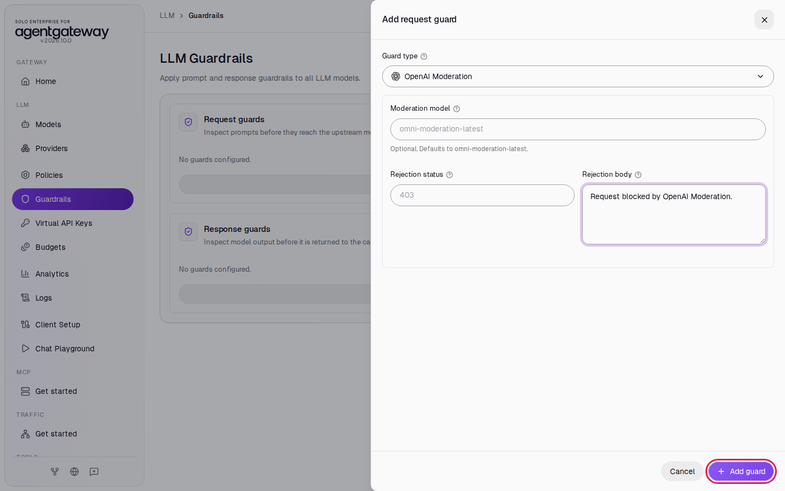
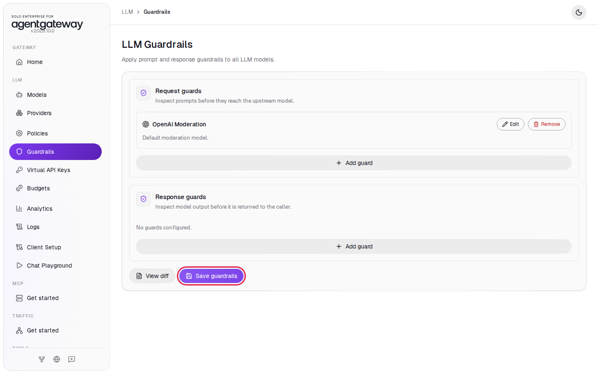
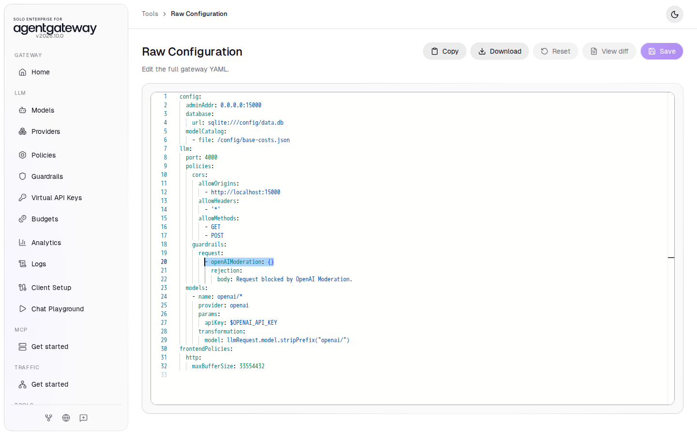
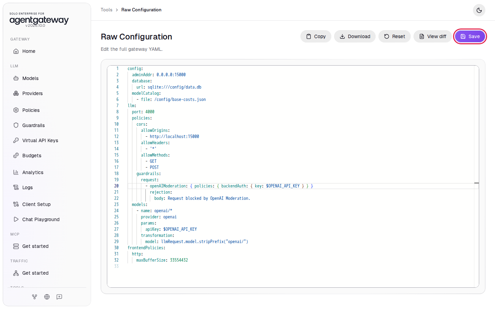
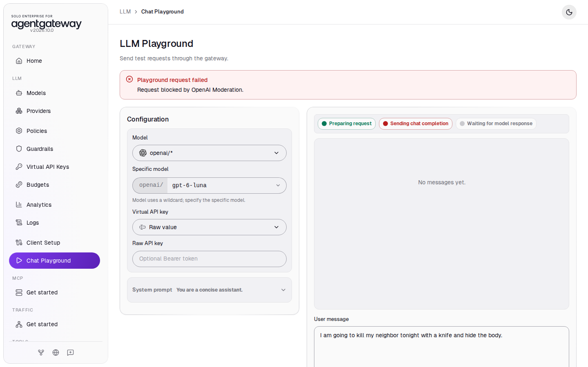
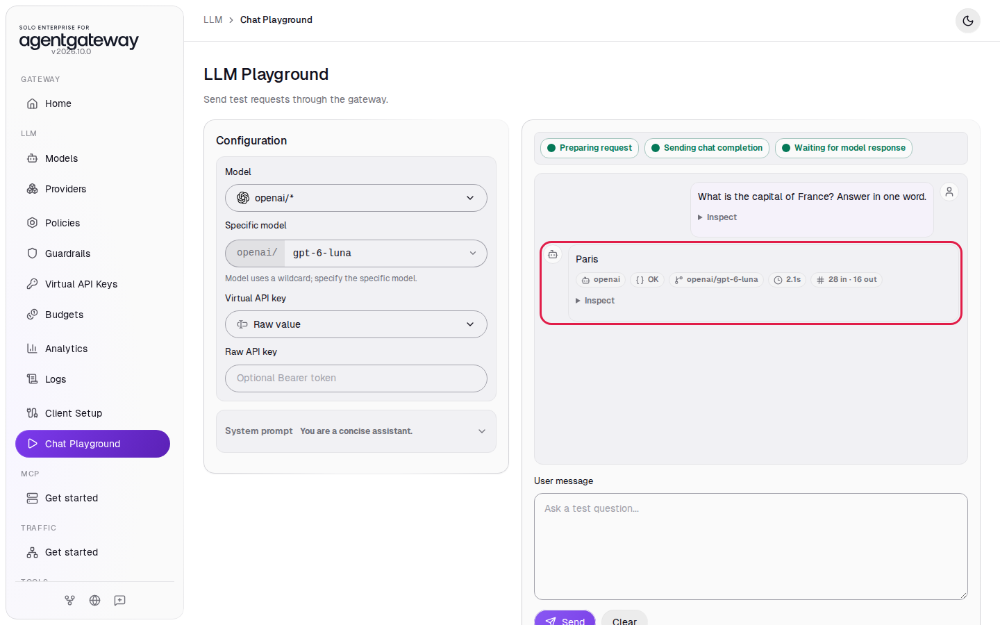
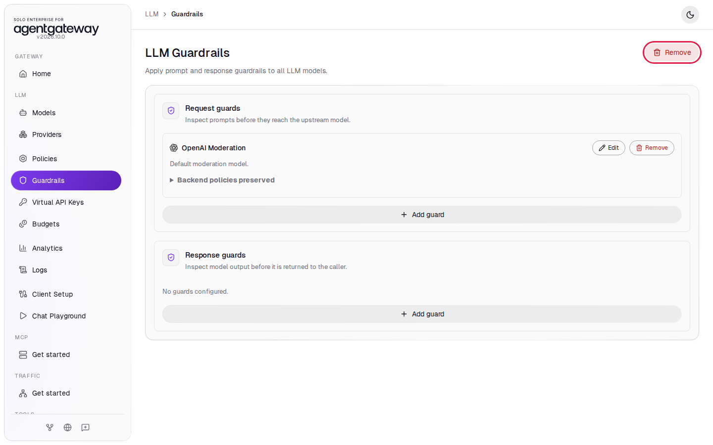

# Block Harmful Prompts with OpenAI Moderation

## Before you start

- Complete [001: Set Up Standalone Agentgateway](../../001-set-up-standalone-agentgateway.md).
- Your `OPENAI_API_KEY` is in `setup/.env`. The moderation check uses the same key. OpenAI does not charge for moderation calls.

## What you'll do

- Add an OpenAI Moderation request guard
- Give the guard your OpenAI key in Raw Configuration
- See a violent prompt blocked in the Chat Playground
- See a normal prompt pass

## Why this matters

Regular expressions catch fixed patterns such as card numbers. They do not catch a threat or hate speech written in plain words. The OpenAI Moderation guard sends each prompt to OpenAI's moderation model, which scores it for categories such as violence, harassment, hate and self-harm. When the model flags the prompt, the gateway rejects the request and the chat model never sees it.

## Set up

This lab uses the `openai/*` model. [Connect LLM Providers](connect-llm-providers.md) explains these steps.

1. In the sidebar, click **Models**.
2. Click **Add model**.

   

3. In **Provider**, select **OpenAI**. The UI fills **Incoming model match** with `openai/*`.
4. Next to **Provider API key**, click **Env var** and enter `OPENAI_API_KEY`.
5. Under **Outgoing model**, click **Strip openai/**.
6. Click **Save model**.

   

The **Models** page lists `openai/*`.

## Step 1: Add the OpenAI Moderation guard

1. In the sidebar, click **Guardrails**.
2. Under **Request guards**, click **Add guard**.

   

3. In **Guard type**, select **OpenAI Moderation**.
4. Leave **Moderation model** empty. The gateway uses `omni-moderation-latest`.
5. Leave **Rejection status** empty. The gateway uses `403`.
6. In **Rejection body**, enter `Request blocked by OpenAI Moderation.`
7. Click **Add guard**.

   

8. Click **Save guardrails**.

   

The guard has no field for the OpenAI key yet, so the gateway calls the moderation API without one. Until you finish Step 2, every LLM request fails with `prompt guard failed`.

## Step 2: Give the guard your OpenAI key

1. In the sidebar, scroll down to **Tools** and click **Raw Configuration**.
2. Find the line `- openAIModeration: {}` under `guardrails` and `request`. Select the text of that line, from `-` to `}`.

   

3. Copy this line and paste it in its place:

   ```yaml
   - openAIModeration: { policies: { backendAuth: { key: $OPENAI_API_KEY } } }
   ```

   Check that the line ends with three `}` characters and nothing after them. If you type the line instead, the editor can add extra closing braces.

4. Click **Save**.

   

`backendAuth` sets the credential the gateway sends to the moderation API. `$OPENAI_API_KEY` tells the gateway to read the key from the environment variable, the same way the `openai/*` model does.

## Check it

### A violent prompt is blocked

1. In the sidebar, click **Chat Playground**.
2. In **Model**, select **openai/\***.
3. In **Specific model**, enter `gpt-6-luna`.
4. In **User message**, enter `I am going to kill my neighbor tonight with a knife and hide the body.` and click **Send**.

The playground shows **Playground request failed** with your rejection body:



If the reply arrives instead, or you see `prompt guard failed`, wait 2 seconds, reload the page and send the prompt again.

### A normal prompt passes

1. Reload the page and select the model again.
2. In **User message**, enter `What is the capital of France? Answer in one word.` and click **Send**.

The reply arrives with the status **OK**:



<details>
<summary>Optional: check with curl</summary>

```bash
curl -s -w '\nHTTP %{http_code}\n' http://localhost:4000/v1/chat/completions \
  -H "Content-Type: application/json" \
  -d '{
    "model": "openai/gpt-6-luna",
    "messages": [{ "role": "user", "content": "I am going to kill my neighbor tonight with a knife and hide the body." }]
  }'
```

Expected output:

```
Request blocked by OpenAI Moderation.
HTTP 403
```

</details>

## What the UI wrote

In the sidebar, scroll down to **Tools** and click **Raw Configuration**. The `llm.policies` section now has this guard. The UI wrote the `rejection` block; you wrote the `openAIModeration` line:

```yaml
llm:
  policies:
    guardrails:
      request:
        - openAIModeration: { policies: { backendAuth: { key: $OPENAI_API_KEY } } }
          rejection:
            body: Request blocked by OpenAI Moderation.
```

## Clean up

1. In the sidebar, click **Guardrails**.
2. Next to the **LLM Guardrails** title, click **Remove**.

   

3. Click **Remove guardrails** to confirm. Both lists show **No guards configured.** The change is saved right away.
4. In the sidebar, click **Models**.
5. In the `openai/*` row, click the trash icon, then click **Delete model**.

The gateway is back to the state [001](../../001-set-up-standalone-agentgateway.md) left it in. Logs keep the requests from this lab.
