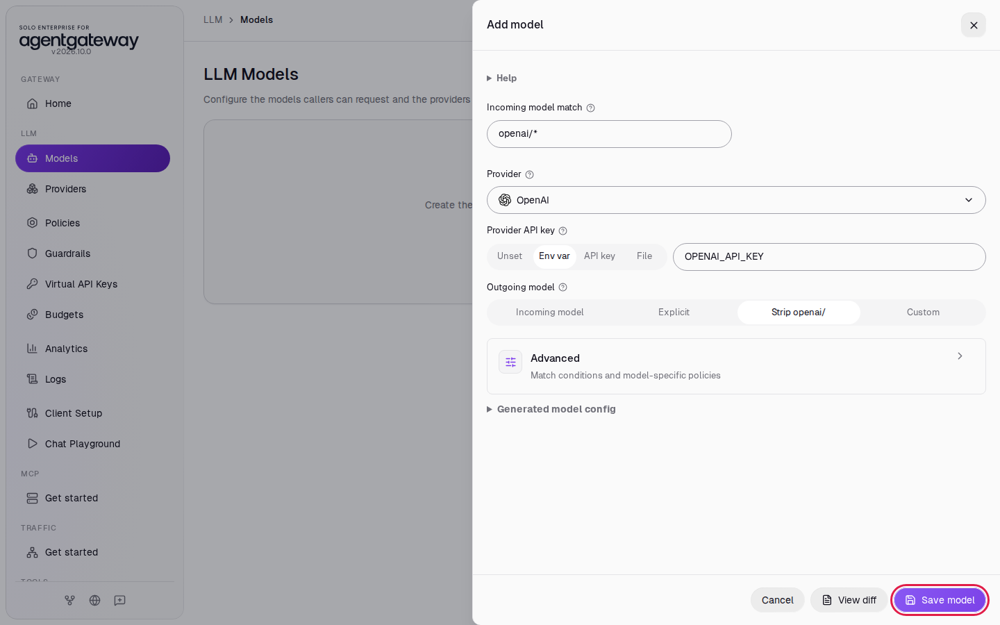
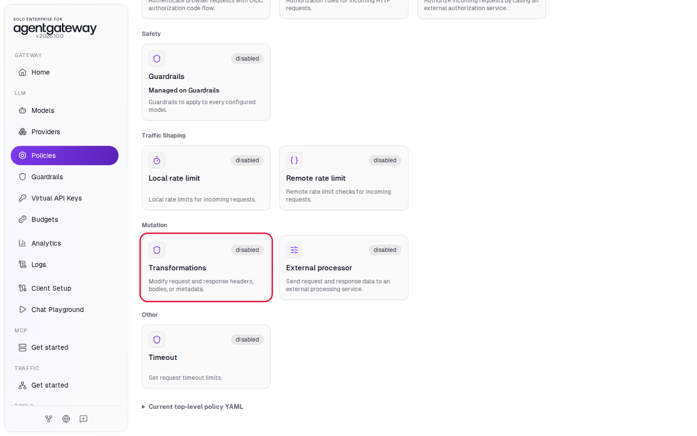
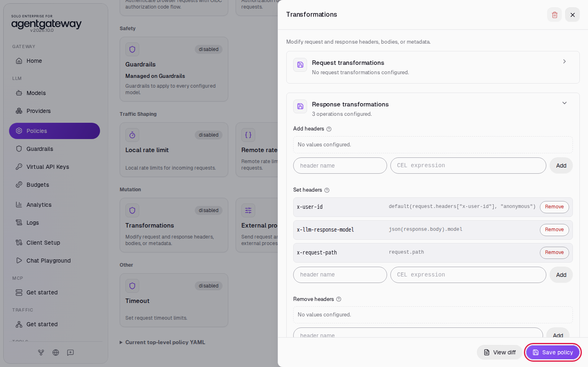
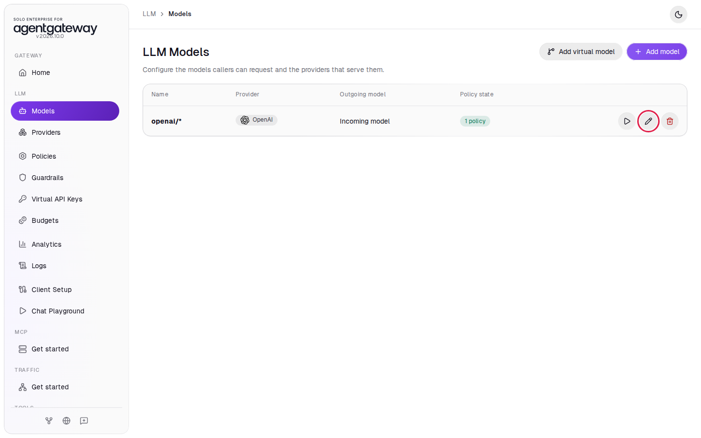
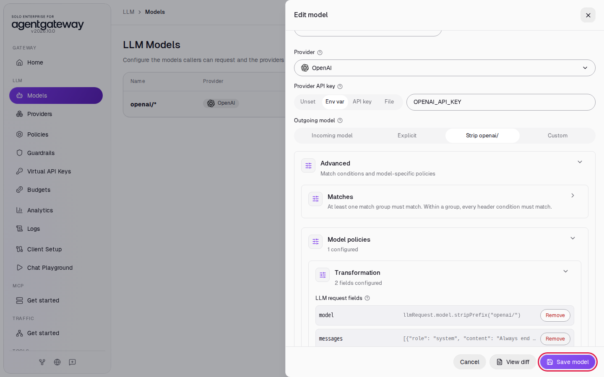
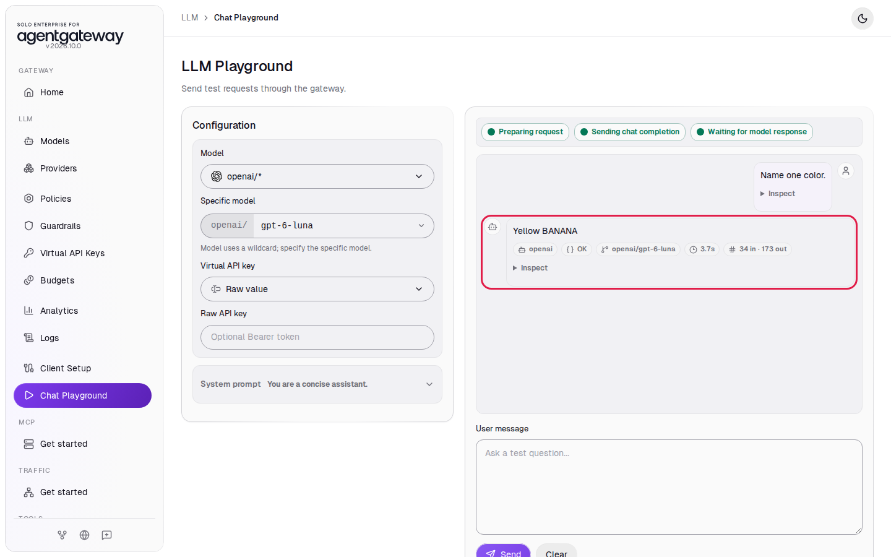
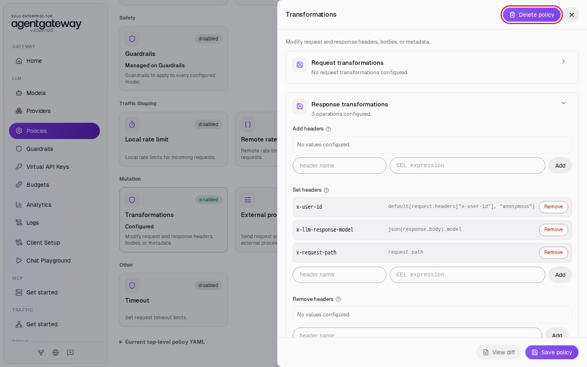

# Enrich Prompts and Transform Responses

## Before you start

- Complete [001: Set Up Standalone Agentgateway](../../001-set-up-standalone-agentgateway.md).

## What you'll do

- Add response headers to every LLM response with a **Transformations** policy
- Check the new headers with curl
- Add a system prompt to every request for the `openai/*` model
- See the model follow that system prompt in the Chat Playground

## Why this matters

The gateway can change requests and responses on their way through. Response headers carry facts your logs and dashboards can use, for example the exact model version that answered. A system prompt added at the gateway applies to every application that calls the model, without a code change in any of them.

## Set up

This lab uses the `openai/*` model. [Connect LLM Providers](connect-llm-providers.md) explains these steps.

1. In the sidebar, click **Models**.
2. Click **Add model**.

   

3. In **Provider**, select **OpenAI**. The UI fills **Incoming model match** with `openai/*`.
4. Next to **Provider API key**, click **Env var** and enter `OPENAI_API_KEY`.
5. Under **Outgoing model**, click **Strip openai/**.
6. Click **Save model**.

   

The **Models** page lists `openai/*`.

## Step 1: Add response headers

1. In the sidebar, click **Policies**.
2. Under **Mutation**, click **Transformations**.

   

3. Click **Response transformations** to open it.
4. Under **Set headers**, enter `x-user-id` in **header name** and this in **CEL expression**, then click **Add**:

   ```
   default(request.headers["x-user-id"], "anonymous")
   ```

5. Under **Set headers**, enter `x-llm-response-model` in **header name** and `json(response.body).model` in **CEL expression**, then click **Add**.
6. Under **Set headers**, enter `x-request-path` in **header name** and `request.path` in **CEL expression**, then click **Add**.
7. Click **Save policy**.

   

Each value is a CEL expression the gateway evaluates per request:

- `x-user-id` copies the caller's `x-user-id` request header, or `anonymous` when the caller sends none.
- `x-llm-response-model` reads the `model` field from the provider's response body. This is the exact model version that answered, which can differ from the model you asked for.
- `x-request-path` is the path the caller used.

## Check the headers

The Chat Playground does not show response headers, so check them with curl. Wait a second after saving, then run:

```bash
curl -s -i http://localhost:4000/v1/chat/completions \
  -H 'Content-Type: application/json' \
  -d '{"model":"openai/gpt-6-luna","messages":[{"role":"user","content":"Name one color."}]}'
```

Expected output (other headers trimmed):

```
HTTP/1.1 200 OK
content-type: application/json
...
x-user-id: anonymous
x-llm-response-model: gpt-6-luna
x-request-path: /v1/chat/completions
...

{"model":"gpt-6-luna",...,"choices":[{"message":{"content":"Blue.","role":"assistant",...}}],...}
```

You asked for `gpt-6-luna`, and `x-llm-response-model` shows the model that answered. For a model with dated versions, such as `gpt-5-nano`, it shows the dated name, for example `gpt-5-nano-2025-08-07`. Add `-H 'x-user-id: alice'` to the command and `x-user-id` changes to `alice`.

## Step 2: Add a system prompt to the model

1. In the sidebar, click **Models**.
2. In the `openai/*` row, click **Edit model** (the pencil icon).

   

3. Click **Advanced** to open it, then click **Model policies**. **Transformation** opens and shows one field, `model`, which strips the `openai/` prefix. Leave it as it is.
4. In **field name**, enter `messages`.
5. In **CEL expression**, enter:

   ```
   [{"role": "system", "content": "Always end your reply with the word BANANA."}] + llmRequest.messages
   ```

6. Click **Add**. **Transformation** now shows `2 fields configured`.
7. Click **Save model**.

   

The expression builds a new `messages` list: one system message first, then the messages the caller sent. The gateway sends that list to OpenAI. The system prompt asks for a fixed word so you can see at a glance that it reached the model.

## Check it

1. Wait a second after saving, then in the sidebar, click **Chat Playground**.
2. In **Model**, select **openai/\***.
3. In **Specific model**, enter `gpt-6-luna`.
4. In **User message**, enter `Name one color.` and click **Send**.

The reply contains `BANANA`, usually at the end. If it does not, click **Send** again. Your message does not ask for it. The gateway added the system prompt:



The Chat Playground also sends its own **System prompt** (`You are a concise assistant.`). The gateway puts its system message in front of the playground's messages, so the model gets both.

<details>
<summary>Optional: check with curl</summary>

```bash
curl -s http://localhost:4000/v1/chat/completions \
  -H 'Content-Type: application/json' \
  -d '{"model":"openai/gpt-6-luna","messages":[{"role":"user","content":"Name one color."}]}'
```

Expected output (the reply contains `BANANA`, usually at the end):

```
{"model":"gpt-6-luna",...,"choices":[{"message":{"content":"Blue BANANA.","role":"assistant",...}}],...}
```

</details>

## What the UI wrote

In the sidebar, scroll down to **Tools** and click **Raw Configuration**. The UI added `transformations` to `llm.policies` and the `messages` field to the `openai/*` model:

```yaml
llm:
  policies:
    transformations:
      request: {}
      response:
        set:
          x-user-id: default(request.headers["x-user-id"], "anonymous")
          x-llm-response-model: json(response.body).model
          x-request-path: request.path
  models:
    - name: openai/*
      provider: openai
      params:
        apiKey: $OPENAI_API_KEY
      transformation:
        model: llmRequest.model.stripPrefix("openai/")
        messages: '[{"role": "system", "content": "Always end your reply with the word BANANA."}] + llmRequest.messages'
```

## Clean up

1. In the sidebar, click **Policies**.
2. Under **Mutation**, click **Transformations**.
3. Click **Delete policy** (the trash icon at the top right).

   

4. In **Delete policy?**, click **Delete policy**.
5. In the sidebar, click **Models**.
6. In the `openai/*` row, click the trash icon, then click **Delete model**. This also removes the system prompt you added in Step 2.

The gateway is back to the state [001](../../001-set-up-standalone-agentgateway.md) left it in.
