# Route Requests by Path, Header, and Query Parameter

## Before you start

- Complete [Connect LLM Providers](../llm/connect-llm-providers.md).
- Start the two mock LLM servers this lab uses. From the `setup/` folder, run:

  ```bash
  env UID=$(id -u) GID=$(id -g) docker compose --profile mock-llm-routing up -d
  ```

  This starts `mock-llm-mini` and `mock-llm-nano` on the gateway's Docker network, both on port `8000`. `mock-llm-mini` serves a model named `mock-mini` and `mock-llm-nano` serves `mock-nano`. Each reply has a `model` field with that name, so you can see which server answered. They cost nothing to call.

## What you'll do

- Add a backend for each mock server, with the model name fixed on the backend
- Add a gateway on port `8080` and a default route to `mini`
- Add three routes to `nano`: one that matches a path, one that matches a header, and one that matches a query parameter
- Send requests with curl and see which model answers each one

## Why this matters

Your applications call one gateway address. Routes decide which model server gets each request, based on the URL path, a header, or a query parameter. You can give a team its own path, or let a client pick a model tier with a header, and the client never needs the server's address or the model name.

## Step 1: Add the two model backends

A route sends traffic to a backend. The UI has no page for traffic backends, so you add them in Raw Configuration. Each backend is an OpenAI-compatible LLM backend that fixes the model name and points at one mock server.

1. In the sidebar, scroll down to **Tools** and click **Raw Configuration**.
2. Click in the editor, just before `config:` on line 1.
3. Paste this block:

   ```yaml
   backends:
     - name: mini
       ai:
         name: mini
         provider:
           openAI:
             model: mock-mini
         hostOverride: mock-llm-mini:8000
     - name: nano
       ai:
         name: nano
         provider:
           openAI:
             model: mock-nano
         hostOverride: mock-llm-nano:8000
   ```

4. Check that `backends:` starts at the left edge of line 1 and `config:` is on line 16, then click **Save**.

   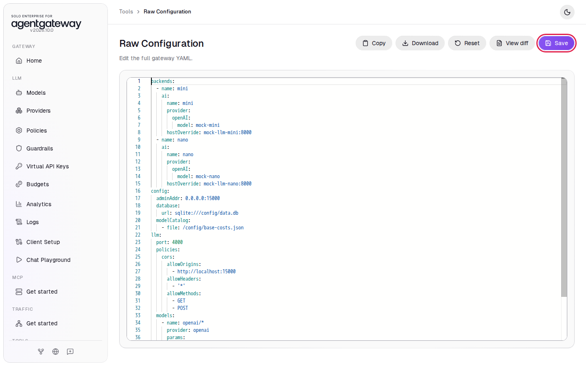

`model: mock-mini` replaces whatever model name the client sends, so a request to `mini` always asks for `mock-mini`. `hostOverride` is the address of the mock server on the Docker network.

## Step 2: Add a gateway on port 8080

1. In the sidebar, under **Traffic**, click **Get started**.
2. Click **Enable**. The UI adds a gateway named `public` on port `8080` and opens **Traffic Gateways**.

   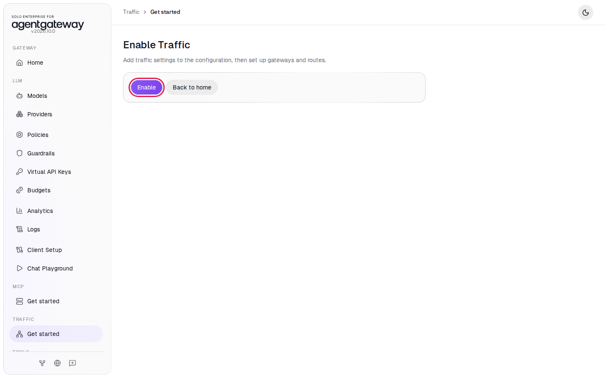

## Step 3: Add a default route to mini

1. In the sidebar, under **Traffic**, click **Routes**.
2. Click **Add route**.
3. In **Gateway**, select **public**.
4. In **Name**, enter `default`.
5. Leave **Path match** on **Prefix** and **Path** on `/`. This route matches every request.
6. Under **Backends**, click **Add backend**.
7. In **Target type**, select **Backend reference**.
8. In **Backend reference**, enter `mini`.
9. Click **Save route**.

   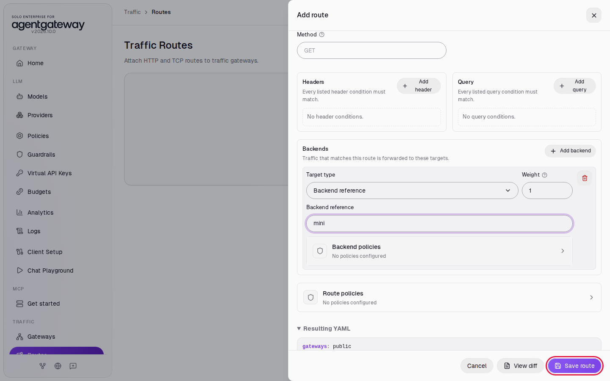

Wait two seconds, then send a chat request to port `8080`. The command prints only the `model` field of the reply:

```bash
curl -s 'http://localhost:8080/v1/chat/completions' -H 'Content-Type: application/json' \
  -d '{"messages":[{"role":"user","content":"Hello"}]}' | grep -o '"model":"[^"]*"'
```

Expected output:

```
"model":"mock-mini"
```

The request has no `model` field. The `mini` backend added `mock-mini`.

## Step 4: Route a path to nano

Path matching gives each model its own URL. Requests to `/nano/...` go to `nano`.

1. Click **Add route**.
2. In **Gateway**, select **public**.
3. In **Name**, enter `nano-path`.
4. Leave **Path match** on **Prefix**. In **Path**, enter `/nano`.

   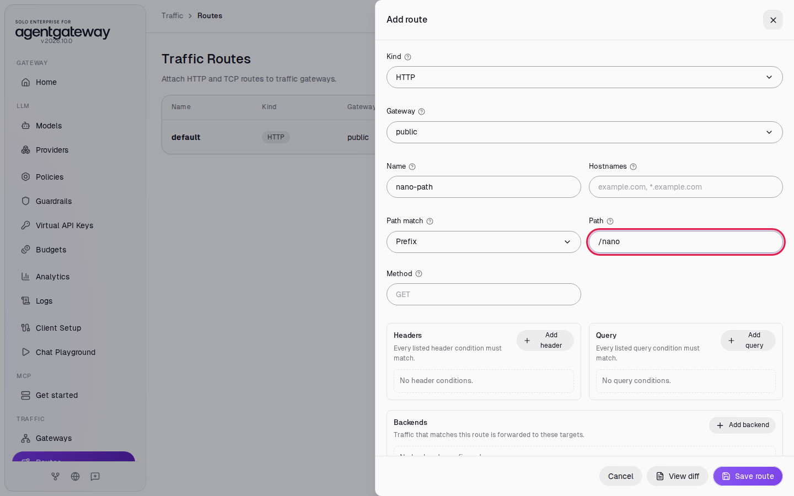

   **Path match** also has **Exact**, which matches only that one path, and **Regex**, which matches a regular expression.

5. Under **Backends**, click **Add backend**. In **Target type**, select **Backend reference**. In **Backend reference**, enter `nano`.
6. Click **Route policies**.

   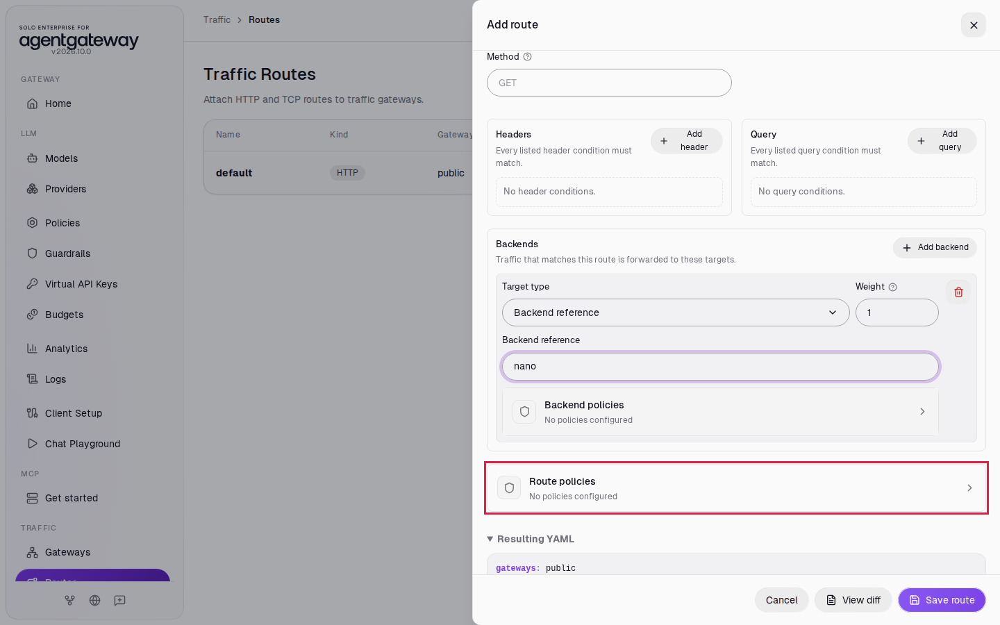

7. Click **URL rewrite**.

   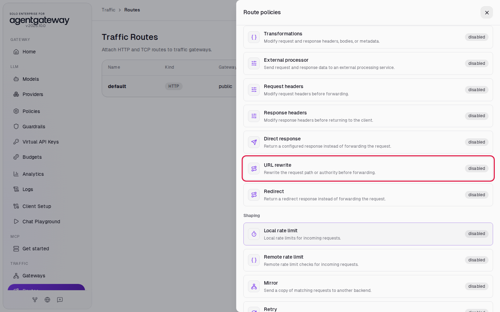

8. In **Policy YAML**, enter:

   ```yaml
   path:
     prefix: /
   ```

9. Click **Save**.

   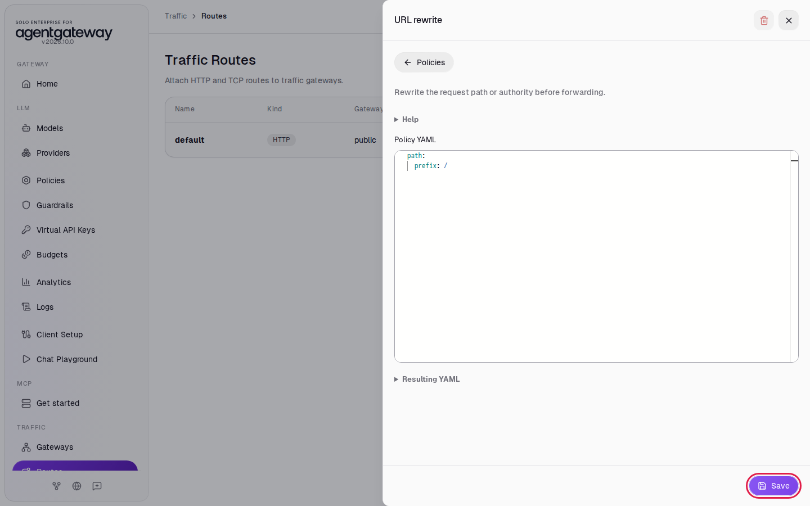

10. The **Route policies** list shows URL rewrite as configured. Click the close icon at the top of the list.
11. Click **Save route**.

The mock server serves chat at `/v1/chat/completions`. The URL rewrite replaces `/nano` with `/` before the gateway forwards the request, so `/nano/v1/chat/completions` reaches the server as `/v1/chat/completions`.

Wait two seconds, then send a request to the `/nano` path:

```bash
curl -s 'http://localhost:8080/nano/v1/chat/completions' -H 'Content-Type: application/json' \
  -d '{"messages":[{"role":"user","content":"Hello"}]}' | grep -o '"model":"[^"]*"'
```

Expected output:

```
"model":"mock-nano"
```

A request to `/v1/chat/completions` still returns `"model":"mock-mini"`. When several routes match, the gateway picks the most specific one: `/nano` is a longer prefix than `/`.

## Step 5: Route a header to nano

Header matching keeps one URL and lets the client pick a model with a header. Requests with `x-model: nano` go to `nano`.

1. Click **Add route**.
2. In **Gateway**, select **public**.
3. In **Name**, enter `nano-header`.
4. Leave **Path match** on **Prefix** and **Path** on `/`.
5. Under **Headers**, click **Add header**.
6. In **Header name**, enter `x-model`. In **Header value**, enter `nano`.
7. Under **Backends**, click **Add backend**. In **Target type**, select **Backend reference**. In **Backend reference**, enter `nano`.
8. Click **Save route**.

   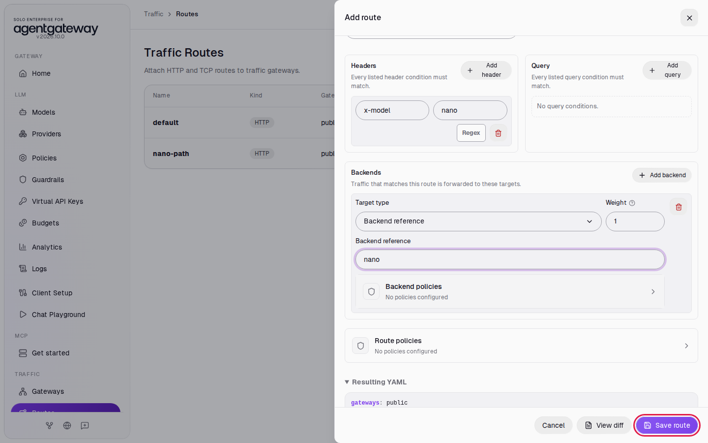

The header value must match exactly. Click **Regex** next to the value to match a regular expression instead.

Wait two seconds, then send a request with the header:

```bash
curl -s 'http://localhost:8080/v1/chat/completions' -H 'x-model: nano' -H 'Content-Type: application/json' \
  -d '{"messages":[{"role":"user","content":"Hello"}]}' | grep -o '"model":"[^"]*"'
```

Expected output:

```
"model":"mock-nano"
```

Without the header, the request goes to `mini`. A route with a header condition is more specific than the `default` route, so it wins when the header is present.

## Step 6: Route a query parameter to nano

Query matching works for clients that can change the URL but not the headers. Requests with `?model=nano` go to `nano`.

1. Click **Add route**.
2. In **Gateway**, select **public**.
3. In **Name**, enter `nano-query`.
4. Leave **Path match** on **Prefix** and **Path** on `/`.
5. Under **Query**, click **Add query**.
6. In **Query name**, enter `model`. In **Query value**, enter `nano`.
7. Under **Backends**, click **Add backend**. In **Target type**, select **Backend reference**. In **Backend reference**, enter `nano`.
8. Click **Save route**.

   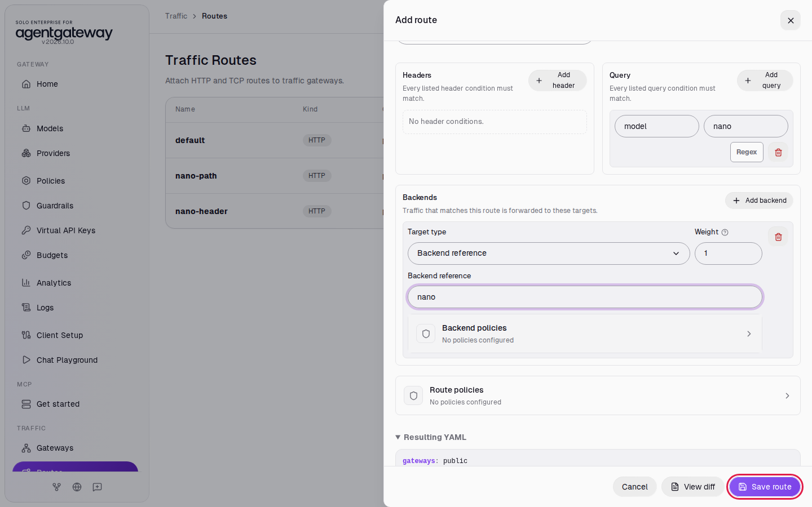

The **Traffic Routes** page now lists four routes:

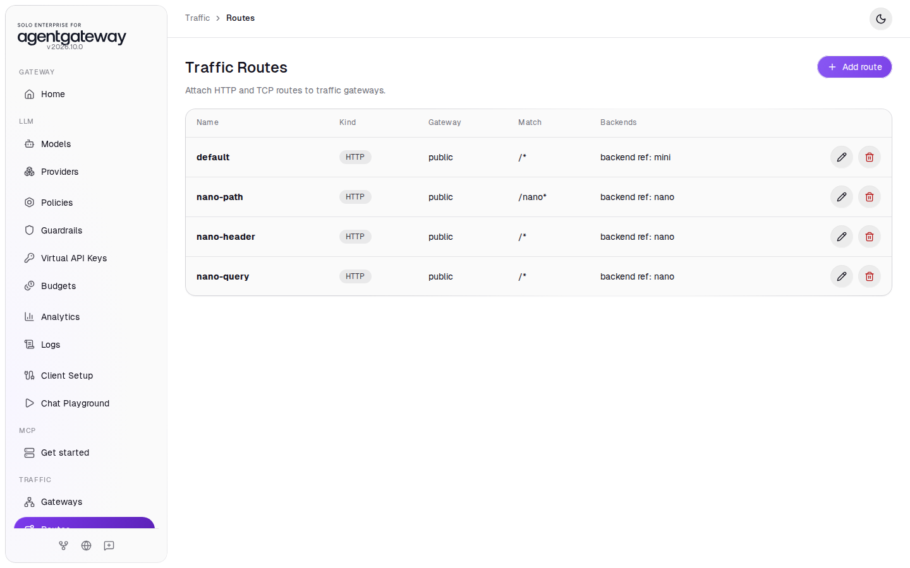

## Check it

Wait two seconds, then send three requests: one with `?model=nano`, one with `?model=mini`, and one with no query parameter:

```bash
for q in '?model=nano' '?model=mini' ''; do
  curl -s "http://localhost:8080/v1/chat/completions$q" -H 'Content-Type: application/json' \
    -d '{"messages":[{"role":"user","content":"Hello"}]}' | grep -o '"model":"[^"]*"'
done
```

Expected output:

```
"model":"mock-nano"
"model":"mock-mini"
"model":"mock-mini"
```

Only `?model=nano` matches the `nano-query` route. The other two requests fall through to `default`.

> **Note:** The routes send requests to the `mini` and `nano` LLM backends, so the requests also appear on the **Logs** page, with the model each backend set: `mock-mini` or `mock-nano`. A traffic route to a plain **Host** backend does not show up there.

## What the UI wrote

In the sidebar, scroll down to **Tools** and click **Raw Configuration**. Step 1 added `backends`. The UI added a gateway and four routes, and moved `backends` near the end of the file:

```yaml
backends:
  - name: mini
    ai:
      name: mini
      provider:
        openAI:
          model: mock-mini
      hostOverride: mock-llm-mini:8000
  - name: nano
    ai:
      name: nano
      provider:
        openAI:
          model: mock-nano
      hostOverride: mock-llm-nano:8000
gateways:
  public:
    port: 8080
routes:
  - gateways: public
    matches:
      - path:
          pathPrefix: /
    backends:
      - backend: mini
    name: default
  - gateways: public
    matches:
      - path:
          pathPrefix: /nano
    backends:
      - backend: nano
    policies:
      urlRewrite:
        path:
          prefix: /
    name: nano-path
  - gateways: public
    matches:
      - path:
          pathPrefix: /
        headers:
          - name: x-model
            value:
              exact: nano
    backends:
      - backend: nano
    name: nano-header
  - gateways: public
    matches:
      - path:
          pathPrefix: /
        query:
          - name: model
            value:
              exact: nano
    backends:
      - backend: nano
    name: nano-query
```

## Clean up

1. In the sidebar, under **Traffic**, click **Routes**.
2. In each of the `nano-query`, `nano-header`, `nano-path` and `default` rows, click **Delete route**. Each route is deleted right away.
3. In the sidebar, under **Traffic**, click **Gateways**.
4. Next to `public`, click **Delete gateway**.
5. In the sidebar, scroll down to **Tools** and click **Raw Configuration**.
6. Select the 15 lines from `backends:` to `hostOverride: mock-llm-nano:8000`, near the end of the file, and press **Delete**.

   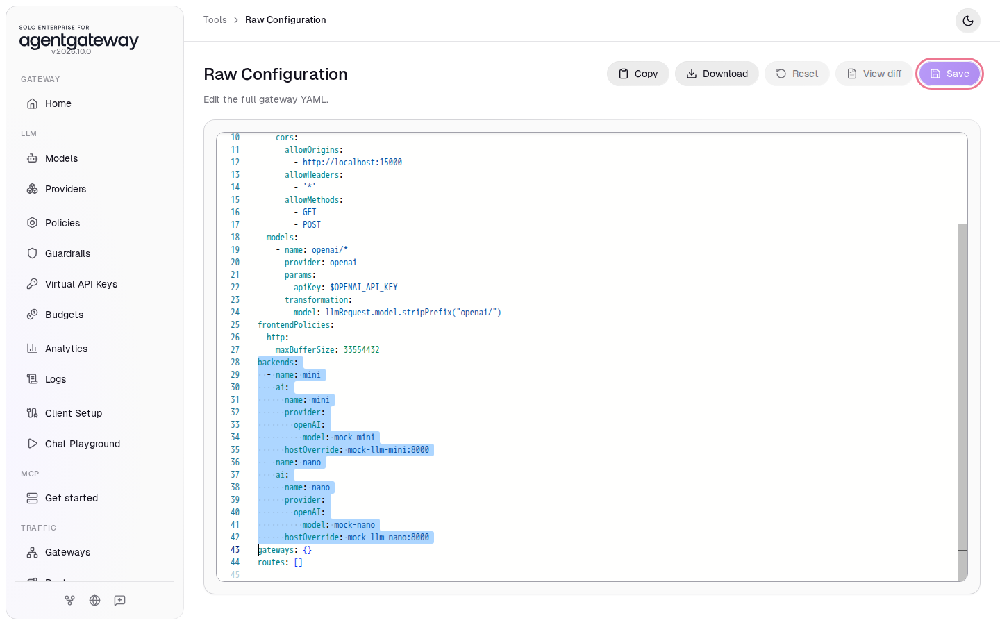

7. Delete the line `gateways: {}` and the line `routes: []`. While `gateways: {}` is there, the sidebar shows **Gateways** and **Routes** under **Traffic** instead of **Get started**.
8. Click **Save**. If a confirmation appears, click **Save** again.
9. Stop the mock servers. From the `setup/` folder, run:

   ```bash
   docker compose --profile mock-llm-routing stop mock-llm-mini mock-llm-nano
   ```

The gateway is back to the state [Connect LLM Providers](../llm/connect-llm-providers.md) left it in.
