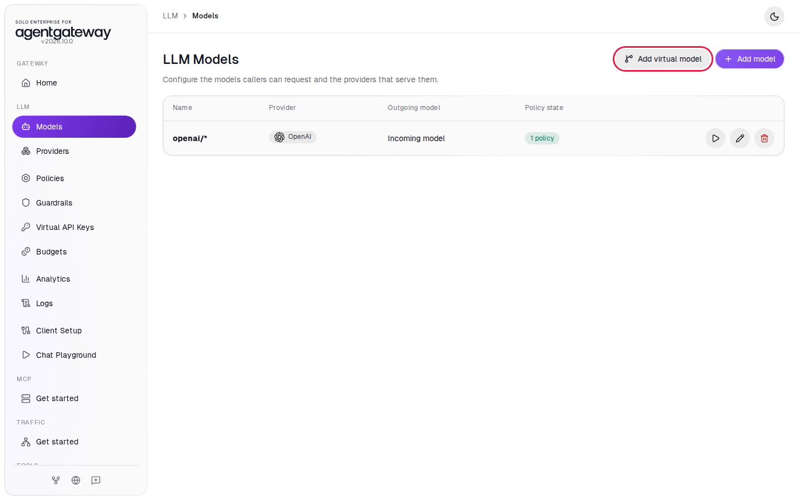
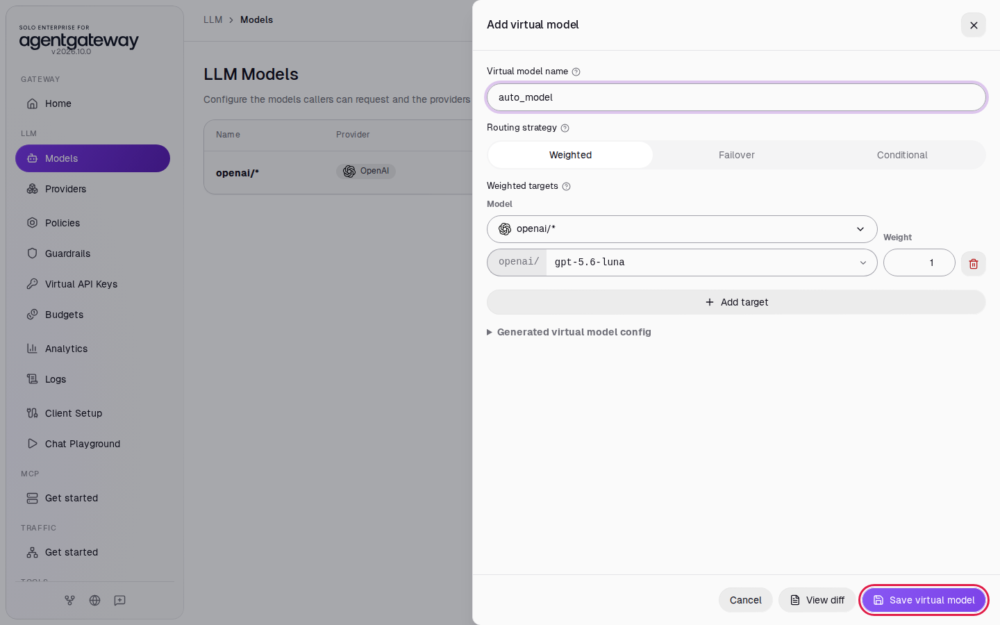
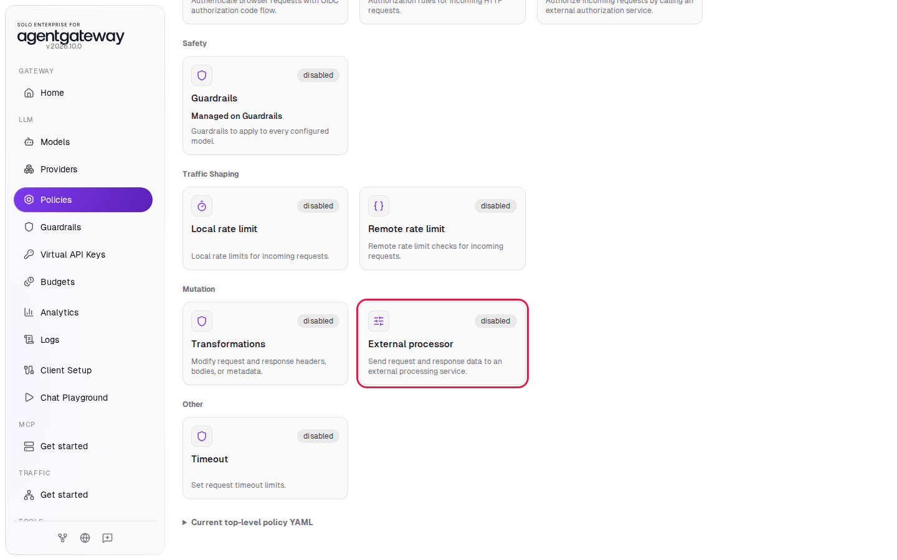
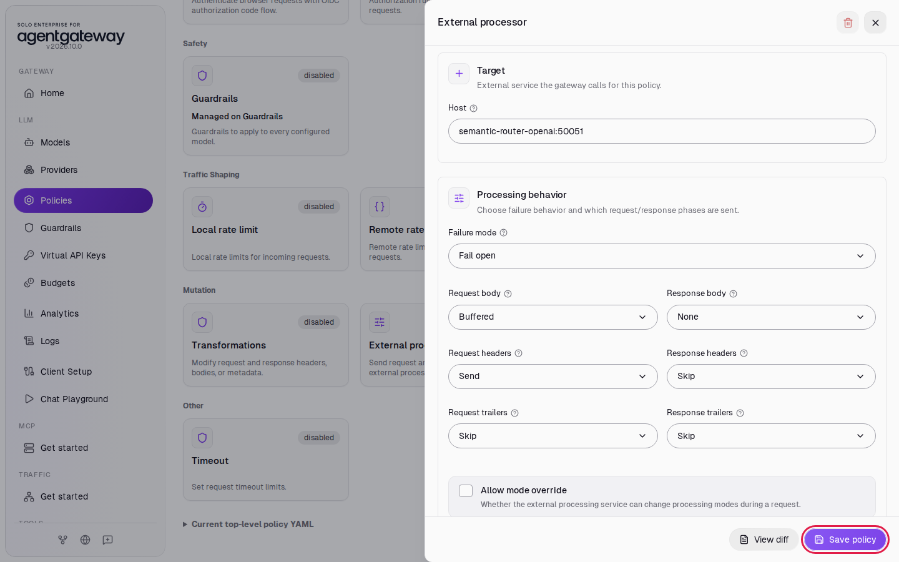
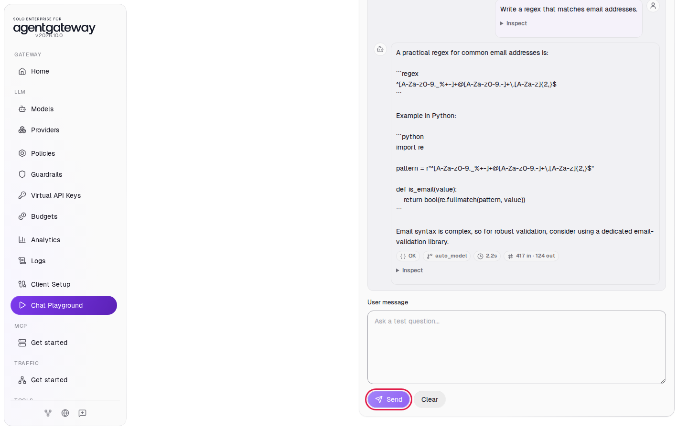
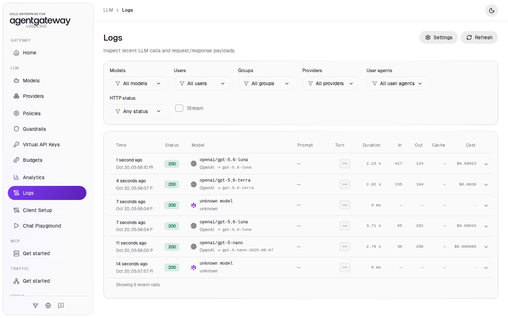
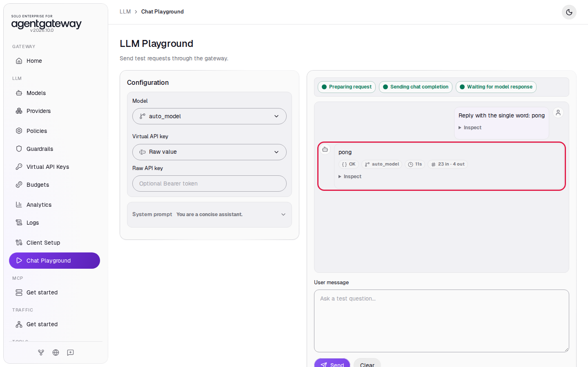
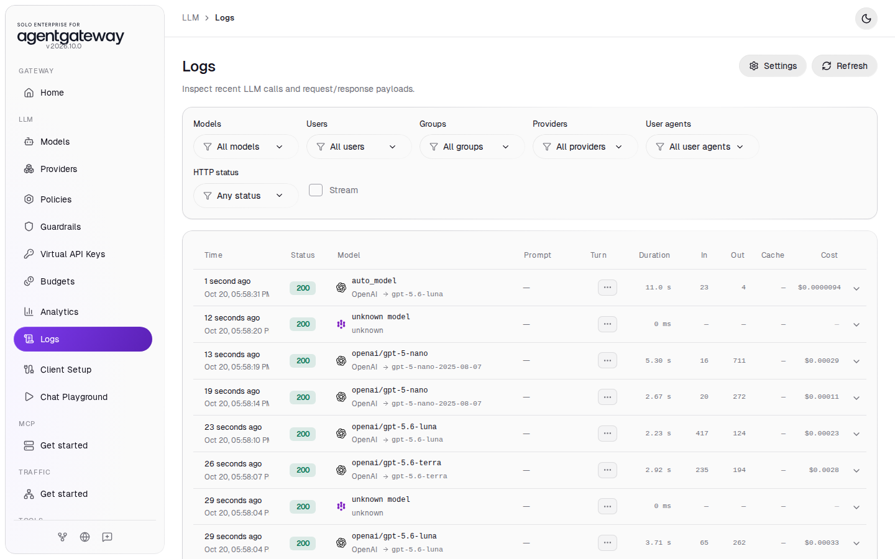
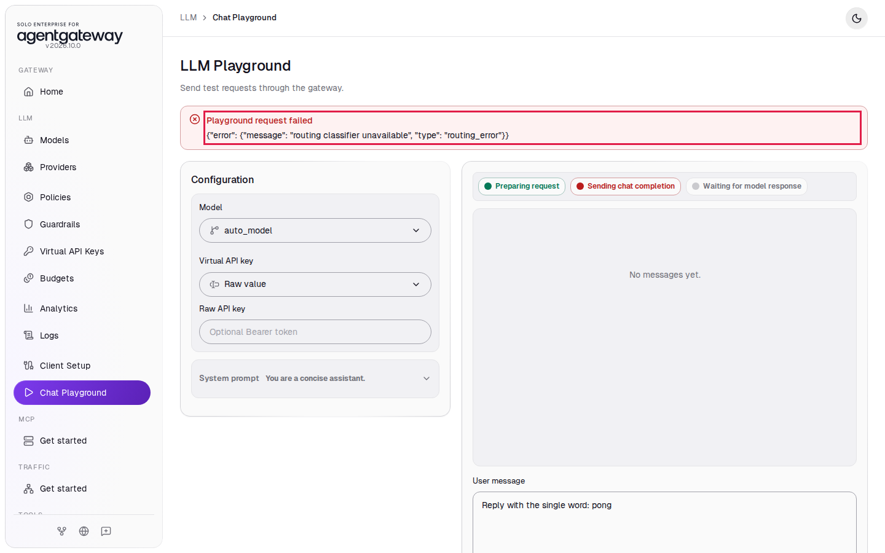
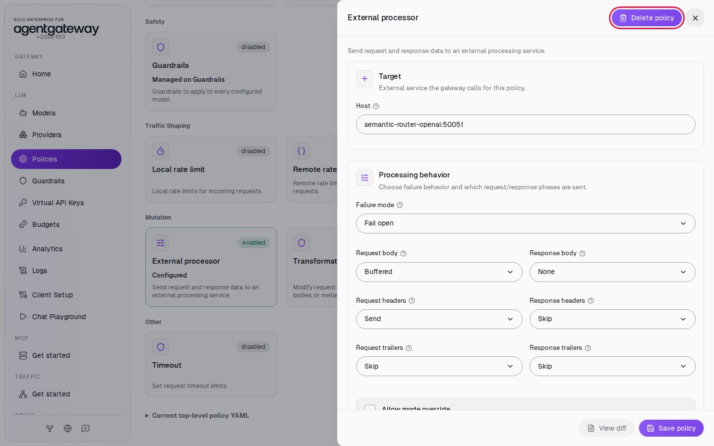

# Route Each Prompt to the Cheapest Model That Can Answer It, with the OpenAI Decisions API

## Before you start

- Complete [001: Set Up Standalone Agentgateway](../../001-set-up-standalone-agentgateway.md).
- Your OpenAI API key in `setup/.env` needs access to the Decisions API (`POST /v1/decisions`, in public beta). The adapter uses the same `OPENAI_API_KEY` as the gateway.
- Start the routing adapter. From the `setup` folder, run:

  ```bash
  env UID=$(id -u) GID=$(id -g) docker compose --profile semantic-router-openai up -d
  ```

  The adapter installs two Python packages when it starts, which takes about 20 seconds. Check that it is ready:

  ```bash
  docker compose logs --no-log-prefix semantic-router-openai --tail 1
  ```

  Expected output:

  ```json
  {"event": "started", "port": 50051, "tiers": {"economy": "openai/gpt-5-nano", "mid": "openai/gpt-5.6-luna", "high": "openai/gpt-5.6-terra"}}
  ```

> **The prompt goes to OpenAI twice.** The adapter sends each prompt to the Decisions API to classify it, and then the gateway sends the same prompt to OpenAI for the reply. Both calls go to the same provider under the same data terms.

## What you'll do

- Give clients one model name, `auto_model`, and let the gateway pick the real model for each prompt
- Connect the gateway to a routing adapter with the External processor policy
- Send prompts of different difficulty and see three different models answer them in Logs
- Read why each prompt went where it did in the adapter log
- Stop the adapter and see `auto_model` keep working on a fallback model
- Break the adapter's OpenAI key and see the gateway reject `auto_model` requests with a clear error

## Why this matters

When each client names its own model, developers pick the model that handles their hardest case, and that model also answers the easy prompts at a high price. With one name, `auto_model`, the platform team decides which model answers what. Clients do not change their code when that rule changes.

The OpenAI [Decisions API](https://developers.openai.com/api/docs/guides/decisions) is a decision model: it picks an answer from options you define instead of writing text. `gpt-6-luna` is its only model, and you pay for input tokens only ($0.10 per million). The adapter asks one `choice` question: which of three price tiers can fully answer this prompt? The API returns the tier, a probability for each tier, and a confidence value. When the model is unsure between two tiers, the adapter sends the prompt to a fallback tier.

[Route prompts with Jev](semantic-routing-jev.md) builds the same router with TypeSafe's Jev model. Both labs use the same tiers and test prompts, so you can compare them.

## How it fits together

```
Client: { "model": "auto_model", "messages": [...] }
   │
   ▼
Gateway, External processor policy  ──gRPC──►  semantic-router-openai adapter
   │                                              │  asks the Decisions API: economy, mid or high?
   │                                              │  low confidence? use the fallback tier
   │  ◄──── body rewritten: model = openai/gpt-5-nano | openai/gpt-5.6-luna | openai/gpt-5.6-terra
   ▼
openai/* model  ──►  OpenAI
```

The gateway sends each LLM request to the adapter before it picks a model. For `auto_model`, the adapter asks the Decisions API, then rewrites the `model` field in the request body. A request that names a real model, such as `openai/gpt-5.6-luna`, passes through unchanged, and the adapter makes no Decisions API call for it.

The tiers and the question are in `setup/semantic-router-openai/profile.json`. The tiers are the same as in the Kubernetes workshop: `gpt-5-nano` costs $0.05 per million input tokens and $0.40 per million output tokens, `gpt-5.6-luna` $0.20 and $1.20, and `gpt-5.6-terra` $2.00 and $12.00. In production you put your own economy, mid and high models in `tiers`.

| Setting | Value | What it does |
|---|---|---|
| `virtualModel` | `auto_model` | The only model name the adapter rewrites |
| `tiers` | `economy`: `openai/gpt-5-nano`, `mid`: `openai/gpt-5.6-luna`, `high`: `openai/gpt-5.6-terra` | The model behind each tier |
| `decisionsModel` | `gpt-6-luna` | The Decisions API model |
| `minConfidence`, `minMargin` | `0.5`, `0.2` | If the model's confidence, or the gap between the top two tiers, is below these values, the adapter uses the fallback tier |
| `fallbackTier` | `mid` | The tier for prompts that the model is unsure about |
| `question` | a `choice` question with a description and examples for each tier | What the model reads to decide |

The gateway also has a **Callout** routing strategy for virtual models, which asks an HTTP service for the model name. The 2026.10.0 UI has no form for it, and the adapter in this lab speaks the External processor protocol (gRPC), so this lab uses the External processor policy.

## Set up

This lab uses the `openai/*` model. [Connect LLM Providers](../llm/connect-llm-providers.md) explains these steps.

1. In the sidebar, click **Models**.
2. Click **Add model**.

   

3. In **Provider**, select **OpenAI**. The UI fills **Incoming model match** with `openai/*`.
4. Next to **Provider API key**, click **Env var** and enter `OPENAI_API_KEY`.
5. Under **Outgoing model**, click **Strip openai/**.
6. Click **Save model**.

   

The **Models** page lists `openai/*`.

## Step 1: Add the auto_model virtual model

1. In the sidebar, click **Models**.
2. Click **Add virtual model**.

   

3. In **Virtual model name**, enter `auto_model`.
4. Leave **Routing strategy** on **Weighted** and **Model** on **openai/\***.
5. In **Specific model**, enter `gpt-5.6-luna`.
6. Click **Save virtual model**.

   

The virtual model puts `auto_model` in the model lists that clients and the Chat Playground see. When the adapter rewrites a request, the gateway uses the rewritten name and skips this virtual model. When the adapter is down, the gateway serves `auto_model` with `gpt-5.6-luna`, the mid tier.

## Step 2: Add the External processor policy

1. In the sidebar, click **Policies**.
2. Click the **External processor** card.

   

3. In **Host**, replace `127.0.0.1:9000` with `semantic-router-openai:50051`.
4. In **Failure mode**, select **Fail open**.
5. In **Request body**, select **Buffered**. The adapter needs the whole prompt to classify it.
6. Leave **Request headers** on **Send**. The adapter removes any `x-decision-tier` or `x-decision-reason` header a client sends, so a client cannot pick its own tier.
7. In **Response body**, select **None**. In **Response headers**, **Request trailers** and **Response trailers**, select **Skip**. The adapter only changes the request, so the gateway does not send it the response.
8. Click **Save policy**.

   

`semantic-router-openai` is the adapter's name on the Docker Compose network. The policy applies to all requests on the LLM port, so the adapter sees each one. With **Fail open**, the gateway sends the request on unchanged when it cannot reach the adapter: `auto_model` requests go to the virtual model from Step 1, and requests for other models keep working. With **Fail closed**, every LLM request fails while the adapter is down.

## Step 3: Send four prompts to auto_model

1. Wait two seconds for the gateway to load the policy.
2. In the sidebar, click **Chat Playground**.
3. In **Model**, select **auto_model**.
4. In **User message**, enter each prompt below and click **Send**. Wait for the reply before you send the next one.

   | Prompt | Tier you expect |
   |---|---|
   | `Summarize this email in one sentence: lunch moved to noon.` | economy |
   | `Write a Python function that parses a CSV file and returns the sum of each numeric column.` | mid |
   | `Show that there are infinitely many primes.` | high |
   | `Write a regex that matches email addresses.` | leans to economy with low confidence, so the fallback tier, mid |

   

Each reply arrives with the status **OK**. The chip under each reply shows `auto_model`, the name the playground sent. Logs show which model answered.

## Check it

1. In the sidebar, click **Logs**.

   

   The newest row is at the top. From the bottom up, the four prompts went to `openai/gpt-5-nano`, `openai/gpt-5.6-luna`, `openai/gpt-5.6-terra` and `openai/gpt-5.6-luna`. The adapter rewrote the model before the gateway picked a model, so Logs and cost tracking record the model that served each prompt.

   You may also see a row named `unknown model`. That is the browser's preflight check from the Chat Playground; you can ignore it.

2. See why the adapter chose each tier. From the `setup` folder, run:

   ```bash
   docker compose logs --no-log-prefix semantic-router-openai | grep routing_decision
   ```

   Expected output (exact numbers vary a little between runs):

   ```json
   {"event": "routing_decision", "original_model": "auto_model", "selected_model": "openai/gpt-5-nano", "tier": "economy", "decisions_choice": "economy", "reason": "classified", "confidence": 1.0, "margin": 1.0, "probabilities": {"economy": 1.0, "mid": 0.0, "high": 0.0}, "decisions_latency_ms": 613}
   {"event": "routing_decision", "original_model": "auto_model", "selected_model": "openai/gpt-5.6-luna", "tier": "mid", "decisions_choice": "mid", "reason": "classified", "confidence": 0.93, "margin": 0.9, "probabilities": {"economy": 0.05, "mid": 0.95, "high": 0.0}, "decisions_latency_ms": 206}
   {"event": "routing_decision", "original_model": "auto_model", "selected_model": "openai/gpt-5.6-terra", "tier": "high", "decisions_choice": "high", "reason": "classified", "confidence": 0.76, "margin": 0.69, "probabilities": {"economy": 0.15, "mid": 0.01, "high": 0.84}, "decisions_latency_ms": 303}
   {"event": "routing_decision", "original_model": "auto_model", "selected_model": "openai/gpt-5.6-luna", "tier": "mid", "decisions_choice": "economy", "reason": "low_confidence", "confidence": 0.48, "margin": 0.3, "probabilities": {"economy": 0.65, "mid": 0.35, "high": 0.0}, "decisions_latency_ms": 257}
   ```

The last line is the regex prompt. The model chose `economy`, but with a confidence of 0.48, below the `minConfidence` of 0.5. The adapter recorded `reason: low_confidence` and served the fallback tier, `gpt-5.6-luna`, instead of `gpt-5-nano`. The margin of 0.3 alone would have passed the gate. OpenAI does not document how it computes `confidence`, so the adapter gates on both values. The proof prompt has no technical words, but the `high` tier description says that rigorous reasoning counts "even when the prompt is short".

<details>
<summary>Optional: check with curl</summary>

The `model` field of the response names the model that answered:

```bash
curl -s http://localhost:4000/v1/chat/completions \
  -H "Content-Type: application/json" \
  -d '{"model":"auto_model","messages":[{"role":"user","content":"Summarize this email in one sentence: lunch moved to noon."}]}' | jq -r '.model'
```

Expected output:

```
gpt-5-nano-2025-08-07
```

A request that names a real model skips classification. This proof prompt would go to the high tier as `auto_model`, but here the model the client named answers it:

```bash
curl -s http://localhost:4000/v1/chat/completions \
  -H "Content-Type: application/json" \
  -d '{"model":"openai/gpt-5-nano","messages":[{"role":"user","content":"Prove that sqrt(2) is irrational."}]}' | jq -r '.model'
```

Expected output:

```
gpt-5-nano-2025-08-07
```

The adapter log has no new `routing_decision` line for the second request. Clients can still name a premium model; this lab makes `auto_model` the low-cost default without taking that choice away.

</details>

## Step 4: Stop the adapter

See what clients get when the adapter is down.

1. From the `setup` folder, stop the adapter:

   ```bash
   docker compose --profile semantic-router-openai stop semantic-router-openai
   ```

2. In the Chat Playground, reload the page and select **auto_model** in **Model**.
3. In **User message**, enter `Reply with the single word: pong` and click **Send**.

The reply arrives with the status **OK** after about 10 seconds. The gateway waits for the adapter to time out, then fails open:



4. In the sidebar, click **Logs**. The newest row is `auto_model`, served by `gpt-5.6-luna`. The gateway sent the request on unchanged, and the virtual model from Step 1 answered it.

   

5. Start the adapter again:

   ```bash
   docker compose --profile semantic-router-openai start semantic-router-openai
   ```

## Step 5: Give the adapter an invalid OpenAI key

See what clients get when the Decisions API rejects the adapter's calls.

1. From the `setup` folder, recreate the adapter with an invalid key. The value on the command line applies only to this command, so the gateway keeps your real key:

   ```bash
   OPENAI_API_KEY=invalid docker compose --profile semantic-router-openai up -d semantic-router-openai
   ```

2. Wait until `docker compose logs --no-log-prefix semantic-router-openai --tail 1` shows the `started` line.
3. In the Chat Playground, reload the page, select **auto_model**, enter `Reply with the single word: pong` and click **Send**.

The playground shows **Playground request failed** with the adapter's error:



The adapter answers `503` instead of sending the prompt to the fallback tier, so a Decisions API outage shows up in your error rates instead of hiding behind working replies. The adapter log shows the cause:

```bash
docker compose logs --no-log-prefix semantic-router-openai --tail 1
```

```json
{"event": "decisions_error", "error": "HTTP Error 401: Unauthorized"}
```

4. Recreate the adapter with your real key:

   ```bash
   docker compose --profile semantic-router-openai up -d semantic-router-openai
   ```

## Tune the profile

The tier descriptions in `setup/semantic-router-openai/profile.json` are the routing rule. To change how prompts are classified, edit the file, then restart the adapter, which reads the profile when it starts:

```bash
docker compose --profile semantic-router-openai restart semantic-router-openai
```

- Change one tier description at a time, then send the same set of test prompts and compare the `routing_decision` lines.
- Raise `minMargin` to send more borderline prompts to the fallback tier. Lower it to trust the model's first choice more often.
- Describe what a tier needs, such as rigorous reasoning or routine code, instead of listing keywords. The model matches the meaning of the description.

A routing decision costs about 250 input tokens, roughly $0.000025 at the [published price](https://developers.openai.com/api/docs/guides/decisions). The Jev router costs about the same per decision: Jev's price per token is lower, but it counts about 530 tokens for the same question.

## What the UI wrote

In the sidebar, scroll down to **Tools** and click **Raw Configuration**. The UI added a virtual model and an `extProc` policy to the `llm` section:

```yaml
llm:
  policies:
    extProc:
      host: semantic-router-openai:50051
      failureMode: failOpen
      processingOptions:
        requestBodyMode: buffered
        responseBodyMode: none
        requestHeaderMode: send
        responseHeaderMode: skip
        requestTrailerMode: skip
        responseTrailerMode: skip
      requestAttributes: {}
      responseAttributes: {}
  virtualModels:
    - name: auto_model
      routing:
        weighted:
          targets:
            - model: openai/gpt-5.6-luna
              weight: 1
```

## Clean up

1. In the sidebar, click **Policies**.
2. Click the **External processor** card.
3. Click **Delete policy** (the trash icon at the top of the panel).

   

4. Click **Delete policy** to confirm. The card shows **disabled**.
5. In the sidebar, click **Models**.
6. In the `auto_model` row, click the trash icon, then click **Delete virtual model**.
7. Stop the adapter. From the `setup` folder, run:

   ```bash
   docker compose --profile semantic-router-openai stop semantic-router-openai
   ```

8. In the sidebar, click **Models**.
9. In the `openai/*` row, click the trash icon, then click **Delete model**.

The gateway is back to the state [001](../../001-set-up-standalone-agentgateway.md) left it in. Logs keep the requests from this lab.
