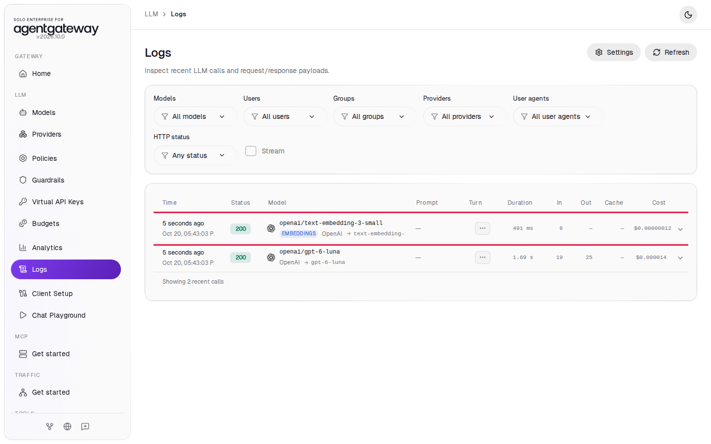
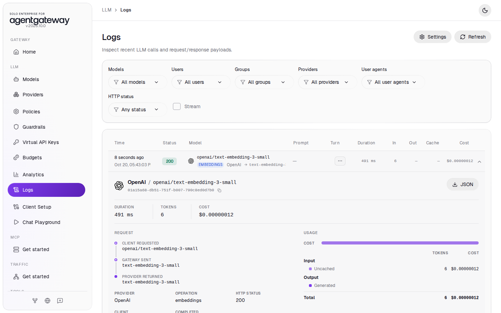

# Stream Replies and Create Embeddings

## Before you start

- Complete [001: Set Up Standalone Agentgateway](../../001-set-up-standalone-agentgateway.md).

## What you'll do

- Stream a chat reply through the gateway
- Turn a sentence into an embedding
- Find both requests in Logs, with their tokens and cost

## Why this matters

A chat window streams a reply as the model writes it, and a search feature turns text into embeddings (lists of numbers that capture its meaning). Both requests go to port `4000` and use the `openai/*` model, and the gateway counts tokens and cost for each.

## Set up

This lab uses the `openai/*` model. [Connect LLM Providers](connect-llm-providers.md) explains these steps.

1. In the sidebar, click **Models**.
2. Click **Add model**.

   

3. In **Provider**, select **OpenAI**. The UI fills **Incoming model match** with `openai/*`.
4. Next to **Provider API key**, click **Env var** and enter `OPENAI_API_KEY`.
5. Under **Outgoing model**, click **Strip openai/**.
6. Click **Save model**.

   

The **Models** page lists `openai/*`.

## Step 1: Stream a reply

Add `"stream": true` to a chat request. The `-N` option tells curl to print each part as it arrives:

```bash
curl -sN http://localhost:4000/v1/chat/completions \
  -H 'Content-Type: application/json' \
  -d '{"model":"openai/gpt-6-luna","stream":true,"messages":[{"role":"user","content":"Count from 1 to 5, one number per line."}]}'
```

Expected output (shortened):

```
data: {"id":"chatcmpl-...","object":"chat.completion.chunk",...,"choices":[{"index":0,"delta":{"content":"1"},"finish_reason":null}],"usage":null,...}

data: {"id":"chatcmpl-...","object":"chat.completion.chunk",...,"choices":[{"index":0,"delta":{"content":"\n"},"finish_reason":null}],"usage":null,...}

data: {"id":"chatcmpl-...","object":"chat.completion.chunk",...,"choices":[{"index":0,"delta":{"content":"2"},"finish_reason":null}],"usage":null,...}

...

data: {"id":"chatcmpl-...","object":"chat.completion.chunk",...,"choices":[],"usage":{"prompt_tokens":19,"completion_tokens":23,"total_tokens":42,...}}

data: [DONE]
```

The reply comes back as a series of `data:` chunks, each with a small piece of the text, and ends with `data: [DONE]`.

The last chunk before `[DONE]` carries `usage`. OpenAI sends usage on a stream only when the request includes `"stream_options": {"include_usage": true}`. Your request leaves that option out, so the gateway adds it, and Logs gets the tokens and cost of the streamed reply.

## Step 2: Create an embedding

Send one sentence to `/v1/embeddings` with an OpenAI embedding model. It uses the same `openai/*` model and key as chat:

```bash
curl -s http://localhost:4000/v1/embeddings \
  -H 'Content-Type: application/json' \
  -d '{"model":"openai/text-embedding-3-small","input":"The gateway counts every request."}'
```

Expected output (shortened):

```
{"object":"list","data":[{"object":"embedding","embedding":[-0.01168060302734375,-0.03076171875,0.0313720703125,...],"index":0}],"model":"text-embedding-3-small","usage":{"prompt_tokens":6,"total_tokens":6}}
```

The `embedding` list has 1,536 numbers. An embedding request has input tokens only, because the model returns numbers instead of text.

## Check it

1. In the sidebar, click **Logs**.
2. Find the two rows with status `200`:
   - `openai/gpt-6-luna` is the streamed reply from Step 1. It shows input tokens, output tokens and a cost, like any chat request.
   - `openai/text-embedding-3-small` has the **EMBEDDINGS** badge. It shows input tokens, an empty **Out** column, and a cost of a fraction of a cent.

   

3. Click the `openai/text-embedding-3-small` row to open its details.

The details show **Operation** `embeddings`, the model the gateway sent to OpenAI (`text-embedding-3-small`, with `openai/` stripped), and the token count and cost:



## What the UI wrote

The UI added only the `openai/*` model from **Set up**. Streaming and embeddings use that model as it is.

## Clean up

1. In the sidebar, click **Models**.
2. In the `openai/*` row, click the trash icon, then click **Delete model**.

The gateway is back to the state [001](../../001-set-up-standalone-agentgateway.md) left it in.
