# Stop Slow Requests and Retry Failed Ones

## Before you start

- Complete [Connect LLM Providers](../llm/connect-llm-providers.md).
- Start the mock LLM servers that this lab uses. From the `setup/` folder, run:

  ```bash
  env UID=$(id -u) GID=$(id -g) docker compose --profile mock-llm-faults up -d
  ```

  This starts three mock LLM servers on the gateway's Docker network. They serve a model named `mock-gpt` on port `8000` and cost nothing to call:

  | Service | How it answers |
  |---|---|
  | `mock-llm-slow` | Waits 5 seconds before each reply |
  | `mock-llm-flaky` | Answers about 3 in 10 requests with `503 Service Unavailable` |
  | `mock-llm-503` | Answers every request with `503`. The next lab, [Load Balance Models and Fail Over to a Backup](load-balancing-and-failover.md), uses it. |

## What you'll do

- Add a slow model and stop its requests after 2 seconds with a timeout
- Put a route on port `8080` in front of a model server that fails some requests
- Add a retry policy and see the failed requests succeed

## Why this matters

A model that hangs holds your application's connection open, and the user waits with no reply. A timeout ends the request at a limit you choose, so the application can show an error or try something else.

Self-hosted model servers fail some requests when they are busy or restarting. A retry policy sends a failed request again, so the caller gets a reply instead of the error.

## Step 1: Add the slow model

1. In the sidebar, click **Models**.
2. Click **Add model**.

   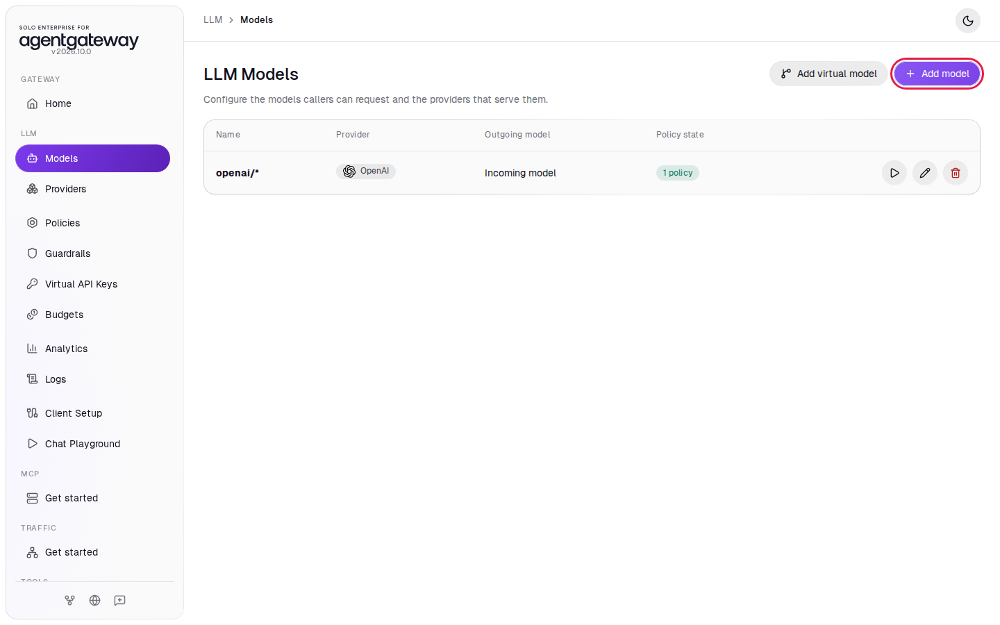

3. In **Provider**, select **Custom**.
4. In **Incoming model match**, enter `mock-llm-slow`.
5. Leave **Provider API key** on **Unset**. The mock needs no key.
6. In **Base URL**, enter `http://mock-llm-slow:8000/v1`.
7. Under **Outgoing model**, click **Explicit**.
8. In **Explicit outgoing model**, enter `mock-gpt`. Click the **Add model** title at the top of the panel to close the suggestion list. Do not press Escape, because Escape closes the whole panel.
9. Click **Save model**.

   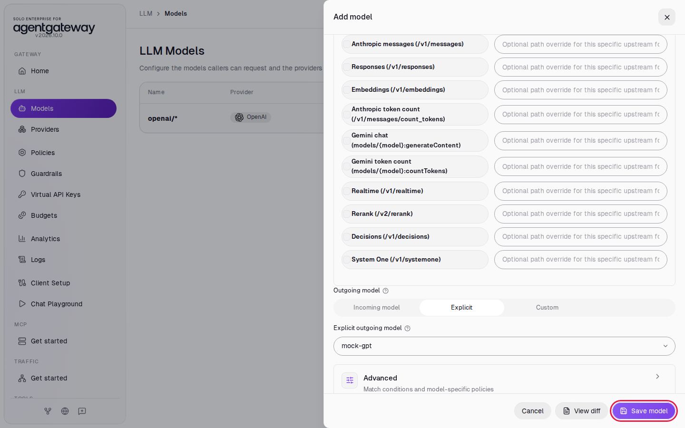

## Step 2: See the slow reply

1. Wait two seconds, then in the sidebar click **Chat Playground**.
2. In **Model**, select **mock-llm-slow**.
3. In **User message**, enter `Hello` and click **Send**.

The reply appears after about 5 seconds. The mock's reply is placeholder text.

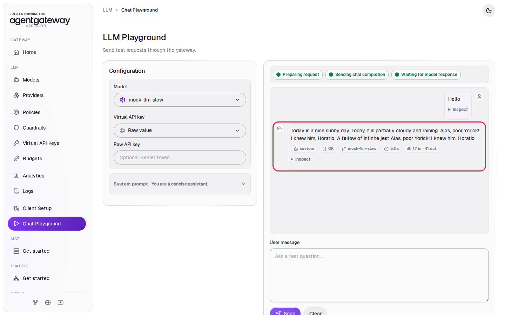

## Step 3: Add a 2 second timeout

1. In the sidebar, click **Policies**.
2. Click the **Timeout** card.

   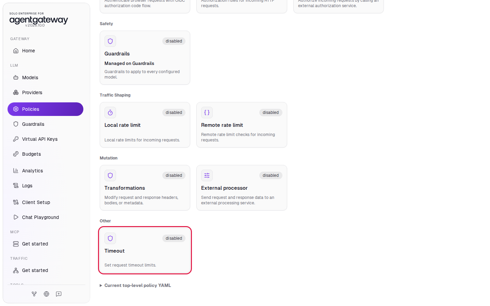

3. In **Policy YAML**, enter:

   ```yaml
   requestTimeout: 2s
   ```

4. Click **Save policy**.

   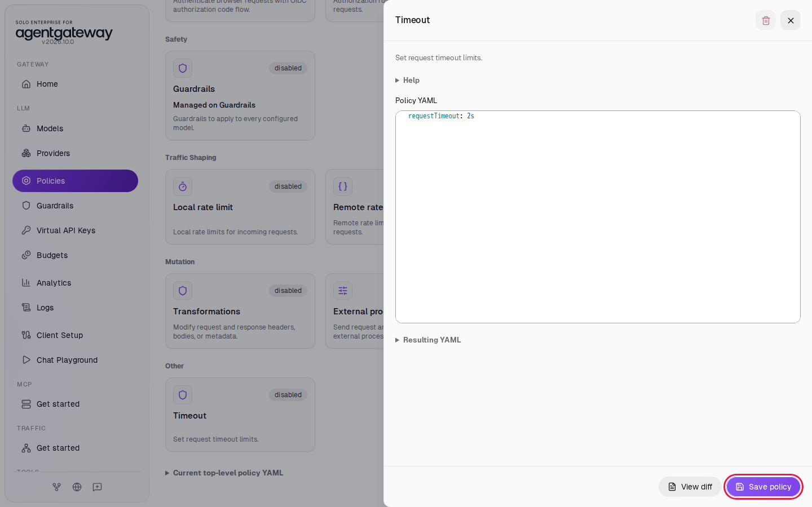

`requestTimeout` is the longest time the gateway waits for the whole response. The policy is on the **LLM Policies** page, so it applies to every LLM model, including `openai/*`.

## Check the timeout

1. Wait two seconds, then in the sidebar click **Chat Playground**.
2. In **Model**, select **mock-llm-slow**.
3. In **User message**, enter `Hello` and click **Send**.

After about 2 seconds, the playground shows **Playground request failed** with `request timeout`. The gateway stopped waiting and returned an error to the caller.

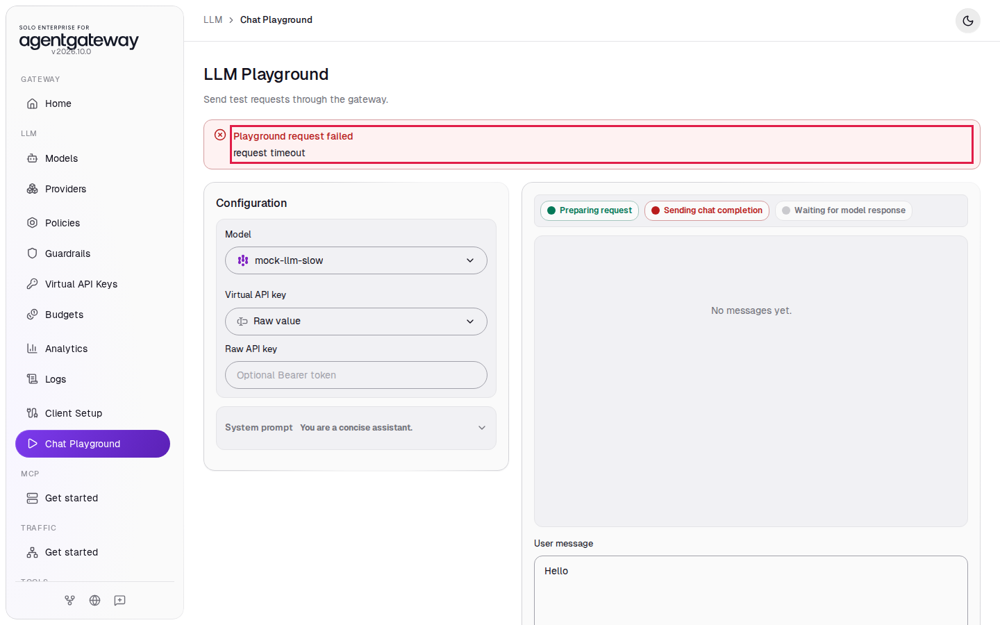

4. In the sidebar, click **Logs**.

The newest `mock-llm-slow` row has status `504` and a duration of about 2 seconds.

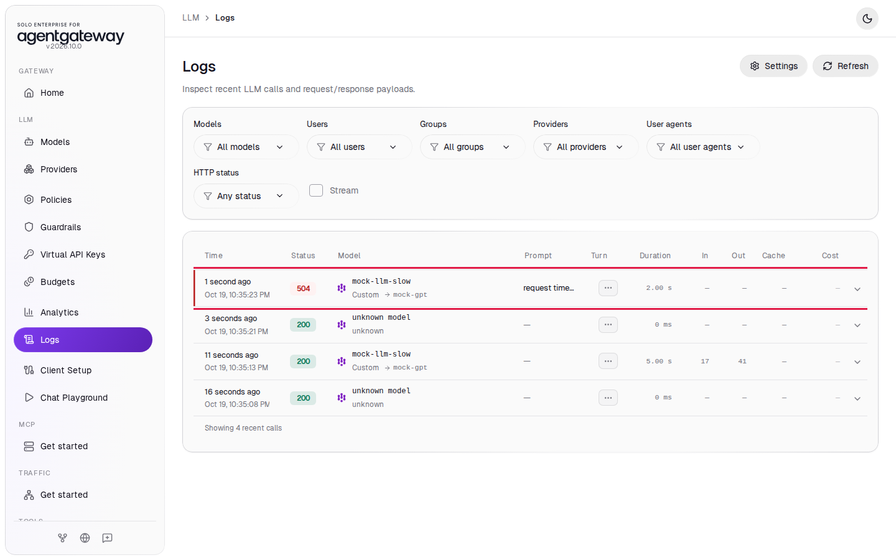

## Step 4: Add a gateway on port 8080

Retries are a route policy. You add them to a traffic route, a plain HTTP route from a gateway port to a server. Send the requests to the flaky model server through a new gateway on port `8080`.

1. In the sidebar, under **Traffic**, click **Get started**.
2. Click **Enable**. The UI adds a gateway named `public` on port `8080` and opens **Traffic Gateways**.

   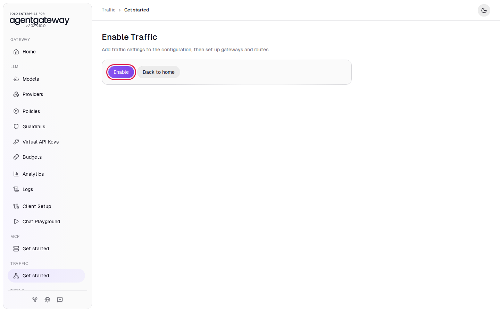

## Step 5: Route port 8080 to the flaky model server

1. In the sidebar, under **Traffic**, click **Routes**.
2. Click **Add route**.
3. In **Gateway**, select **public**.
4. In **Name**, enter `flaky-llm`.
5. Leave **Path match** on **Prefix** and **Path** on `/`.
6. Under **Backends**, click **Add backend**.
7. Leave **Target type** on **Host**. In **Host**, enter `mock-llm-flaky:8000`.
8. Click **Save route**.

   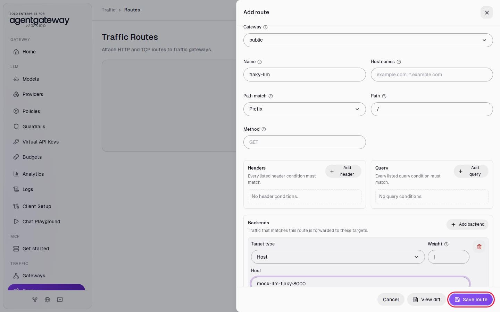

## Step 6: Send requests without retries

Run this loop. It sends 20 chat requests to port `8080` and prints the status code of each:

```bash
for i in $(seq 1 20); do
  curl -s -o /dev/null -w '%{http_code} ' http://localhost:8080/v1/chat/completions \
    -H 'Content-Type: application/json' \
    -d '{"model":"mock-gpt","messages":[{"role":"user","content":"Hello"}]}'
done; echo
```

Expected output (your mix differs):

```
200 200 200 200 200 200 200 200 200 200 503 200 503 200 200 200 200 200 503 200
```

About 3 in 10 requests fail with `503`. Each of those is an error your application would have to handle.

## Step 7: Add a retry policy

1. On the **Traffic Routes** page, in the `flaky-llm` row, click **Edit route**.
2. Click **Route policies**.
3. Click **Retry**.

   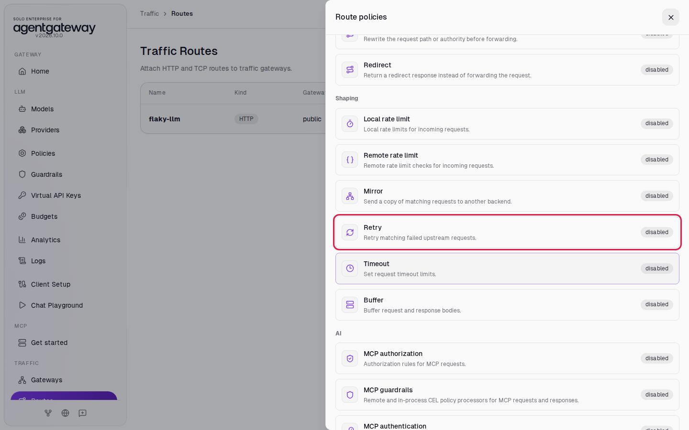

4. In **Policy YAML**, enter:

   ```yaml
   attempts: 5
   backoff: 100ms
   codes:
   - 503
   ```

5. Click **Save**.

   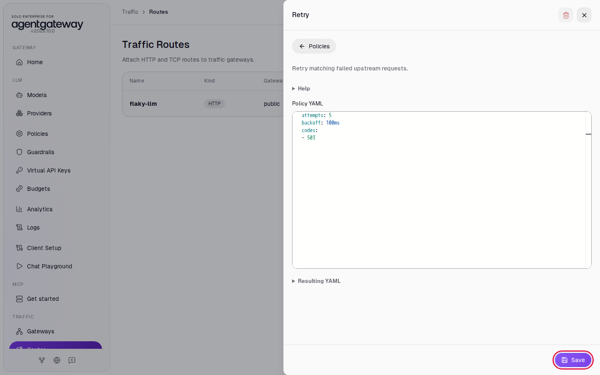

6. The **Route policies** list shows Retry as configured. Click the close icon at the top of the list.

   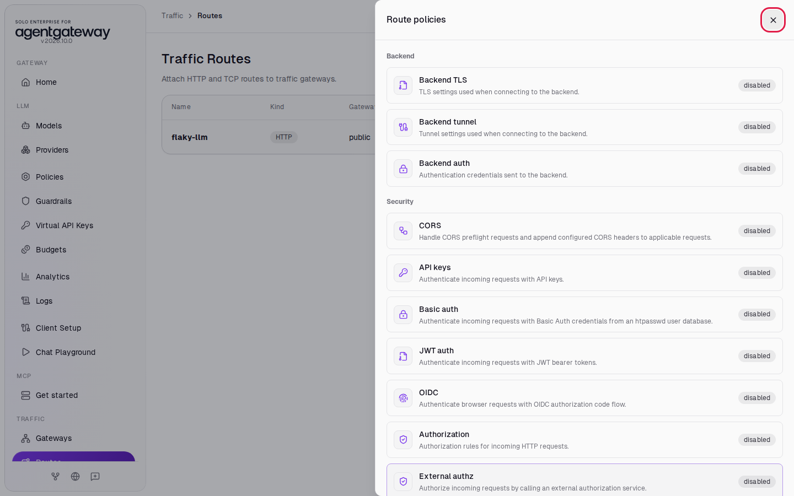

7. Click **Save route**.

The gateway now sends a request again when the server answers `503`, up to 5 more times, and waits 100 ms before each new attempt. Retry only codes that are safe to repeat. A `503` means the server could not take the request, so sending it again does no harm.

## Check the retries

Wait two seconds, then run the loop from Step 6 again.

Expected output:

```
200 200 200 200 200 200 200 200 200 200 200 200 200 200 200 200 200 200 200 200
```

All 20 requests return `200`. With 5 retries, a request fails only if all 6 attempts fail, about once in 1,400 requests with this mock.

<details>
<summary>Optional: see the retries in the gateway log</summary>

From the `setup/` folder, run:

```bash
docker compose logs agentgateway | grep retry.attempt | tail -2
```

Expected output (trimmed):

```
... route=default/flaky-llm endpoint=mock-llm-flaky:8000 ... http.status=200 protocol=http retry.attempt=3 duration=317ms
... route=default/flaky-llm endpoint=mock-llm-flaky:8000 ... http.status=200 protocol=http retry.attempt=1 duration=107ms
```

`retry.attempt` is the number of retries the gateway made before it got the `200`.

</details>

> **Note:** Requests on port `8080` go through a traffic route, so they do not appear on the **Logs** page. That page shows requests to the LLM port, `4000`.

## What the UI wrote

In the sidebar, scroll down to **Tools** and click **Raw Configuration**. The UI added the timeout to `llm.policies`, the model to `llm.models`, and a gateway and a route at the top level:

```yaml
llm:
  policies:
    ...
    timeout:
      requestTimeout: 2s
  models:
    ...
    - name: mock-llm-slow
      provider:
        custom:
          formats:
            - type: completions
      params:
        model: mock-gpt
        baseUrl: http://mock-llm-slow:8000/v1
gateways:
  public:
    port: 8080
routes:
  - gateways: public
    matches:
      - path:
          pathPrefix: /
    backends:
      - host: mock-llm-flaky:8000
    name: flaky-llm
    policies:
      retry:
        attempts: 5
        backoff: 100ms
        codes:
          - 503
```

## Clean up

1. In the sidebar, under **Traffic**, click **Routes**.
2. In the `flaky-llm` row, click **Delete route**. The route is deleted right away.
3. In the sidebar, under **Traffic**, click **Gateways**.
4. Next to `public`, click **Delete gateway**.
5. In the sidebar, click **Policies**.
6. Click the **Timeout** card. Click the **Delete policy** icon at the top of the panel, then click **Delete policy** to confirm.
7. In the sidebar, click **Models**.
8. In the `mock-llm-slow` row, click the trash icon, then click **Delete model**.
9. In the sidebar, scroll down to **Tools** and click **Raw Configuration**.
10. Delete the two lines `gateways: {}` and `routes: []` near the end, then click **Save**. If a confirmation appears, click **Save** again. While `gateways: {}` is there, the sidebar shows **Gateways** and **Routes** under **Traffic** instead of **Get started**.
11. Stop the mock servers. From the `setup/` folder, run:

   ```bash
   docker compose --profile mock-llm-faults stop mock-llm-slow mock-llm-flaky mock-llm-503
   ```

The gateway is back to the state [Connect LLM Providers](../llm/connect-llm-providers.md) left it in.
