# Give Each User a Virtual API Key

## Before you start

- Complete [Connect LLM Providers](../llm/connect-llm-providers.md). The gateway has the `openai/*` model.

## What you'll do

- Turn on API key authentication for LLM traffic
- Create a virtual API key for `alice` and one for `bob`
- See the gateway reject a request that has no key
- Send a request with alice's key
- Find alice's requests in Logs and Analytics

## Why this matters

Without authentication, anyone who can reach port `4000` can spend your OpenAI credits. A virtual API key is a key the gateway issues and checks. Each user or app gets its own key, the provider key stays inside the gateway, and every request is recorded under the name of the key that sent it. To cut off one user, you delete their key.

## Step 1: Turn on API key authentication

1. In the sidebar, click **Virtual API Keys**.
2. Click **Enable API key auth**.

   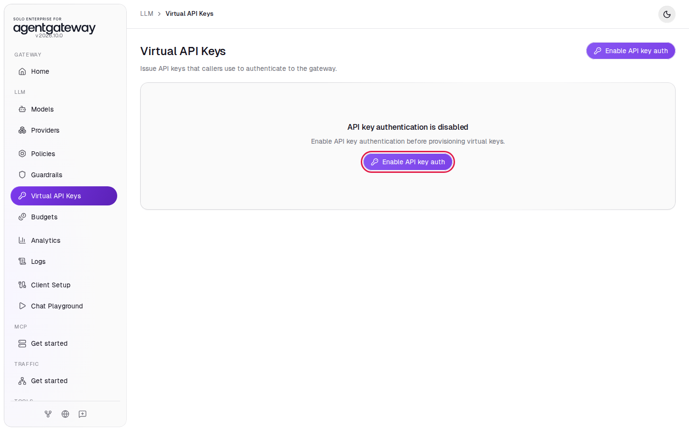

3. Leave **Validation mode** on **Strict**.
4. Click **Enable API key auth**.

   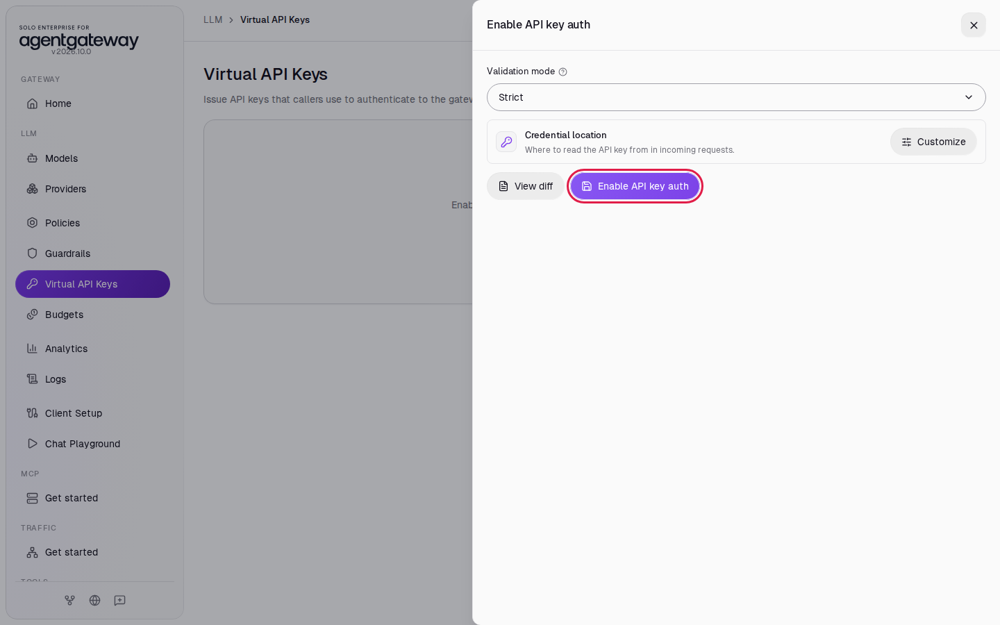

**Strict** means every request to port `4000` must carry a valid key. From now on, a request without a key gets HTTP `401`.

## Step 2: Create a key for alice

1. Click **New key**.

   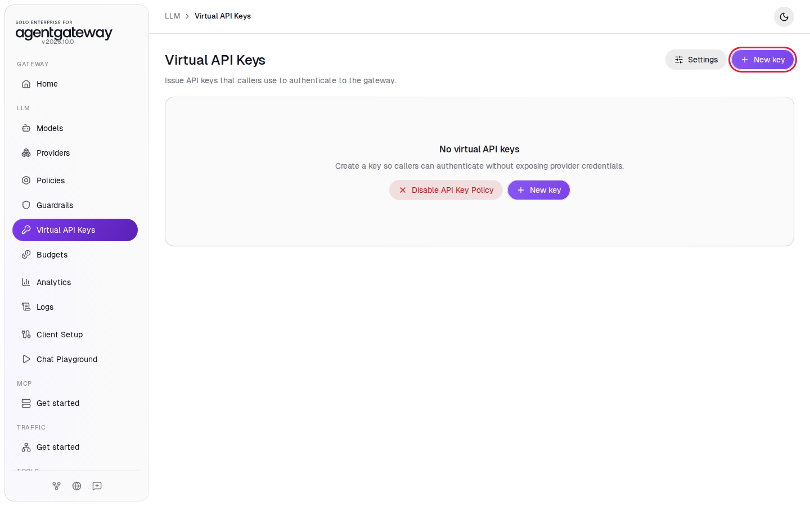

2. In **Name**, enter `alice`.
3. Leave **Key value** on **agw_sk_\*\*\*\*\* (auto generate)**.
4. Click **Save key**.

   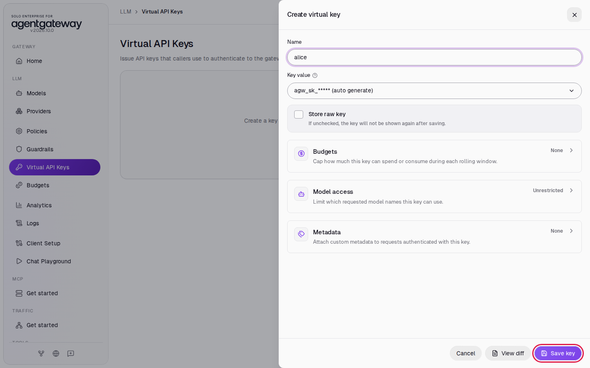

5. The **Copy your new API key** window shows the full key, which starts with `agw_sk_`. Click **Copy** and paste the key into a text file. You need it in Step 4.

   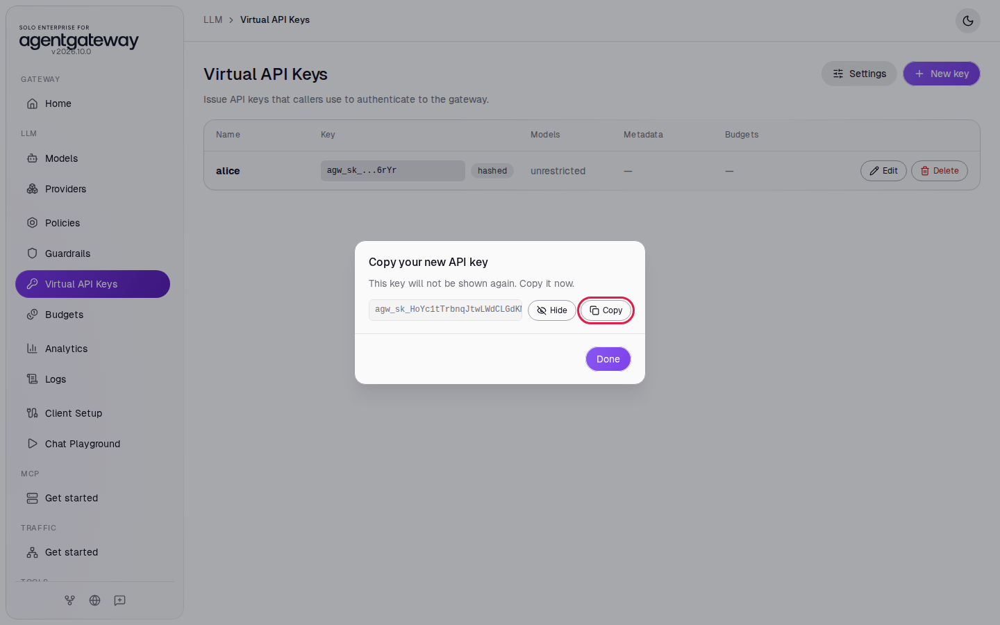

6. Click **Done**.

The gateway stores only a hash of the key, so this window is the only time you see the full key. If you lose it, delete the key and create a new one.

## Step 3: Create a key for bob

1. Click **New key**.
2. In **Name**, enter `bob`.
3. Click **Save key**.
4. Click **Copy**, paste bob's key into your text file, and click **Done**.

The list shows both keys. The **Key** column shows only the start and the last four characters of each key.

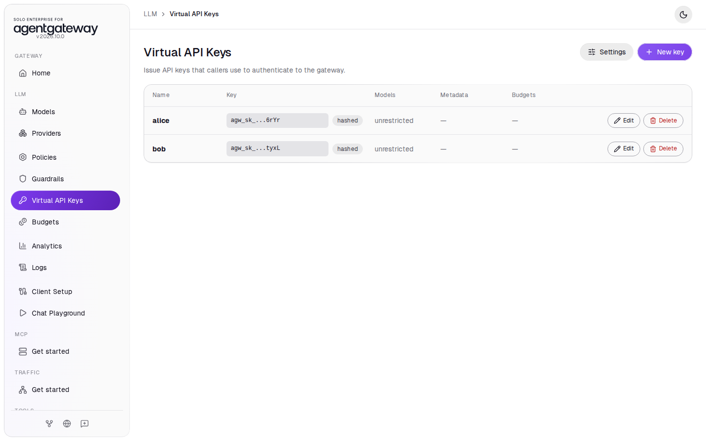

## Step 4: Send a request without a key

1. In the sidebar, click **Chat Playground**.
2. In **Model**, select **openai/\***.
3. In **Specific model**, enter `gpt-4o-mini`.
4. Leave **Raw API key** empty.
5. In **User message**, enter `Reply with the single word: pong` and click **Send**.

The gateway rejects the request. A red box shows **Playground request failed** with the message `api key authentication failure: no API Key found`:

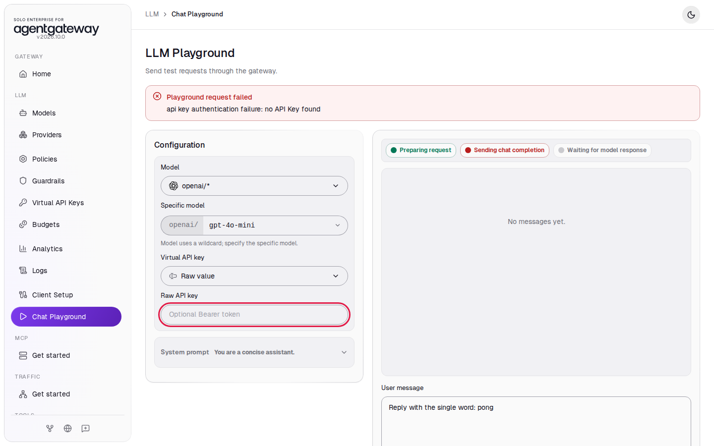

## Step 5: Send a request with alice's key

1. In **Raw API key**, paste alice's key.
2. In **User message**, enter `Reply with the single word: pong` and click **Send**.

The reply appears with the status **OK**:

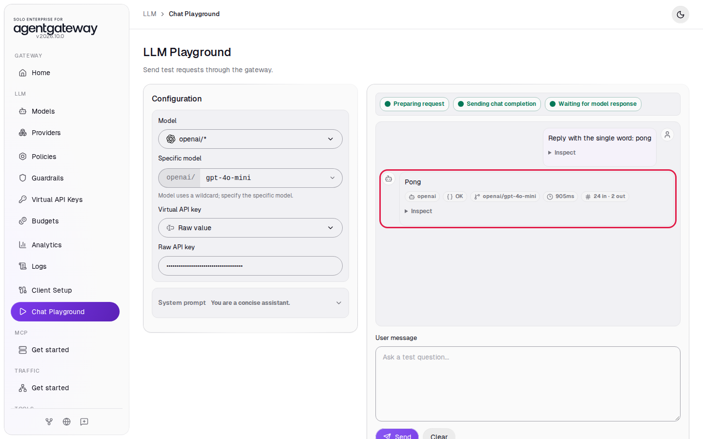

## Check it

1. In the sidebar, click **Logs**.
2. Click **All users** and select **alice**. The list shows only alice's request, with status `200`.

   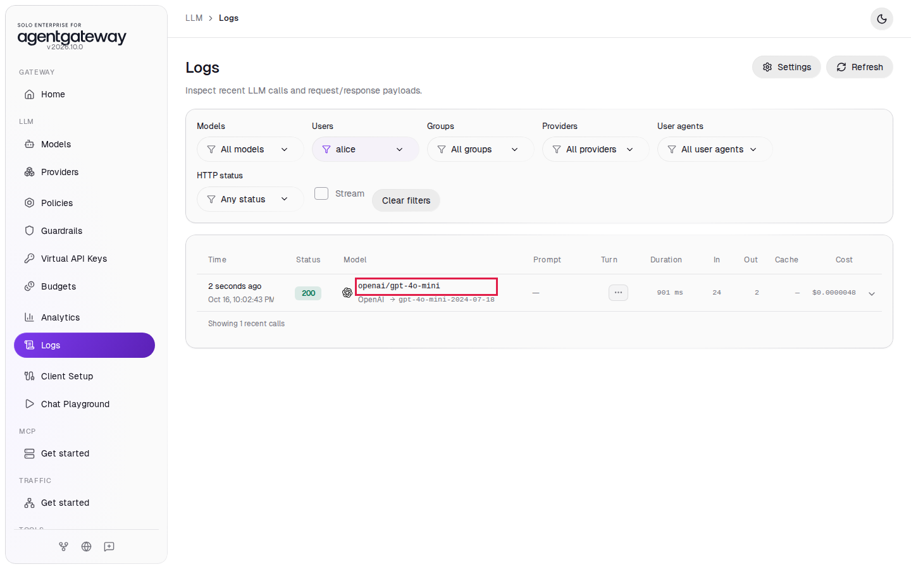

3. Click the `openai/gpt-4o-mini` row. In the details, **User** shows `alice`.

   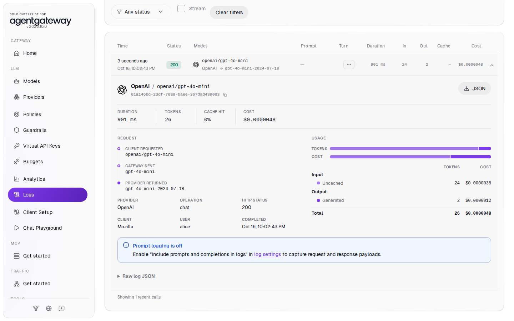

The gateway took the user name from the key. The caller cannot change it, because the name comes from the key, not from the request.

4. In the sidebar, click **Analytics**.
5. In **Group by**, select **User**, then click an empty part of the page to close the list.

The chart splits the token count by user. If you also sent a request with bob's key (see the curl check below), you see `alice` and `bob` in the legend:

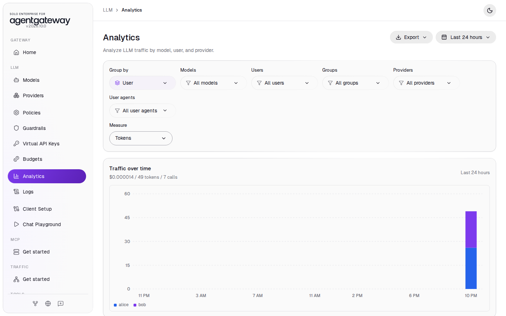

<details>
<summary>Optional: check with curl</summary>

Without a key:

```bash
curl -s -o /dev/null -w '%{http_code}\n' http://localhost:4000/v1/chat/completions \
  -H "Content-Type: application/json" \
  -d '{"model":"openai/gpt-4o-mini","messages":[{"role":"user","content":"Hello from agentgateway"}]}'
```

Expected output:

```
401
```

With bob's key (replace `<bob's key>` with the key you copied in Step 3):

```bash
curl -s -o /dev/null -w '%{http_code}\n' http://localhost:4000/v1/chat/completions \
  -H "Content-Type: application/json" \
  -H "Authorization: Bearer <bob's key>" \
  -d '{"model":"openai/gpt-4o-mini","messages":[{"role":"user","content":"Hello from agentgateway"}]}'
```

Expected output:

```
200
```

A key the gateway did not issue, for example `agw_sk_not-a-real-key`, also gets `401`.

</details>

## What the UI wrote

In the sidebar, scroll down to **Tools** and click **Raw Configuration**. The UI added an `apiKey` policy to the `llm` section. Each key appears only as a hash, with its name in `metadata`:

```yaml
llm:
  policies:
    apiKey:
      mode: strict
      keys:
      - keyHash: sha256:c7ced9a1022889370d0a515c62f87e930c3d49af9a6da27e69242cc6703b3756
        metadata:
          name: alice
          agentgateway.dev/keyHint: agw_sk_...eXLg
          agentgateway.dev/id: ea731c50-06f7-4760-bb0a-c64f48af3068
          agentgateway.dev/createdAt: 1792185709
      - keyHash: sha256:...
        metadata:
          name: bob
          ...
```

Your hashes, hints and IDs are different.

## Clean up

1. In the sidebar, click **Virtual API Keys**.
2. In the **alice** row, click **Delete**, then click **Delete key** to confirm.
3. In the **bob** row, click **Delete**, then click **Delete key** to confirm.
4. With both keys deleted, the page shows **No virtual API keys** with a **Disable API Key Policy** button next to **New key**. Click **Disable API Key Policy**.

   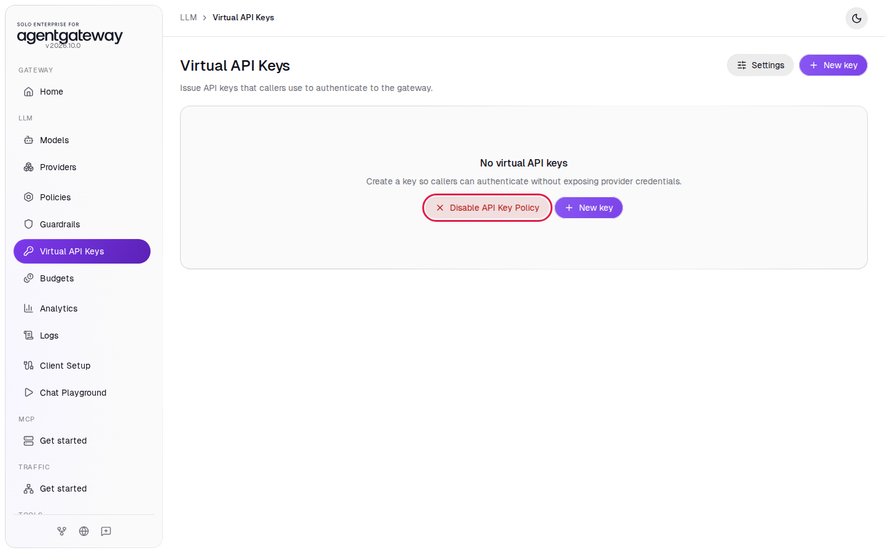

5. Click **Disable API Key Policy** to confirm.

The page shows **API key authentication is disabled**, and requests without a key work again.
