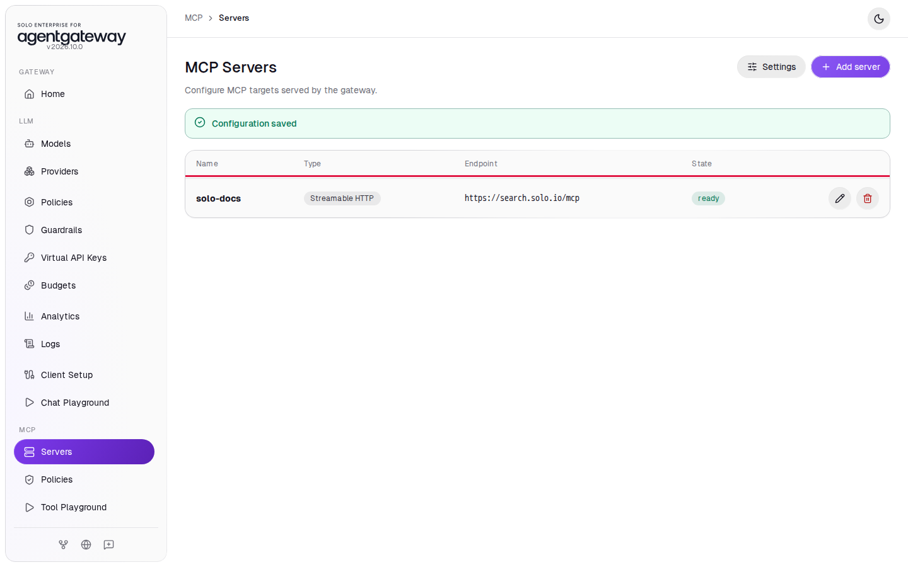
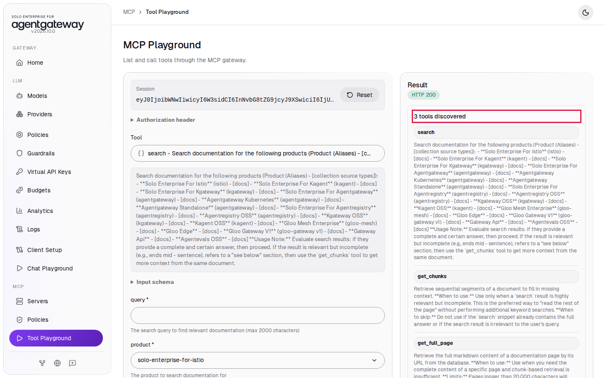
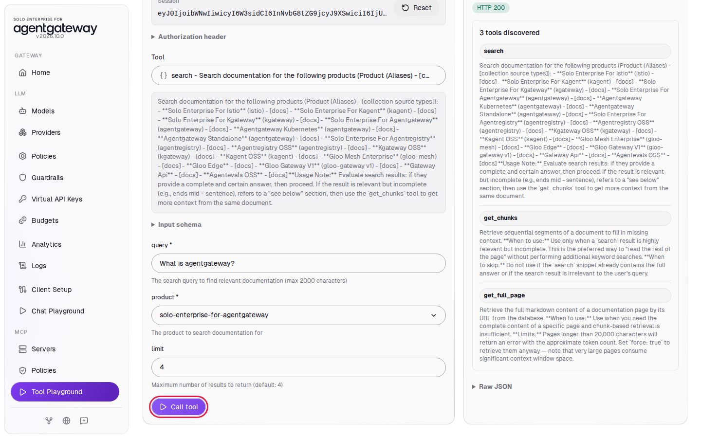
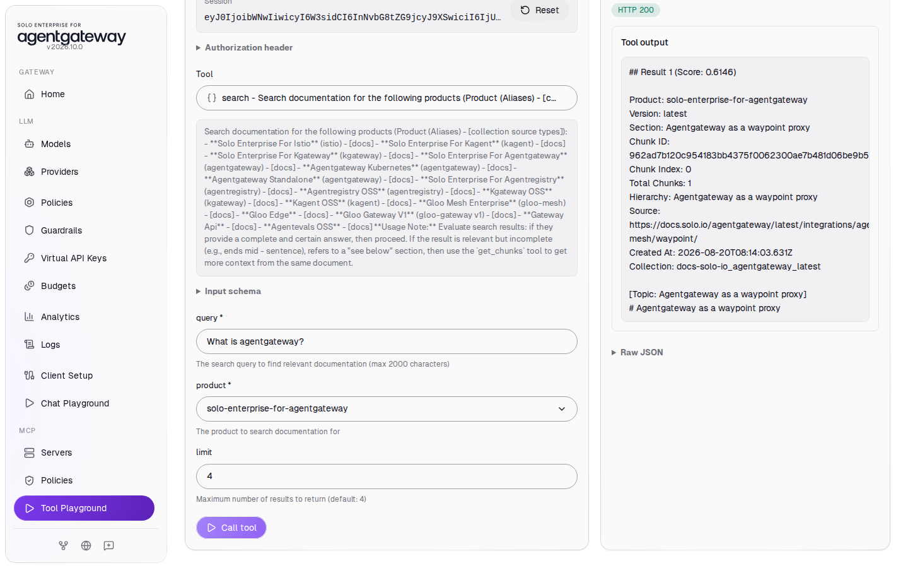

# Connect a Remote MCP Server

## Before you start

- Complete [001: Set Up Standalone Agentgateway](../../001-set-up-standalone-agentgateway.md).
- Complete [Connect LLM Providers](../llm/connect-llm-providers.md).
- Your computer can reach `https://search.solo.io`.

Every other MCP lab starts from the state this lab leaves behind. This lab has no cleanup section.

## What you'll do

- Turn on MCP in the gateway
- Add the Solo.io documentation MCP server, which runs on the internet
- Call one of its tools from the Tool Playground
- Optional: connect Claude Code to the gateway

## Why this matters

AI agents use MCP servers to call tools. When the agents connect to the gateway instead of to each server, you get one place to add servers, control access, and see every tool call. The agent needs one URL: `http://localhost:4001/mcp`.

## Step 1: Turn on MCP

1. In the sidebar, under **MCP**, click **Get started**.

   

2. Click **Enable**.

   

The UI creates a gateway listener named `default` on port `4001` and serves MCP on it. The sidebar now shows **Servers**, **Policies** and **Tool Playground** under **MCP**.

## Step 2: Add the MCP server

1. On the **MCP Servers** page, click **Add server**.
2. In **Server name**, enter `solo-docs`.
3. Leave the transport on **Streamable HTTP**.
4. In **URL**, enter `https://search.solo.io/mcp`.
5. Click **Save server**.

   

After a few seconds, the **State** column shows **ready**. The gateway connected to the server.



## Step 3: Allow the Tool Playground to connect

The Tool Playground runs in your browser and calls the gateway on port `4001`. The browser blocks that call until the gateway allows the UI's address with a CORS policy. The playground adds the policy for you.

1. In the sidebar, click **Tool Playground**.
2. Click **Apply CORS**.

   

3. Wait two seconds, then reload the page.

If you click **Initialize** before the gateway loads the new policy, you see **MCP request failed** with **Failed to fetch**. Reload the page and click **Initialize** again.

## Check it

1. Click **Initialize**. The **Session** field shows a session ID and the **Result** panel lists **3 tools discovered**.

   

2. In **Tool**, select **search**.
3. In **query**, enter `What is agentgateway?`.
4. In **product**, select **solo-enterprise-for-agentgateway**.
5. Click **Call tool**.

   

The **Tool output** shows search results from the Solo.io docs, starting with **Result 1**:



The gateway passed your tool call to `search.solo.io` and returned the answer.

<details>
<summary>Optional: check with curl</summary>

Start an MCP session. The gateway returns the session ID in the `mcp-session-id` header:

```bash
curl -s -i http://localhost:4001/mcp \
  -H "Content-Type: application/json" \
  -H "Accept: application/json, text/event-stream" \
  -d '{"jsonrpc":"2.0","id":1,"method":"initialize","params":{"protocolVersion":"2025-06-18","capabilities":{},"clientInfo":{"name":"curl","version":"1"}}}'
```

Expected output:

```
HTTP/1.1 200 OK
content-type: text/event-stream
mcp-session-id: eyJ0IjoibWNwIi...

event: message
data: {"jsonrpc":"2.0","id":1,"result":{"protocolVersion":"2025-06-18",...,"serverInfo":{"name":"Solo.io - Docs MCP",...}}}
```

</details>

## Optional: connect Claude Code

If you use [Claude Code](https://docs.claude.com/en/docs/claude-code/overview), add the gateway as an MCP server:

```bash
claude mcp add --transport http solo-docs http://localhost:4001/mcp
```

Start `claude` and type `/mcp`. The `solo-docs` server shows as connected, with the `search`, `get_chunks` and `get_full_page` tools. Ask Claude a question about agentgateway, and the tool calls go through your gateway.

To remove it later:

```bash
claude mcp remove solo-docs
```

## What the UI wrote

In the sidebar, scroll down to **Tools** and click **Raw Configuration**. The UI added a gateway and an `mcp` section:

```yaml
gateways:
  default:
    port: 4001
mcp:
  gateways: default
  targets:
    - name: solo-docs
      mcp:
        host: https://search.solo.io/mcp
  policies:
    cors:
      allowOrigins:
      - http://localhost:15000
      allowHeaders:
      - '*'
      allowMethods:
      - GET
      - POST
      exposeHeaders:
      - Mcp-Session-Id
```

## Next

Pick any lab in the MCP track. Each one starts from the state you have now and returns to it in its cleanup.
