# Federate a Local MCP Server with a Remote One

## Before you start

- Complete [Connect a Remote MCP Server](../mcp/connect-remote-mcp-server.md). The `solo-docs` server is on the **MCP Servers** page.
- Start the local MCP server that this lab uses. From the `setup/` folder, run:

  ```bash
  env UID=$(id -u) GID=$(id -g) docker compose --profile mcp-everything up -d
  ```

  This starts the `mcp-everything` container: the MCP "everything" reference server, which offers 13 test tools such as `echo` and `get-sum`. The gateway reaches it at `http://mcp-everything:3001/mcp`.

## What you'll do

- Add a second MCP server that runs next to the gateway
- See the tools of both servers in one session, with the server name in front of each tool name
- Turn the tool name prefix off
- See what happens when one server cannot be reached, with **Fail closed** and with **Fail open**

## Why this matters

Your agents should not need one connection for each MCP server. The gateway joins the tools of all servers into one list on one URL (federation). When one server goes down, you choose: stop the whole session, or keep serving the tools of the servers that still work.

## Step 1: Add the local MCP server

1. In the sidebar, under **MCP**, click **Servers**.
2. Click **Add server**.
3. In **Server name**, enter `everything`.
4. Leave the transport on **Streamable HTTP**.
5. In **URL**, enter `http://mcp-everything:3001/mcp`.
6. Click **Save server**.

   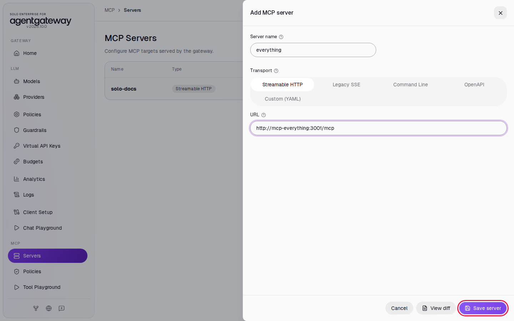

The list shows two servers. The **State** of `everything` is **ready**.

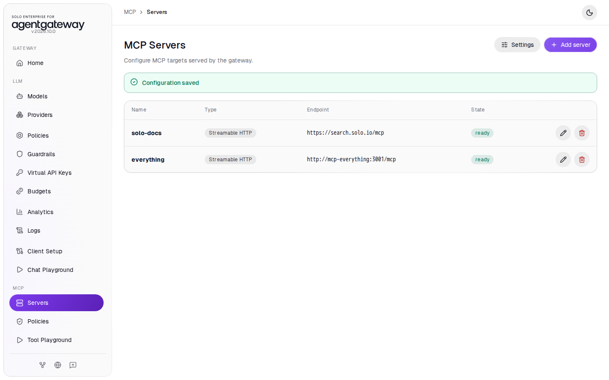

## Step 2: See the tools of both servers in one session

1. In the sidebar, click **Tool Playground**.
2. Click **Initialize**.

   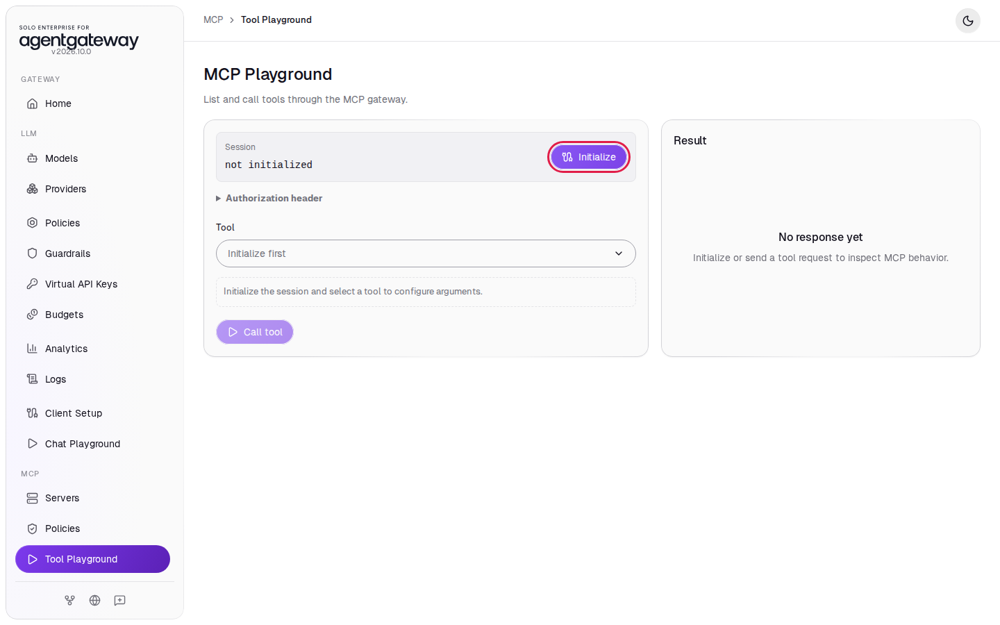

The **Result** panel shows **16 tools discovered**: 3 from `solo-docs` and 13 from `everything`. When there is more than one server, the gateway puts the server name and an underscore in front of each tool name, for example `solo-docs_search` and `everything_echo`. It uses this prefix to send each call to the correct server.

3. In **Tool**, select **everything_echo**.
4. In **message**, enter `hello from the workshop`.
5. Click **Call tool**.

   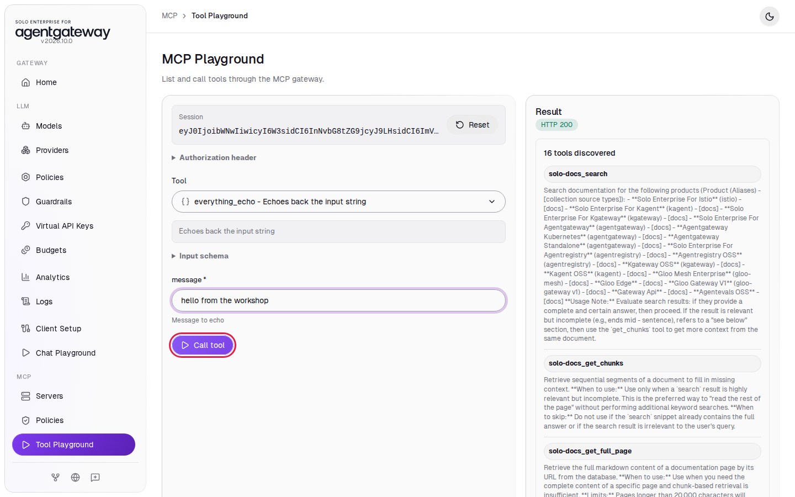

The **Tool output** shows `Echo: hello from the workshop`. The local server answered through the same session that lists the Solo.io docs tools.

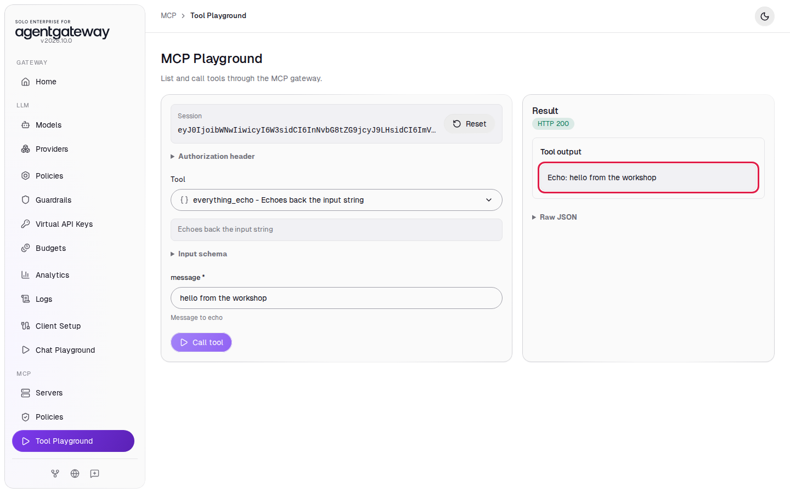

<details>
<summary>Optional: check with curl</summary>

Start a session, then list the tools:

```bash
SESSION=$(curl -s -D - -o /dev/null http://localhost:4001/mcp \
  -H "Content-Type: application/json" \
  -H "Accept: application/json, text/event-stream" \
  -d '{"jsonrpc":"2.0","id":1,"method":"initialize","params":{"protocolVersion":"2025-06-18","capabilities":{},"clientInfo":{"name":"curl","version":"1"}}}' \
  | grep -i '^mcp-session-id:' | awk '{print $2}' | tr -d '\r')
curl -s http://localhost:4001/mcp \
  -H "Content-Type: application/json" \
  -H "Accept: application/json, text/event-stream" \
  -H "Mcp-Session-Id: $SESSION" \
  -d '{"jsonrpc":"2.0","id":2,"method":"tools/list"}' \
  | grep -o '"name":"[^"]*"'
```

Expected output:

```
"name":"solo-docs_search"
"name":"solo-docs_get_chunks"
"name":"solo-docs_get_full_page"
"name":"everything_echo"
"name":"everything_get-annotated-message"
...
```

</details>

## Step 3: Turn off the tool name prefix

Some agents work better with short tool names. If no two servers have a tool with the same name, you can turn the prefix off.

1. In the sidebar, click **Servers**.
2. Click **Settings**.
3. In **Prefix mode**, select **Never**.
4. Click **Save settings**.

   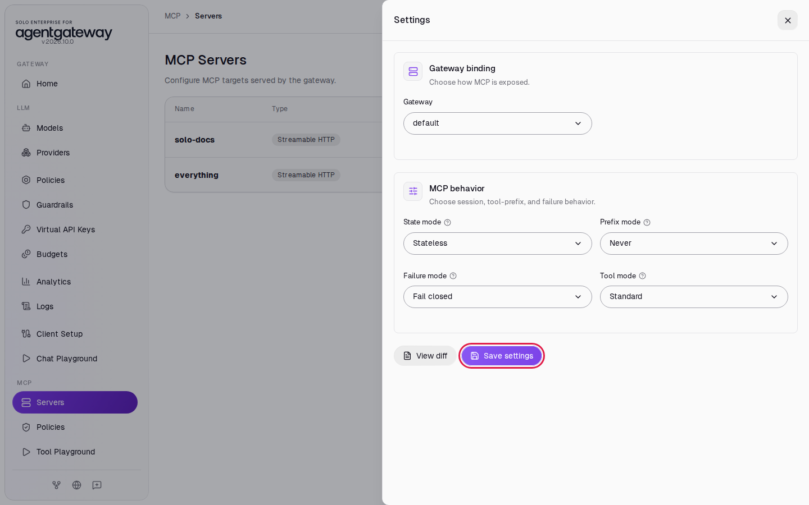

5. In the sidebar, click **Tool Playground**.
6. Wait two seconds, then reload the page.
7. Click **Initialize**.

The **Result** panel still shows **16 tools discovered**, now with plain names such as `search` and `echo`.

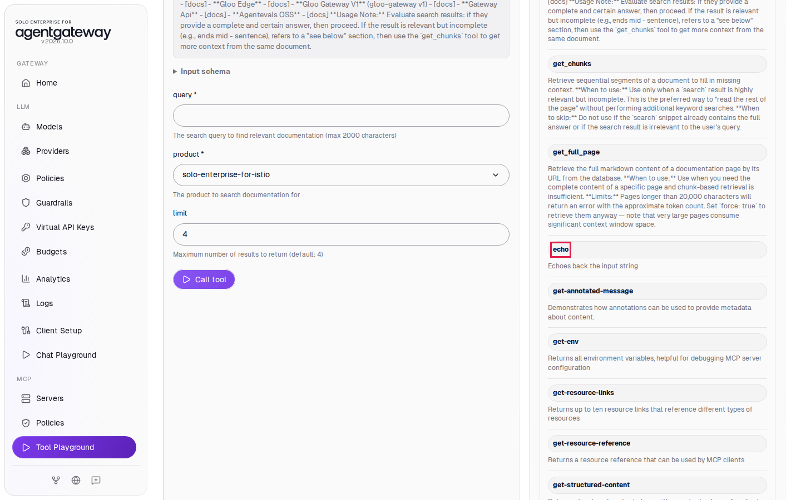

## Step 4: Add a server that cannot be reached

To see what happens when a server is down, add a server with an address that does not exist.

1. In the sidebar, click **Servers**.
2. Click **Add server**.
3. In **Server name**, enter `broken`.
4. In **URL**, enter `http://does-not-exist:3001/mcp`.
5. Click **Save server**.

   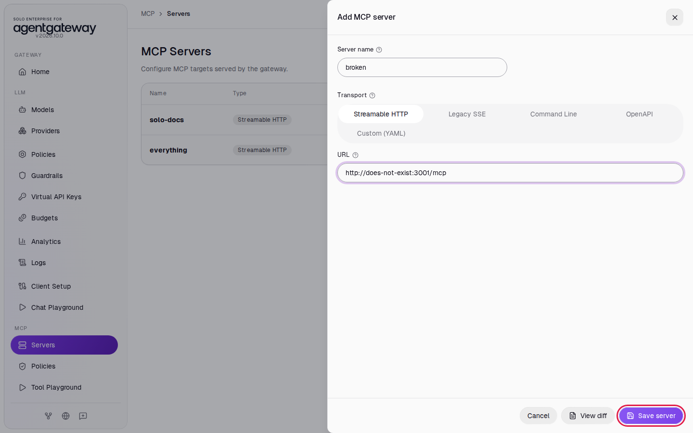

The **State** of `broken` shows **ready**. That state tells you the gateway accepted the configuration. The gateway connects to a server only when a client starts a session.

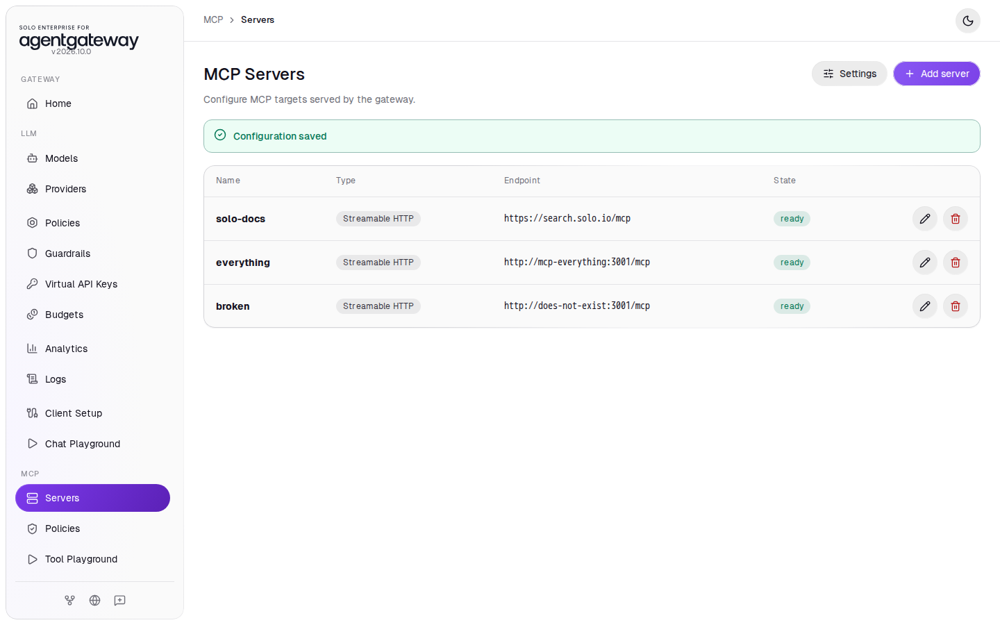

6. In the sidebar, click **Tool Playground**.
7. Wait two seconds, then reload the page.
8. Click **Initialize**.

The playground shows **MCP request failed** with `backends required DNS resolution which failed`. The default **Failure mode** is **Fail closed**: if one server fails, the whole session fails. The two healthy servers are not available either.

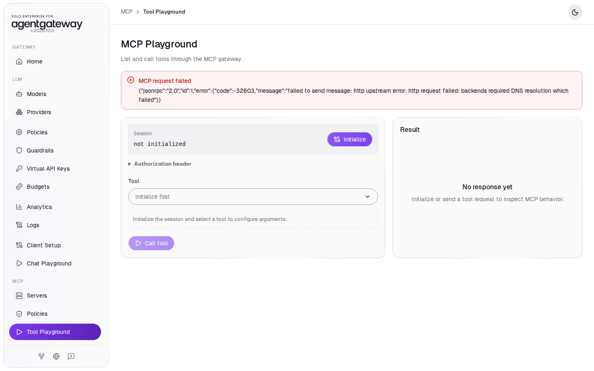

## Step 5: Keep serving the healthy servers

1. In the sidebar, click **Servers**.
2. Click **Settings**.
3. In **Failure mode**, select **Fail open**.
4. Click **Save settings**.

   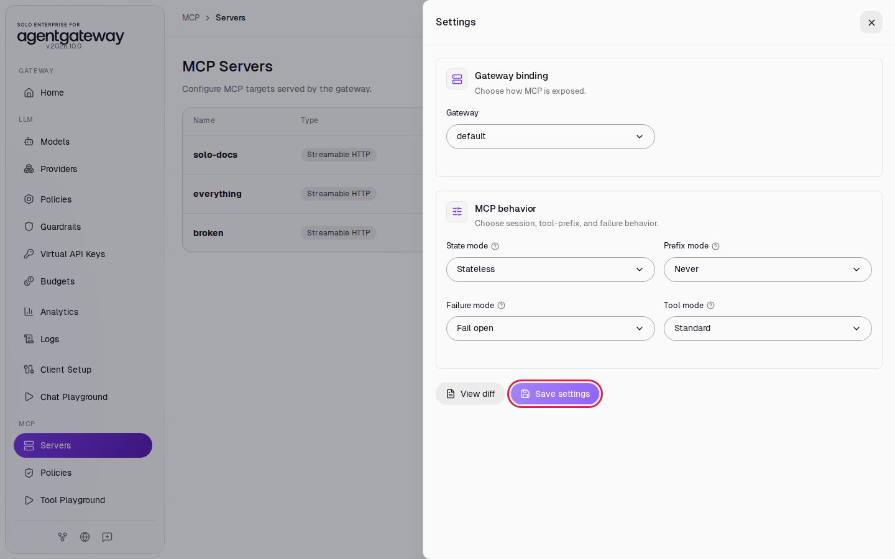

5. In the sidebar, click **Tool Playground**.
6. Wait two seconds, then reload the page.
7. Click **Initialize**.

## Check it

The session starts. The **Result** panel shows **16 tools discovered**: the tools of `solo-docs` and `everything`. The gateway skipped `broken`. If all servers fail, the session still fails.

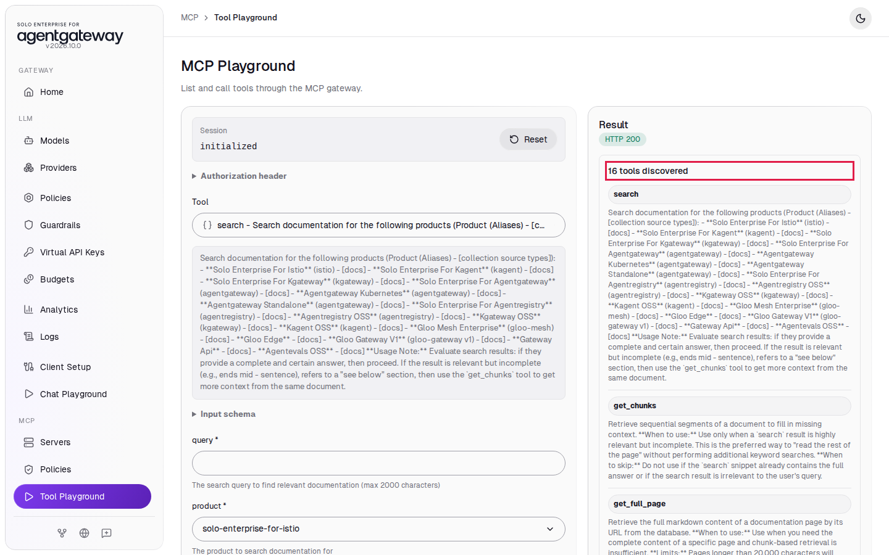

## What the UI wrote

In the sidebar, scroll down to **Tools** and click **Raw Configuration**. The UI added two targets and four settings to the `mcp` section:

```yaml
mcp:
  targets:
  - name: solo-docs
    mcp:
      host: https://search.solo.io/mcp
  - name: everything
    mcp:
      host: http://mcp-everything:3001/mcp
  - name: broken
    mcp:
      host: http://does-not-exist:3001/mcp
  ...
  statefulMode: stateless
  prefixMode: never
  failureMode: failOpen
  toolMode: standard
```

**Save settings** writes every setting in the panel, including the ones you did not change.

## Clean up

1. In the sidebar, click **Servers**.
2. In the `broken` row, click the delete icon, then click **Delete server**.

   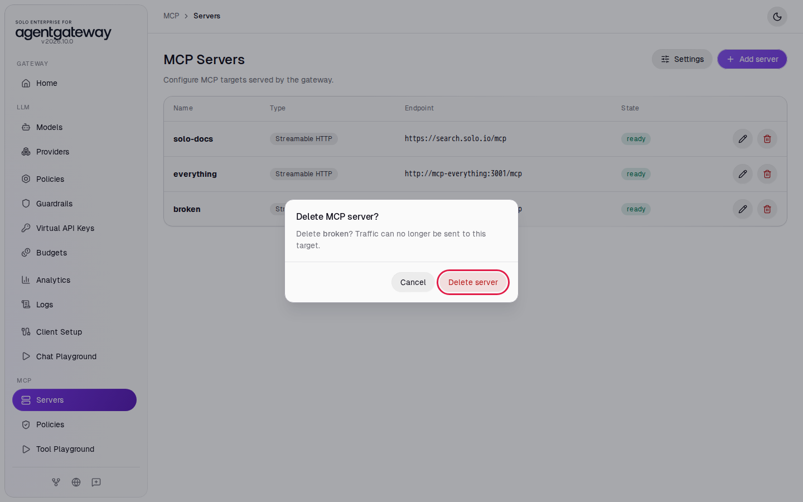

3. In the `everything` row, click the delete icon, then click **Delete server**.
4. Click **Settings**.
5. In **Prefix mode**, select **None**.
6. In **Failure mode**, select **Fail closed**.
7. Click **Save settings**.

   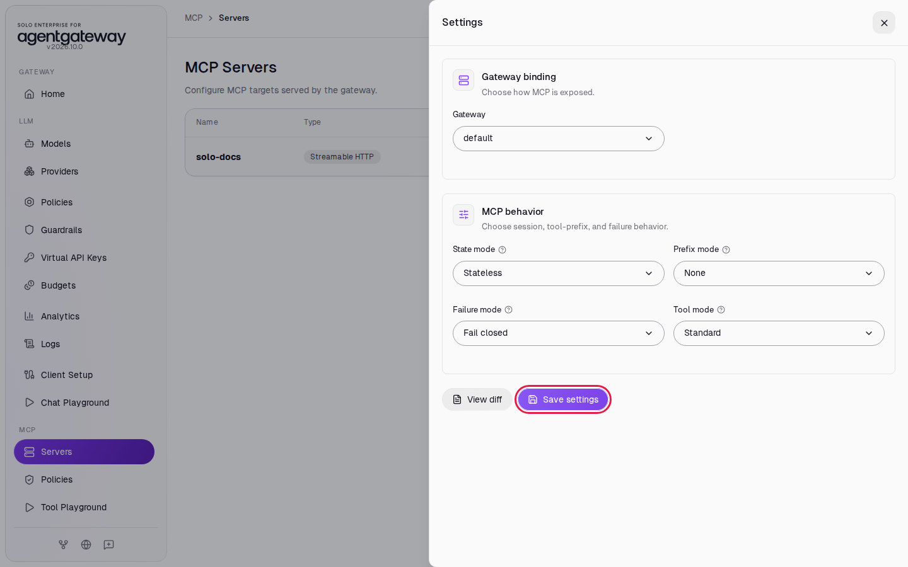

The settings now behave as before, but the UI wrote the default values into the configuration. Remove them so the configuration is the same as when you started:

8. In the sidebar, scroll down to **Tools** and click **Raw Configuration**.
9. At the end of the file, select these three lines and press **Delete**:

   ```yaml
     statefulMode: stateless
     failureMode: failClosed
     toolMode: standard
   ```

   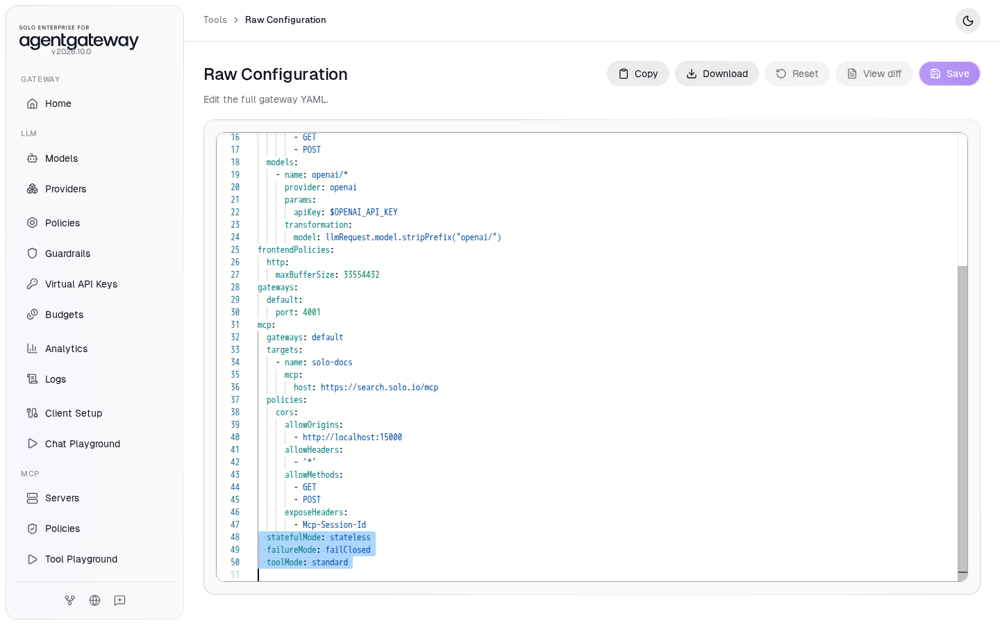

10. Click **Save**.

    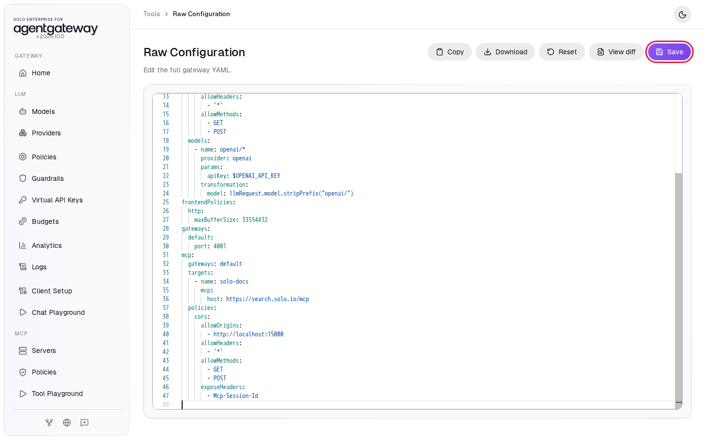

11. Stop the local MCP server. From the `setup/` folder, run:

    ```bash
    docker compose --profile mcp-everything stop mcp-everything
    ```
