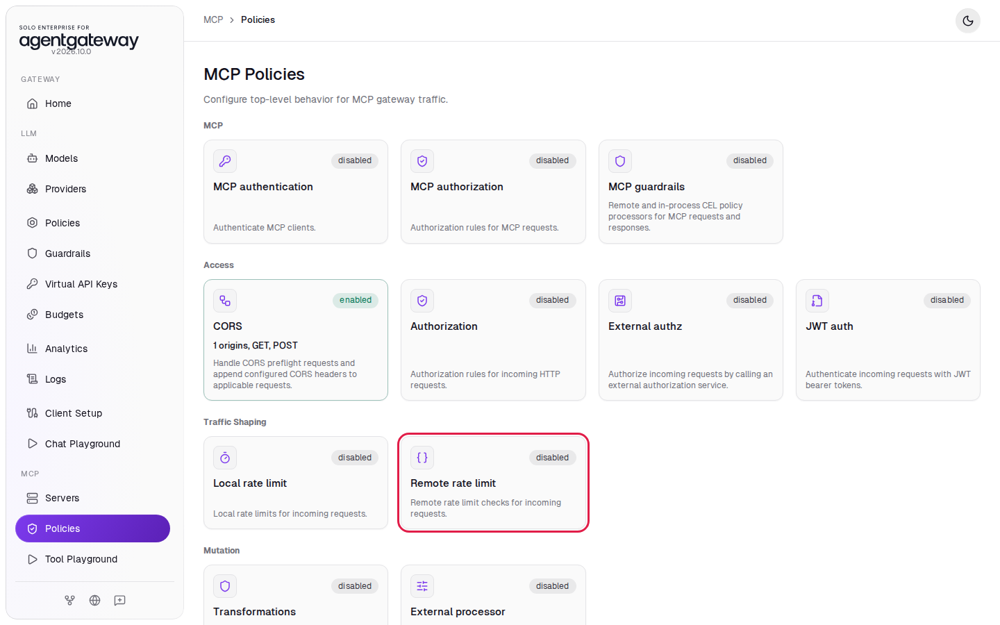
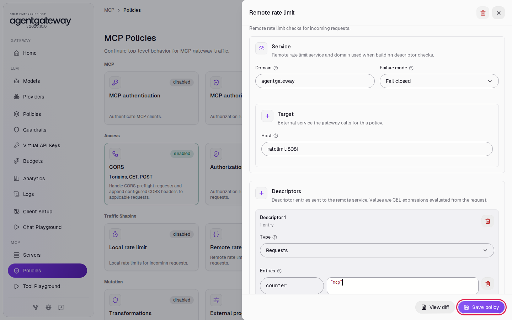
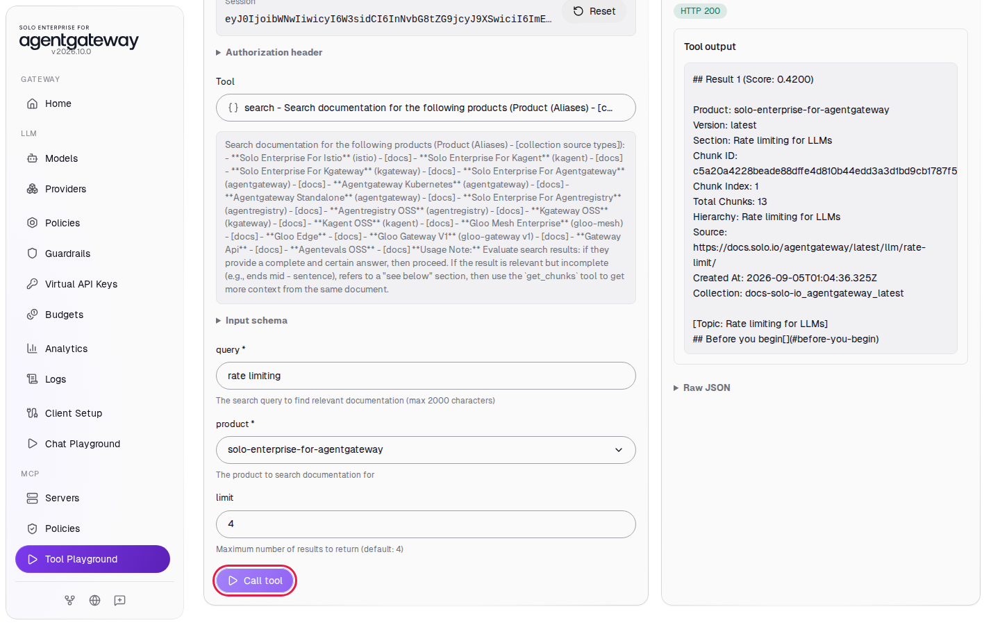
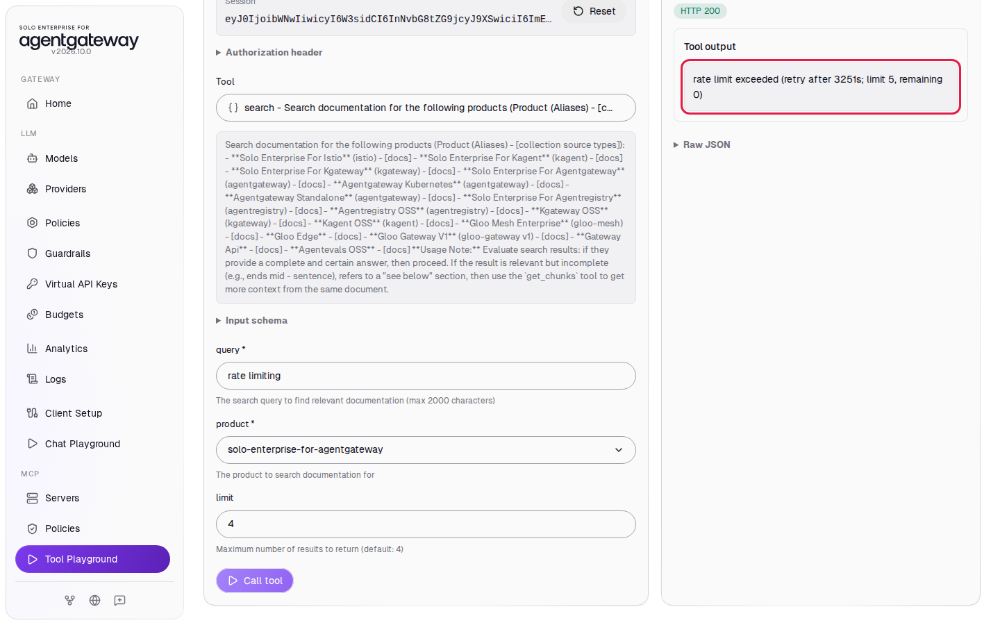
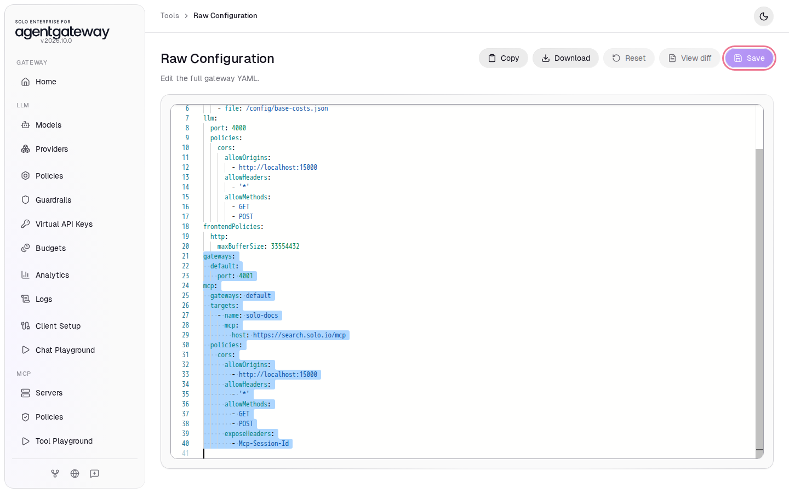

# Share an MCP Rate Limit with a Rate Limit Service

## Before you start

- Complete [001: Set Up Standalone Agentgateway](../../001-set-up-standalone-agentgateway.md).
- Your computer can reach `https://search.solo.io`.
- Start the rate limit service and its Redis database. From the `setup/` folder, run:

  ```bash
  env UID=$(id -u) GID=$(id -g) docker compose --profile ratelimit up -d
  ```

  This starts `ratelimit` (the open source Envoy rate limit service, listening for gRPC on port `8081`) and `redis`. [Share a Rate Limit Across Gateways](../llm/llm-global-rate-limiting.md) explains how the gateway and the service work together. This lab uses the same service for MCP.

## What you'll do

- Add a **Remote rate limit** policy to MCP that allows 5 requests per hour
- Call a tool in the Tool Playground until the gateway stops the calls
- Read the rate limit error the client gets

## Why this matters

A local rate limit counts inside one gateway. A remote rate limit keeps the count in a shared service, so several gateways in front of the same MCP servers share one limit. The gateway builds the descriptor it sends from the request, as in [Share a Rate Limit Across Gateways](../llm/llm-global-rate-limiting.md), so a limit can follow a header value instead of the whole gateway.

Every MCP message is one HTTP request to the gateway. When a client connects, it sends 3 requests: `initialize`, `notifications/initialized` and `tools/list`. Each tool call is 1 more request.

## Set up

This lab uses the `solo-docs` MCP server. [Connect a Remote MCP Server](connect-remote-mcp-server.md) explains these steps.

Turn on MCP:

1. In the sidebar, under **MCP**, click **Get started**.

   

2. Click **Enable**.

   

Add the `solo-docs` server:

1. On the **MCP Servers** page, click **Add server**.
2. In **Server name**, enter `solo-docs`.
3. Leave the transport on **Streamable HTTP**.
4. In **URL**, enter `https://search.solo.io/mcp`.
5. Click **Save server**.

   

After a few seconds, the **State** column shows **ready**.

Allow the Tool Playground to connect:

1. In the sidebar, click **Tool Playground**.
2. Click **Apply CORS**.

   

3. Wait two seconds, then reload the page.

## Step 1: Add the remote rate limit

1. In the sidebar, under **MCP**, click **Policies**.
2. Click the **Remote rate limit** card.

   

3. In **Domain**, enter `agentgateway`.
4. In **Host**, enter `ratelimit:8081`.
5. Under **Entries**, in the first box, replace `user` with `counter`.
6. In the second box, select the text and replace it with `"mcp"` (with the quotes).
7. Click **Save policy**.

   

Every MCP request now sends the descriptor `counter=mcp`. The service rule for it, in `setup/ratelimit/config.yaml`, allows 5 requests per hour:

```yaml
  - key: counter
    value: mcp
    rate_limit:
      unit: hour
      requests_per_unit: 5
```

## Step 2: Call a tool

1. Wait two seconds, then in the sidebar click **Tool Playground**.
2. Click **Initialize**. This uses 3 of the 5 requests.
3. In **Tool**, select **search**.
4. In **query**, enter `rate limiting`.
5. In **product**, select **solo-enterprise-for-agentgateway**.
6. Click **Call tool**.

The **Tool output** shows search results, starting with **Result 1**. This call used the fourth request.



## Check it

1. Click **Call tool** again. This call uses the fifth request and returns results.
2. Click **Call tool** a third time.

The **Tool output** shows `rate limit exceeded`, the seconds until the hour ends, `limit 5` and `remaining 0`.



The gateway answers with HTTP `200` and a tool result marked as an error (`isError: true`), the same as the local rate limit, so MCP clients can show the error to the agent.

The count lives in Redis, not in the gateway. To start over before the hour ends, run this from the `setup/` folder (this Redis keeps the counts in memory only, so a restart clears them). Wait about five seconds for the service to reconnect:

```bash
docker compose --profile ratelimit restart redis
```

## What the UI wrote

In the sidebar, scroll down to **Tools** and click **Raw Configuration**. The UI added `remoteRateLimit` under `mcp.policies`:

```yaml
mcp:
  policies:
    remoteRateLimit:
      host: ratelimit:8081
      domain: agentgateway
      descriptors:
        - entries:
            - key: counter
              value: '"mcp"'
```

## Clean up

1. Turn off MCP. In the sidebar, scroll down to **Tools** and click **Raw Configuration**.
2. Select from the line `gateways:` to the end of the file. This is the `default` gateway on port `4001` and the `mcp:` section, with the `solo-docs` server, the CORS policy and the rate limit.

   

3. Press **Delete**.
4. Click **Save**. If a confirmation appears, click **Save** again.
5. From the `setup/` folder, stop the helpers:

   ```bash
   docker compose --profile ratelimit stop ratelimit redis
   ```

The gateway is back to the state [001](../../001-set-up-standalone-agentgateway.md) left it in.
