# Sign In to MCP with Keycloak

## Before you start

- Complete [001: Set Up Standalone Agentgateway](../../001-set-up-standalone-agentgateway.md).
- Start Keycloak and MCP Inspector. From the `setup/` folder, run:

  ```bash
  env UID=$(id -u) GID=$(id -g) docker compose --profile keycloak --profile mcp-inspector up -d
  ```

  Both containers share the gateway's network. Keycloak serves the `workshop` realm at `http://localhost:8180`, with the users `alice`, `bob` and `carol` (password `workshop`). MCP Inspector, an MCP client that runs in your browser, is at `http://localhost:6274`. Keycloak takes up to a minute to start the first time.

## What you'll do

- Require a Keycloak token for every MCP request
- Connect MCP Inspector to the gateway and sign in as `alice` in Keycloak
- Follow the OAuth steps that Inspector ran, and call a tool

## Why this matters

[Require a Token for MCP and Limit Tools by Team](mcp-auth-and-tool-authorization.md) pastes a token into the Tool Playground. Real users sign in instead. The MCP specification defines how: the gateway answers an unauthenticated request with `401` and a link to its metadata, the metadata names your identity provider, and the MCP client signs the user in there and sends the token it gets. Claude Code, Cursor, VS Code and MCP Inspector all follow these steps. You configure the gateway once, and each of these clients shows your identity provider's sign-in page.

## Set up

This lab uses the `solo-docs` MCP server. [Connect a Remote MCP Server](connect-remote-mcp-server.md) explains these steps.

Turn on MCP:

1. In the sidebar, under **MCP**, click **Get started**.

   

2. Click **Enable**.

   

Add the `solo-docs` server:

1. On the **MCP Servers** page, click **Add server**.
2. In **Server name**, enter `solo-docs`.
3. Leave the transport on **Streamable HTTP**.
4. In **URL**, enter `https://search.solo.io/mcp`.
5. Click **Save server**.

   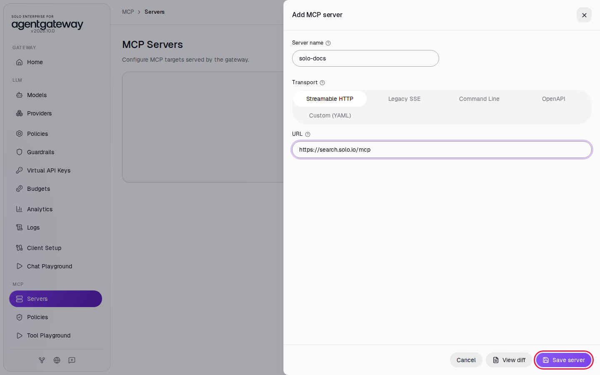

After a few seconds, the **State** column shows **ready**.

Allow the Tool Playground to connect:

1. In the sidebar, click **Tool Playground**.
2. Click **Apply CORS**.

   

3. Wait two seconds, then reload the page.

## Step 1: Require a Keycloak token

1. In the sidebar, under **MCP**, click **Policies**.
2. Click the **MCP authentication** card.

   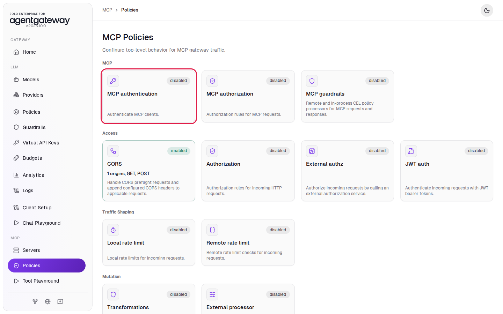

3. Leave **Validation mode** on **Strict**.
4. Under **JWKS source**, click **Remote URL**.
5. In **JWKS URL**, enter `http://localhost:8180/realms/workshop/protocol/openid-connect/certs`.
6. In **Issuer**, enter `http://localhost:8180/realms/workshop`.
7. Click **Save policy**.

   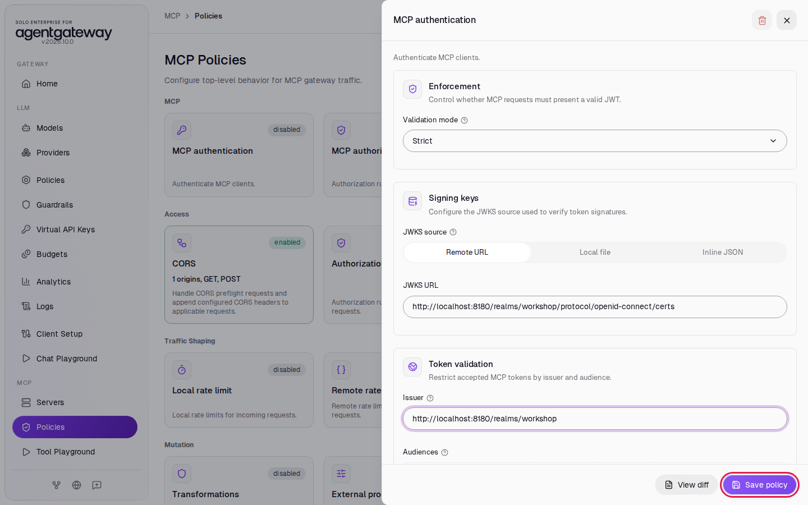

The gateway downloads Keycloak's signing keys from the JWKS URL and accepts a token only if Keycloak signed it and its issuer is the `workshop` realm. The gateway also publishes the issuer to MCP clients as the place to sign in.

## Step 2: Try the Tool Playground

1. Wait two seconds, then in the sidebar click **Tool Playground**.
2. Click **Initialize**.

The playground shows **MCP request failed** with `JWT token required`. The Tool Playground has no Keycloak token and cannot sign in.

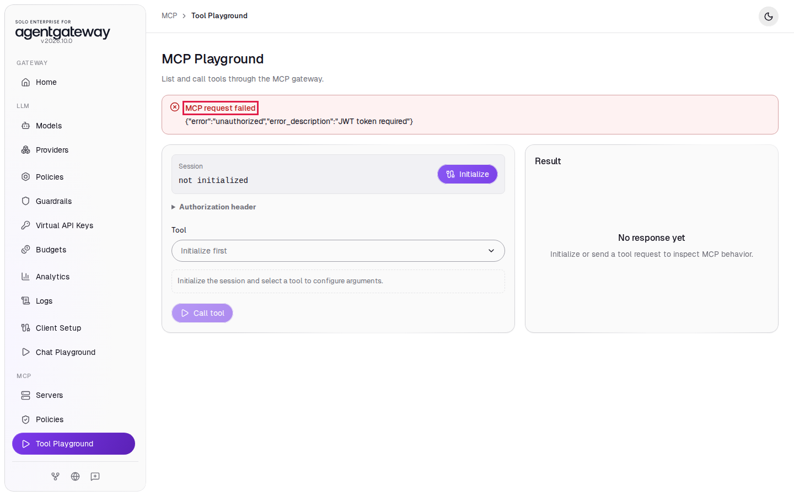

## Step 3: Sign in through MCP Inspector

1. In a new browser tab, open `http://localhost:6274/?MCP_INSPECTOR_API_TOKEN=workshop`.

   The **Servers** list has one server, `localhost:4001`, with the URL `http://localhost:4001/mcp`. You can ignore the **Read-only session** note. It means that the workshop started Inspector with this one server.

2. Click the switch next to **Disconnected**.

   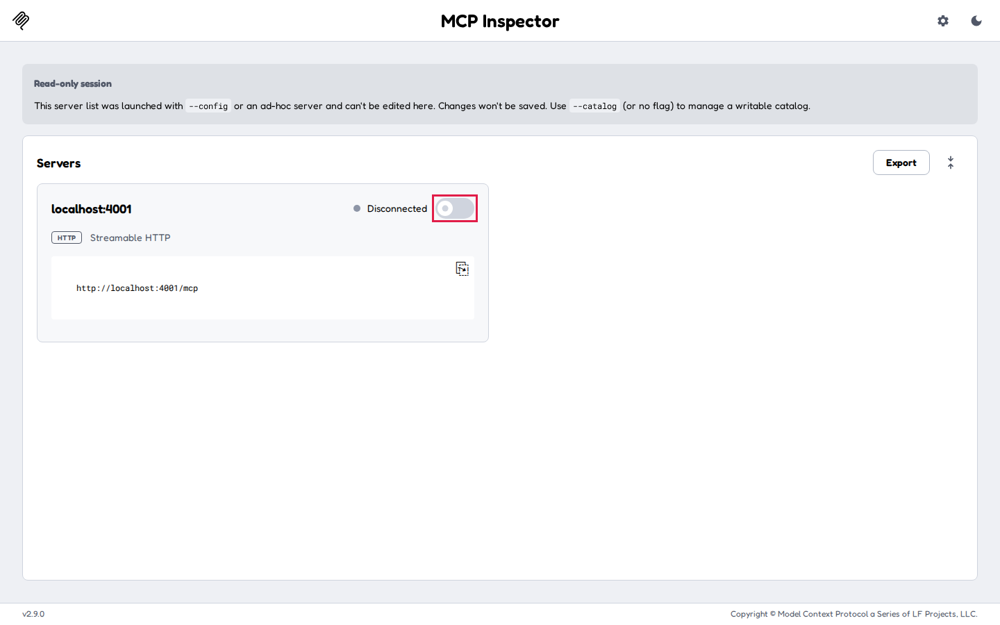

   The browser opens the Keycloak sign-in page for the `workshop` realm.

3. In **Username or email**, enter `alice`.
4. In **Password**, enter `workshop`.
5. Click **Sign In**.

   

The browser returns to Inspector. The server shows **Connected**, and a message says **Authorization complete**.

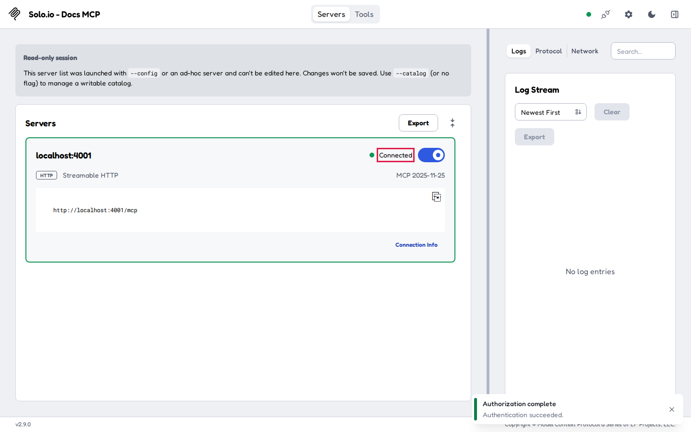

## Check it

1. In the right panel of Inspector, click **Network**.

   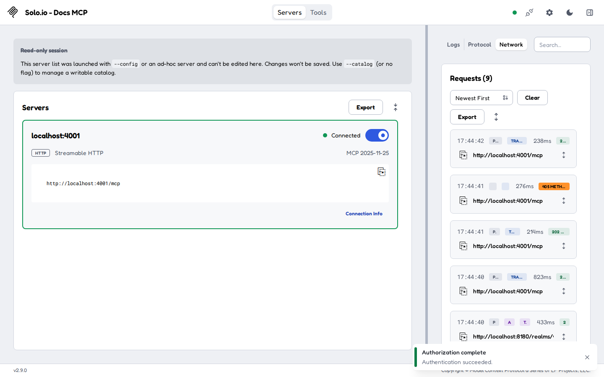

   The list shows the requests of the sign-in, newest first. These are the main ones, from the bottom up:

   | Request | What happened |
   |---|---|
   | `POST http://localhost:4001/mcp`, `401` | The gateway rejected the request without a token. |
   | `GET http://localhost:4001/.well-known/oauth-protected-resource/mcp` | Inspector read the gateway's metadata, which names Keycloak. |
   | `GET http://localhost:8180/.well-known/oauth-authorization-server/realms/workshop` | Inspector read Keycloak's endpoints. |
   | `POST http://localhost:8180/realms/workshop/clients-registrations/openid-connect`, `201` | Inspector registered itself as a client in Keycloak. |
   | `POST http://localhost:8180/realms/workshop/protocol/openid-connect/token`, `200` | Inspector traded the sign-in result for alice's token. |
   | `POST http://localhost:4001/mcp`, `200` | Inspector sent the request again with the token, and the gateway let it through. |

2. At the top of the page, click **Tools**.

   The list shows `search`, `get_chunks` and `get_full_page`, the tools of the `solo-docs` server.

   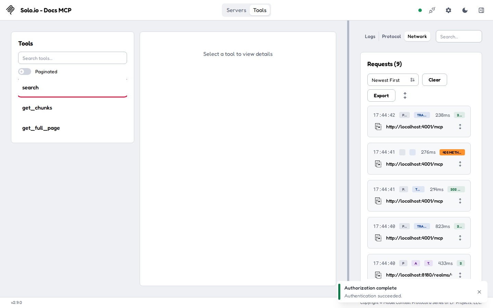

3. Click **search**.
4. In **query**, enter `MCP authentication`.
5. In **product**, select **solo-enterprise-for-agentgateway**.
6. Click **Execute Tool**.

   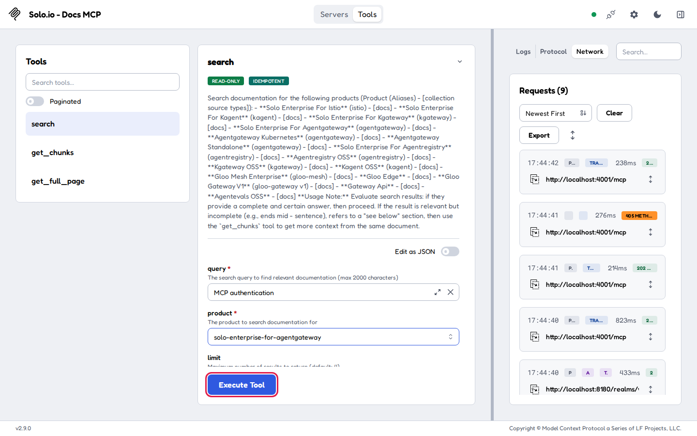

The **Results** panel shows search results, starting with **Result 1**. Each request carries alice's token, and the gateway checks it before it passes the request on.

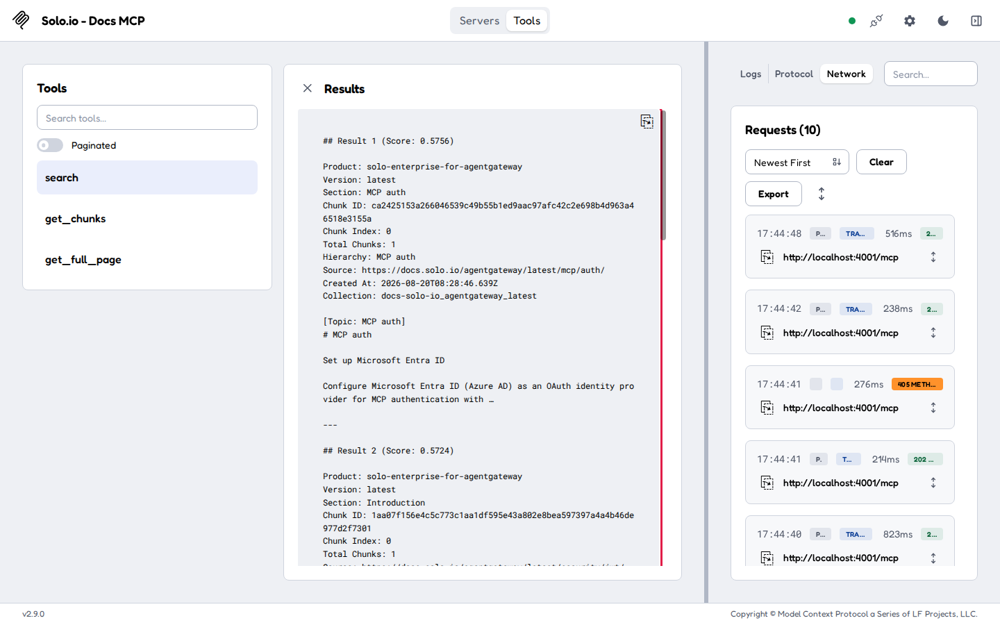

> **Note:** The workshop realm lets any MCP client register itself from `localhost` (Keycloak's **Trusted Hosts** client registration policy). Each client that signs in adds a client to the realm. In production, decide which hosts and redirect URLs may register, or create the clients yourself.

## What the UI wrote

In the sidebar, scroll down to **Tools** and click **Raw Configuration**. The UI added `mcpAuthentication` under `mcp.policies`:

```yaml
mcp:
  policies:
    mcpAuthentication:
      mode: strict
      issuer: http://localhost:8180/realms/workshop
      jwks:
        url: http://localhost:8180/realms/workshop/protocol/openid-connect/certs
      resourceMetadata: {}
```

With `resourceMetadata` empty, the gateway builds its metadata from the issuer.

> **Note:** The gateway downloads Keycloak's keys when you save the policy. If you remove and recreate the Keycloak container while the policy exists, Keycloak gets new keys and the gateway rejects the new tokens: save the policy again. The gateway also downloads the keys when it starts, and Keycloak runs in the gateway's network, so Keycloak is not up yet at that moment. If the policy exists when you restart the Compose stack, the gateway exits. Delete the policy before you restart. **Clean up** deletes it when you turn off MCP.

## Clean up

1. Close the Inspector tab, then stop Keycloak and Inspector. From the `setup/` folder, run:

   ```bash
   docker compose --profile keycloak --profile mcp-inspector stop keycloak mcp-inspector
   ```

2. Turn off MCP. In the sidebar, scroll down to **Tools** and click **Raw Configuration**.
3. Select from the line `gateways:` to the end of the file. This is the `default` gateway on port `4001` and the `mcp:` section, with the `solo-docs` server, the CORS policy and the MCP authentication policy.

   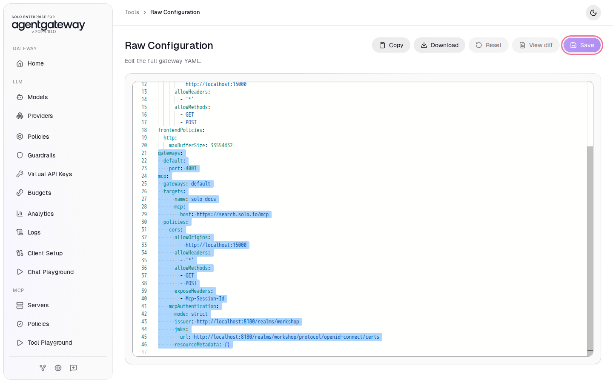

4. Press **Delete**.
5. Click **Save**. If a confirmation appears, click **Save** again.

The gateway is back to the state [001](../../001-set-up-standalone-agentgateway.md) left it in.
