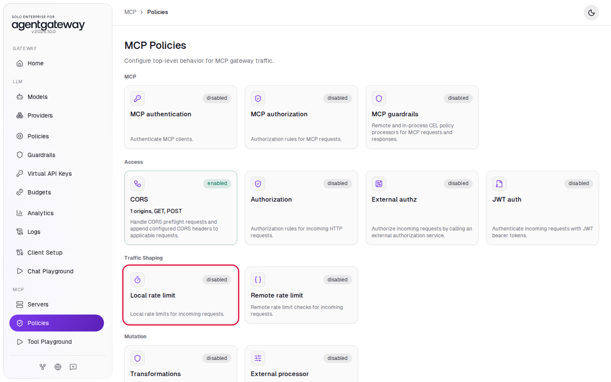
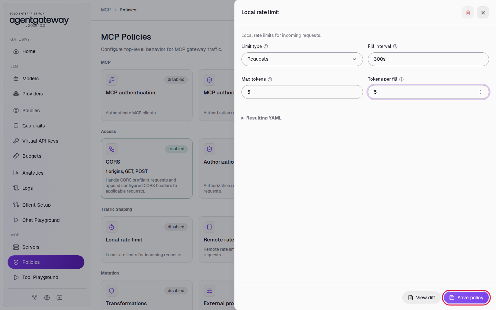
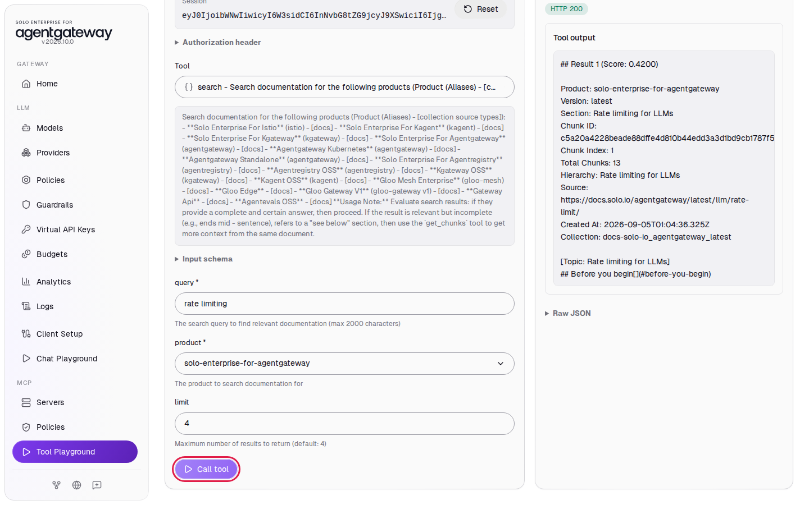
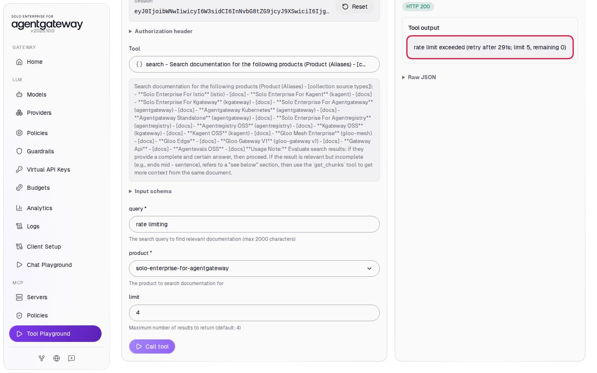

# Rate Limit MCP Traffic

## Before you start

- Complete [Connect a Remote MCP Server](../mcp/connect-remote-mcp-server.md). The gateway serves the `solo-docs` MCP server on port `4001`.

## What you'll do

- Add a local rate limit of 5 MCP requests every 5 minutes
- Call a tool in the Tool Playground until the gateway stops the calls
- Read the rate limit error the client gets

## Why this matters

An AI agent can call tools in a fast loop. A rate limit protects the MCP servers behind the gateway, and the APIs and costs behind them, from a runaway agent. The gateway counts requests and rejects them when the limit is used up, so the MCP server never sees the extra calls.

Every MCP message is one HTTP request to the gateway. When a client connects, it sends 3 requests: `initialize`, `notifications/initialized` and `tools/list`. Each tool call is 1 more request. Size a limit in sessions and calls, not only in tool calls.

## Step 1: Add a local rate limit

1. In the sidebar, under **MCP**, click **Policies**.
2. Click the **Local rate limit** card.

   

3. Leave **Limit type** on **Requests**.
4. In **Fill interval**, enter `300s`.
5. In **Max tokens**, enter `5`.
6. In **Tokens per fill**, enter `5`.
7. Click **Save policy**.

   

The gateway now has a bucket of 5 tokens. Each MCP request uses one token, and every 300 seconds (5 minutes) the bucket fills back up to 5. The long interval gives you time to make the calls below before the bucket fills again. The limit applies to all MCP traffic on the gateway.

## Step 2: Call a tool

1. Wait two seconds, then in the sidebar click **Tool Playground**.
2. Click **Initialize**. This uses 3 of the 5 requests.
3. In **Tool**, select **search**.
4. In **query**, enter `rate limiting`.
5. In **product**, select **solo-enterprise-for-agentgateway**.
6. Click **Call tool**.

The **Tool output** shows search results, starting with **Result 1**. This call used the fourth request.



## Check it

1. Click **Call tool** again. This call uses the fifth request and returns results.
2. Click **Call tool** a third time.

The **Tool output** shows `rate limit exceeded`, the seconds until the next fill, `limit 5` and `remaining 0`.



The gateway still answers with HTTP `200`, not `429`. The response is a tool result marked as an error (`isError: true`), so MCP clients can show the error to the agent. Wait five minutes, and the calls work again.

<details>
<summary>Optional: check with curl</summary>

Run this right after the playground hits the limit, before the five minutes are over. The `-i` flag shows the rate limit headers:

```bash
curl -s -i http://localhost:4001/mcp \
  -H "Content-Type: application/json" \
  -H "Accept: application/json, text/event-stream" \
  -d '{"jsonrpc":"2.0","id":1,"method":"initialize","params":{"protocolVersion":"2025-06-18","capabilities":{},"clientInfo":{"name":"curl","version":"1"}}}'
```

Expected output:

```
HTTP/1.1 200 OK
content-type: application/json
x-ratelimit-limit: 5
x-ratelimit-remaining: 0
x-ratelimit-reset: 280
...

{"jsonrpc":"2.0","id":1,"error":{"code":-32003,"message":"rate limit exceeded","data":{"limit":5,"remaining":0,"retryAfterSeconds":280}}}
```

</details>

## What the UI wrote

In the sidebar, scroll down to **Tools** and click **Raw Configuration**. The UI added `localRateLimit` under `mcp.policies`:

```yaml
mcp:
  policies:
    localRateLimit:
      - type: requests
        fillInterval: 300s
        maxTokens: 5
        tokensPerFill: 5
```

## Clean up

1. In the sidebar, under **MCP**, click **Policies**.
2. Click the **Local rate limit** card.
3. Click the **Delete policy** icon at the top of the panel, then click **Delete policy** to confirm.

The **Local rate limit** card shows **disabled**. MCP requests are no longer limited.
