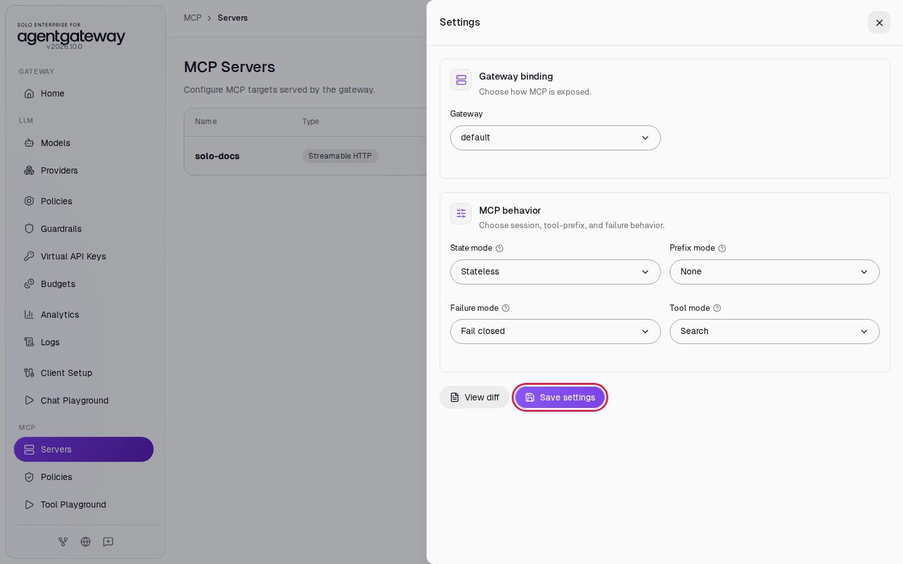
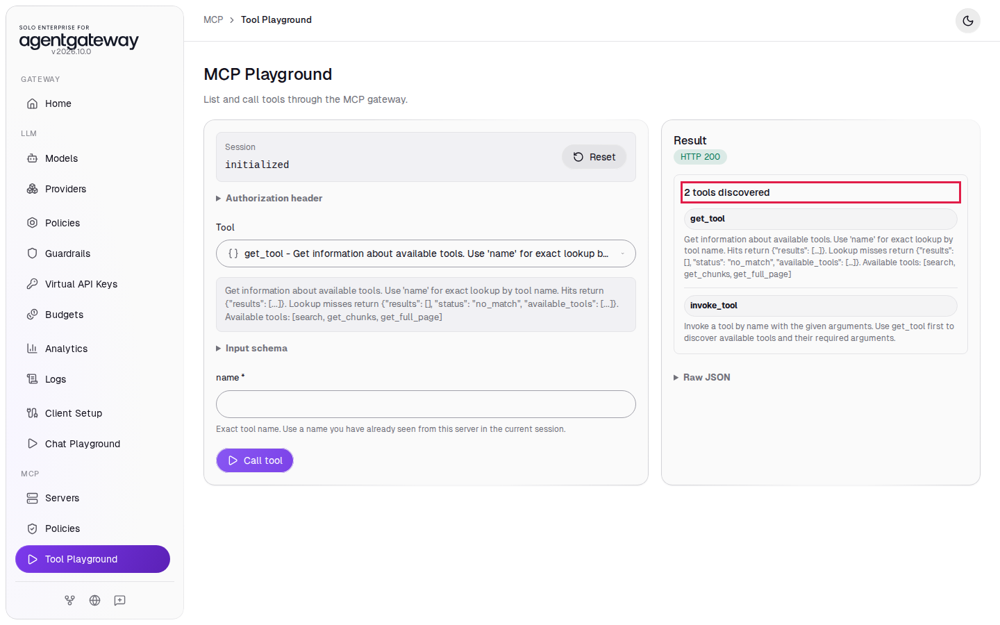
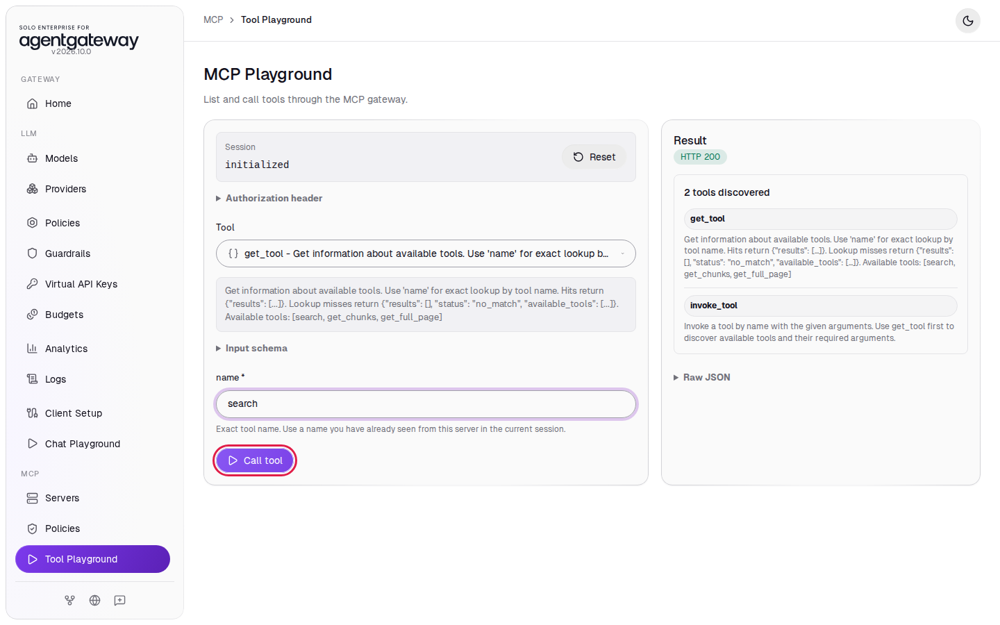
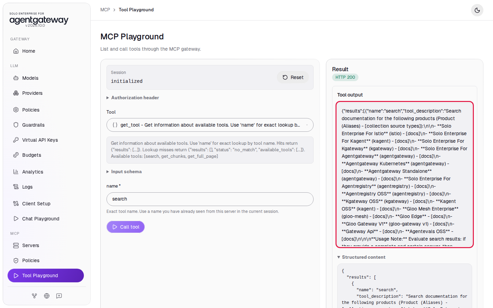
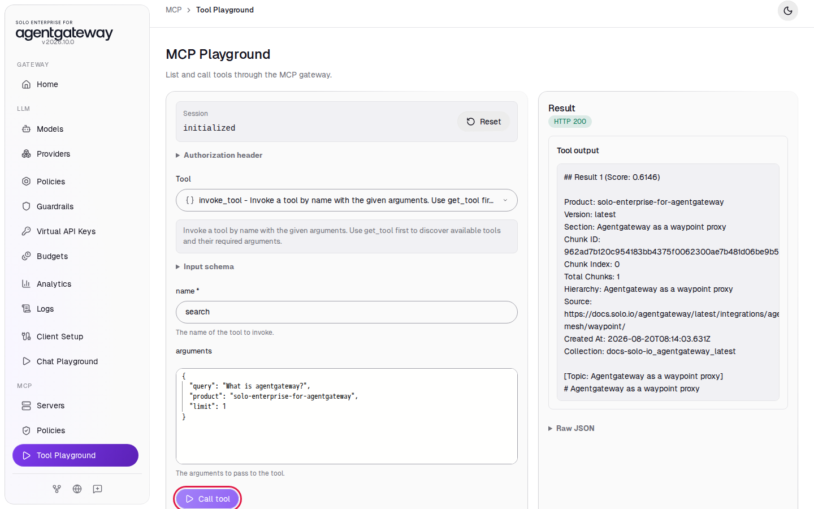
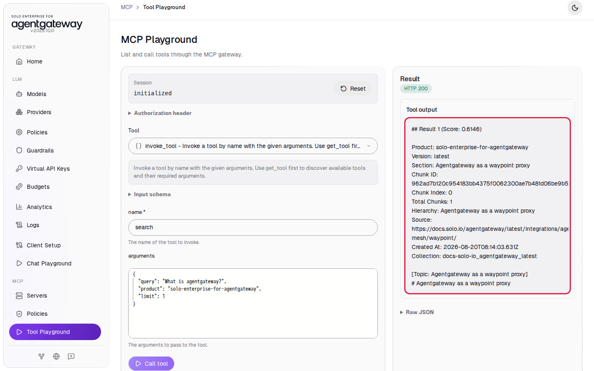
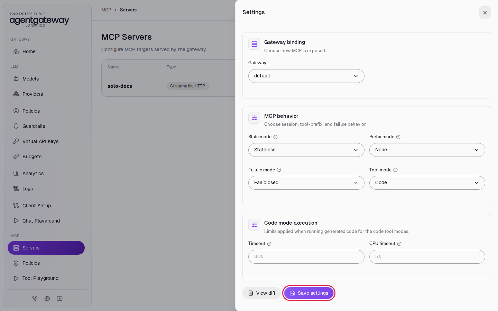
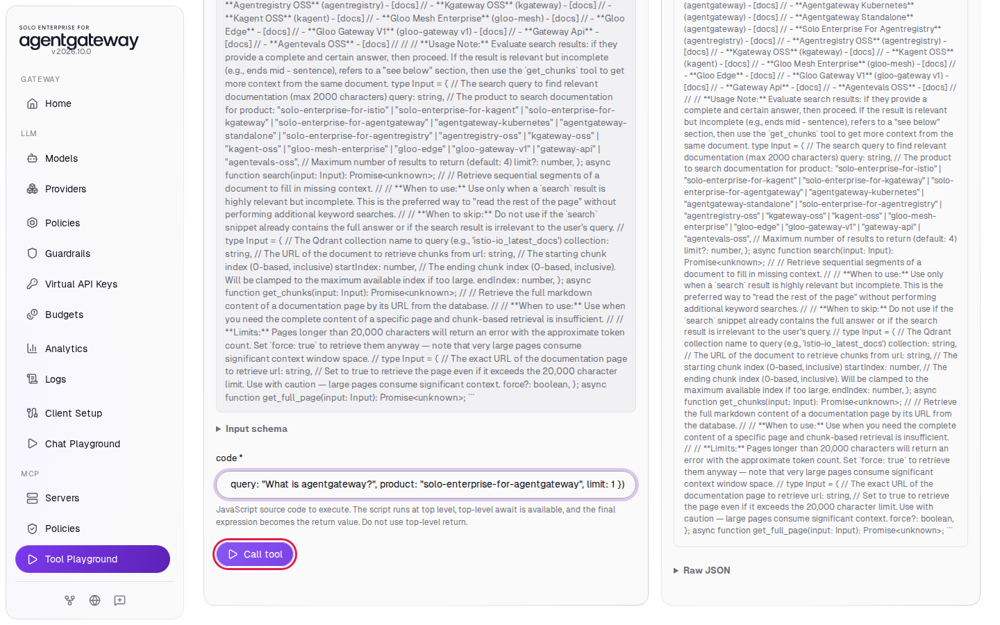
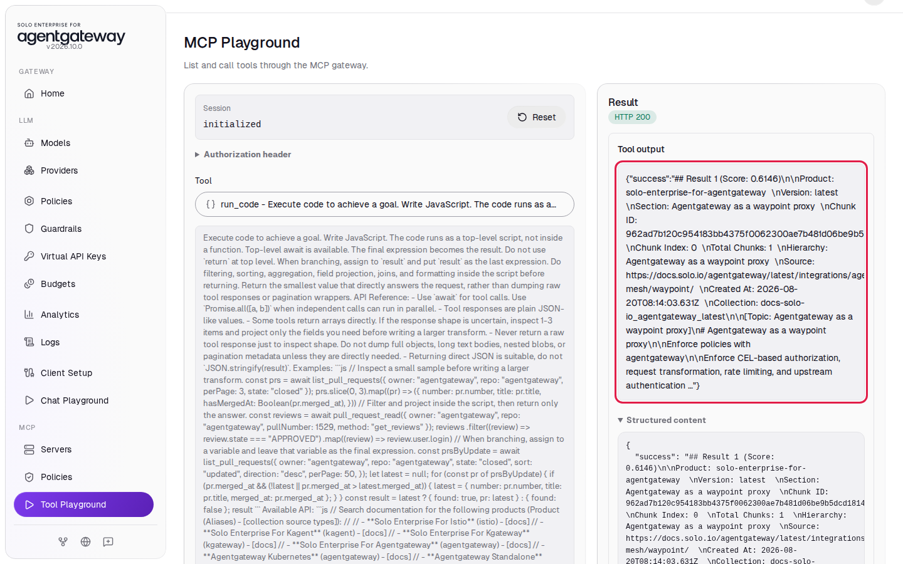
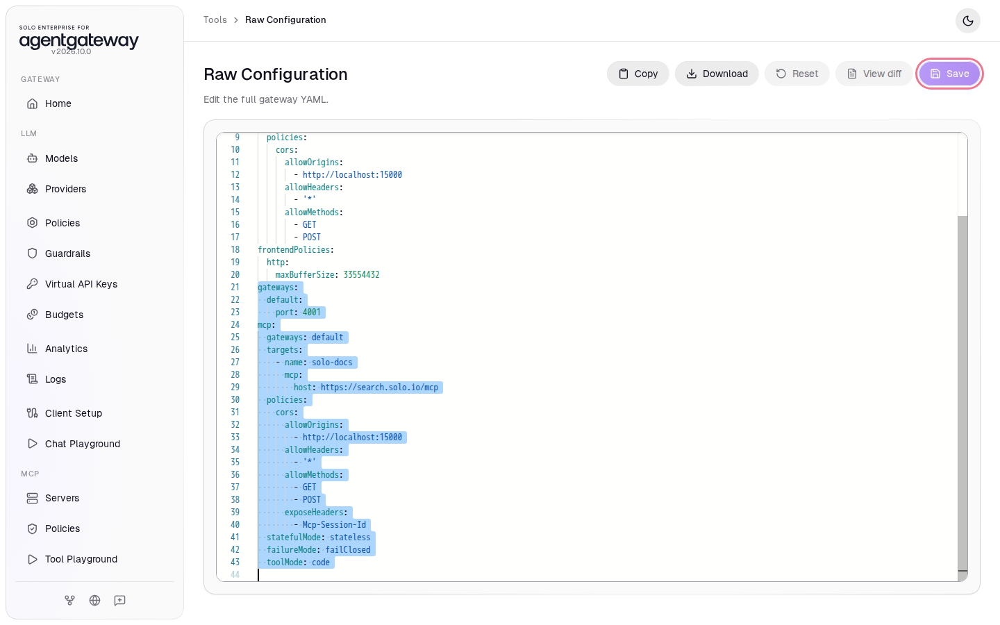

# Shrink the Tool List with Search and Code Tool Modes

## Before you start

- Complete [001: Set Up Standalone Agentgateway](../../001-set-up-standalone-agentgateway.md).
- Your computer can reach `https://search.solo.io`.

## What you'll do

- Switch the gateway to **Search** tool mode, find a tool with `get_tool`, and call it with `invoke_tool`
- Switch to **Code** tool mode and call a tool from a short JavaScript script with `run_code`
- Switch back to **Standard**

## Why this matters

An agent sends the name, description and input schema of every tool to the model on each request. With many MCP servers, that list can use a large part of the model's context. The tool mode changes what the gateway shows to the agent:

| Tool mode | Tools the agent sees |
|---|---|
| **Standard** | Every tool of every server (the default) |
| **Search** | Two tools: `get_tool` looks up one tool's definition, `invoke_tool` calls a tool by name |
| **Code** | One tool: `run_code` runs JavaScript that calls the real tools as functions |

The tools behind the gateway do not change. Only the list the agent gets is different.

## Set up

This lab uses the `solo-docs` MCP server. [Connect a Remote MCP Server](connect-remote-mcp-server.md) explains these steps.

Turn on MCP:

1. In the sidebar, under **MCP**, click **Get started**.

   

2. Click **Enable**.

   

Add the `solo-docs` server:

1. On the **MCP Servers** page, click **Add server**.
2. In **Server name**, enter `solo-docs`.
3. Leave the transport on **Streamable HTTP**.
4. In **URL**, enter `https://search.solo.io/mcp`.
5. Click **Save server**.

   

After a few seconds, the **State** column shows **ready**.

Allow the Tool Playground to connect:

1. In the sidebar, click **Tool Playground**.
2. Click **Apply CORS**.

   

3. Wait two seconds, then reload the page.

## Step 1: Turn on Search mode

1. In the sidebar, under **MCP**, click **Servers**.
2. Click **Settings**.
3. In **Tool mode**, select **Search**.
4. Click **Save settings**.

   

5. In the sidebar, click **Tool Playground**.
6. Wait two seconds, then reload the page.
7. Click **Initialize**.

The **Result** panel shows **2 tools discovered**: **get_tool** and **invoke_tool**. The `search`, `get_chunks` and `get_full_page` tools of `solo-docs` are not in the list. The description of `get_tool` names them.



## Step 2: Look up a tool with get_tool

1. In **Tool**, select **get_tool**.
2. In **name**, enter `search`.
3. Click **Call tool**.

   

The **Tool output** shows the definition of the `search` tool: its `tool_description` and its `args` (the input schema). An agent reads this to learn how to call the tool.



## Step 3: Call the tool with invoke_tool

1. In **Tool**, select **invoke_tool**.
2. In **name**, enter `search`.
3. Click in **arguments**, select all the text, and paste:

   ```json
   {"query": "What is agentgateway?", "product": "solo-enterprise-for-agentgateway", "limit": 1}
   ```

4. Click **Call tool**.

   

The **Tool output** shows a search result from the Solo.io docs, starting with **Result 1 (Score**. The gateway passed the call to the `search` tool of `solo-docs`.



## Step 4: Turn on Code mode

1. In the sidebar, click **Servers**.
2. Click **Settings**.
3. In **Tool mode**, select **Code**.
4. Click **Save settings**.

   

5. In the sidebar, click **Tool Playground**.
6. Wait two seconds, then reload the page.
7. Click **Initialize**. The **Result** panel shows **1 tools discovered**: **run_code**. Its description lists each real tool as a JavaScript function, for example `async function search(input: Input)`.
8. In **Tool**, select **run_code**.
9. In **code**, enter:

   ```js
   await search({ query: "What is agentgateway?", product: "solo-enterprise-for-agentgateway", limit: 1 })
   ```

10. Click **Call tool**.

    

## Check it

The **Tool output** shows `{"success":"## Result 1 (Score: ...` with a search result from the Solo.io docs. The gateway ran your script, and the script called the `search` tool of `solo-docs`.



An agent in Code mode can call several tools in one script and return only the part of the results it needs. That saves model context too.

## What the UI wrote

In the sidebar, scroll down to **Tools** and click **Raw Configuration**. **Save settings** writes every setting in the panel to the end of the `mcp` section:

```yaml
mcp:
  ...
  statefulMode: stateless
  failureMode: failClosed
  toolMode: code
```

In Search mode, `toolMode` is `search`.

## Clean up

1. Turn off MCP. In the sidebar, scroll down to **Tools** and click **Raw Configuration**.
2. Select from the line `gateways:` to the end of the file. This is the `default` gateway on port `4001` and the `mcp:` section, with the `solo-docs` server, the CORS policy and the tool mode settings.

   

3. Press **Delete**.
4. Click **Save**. If a confirmation appears, click **Save** again.

The gateway is back to the state [001](../../001-set-up-standalone-agentgateway.md) left it in.
