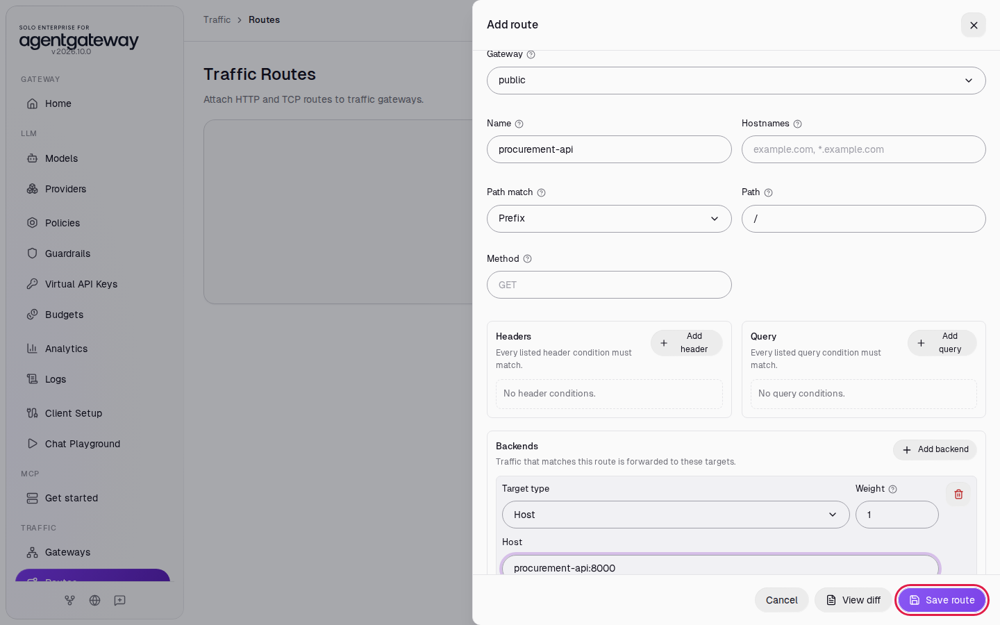
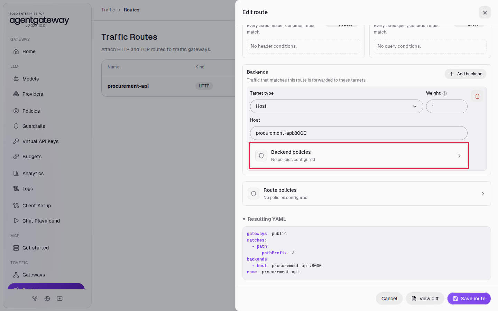
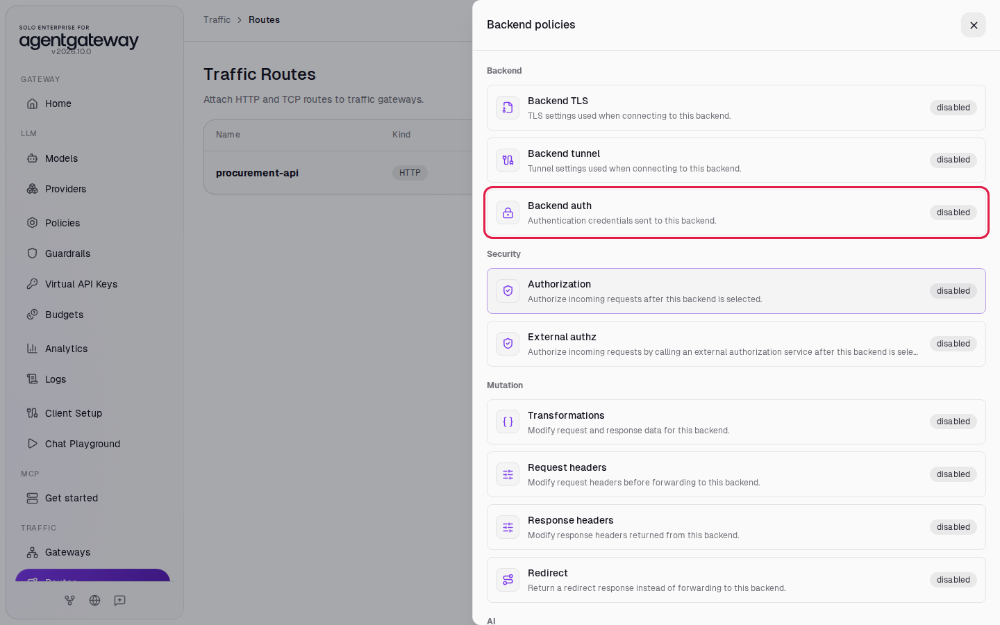
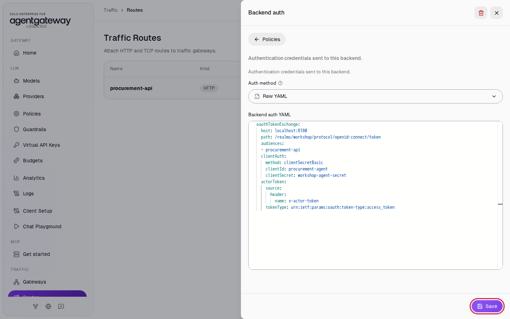
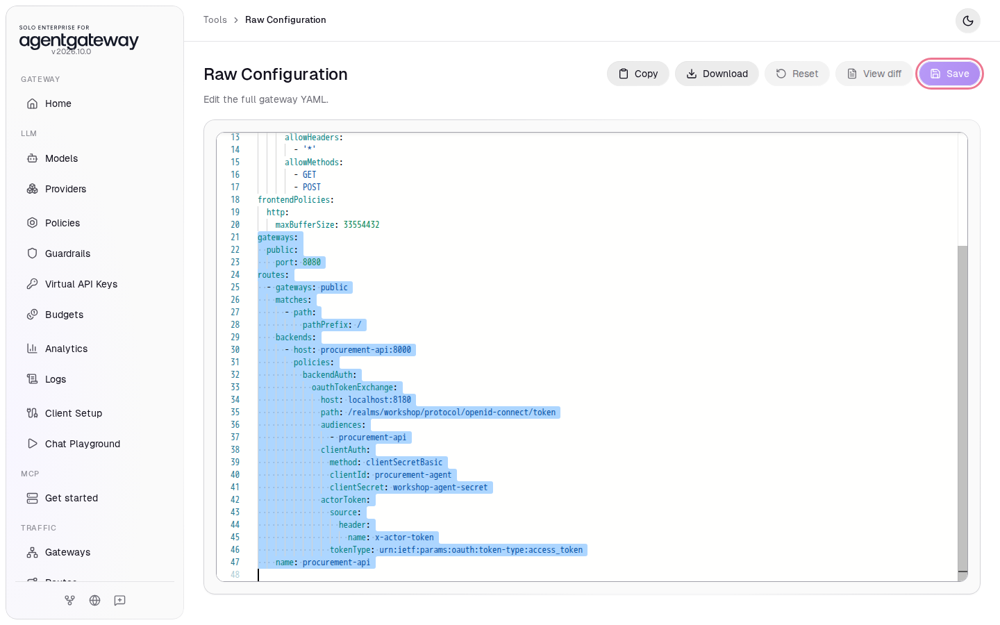

# Call an API on the User's Behalf with Token Exchange

## Before you start

- Complete [001: Set Up Standalone Agentgateway](../../001-set-up-standalone-agentgateway.md).
- Start Keycloak and the example API. From the `setup/` folder, run:

  ```bash
  env UID=$(id -u) GID=$(id -g) docker compose --profile keycloak --profile obo up -d
  ```

  Keycloak serves the `workshop` realm at `http://localhost:8180`, with the users `alice`, `bob` and `carol` (password `workshop`). It takes up to a minute to start the first time. The `procurement-api` container stands in for an internal API. It answers every request with the request it received, including the decoded token from the `Authorization` header, so you can see which token reached it.

## What you'll do

- Route port `8080` to the procurement API
- Call the API with alice's Keycloak token and see that the API receives the same token
- Make the gateway exchange the token at Keycloak for one issued to the API
- Call the API again and compare the tokens
- Switch to delegation: an agent calls the API for alice, and the API's token names both alice and the agent

## Why this matters

An agent acts for a user: it calls the gateway with the user's token, and the gateway calls internal APIs. If the gateway passes the user's token on, every API receives a token issued for the gateway. Any API that receives it can send it back to the gateway and act as that user.

Token exchange (RFC 8693) fixes this. Before the gateway calls the API, it sends the user's token to Keycloak and asks for a new token for that API only. The new token keeps the user's identity and names the gateway as the client that asked for it. The API checks that the token is issued for it, and it still knows which user the call is for. This pattern is also called on-behalf-of (OBO).

Steps 5 and 6 add delegation. An agent calls the gateway with alice's token and its own token. The gateway sends both to Keycloak, and the new token has an `act` claim that names the agent. The API then knows both the user and the agent acting for that user. Keycloak issues the token only when alice's token names that agent in a `may_act` claim.

The workshop realm has these clients for this lab:

| Client | Role |
|---|---|
| `workshop-cli` | The app alice signs in with. Its tokens have the audience `agentgateway`. |
| `agentgateway` | The gateway's own client. It may exchange tokens, and it signs in to Keycloak with the secret `workshop-gateway-secret`. |
| `procurement-api` | The API. Tokens for it have the audience `procurement-api`. |
| `agent-cli` | The app alice signs in with for delegation. Its tokens have a `may_act` claim that names `procurement-agent`. |
| `procurement-agent` | The agent. It gets its own token with its secret `workshop-agent-secret`, and it may exchange tokens. |

## Step 1: Turn on Traffic

1. In the sidebar, under **Traffic**, click **Get started**.
2. Click **Enable**.

   

The UI creates a gateway named `public` on port `8080`. The sidebar now shows **Gateways** and **Routes** under **Traffic**.

## Step 2: Route port 8080 to the API

1. In the sidebar, under **Traffic**, click **Routes**.
2. Click **Add route**.
3. In **Gateway**, select **public**.
4. In **Name**, enter `procurement-api`.
5. Under **Backends**, click **Add backend**.
6. Leave **Target type** on **Host**. In **Host**, enter `procurement-api:8000`.
7. Click **Save route**.

   

## Step 3: Call the API with alice's token

1. Sign in as alice with the `workshop-cli` client and keep her access token in `TOKEN`:

   ```bash
   TOKEN=$(curl -s http://localhost:8180/realms/workshop/protocol/openid-connect/token \
     -d grant_type=password -d client_id=workshop-cli \
     -d username=alice -d password=workshop \
     | sed -E 's/.*"access_token":"([^"]+)".*/\1/')
   ```

2. Call the API through the gateway and print the token the API received:

   ```bash
   curl -s http://localhost:8080/orders -H "Authorization: Bearer $TOKEN" \
     | tr -d ' \n' | grep -o '"payload":{[^}]*}'
   ```

   Expected output (trimmed):

   ```
   "payload":{...,"iss":"http://localhost:8180/realms/workshop","aud":"agentgateway",...,"azp":"workshop-cli",...,"preferred_username":"alice",...}
   ```

The API received alice's own token. Its audience is `agentgateway`: Keycloak issued it for the gateway.

## Step 4: Exchange the token at Keycloak

1. On the **Traffic Routes** page, in the `procurement-api` row, click **Edit route**.
2. Under **Backends**, click **Backend policies**.

   

3. Click **Backend auth**.

   

4. In **Auth method**, select **Raw YAML**.
5. In **Backend auth YAML**, enter:

   ```yaml
   oauthTokenExchange:
     host: localhost:8180
     path: /realms/workshop/protocol/openid-connect/token
     audiences:
     - procurement-api
     clientAuth:
       method: clientSecretBasic
       clientId: agentgateway
       clientSecret: workshop-gateway-secret
   ```

6. Click **Save**.

   

7. The **Backend policies** list shows Backend auth as configured. Click the close icon at the top of the list.
8. Click **Save route**.

For each request, the gateway sends the incoming token to Keycloak's token endpoint at `localhost:8180`, signs in as the `agentgateway` client, and asks for a token with the audience `procurement-api`. It sends the new token to the API in place of the old one. The gateway keeps the new token until it expires, so repeated calls for the same user do not go to Keycloak each time.

## Check it

1. Wait two seconds, then run the call from Step 3 again. If `TOKEN` is older than five minutes, get a new one first with the command in Step 3.

   ```bash
   curl -s http://localhost:8080/orders -H "Authorization: Bearer $TOKEN" \
     | tr -d ' \n' | grep -o '"payload":{[^}]*}'
   ```

   Expected output (trimmed):

   ```
   "payload":{...,"iss":"http://localhost:8180/realms/workshop","aud":"procurement-api",...,"azp":"agentgateway",...,"preferred_username":"alice",...}
   ```

   The API now receives a different token. Its audience is `procurement-api`, it names `agentgateway` as the client that requested it, and it is still alice's token.

2. Call the API without a token:

   ```bash
   curl -s -w '\nHTTP %{http_code}\n' http://localhost:8080/orders
   ```

   Expected output:

   ```
   invalid request
   HTTP 400
   ```

   The gateway has no user token to exchange, so it does not call the API.

## Step 5: Switch the exchange to delegation

1. On the **Traffic Routes** page, in the `procurement-api` row, click **Edit route**.
2. Under **Backends**, click **Backend policies**, then click **Backend auth**.
3. In **Backend auth YAML**, replace the YAML with:

   ```yaml
   oauthTokenExchange:
     host: localhost:8180
     path: /realms/workshop/protocol/openid-connect/token
     audiences:
     - procurement-api
     clientAuth:
       method: clientSecretBasic
       clientId: procurement-agent
       clientSecret: workshop-agent-secret
     actorToken:
       source:
         header:
           name: x-actor-token
       tokenType: urn:ietf:params:oauth:token-type:access_token
   ```

4. Click **Save**.

   

5. Click the close icon at the top of the **Backend policies** list, then click **Save route**.

The gateway now reads the agent's token from the `x-actor-token` header and sends it to Keycloak with alice's token. It signs in to Keycloak as `procurement-agent`, because Keycloak accepts a delegation request only from the agent's own client. It removes the `x-actor-token` header before it calls the API.

## Step 6: Call the API as the agent

1. Sign in as alice with the `agent-cli` client:

   ```bash
   USER_TOKEN=$(curl -s http://localhost:8180/realms/workshop/protocol/openid-connect/token \
     -d grant_type=password -d client_id=agent-cli \
     -d username=alice -d password=workshop \
     | sed -E 's/.*"access_token":"([^"]+)".*/\1/')
   ```

   The `workshop-cli` token from Step 3 has no `may_act` claim, so Keycloak refuses to exchange it for delegation.

2. Get the agent's own token:

   ```bash
   AGENT_TOKEN=$(curl -s http://localhost:8180/realms/workshop/protocol/openid-connect/token \
     -u procurement-agent:workshop-agent-secret -d grant_type=client_credentials \
     | sed -E 's/.*"access_token":"([^"]+)".*/\1/')
   ```

3. Call the API with both tokens and print the claims that matter:

   ```bash
   curl -s http://localhost:8080/orders \
     -H "Authorization: Bearer $USER_TOKEN" -H "x-actor-token: $AGENT_TOKEN" \
     | tr -d ' \n' | grep -oE '"(aud|azp|preferred_username)":"[^"]*"|"act":\{[^}]*\}'
   ```

   Expected output:

   ```
   "aud":"procurement-api"
   "azp":"procurement-agent"
   "act":{"sub":"5a1c0e7e-0000-4000-8000-00000000a6e1","client_id":"procurement-agent"}
   "preferred_username":"alice"
   ```

The token is still alice's. The `act` claim names the agent: `client_id` is `procurement-agent`, and `sub` is the ID of its service account user in Keycloak.

In this workshop, a fixed claim on the `agent-cli` client puts `may_act` in alice's token. In production, Keycloak adds `may_act` only when an admin permits the agent to act for users and alice consents at sign-in (the `delegation:client:procurement-agent` scope). Keycloak runs with its `token-exchange-delegation` preview feature for this.

## Check it: delegation

1. Call the API without the agent's token:

   ```bash
   curl -s -w '\nHTTP %{http_code}\n' http://localhost:8080/orders -H "Authorization: Bearer $USER_TOKEN"
   ```

   Expected output:

   ```
   invalid request
   HTTP 400
   ```

   The gateway has no actor token to send, so it does not call Keycloak or the API.

2. Send a token from a client that alice did not name in `may_act`, the gateway's own `agentgateway` client:

   ```bash
   OTHER_TOKEN=$(curl -s http://localhost:8180/realms/workshop/protocol/openid-connect/token \
     -u agentgateway:workshop-gateway-secret -d grant_type=client_credentials \
     | sed -E 's/.*"access_token":"([^"]+)".*/\1/')
   curl -s -w '\nHTTP %{http_code}\n' http://localhost:8080/orders \
     -H "Authorization: Bearer $USER_TOKEN" -H "x-actor-token: $OTHER_TOKEN"
   ```

   Expected output:

   ```
   backend authentication failed: token exchange returned status 403 Forbidden
   HTTP 500
   ```

   Keycloak refuses the exchange, and the gateway does not call the API.

## What the UI wrote

In the sidebar, scroll down to **Tools** and click **Raw Configuration**. The UI added a gateway and a route with the delegation exchange from Step 5 on its backend:

```yaml
gateways:
  public:
    port: 8080
routes:
  - gateways: public
    matches:
      - path:
          pathPrefix: /
    backends:
      - host: procurement-api:8000
        policies:
          backendAuth:
            oauthTokenExchange:
              host: localhost:8180
              path: /realms/workshop/protocol/openid-connect/token
              audiences:
                - procurement-api
              clientAuth:
                method: clientSecretBasic
                clientId: procurement-agent
                clientSecret: workshop-agent-secret
              actorToken:
                source:
                  header:
                    name: x-actor-token
                tokenType: urn:ietf:params:oauth:token-type:access_token
    name: procurement-api
```

The Step 4 version had `clientId: agentgateway`, its secret, and no `actorToken`.

The same `backendAuth` policy also works on an MCP server or a model.

## Clean up

1. Stop Keycloak and the API. From the `setup/` folder, run:

   ```bash
   docker compose --profile keycloak --profile obo stop keycloak procurement-api
   ```

2. Turn off Traffic. In the sidebar, scroll down to **Tools** and click **Raw Configuration**.
3. Select from the line `gateways:` to the end of the file. This is the `public` gateway on port `8080` and the `routes:` section with the `procurement-api` route.

   

4. Press **Delete**.
5. Click **Save**. If a confirmation appears, click **Save** again.

The sidebar shows **Get started** under **Traffic** again. The gateway is back to the state [001](../../001-set-up-standalone-agentgateway.md) left it in.
