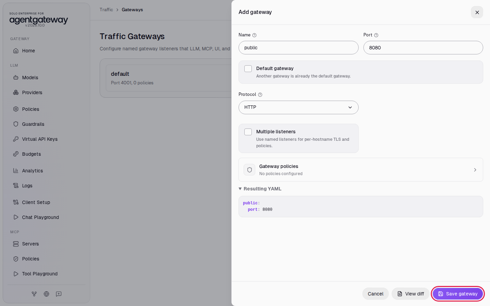

# Call an API on the User's Behalf with Token Exchange

## Before you start

- Complete [Connect a Remote MCP Server](../mcp/connect-remote-mcp-server.md).
- Start Keycloak and the example API. From the `setup/` folder, run:

  ```bash
  env UID=$(id -u) GID=$(id -g) docker compose --profile keycloak --profile obo up -d
  ```

  Keycloak serves the `workshop` realm at `http://localhost:8180`, with the users `alice`, `bob` and `carol` (password `workshop`). It takes up to a minute to start the first time. The `procurement-api` container stands in for an internal API. It answers every request with the request it received, including the decoded token from the `Authorization` header, so you can see which token reached it.

## What you'll do

- Route port `8080` to the procurement API
- Call the API with alice's Keycloak token and see that the API receives the same token
- Make the gateway exchange the token at Keycloak for one issued to the API
- Call the API again and compare the tokens

## Why this matters

An agent acts for a user: it calls the gateway with the user's token, and the gateway calls internal APIs. If the gateway passes the user's token on, every API receives a token issued for the gateway. Any API that receives it can send it back to the gateway and act as that user.

Token exchange (RFC 8693) fixes this. Before the gateway calls the API, it sends the user's token to Keycloak and asks for a new token for that API only. The new token keeps the user's identity and names the gateway as the client that asked for it. The API checks that the token is issued for it, and it still knows which user the call is for. This pattern is also called on-behalf-of (OBO).

The workshop realm has three clients for this lab:

| Client | Role |
|---|---|
| `workshop-cli` | The app alice signs in with. Its tokens have the audience `agentgateway`. |
| `agentgateway` | The gateway's own client. It may exchange tokens, and it signs in to Keycloak with the secret `workshop-gateway-secret`. |
| `procurement-api` | The API. Tokens for it have the audience `procurement-api`. |

## Step 1: Add a gateway on port 8080

1. In the sidebar, under **Traffic**, click **Gateways**.
2. Click **Add gateway**. The panel fills in **Name** `public` and **Port** `8080`.
3. Click **Save gateway**.

   

## Step 2: Route port 8080 to the API

1. In the sidebar, under **Traffic**, click **Routes**.
2. Click **Add route**.
3. In **Gateway**, select **public**.
4. In **Name**, enter `procurement-api`.
5. Under **Backends**, click **Add backend**.
6. Leave **Target type** on **Host**. In **Host**, enter `procurement-api:8000`.
7. Click **Save route**.

   

## Step 3: Call the API with alice's token

1. Sign in as alice with the `workshop-cli` client and keep her access token in `TOKEN`:

   ```bash
   TOKEN=$(curl -s http://localhost:8180/realms/workshop/protocol/openid-connect/token \
     -d grant_type=password -d client_id=workshop-cli \
     -d username=alice -d password=workshop \
     | sed -E 's/.*"access_token":"([^"]+)".*/\1/')
   ```

2. Call the API through the gateway and print the token the API received:

   ```bash
   curl -s http://localhost:8080/orders -H "Authorization: Bearer $TOKEN" \
     | tr -d ' \n' | grep -o '"payload":{[^}]*}'
   ```

   Expected output (trimmed):

   ```
   "payload":{...,"iss":"http://localhost:8180/realms/workshop","aud":"agentgateway",...,"azp":"workshop-cli",...,"preferred_username":"alice",...}
   ```

The API received alice's own token. Its audience is `agentgateway`: Keycloak issued it for the gateway.

## Step 4: Exchange the token at Keycloak

1. On the **Traffic Routes** page, in the `procurement-api` row, click **Edit route**.
2. Under **Backends**, click **Backend policies**.

   

3. Click **Backend auth**.

   

4. In **Auth method**, select **Raw YAML**.
5. In **Backend auth YAML**, enter:

   ```yaml
   oauthTokenExchange:
     host: localhost:8180
     path: /realms/workshop/protocol/openid-connect/token
     audiences:
     - procurement-api
     clientAuth:
       method: clientSecretBasic
       clientId: agentgateway
       clientSecret: workshop-gateway-secret
   ```

6. Click **Save**.

   

7. The **Backend policies** list shows Backend auth as configured. Click the close icon at the top of the list.
8. Click **Save route**.

For each request, the gateway sends the incoming token to Keycloak's token endpoint at `localhost:8180`, signs in as the `agentgateway` client, and asks for a token with the audience `procurement-api`. It sends the new token to the API in place of the old one. The gateway keeps the new token until it expires, so repeated calls for the same user do not go to Keycloak each time.

## Check it

1. Wait two seconds, then run the call from Step 3 again. If `TOKEN` is older than five minutes, get a new one first with the command in Step 3.

   ```bash
   curl -s http://localhost:8080/orders -H "Authorization: Bearer $TOKEN" \
     | tr -d ' \n' | grep -o '"payload":{[^}]*}'
   ```

   Expected output (trimmed):

   ```
   "payload":{...,"iss":"http://localhost:8180/realms/workshop","aud":"procurement-api",...,"azp":"agentgateway",...,"preferred_username":"alice",...}
   ```

   The API now receives a different token. Its audience is `procurement-api`, it names `agentgateway` as the client that requested it, and it is still alice's token.

2. Call the API without a token:

   ```bash
   curl -s -w '\nHTTP %{http_code}\n' http://localhost:8080/orders
   ```

   Expected output:

   ```
   invalid request
   HTTP 400
   ```

   The gateway has no user token to exchange, so it does not call the API.

## What the UI wrote

In the sidebar, scroll down to **Tools** and click **Raw Configuration**. The UI added a gateway and a route with the token exchange on its backend:

```yaml
gateways:
  ...
  public:
    port: 8080
routes:
  - gateways: public
    matches:
      - path:
          pathPrefix: /
    backends:
      - host: procurement-api:8000
        policies:
          backendAuth:
            oauthTokenExchange:
              host: localhost:8180
              path: /realms/workshop/protocol/openid-connect/token
              audiences:
                - procurement-api
              clientAuth:
                method: clientSecretBasic
                clientId: agentgateway
                clientSecret: workshop-gateway-secret
    name: procurement-api
```

The same `backendAuth` policy also works on an MCP server or a model.

## Clean up

1. In the sidebar, under **Traffic**, click **Routes**.
2. In the `procurement-api` row, click **Delete route**. The route is deleted right away.
3. In the sidebar, under **Traffic**, click **Gateways**.
4. Next to `public`, click **Delete gateway**.
5. Stop Keycloak and the API. From the `setup/` folder, run:

   ```bash
   docker compose --profile keycloak --profile obo stop keycloak procurement-api
   ```
