# Turn Your Own REST API into MCP Tools with OpenAPI

## Before you start

- Complete [Connect a Remote MCP Server](../mcp/connect-remote-mcp-server.md). The `solo-docs` server is on the **MCP Servers** page.
- Start the example API. From the `setup/` folder, run:

  ```bash
  env UID=$(id -u) GID=$(id -g) docker compose --profile stripe-mock up -d
  ```

  The `stripe-mock` container runs [stripe-mock](https://github.com/stripe/stripe-mock), a mock of the Stripe payments API. It stands in for a REST API that your team runs. It answers on port `12111` with sample Stripe data, and it rejects requests that have no `Authorization` header. You need no Stripe account.

## What you'll do

- Add the API as an MCP server, with an OpenAPI schema that describes three of its operations
- Call a generated tool and see the API refuse it, because the call has no API key
- Give the gateway the API key, so it adds the key to each call
- Call a tool that lists products, and a tool that takes a customer ID in the URL path

## Why this matters

Most companies run internal REST APIs that already have an OpenAPI schema. The gateway reads the schema and makes one MCP tool for each operation, so agents can use the API without a new MCP server. [Turn a REST API into MCP Tools with OpenAPI](openapi-to-mcp.md) does this for a public API with one operation. Here the API runs next to the gateway and needs a key, as most internal APIs do. The gateway keeps the key, so agents never see it.

## Step 1: Add the API as an MCP server

1. In the sidebar, under **MCP**, click **Servers**.
2. Click **Add server**.
3. In **Server name**, enter `stripe`.
4. In **Transport**, click **OpenAPI**.
5. In **URL**, enter `http://stripe-mock:12111`. The gateway reaches the container by its Compose service name. `http://` means plain HTTP, with no TLS, as is common for a service on the same network.
6. In **Schema source**, click **Inline**.

   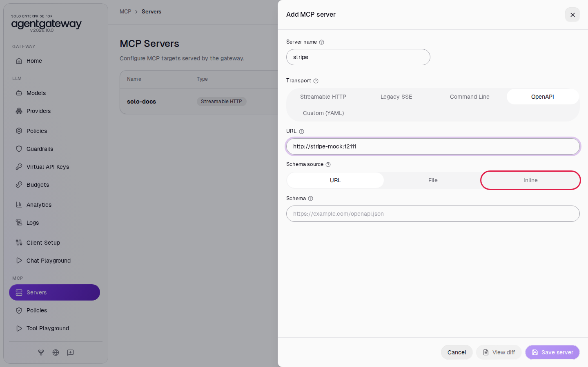

7. Click in **Schema**, select all the text, and paste this schema. The full Stripe schema has hundreds of operations, and each one would become a tool. This schema keeps three: `listProducts`, `listPrices` and `getCustomer`. `getCustomer` has a path parameter: the customer ID is part of the URL, as in `/v1/customers/cus_workshop`.

   ```json
   {
     "openapi": "3.0.0",
     "info": {
       "title": "Stripe Mock API (subset)",
       "version": "1.0.0",
       "description": "Three operations of the Stripe API, served by stripe-mock."
     },
     "servers": [
       { "url": "/" }
     ],
     "paths": {
       "/v1/products": {
         "get": {
           "operationId": "listProducts",
           "summary": "List products",
           "description": "Returns the product catalog. Each product has a name, a description and a default price.",
           "parameters": [
             {
               "name": "limit",
               "in": "query",
               "required": false,
               "description": "Maximum number of products to return (1-100).",
               "schema": { "type": "integer" }
             }
           ],
           "responses": {
             "200": { "description": "A list of products" }
           }
         }
       },
       "/v1/prices": {
         "get": {
           "operationId": "listPrices",
           "summary": "List prices",
           "description": "Returns the prices of the products. unit_amount is in cents, so 2000 means 20.00 USD.",
           "parameters": [
             {
               "name": "limit",
               "in": "query",
               "required": false,
               "description": "Maximum number of prices to return (1-100).",
               "schema": { "type": "integer" }
             }
           ],
           "responses": {
             "200": { "description": "A list of prices" }
           }
         }
       },
       "/v1/customers/{customer}": {
         "get": {
           "operationId": "getCustomer",
           "summary": "Get a customer",
           "description": "Returns one customer by ID.",
           "parameters": [
             {
               "name": "customer",
               "in": "path",
               "required": true,
               "description": "The customer ID, for example cus_workshop.",
               "schema": { "type": "string" }
             }
           ],
           "responses": {
             "200": { "description": "A customer" }
           }
         }
       }
     }
   }
   ```

   The `servers` URL is `/` on purpose: the host comes from the **URL** field, not from the schema.

8. Click **Save server**.

   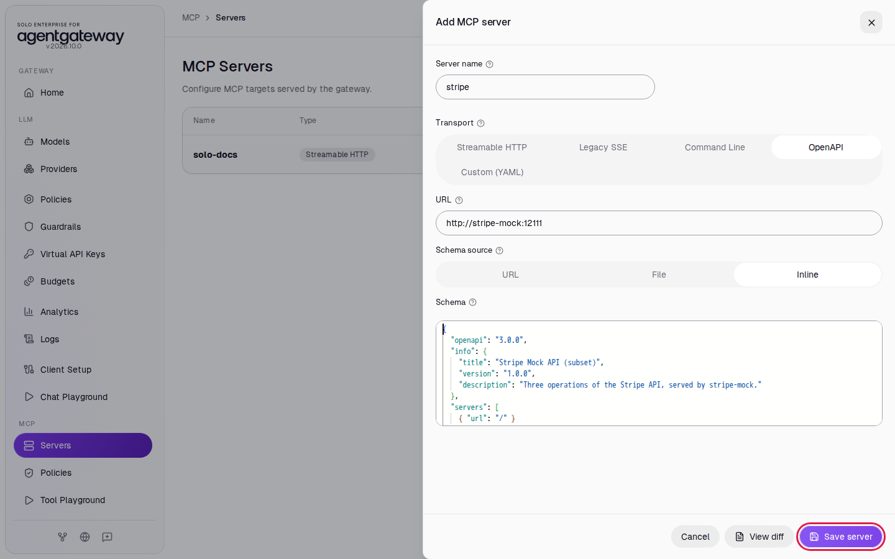

The list shows `stripe` with the type **OpenAPI**, the endpoint `http://stripe-mock:12111` and the state **ready**.

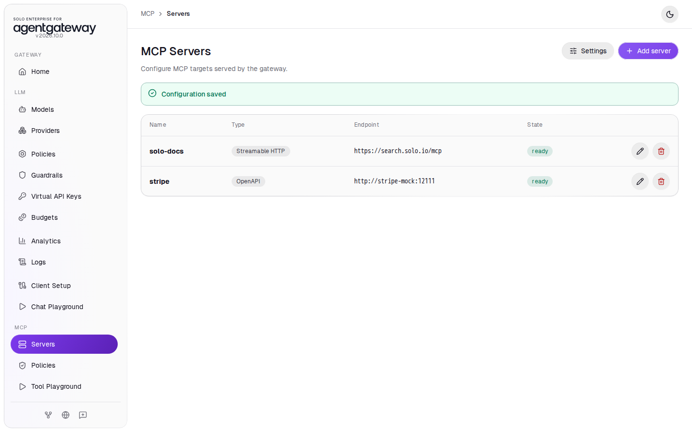

## Step 2: Call a tool without an API key

1. In the sidebar, click **Tool Playground**.
2. Click **Initialize**. The **Result** panel shows **6 tools discovered**: the 3 `solo-docs` tools and the 3 `stripe` tools.
3. Click **Tool**. The list shows `stripe_listProducts`, `stripe_listPrices` and `stripe_getCustomer`, one tool for each operation in the schema. The gateway puts the server name in front of each tool name. Select **stripe_listProducts**.

   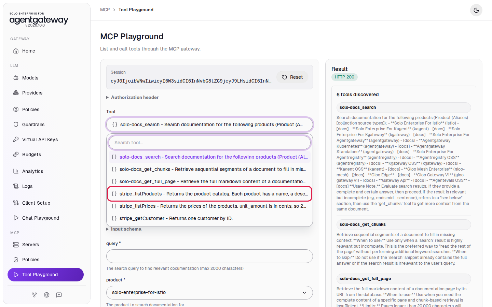

4. Leave **query** as `{}`. The `limit` parameter is optional. Click **Call tool**.

The **Tool output** shows the API's answer:

```
{"error":{"message":"Please authenticate by specifying an `Authorization` header with any valid looking testmode secret API key. For example, `Authorization: Bearer sk_test_123`. Authorization was ''.","type":"invalid_request_error"}}
```

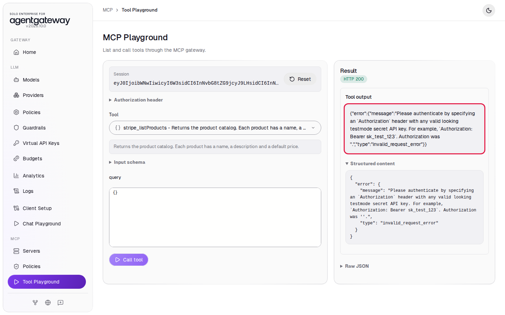

The gateway reached the API, but the API refused the call because it had no key. The playground still shows **HTTP 200**: the gateway returns the API's error as the tool result, so read the **Tool output** to see it.

## Step 3: Give the gateway the API key

The **Add MCP server** panel has no field for credentials, so you add the key in Raw Configuration. stripe-mock accepts any key that starts with `sk_test_`. This lab uses `sk_test_123`.

1. In the sidebar, scroll down to **Tools** and click **Raw Configuration**.
2. Scroll down in the editor to `mcp`, then `targets`. Click at the end of the line `- name: stripe`.

   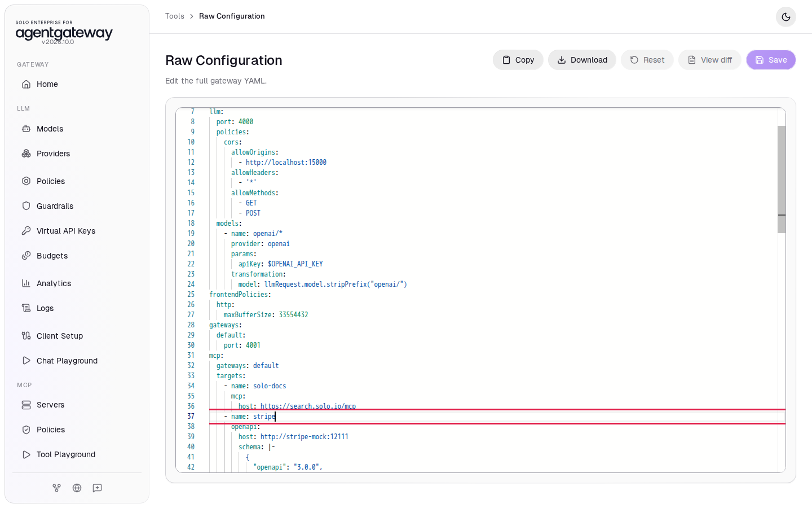

3. Press **Enter**. The editor starts the new line under the `-`.
4. Copy this line, with its two leading spaces, and paste it:

   ```yaml
     policies: { backendAuth: { key: sk_test_123 } }
   ```

   Check that `policies` lines up with `name` on the line above and that the line ends with three `}` characters. If you type the line instead, the editor can add extra closing braces.

5. Click **Save**.

   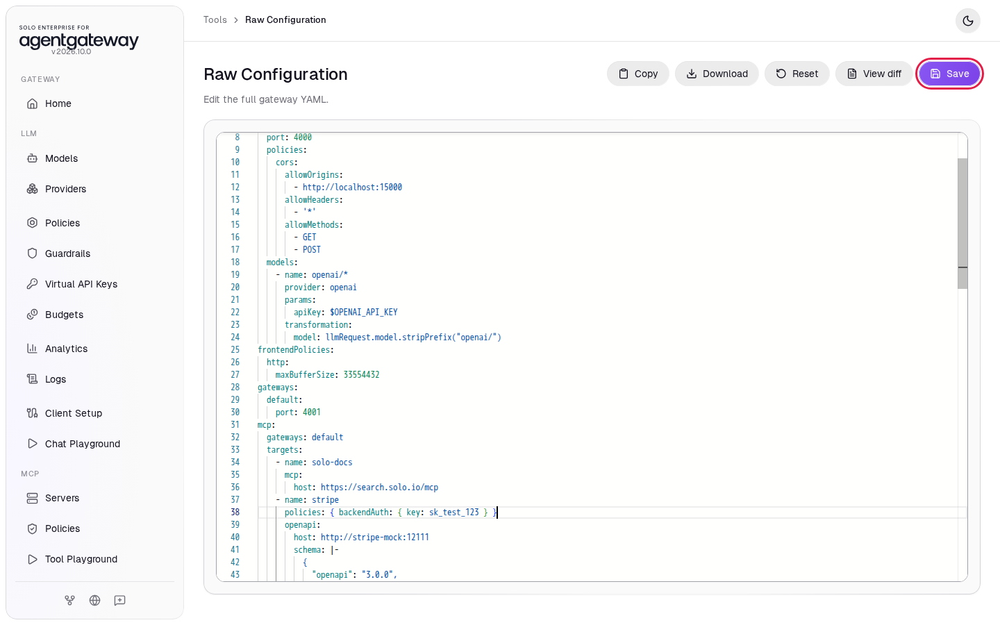

`backendAuth` with a `key` makes the gateway send `Authorization: Bearer sk_test_123` on each call to this server. The policy applies only to the `stripe` target. For a real API, keep the key out of `config.yaml`: write `key: $STRIPE_API_KEY` and set the environment variable on the gateway container, the same way the `openai/*` model reads `$OPENAI_API_KEY`.

## Check it

### List products

1. In the sidebar, click **Tool Playground**.
2. Click **Initialize**.
3. In **Tool**, select **stripe_listProducts**.
4. The gateway puts the query parameters of an operation into one **query** object. Click in **query**, select all the text, and paste:

   ```json
   {"limit": 1}
   ```

5. Click **Call tool**.

   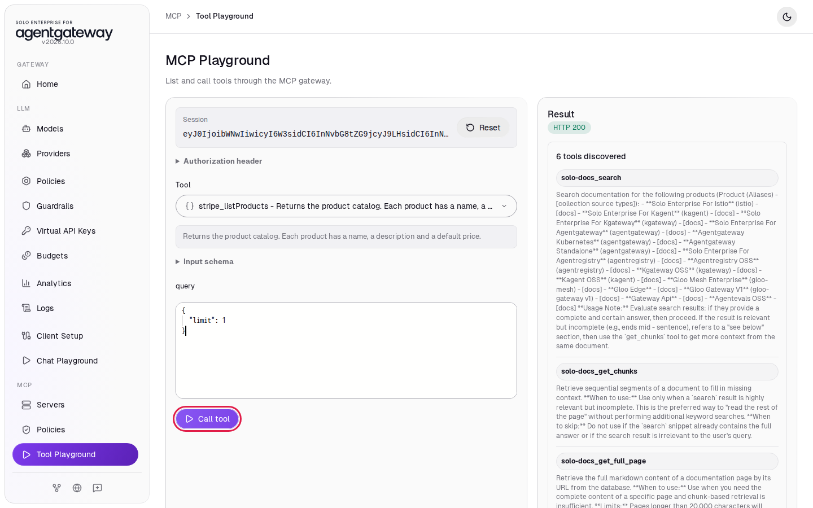

The **Tool output** shows a Stripe list with one product: `"name":"T-shirt"`, `"description":"Comfortable gray cotton t-shirt"` and `"object":"product"`. This is stripe-mock's sample product.

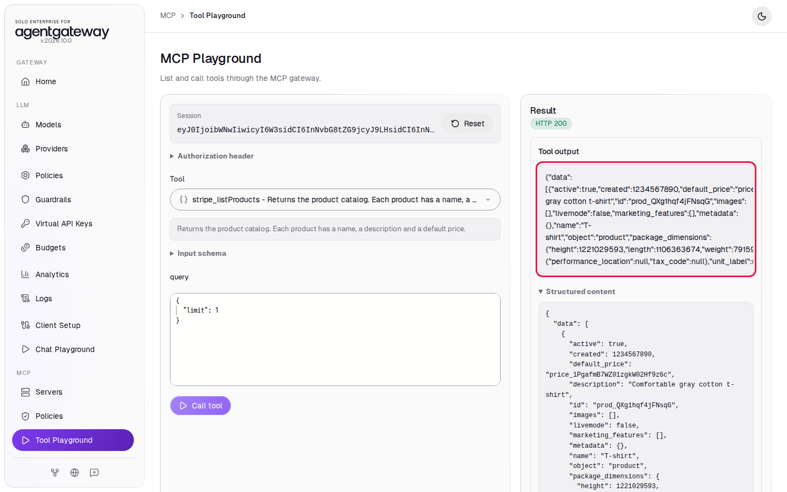

If you still see the authentication error, wait 2 seconds, reload the page and call the tool again.

### Get a customer by ID

1. Click **Initialize**.
2. In **Tool**, select **stripe_getCustomer**.
3. Path parameters go into a **path** object. Click in **path**, select all the text, and paste:

   ```json
   {"customer": "cus_workshop"}
   ```

4. Click **Call tool**.

   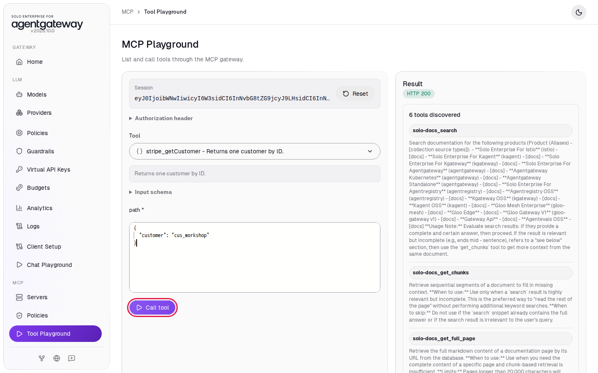

The gateway called `GET http://stripe-mock:12111/v1/customers/cus_workshop`. The **Tool output** shows a customer with `"object":"customer"`. In **Structured content**, find `"id": "cus_workshop"`: stripe-mock returns the ID you sent.

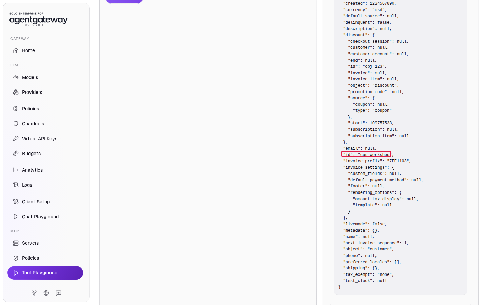

<details>
<summary>Optional: check with curl</summary>

Start a session, then call the third tool, `stripe_listPrices`:

```bash
SESSION=$(curl -s -D - -o /dev/null http://localhost:4001/mcp \
  -H "Content-Type: application/json" \
  -H "Accept: application/json, text/event-stream" \
  -d '{"jsonrpc":"2.0","id":1,"method":"initialize","params":{"protocolVersion":"2025-06-18","capabilities":{},"clientInfo":{"name":"curl","version":"1"}}}' \
  | grep -i '^mcp-session-id:' | awk '{print $2}' | tr -d '\r')
curl -s http://localhost:4001/mcp \
  -H "Content-Type: application/json" \
  -H "Accept: application/json, text/event-stream" \
  -H "Mcp-Session-Id: $SESSION" \
  -d '{"jsonrpc":"2.0","id":2,"method":"tools/call","params":{"name":"stripe_listPrices","arguments":{"query":{"limit":1}}}}'
```

Expected output (trimmed):

```
event: message
data: {"jsonrpc":"2.0","id":2,"result":{"content":[{"type":"text","text":"{\"data\":[{\"active\":true,...,\"object\":\"price\",\"product\":\"prod_QXg1hqf4jFNsqG\",\"recurring\":{\"interval\":\"month\",...},...,\"unit_amount\":2000,...}"}],"structuredContent":{...}}}
```

`unit_amount` is in cents, so the T-shirt costs 20.00 USD a month.

</details>

## What the UI wrote

In the sidebar, scroll down to **Tools** and click **Raw Configuration**. The UI added a target with an `openapi` section to `mcp.targets`, and your edit added `policies` to it. When the UI saves, it writes `policies` after `openapi` in block style:

```yaml
mcp:
  targets:
  - name: solo-docs
    mcp:
      host: https://search.solo.io/mcp
  - name: stripe
    openapi:
      host: http://stripe-mock:12111
      schema: |-
        {
          "openapi": "3.0.0",
          ...
        }
    policies:
      backendAuth:
        key: sk_test_123
```

## Clean up

1. In the sidebar, click **Servers**.
2. In the `stripe` row, click the delete icon, then click **Delete server**. This also removes the API key from the configuration.

   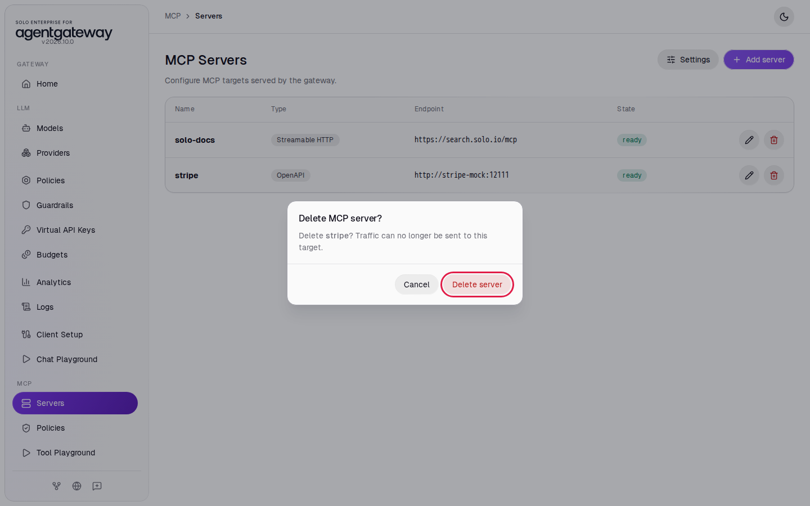

3. Stop the example API. From the `setup/` folder, run:

   ```bash
   docker compose --profile stripe-mock stop stripe-mock
   ```
