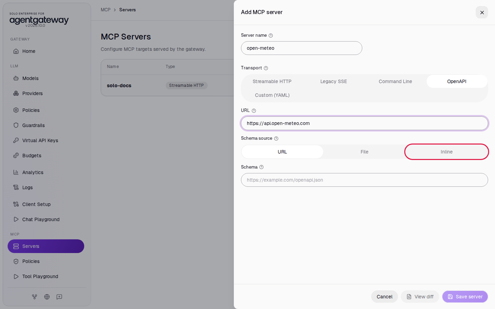
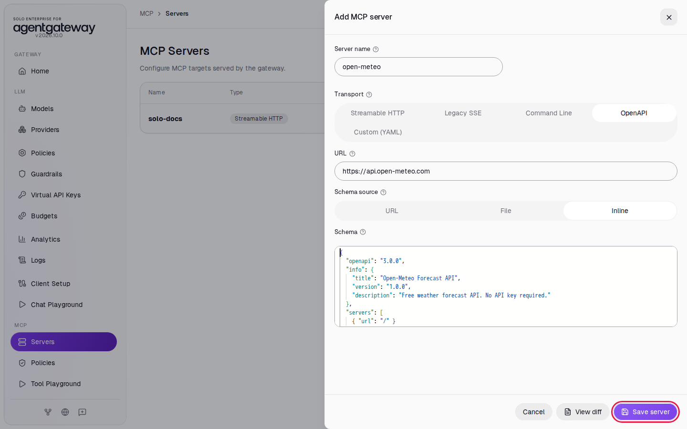
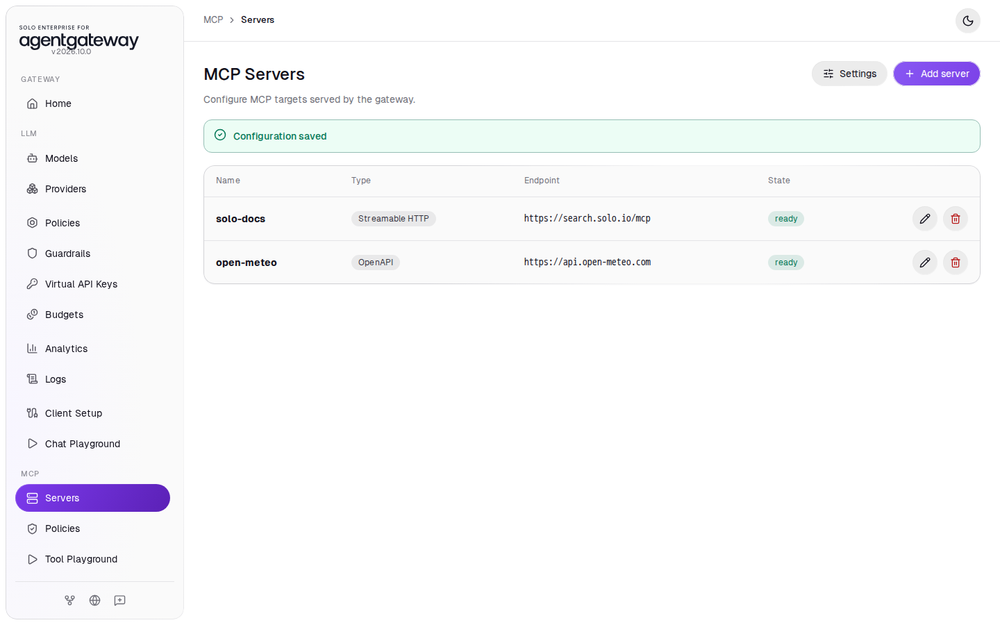
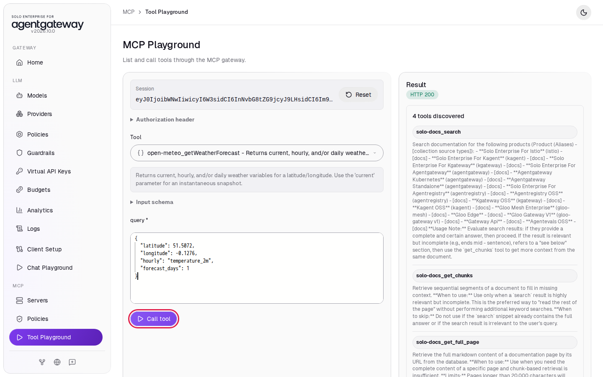
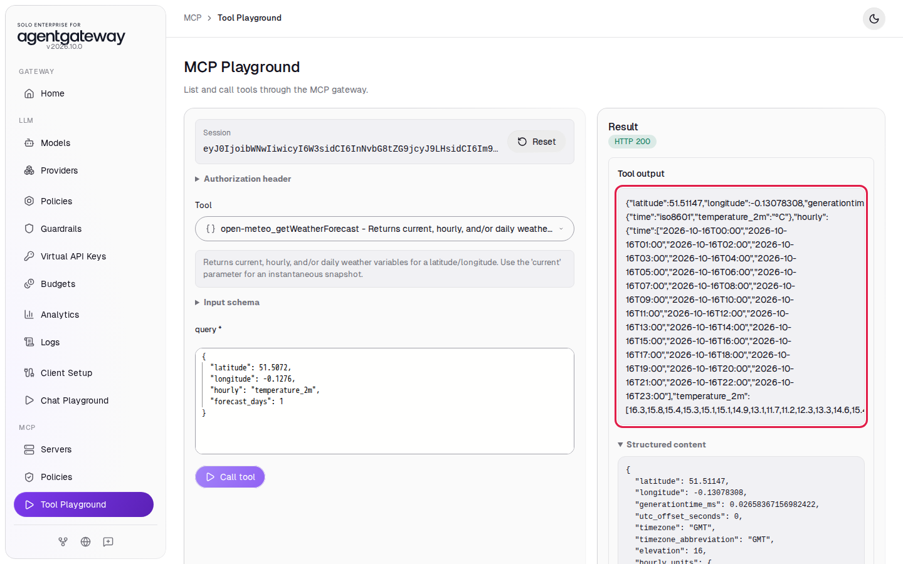
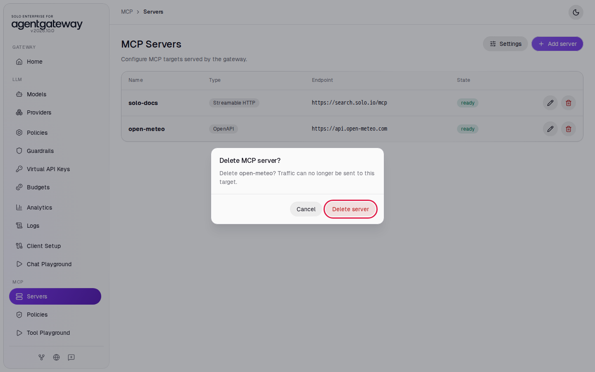

# Turn a REST API into MCP Tools with OpenAPI

## Before you start

- Complete [Connect a Remote MCP Server](../mcp/connect-remote-mcp-server.md). The `solo-docs` server is on the **MCP Servers** page.
- Your computer can reach `https://api.open-meteo.com`. [Open-Meteo](https://open-meteo.com/) is a free weather API. It needs no account or API key.

## What you'll do

- Add the Open-Meteo forecast API as an MCP server, using an OpenAPI schema that you paste into the UI
- Call the tool that the gateway makes from the schema
- Get live weather data back as JSON

## Why this matters

Many companies already describe their REST APIs with OpenAPI. The gateway reads the OpenAPI schema and makes one MCP tool for each API operation, so agents can call the API without a new MCP server. The `operationId` of each operation becomes the tool name.

## Step 1: Add the Open-Meteo API as an MCP server

1. In the sidebar, under **MCP**, click **Servers**.
2. Click **Add server**.
3. In **Server name**, enter `open-meteo`.
4. In **Transport**, click **OpenAPI**.
5. In **URL**, enter `https://api.open-meteo.com`. This is the address of the REST API. The `https://` tells the gateway to use TLS.
6. In **Schema source**, click **Inline**.

   

7. Click in **Schema**, select all the text, and paste this schema. It describes one operation, `getWeatherForecast`, on the path `/v1/forecast`:

   ```json
   {
     "openapi": "3.0.0",
     "info": {
       "title": "Open-Meteo Forecast API",
       "version": "1.0.0",
       "description": "Free weather forecast API. No API key required."
     },
     "servers": [
       { "url": "/" }
     ],
     "paths": {
       "/v1/forecast": {
         "get": {
           "operationId": "getWeatherForecast",
           "summary": "Get the weather forecast for a geographic location",
           "description": "Returns current, hourly, and/or daily weather variables for a latitude/longitude. Use the 'current' parameter for an instantaneous snapshot.",
           "parameters": [
             {
               "name": "latitude",
               "in": "query",
               "required": true,
               "description": "Latitude of the location in decimal degrees (e.g. 51.5072 for London).",
               "schema": { "type": "number" }
             },
             {
               "name": "longitude",
               "in": "query",
               "required": true,
               "description": "Longitude of the location in decimal degrees (e.g. -0.1276 for London).",
               "schema": { "type": "number" }
             },
             {
               "name": "current",
               "in": "query",
               "required": false,
               "description": "Comma-separated list of current weather variables, e.g. 'temperature_2m,wind_speed_10m,relative_humidity_2m'.",
               "schema": { "type": "string" }
             },
             {
               "name": "hourly",
               "in": "query",
               "required": false,
               "description": "Comma-separated list of hourly weather variables, e.g. 'temperature_2m,precipitation'.",
               "schema": { "type": "string" }
             },
             {
               "name": "daily",
               "in": "query",
               "required": false,
               "description": "Comma-separated list of daily weather variables, e.g. 'temperature_2m_max,temperature_2m_min'.",
               "schema": { "type": "string" }
             },
             {
               "name": "temperature_unit",
               "in": "query",
               "required": false,
               "description": "Unit for temperature values.",
               "schema": { "type": "string", "enum": ["celsius", "fahrenheit"] }
             },
             {
               "name": "timezone",
               "in": "query",
               "required": false,
               "description": "Timezone for daily/hourly timestamps. Use 'auto' to resolve from the coordinates.",
               "schema": { "type": "string" }
             },
             {
               "name": "forecast_days",
               "in": "query",
               "required": false,
               "description": "Number of forecast days to return (0-16).",
               "schema": { "type": "integer" }
             }
           ],
           "responses": {
             "200": {
               "description": "Weather forecast data"
             }
           }
         }
       }
     }
   }
   ```

   The `servers` URL is `/` on purpose: the host comes from the **URL** field, not from the schema.

8. Click **Save server**.

   

The list shows `open-meteo` with the type **OpenAPI** and the state **ready**.



## Step 2: Call the generated tool

1. In the sidebar, click **Tool Playground**.
2. Click **Initialize**. The **Result** panel lists **4 tools discovered**: the 3 `solo-docs` tools and `open-meteo_getWeatherForecast`. With more than one server, the gateway puts the server name in front of each tool name.
3. In **Tool**, select **open-meteo_getWeatherForecast**.
4. The gateway puts all query parameters of the operation into one **query** object. Click in **query**, select all the text, and paste:

   ```json
   {"latitude": 51.5072, "longitude": -0.1276, "hourly": "temperature_2m", "forecast_days": 1}
   ```

5. Click **Call tool**.

   

## Check it

The **Tool output** shows the JSON that Open-Meteo returned for London: `hourly_units` and an `hourly` object with 24 times and 24 temperatures. The **Structured content** section shows the same data, formatted.



The gateway changed your MCP tool call into `GET https://api.open-meteo.com/v1/forecast?latitude=51.5072&...` and returned the API response as the tool result.

<details>
<summary>Optional: check with curl</summary>

Start a session, then call the tool. This call asks for the current temperature:

```bash
SESSION=$(curl -s -D - -o /dev/null http://localhost:4001/mcp \
  -H "Content-Type: application/json" \
  -H "Accept: application/json, text/event-stream" \
  -d '{"jsonrpc":"2.0","id":1,"method":"initialize","params":{"protocolVersion":"2025-06-18","capabilities":{},"clientInfo":{"name":"curl","version":"1"}}}' \
  | grep -i '^mcp-session-id:' | awk '{print $2}' | tr -d '\r')
curl -s http://localhost:4001/mcp \
  -H "Content-Type: application/json" \
  -H "Accept: application/json, text/event-stream" \
  -H "Mcp-Session-Id: $SESSION" \
  -d '{"jsonrpc":"2.0","id":2,"method":"tools/call","params":{"name":"open-meteo_getWeatherForecast","arguments":{"query":{"latitude":51.5072,"longitude":-0.1276,"current":"temperature_2m"}}}}'
```

Expected output (your time and temperature differ):

```
event: message
data: {"jsonrpc":"2.0","id":2,"result":{"content":[{"type":"text","text":"{\"latitude\":51.51147,...,\"current_units\":{\"time\":\"iso8601\",\"interval\":\"seconds\",\"temperature_2m\":\"°C\"},\"current\":{\"time\":\"2026-10-16T21:30\",\"interval\":900,\"temperature_2m\":11.2}}"}],"structuredContent":{...}}}
```

</details>

## What the UI wrote

In the sidebar, scroll down to **Tools** and click **Raw Configuration**. The UI added a target with an `openapi` section to `mcp.targets`. The schema you pasted is stored inline:

```yaml
mcp:
  targets:
  - name: solo-docs
    mcp:
      host: https://search.solo.io/mcp
  - name: open-meteo
    openapi:
      host: https://api.open-meteo.com
      schema: |
        {
          "openapi": "3.0.0",
          ...
        }
```

## Clean up

1. In the sidebar, click **Servers**.
2. In the `open-meteo` row, click the delete icon, then click **Delete server**.

   
