# See Gateway Metrics, Traces, and Alerts in Grafana

## Before you start

- Complete [001: Set Up Standalone Agentgateway](../../001-set-up-standalone-agentgateway.md).
- Start the monitoring tools and the mock LLM servers. From the `setup/` folder, run:

  ```bash
  env UID=$(id -u) GID=$(id -g) docker compose --profile observability --profile mock-llm-faults up -d
  ```

  The `observability` profile starts three services on the gateway's Docker network. Their settings are in `setup/observability/`.

  | Service | What it does | Open it at |
  |---|---|---|
  | `prometheus` | Reads the gateway's metrics on port `15020` every 5 seconds and checks the alert rules in `alerts.yml` | `http://localhost:9090` |
  | `tempo` | Stores the traces the gateway sends on port `4317` | (through Grafana) |
  | `grafana` | Shows the metrics and traces, with the agentgateway dashboard already installed | `http://localhost:3000` |

  Grafana opens without a sign-in, and every visitor is an admin. Use this setup only on your own computer.

  The `mock-llm-faults` profile starts mock LLM servers. This lab uses `mock-llm-503`, which answers every request with `503 Service Unavailable`.

## What you'll do

- Check that Prometheus reads the gateway's metrics
- Turn on tracing and send the traces to Tempo
- See request and token counts on the agentgateway Grafana dashboard
- Open a trace in Grafana and read the model and token counts of one request
- Make a model fail and watch a Prometheus alert fire

## Why this matters

The **Logs** and **Analytics** pages show what one gateway did recently. If your team already watches its systems in Prometheus and Grafana, you can put the LLM traffic on the same screens and alerts. Metrics tell you how much traffic, how many tokens, and how many errors. A trace shows one request from start to end, with the model it used and the tokens it cost.

## Set up

This lab uses the `openai/*` model. [Connect LLM Providers](../llm/connect-llm-providers.md) explains these steps.

1. In the sidebar, click **Models**.
2. Click **Add model**.

   

3. In **Provider**, select **OpenAI**. The UI fills **Incoming model match** with `openai/*`.
4. Next to **Provider API key**, click **Env var** and enter `OPENAI_API_KEY`.
5. Under **Outgoing model**, click **Strip openai/**.
6. Click **Save model**.

   

The **Models** page lists `openai/*`.

## Step 1: Check that Prometheus reads the gateway's metrics

The gateway publishes metrics on port `15020` by default. Prometheus reads them over the Docker network at `agentgateway:15020`.

1. Open `http://localhost:9090/targets`.

The `agentgateway` row shows the endpoint `http://agentgateway:15020/metrics` with the state **UP**.

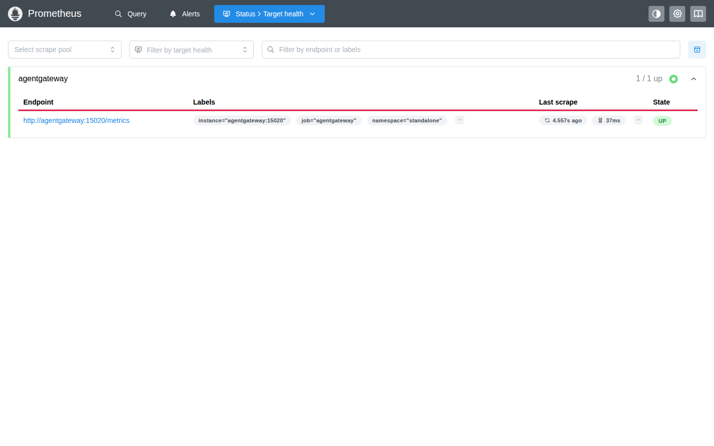

The `namespace="standalone"` label comes from `setup/observability/prometheus.yml`. The Grafana dashboard filters on a `namespace` label, and Prometheus adds one because a standalone gateway's metrics have none.

## Step 2: Turn on tracing

1. In the agentgateway UI sidebar, scroll down and click **Settings**.
2. Click **Observability**, then click the **Tracing** card.

   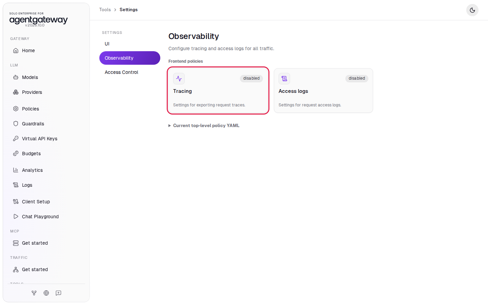

3. In **Host**, enter `tempo:4317`.
4. Leave **Protocol** on **gRPC**.
5. In **Random sampling**, enter `true`.
6. Click **Save policy**.

   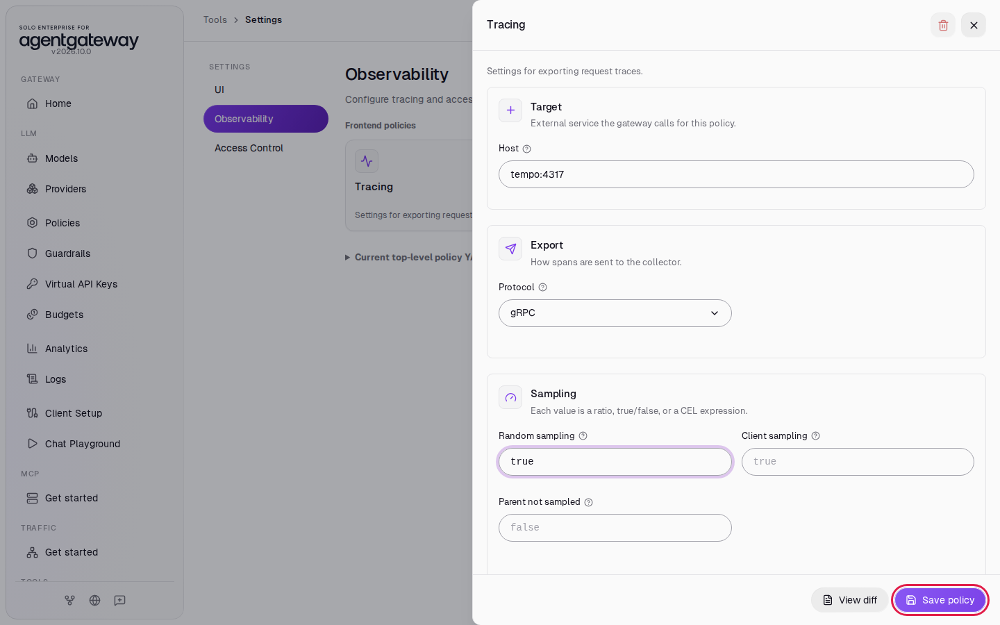

**Random sampling** set to `true` traces every request. Left empty, the gateway starts no traces. On a busy gateway, enter a ratio such as `0.1` to trace 1 request in 10. The gateway applies the change at once, without a restart.

## Step 3: Send chat requests

1. Wait two seconds, then in the sidebar click **Chat Playground**.
2. In **Model**, select **openai/\***. In **Specific model**, enter `gpt-6-luna`.
3. In **User message**, enter `Reply with exactly: PONG-1` and click **Send**.
4. Wait about 5 seconds and send `Reply with exactly: PONG-2`, then again `Reply with exactly: PONG-3`.

Each reply shows **OK** and the token counts, for example `25 in · 4 out`.

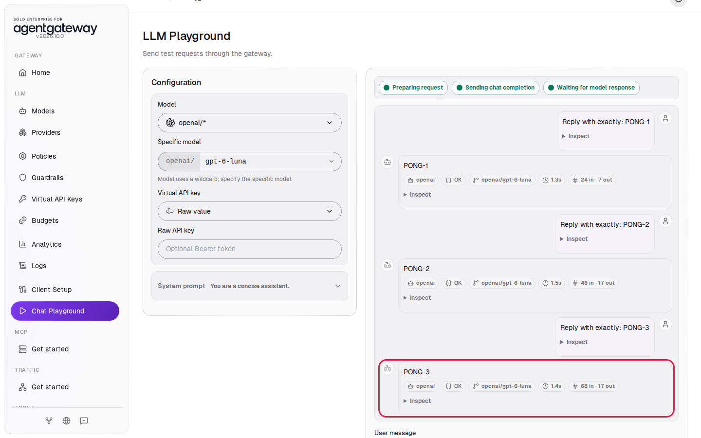

Prometheus reads the metrics every 5 seconds. A counter that changes between two reads shows up on the dashboard. Requests sent all at once, before the first read, can be missed.

## Step 4: See the metrics on the dashboard

1. Open `http://localhost:3000/dashboards`.
2. Click **AgentGateway Dashboard**.

   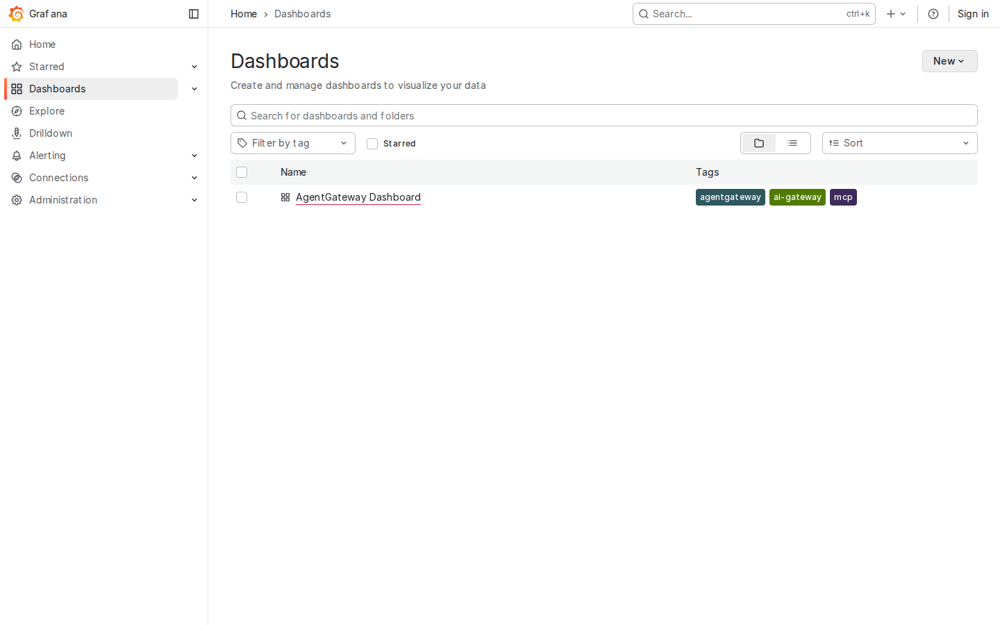

The **Overview** row shows the traffic of the last hour. **Total Requests** counts every request on port `4000`, including the browser's preflight requests from the Chat Playground. **Total Input Tokens** and **Total Output Tokens** count the tokens the model used.

The Total panels add up in 1-minute steps. If they show **No data** or `0`, wait a minute and reload the page.

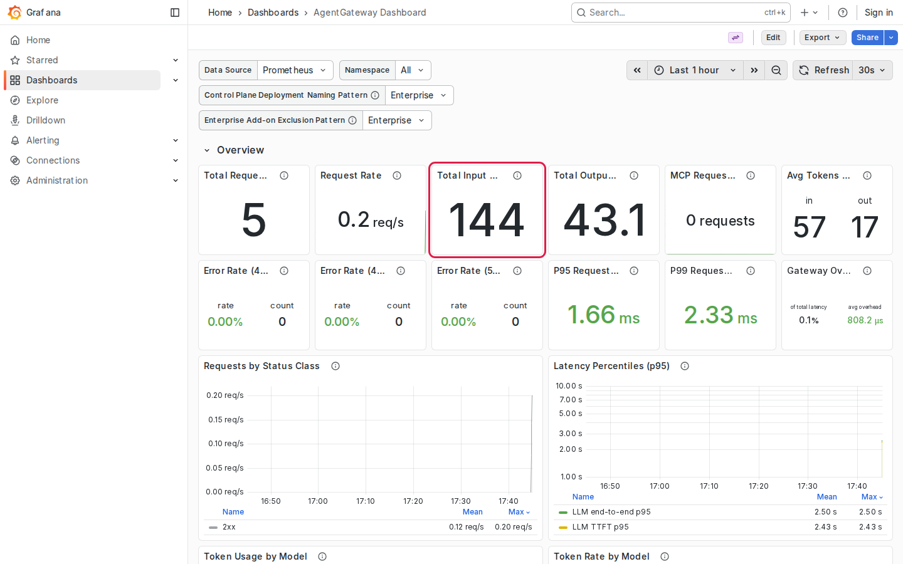

The totals are estimates that Prometheus calculates from the 5-second reads, so they can show a decimal, such as `8.73` output tokens.

3. Scroll down to **Token Usage by Model**.

The table lists `gpt-6-luna`, the model name OpenAI returned.

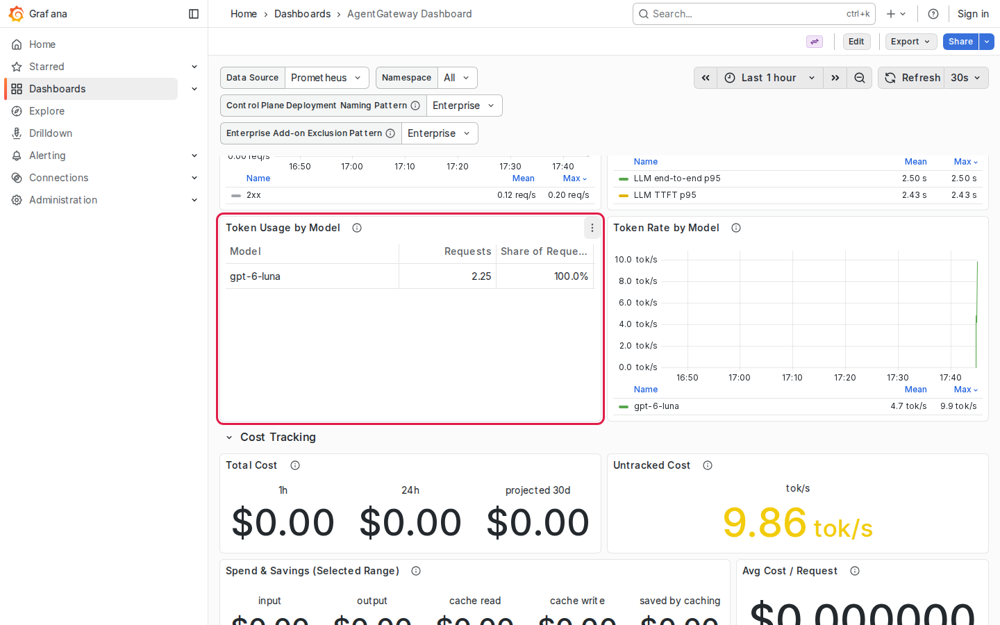

The dashboard also has rows for cost, MCP, and streaming. The **Infrastructure Overview** row reads Kubernetes metrics, so it stays empty for a standalone gateway. The cost panels have prices for a fixed list of models, and `gpt-6-luna` is not on that list, so they show `$0.00`.

## Step 5: Open a trace

1. Open `http://localhost:3000/explore`.
2. At the top of the Grafana menu, click the dock icon next to **Grafana** to hide the menu. Explore needs the room in the next steps.

   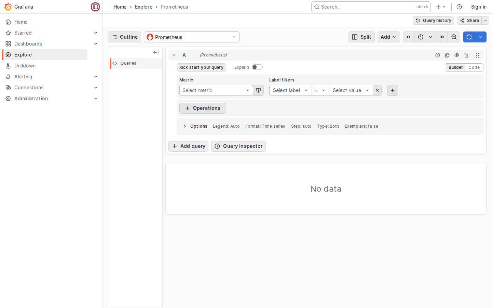

3. Click the data source picker, which shows **Prometheus**, and select **Tempo**.

   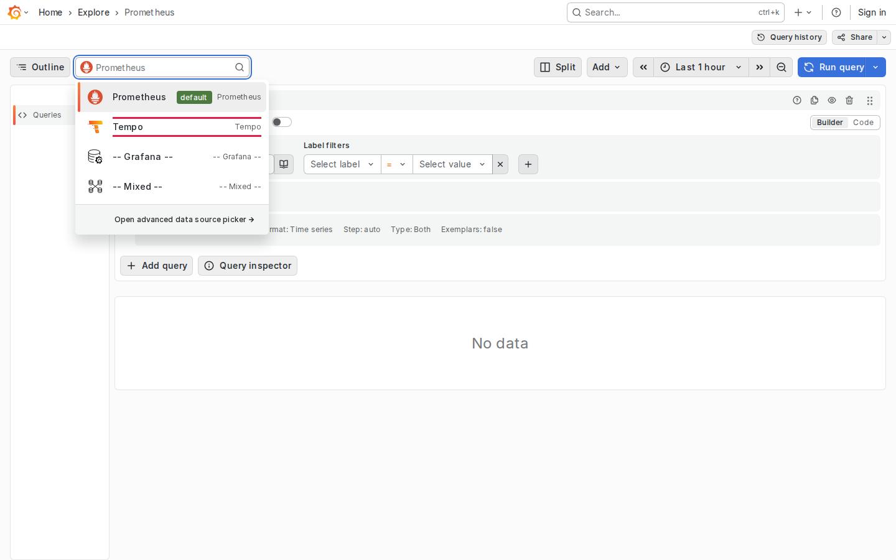

4. Under **Query type**, click **Search**.
5. In **Span Name**, select `POST /v1/chat/completions`.
6. Click **Run query**.

The table lists three traces, one for each chat request. Without the **Span Name** filter, it also lists short traces named `unknown`: those are the browser's preflight requests.

7. Click the first trace ID.

   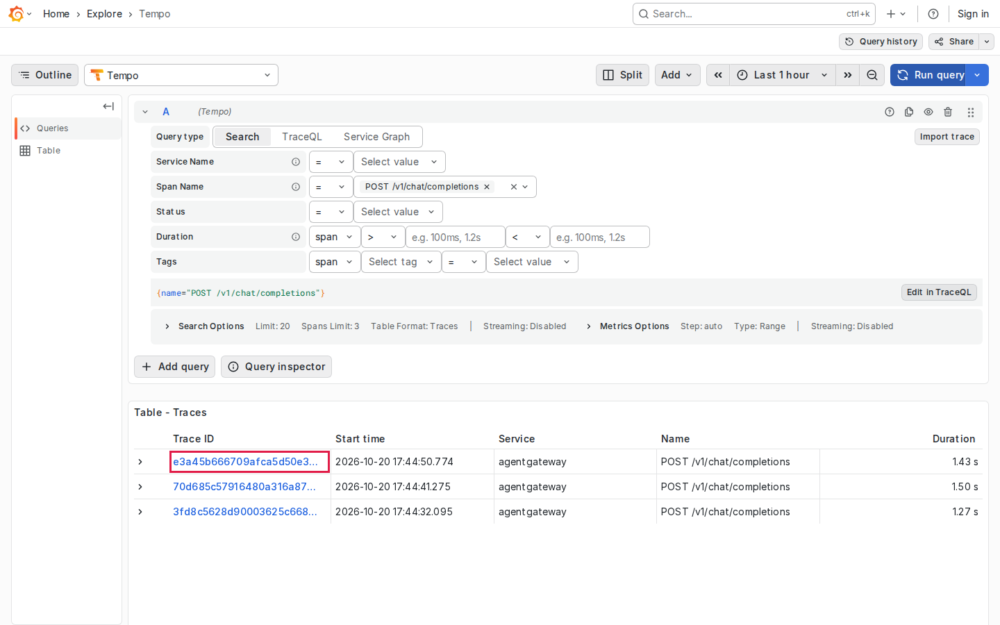

8. The trace opens in a second pane on the right. In the left pane, click **Close**.

   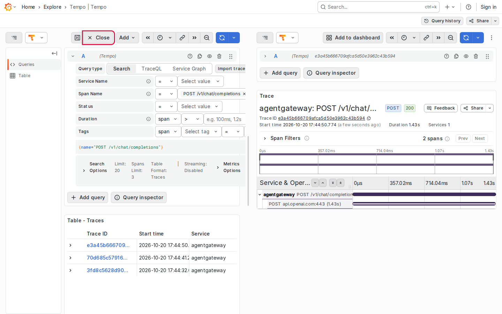

The trace has two spans. `POST /v1/chat/completions` is the request to the gateway. `POST api.openai.com:443` is the gateway's call to OpenAI, so the difference between the two durations is the time the gateway itself took.

9. Click the `agentgateway POST /v1/chat/completions` row.

   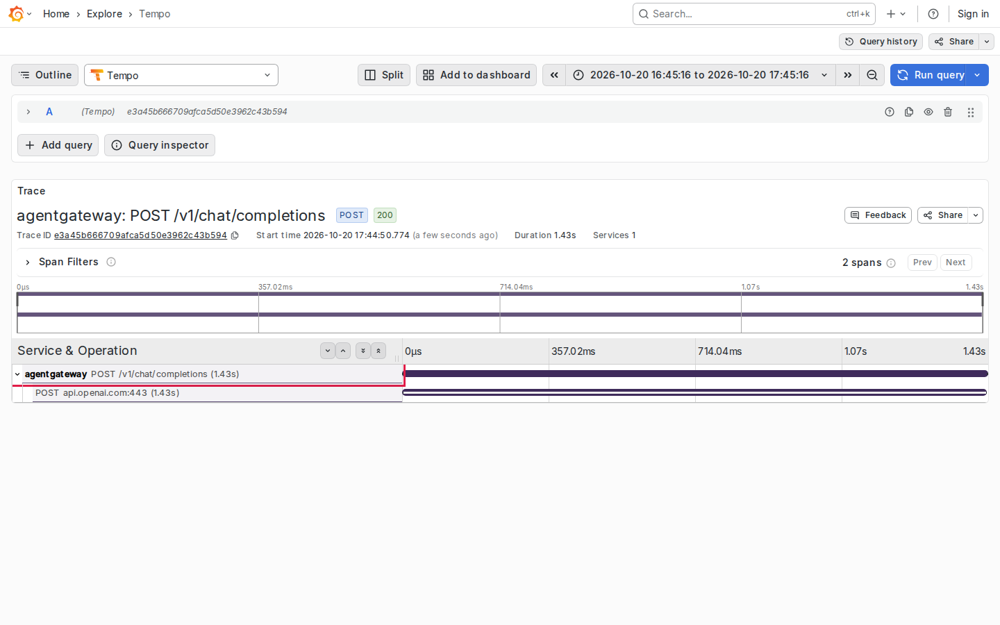

10. Click **Span attributes** and scroll down.

The `gen_ai.*` attributes show the request in LLM terms: `gen_ai.request.model` is `gpt-6-luna`, `gen_ai.response.model` is `gpt-6-luna`, and `gen_ai.usage.input_tokens` and `gen_ai.usage.output_tokens` match the counts in the Chat Playground. The `agw.ai.usage.cost.*` attributes hold the cost of this request in US dollars.

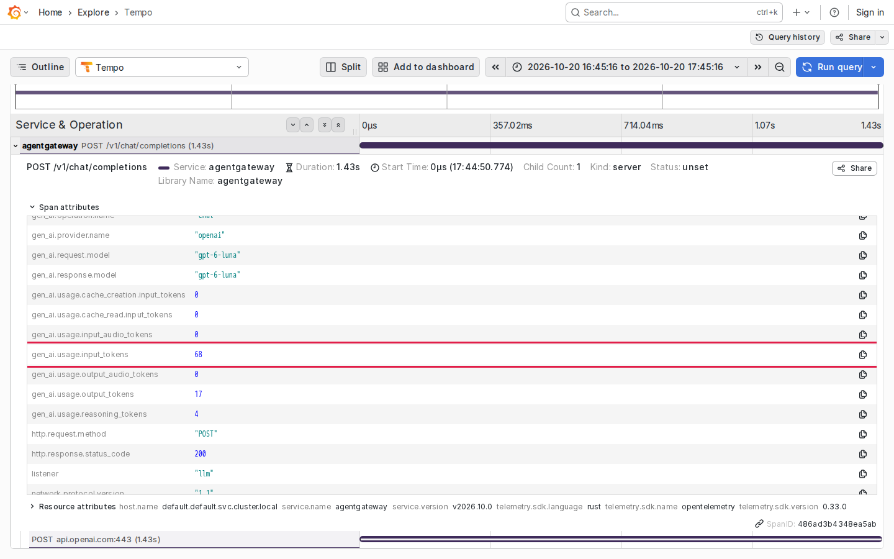

## Step 6: Make a model fail

Prometheus already has three alert rules from `setup/observability/alerts.yml`. `AgentGatewayHighErrorRate` fires when more than 5% of requests in the last 5 minutes return a `5xx` error. Add a model that always fails to make it fire.

1. In the agentgateway UI sidebar, click **Models**, then click **Add model**.
2. In **Provider**, select **Custom**.
3. In **Incoming model match**, enter `mock-llm-503`.
4. Leave **Provider API key** on **Unset**. The mock accepts requests with no key.
5. In **Base URL**, enter `http://mock-llm-503:8000/v1`.
6. Under **Outgoing model**, click **Explicit**.
7. In **Explicit outgoing model**, enter `mock-gpt`. Click the **Add model** title at the top of the panel to close the suggestion list. Do not press Escape, because Escape closes the whole panel.
8. Click **Save model**.

   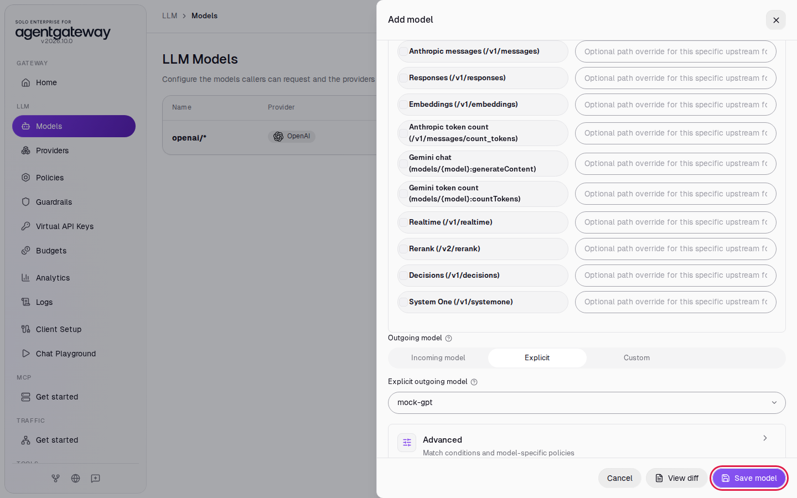

9. Wait two seconds, then in the sidebar click **Chat Playground**.
10. In **Model**, select **mock-llm-503**.
11. In **User message**, enter `Hello` and click **Send**. Send it two more times, about 5 seconds apart.

Each time, the playground shows **Playground request failed** with `"code":503`.

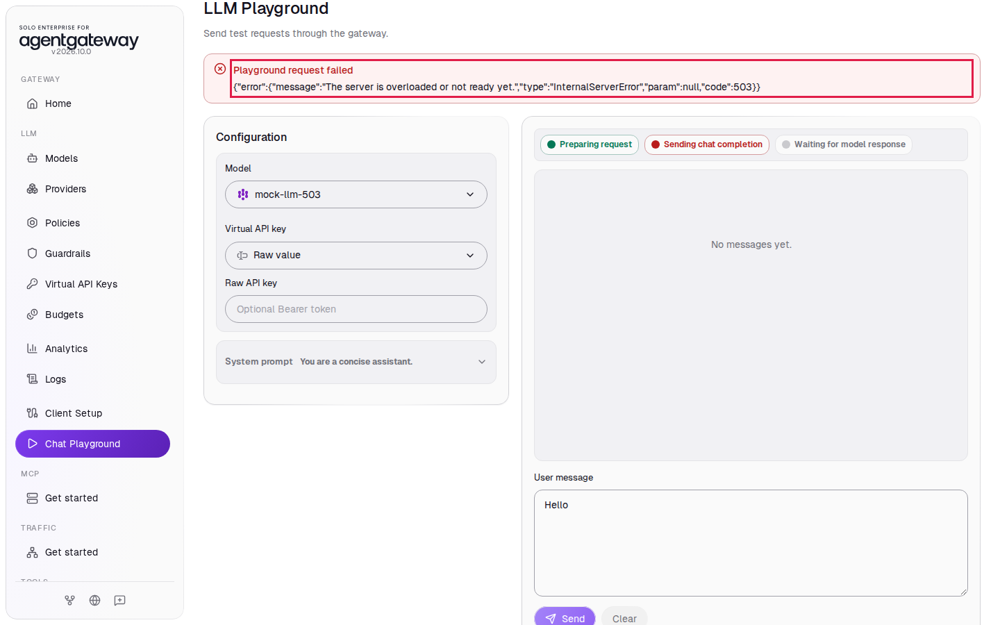

## Check it

1. Open `http://localhost:9090/alerts`.

After 30 to 60 seconds, the `AgentGatewayHighErrorRate` rule shows **FIRING (1)**. Before that, it shows **PENDING**: the rule waits 30 seconds (`for: 30s`) so that one short spike does not fire it. In production, wait 5 minutes or more.

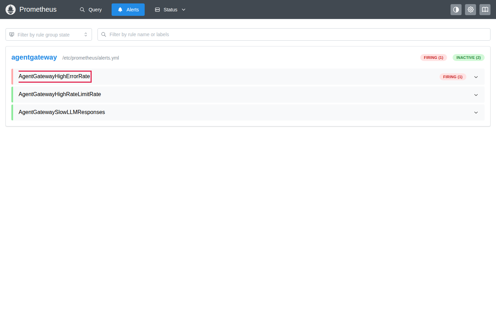

2. Click **AgentGatewayHighErrorRate**.

The alert has the label `gateway="default/default"` and the summary `AgentGateway default/default has >5% error rate`. The description gives the share of requests that failed.

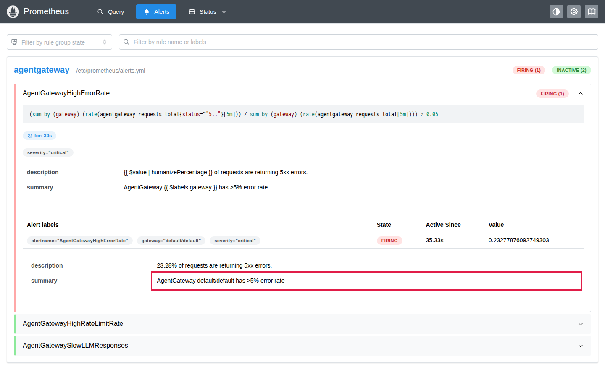

To send these alerts to email, Slack, or a pager, add Alertmanager to Prometheus. The workshop leaves it out.

<details>
<summary>Optional: query Prometheus with curl</summary>

```bash
curl -s http://localhost:9090/api/v1/query \
  --data-urlencode 'query=sum by (gen_ai_token_type) (agentgateway_gen_ai_client_token_usage_sum{gen_ai_request_model="gpt-6-luna"})'
```

Expected output (your counts differ):

```
{"status":"success","data":{"resultType":"vector","result":[{"metric":{"gen_ai_token_type":"output"},"value":[...,"12"]},{"metric":{"gen_ai_token_type":"input_cache_read"},"value":[...,"0"]},{"metric":{"gen_ai_token_type":"input"},"value":[...,"135"]}]}}
```

The values are the total output, cached input, and input tokens since the gateway started.

</details>

## What the UI wrote

In the sidebar, scroll down to **Tools** and click **Raw Configuration**. The UI added the tracing settings to `frontendPolicies` and the mock model to `llm.models`:

```yaml
llm:
  models:
    ...
    - name: mock-llm-503
      provider:
        custom:
          formats:
            - type: completions
      params:
        model: mock-gpt
        baseUrl: http://mock-llm-503:8000/v1
frontendPolicies:
  ...
  tracing:
    host: tempo:4317
    protocol: grpc
    randomSampling: true
```

## Clean up

1. In the sidebar, click **Models**.
2. In the `mock-llm-503` row, click the trash icon, then click **Delete model**.
3. In the sidebar, scroll down and click **Settings**, then click **Observability**.
4. Click the **Tracing** card. Click the **Delete policy** icon at the top of the panel, then click **Delete policy** to confirm.
5. In the sidebar, click **Models**.
6. In the `openai/*` row, click the trash icon, then click **Delete model**.
7. Stop the helper services. From the `setup/` folder, run:

   ```bash
   docker compose --profile observability --profile mock-llm-faults stop prometheus tempo grafana mock-llm-slow mock-llm-flaky mock-llm-503
   ```

The gateway is back to the state [001](../../001-set-up-standalone-agentgateway.md) left it in. Prometheus and Tempo keep their data only while their containers exist, so `docker compose --profile observability down` deletes it.
