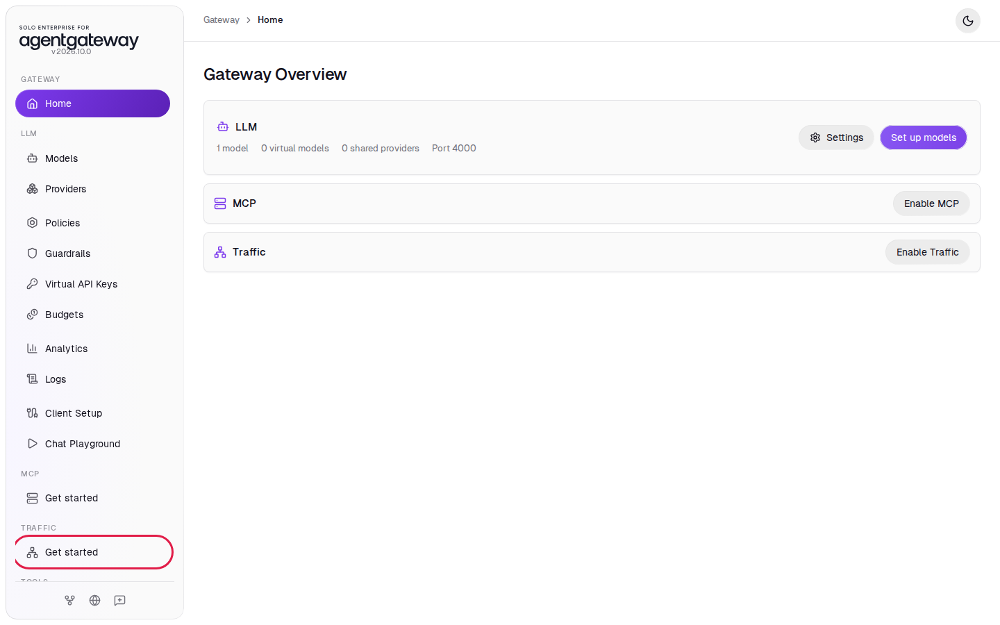
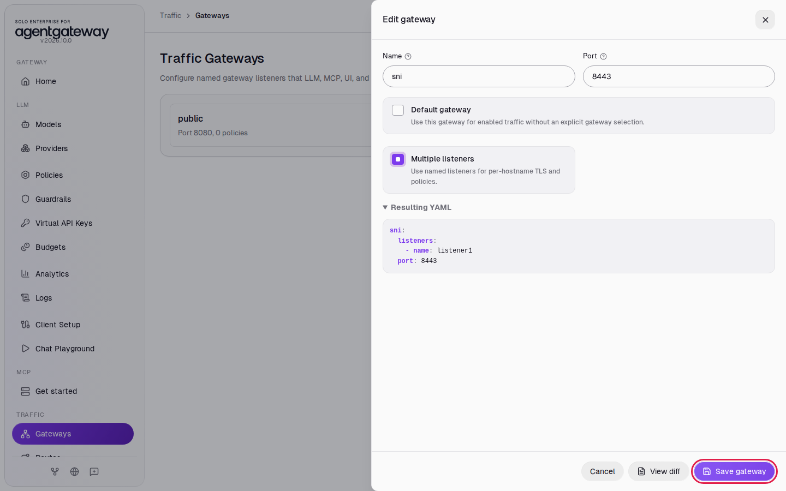
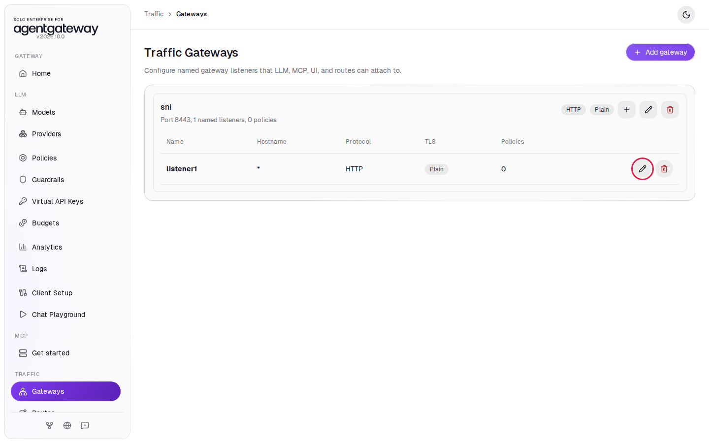
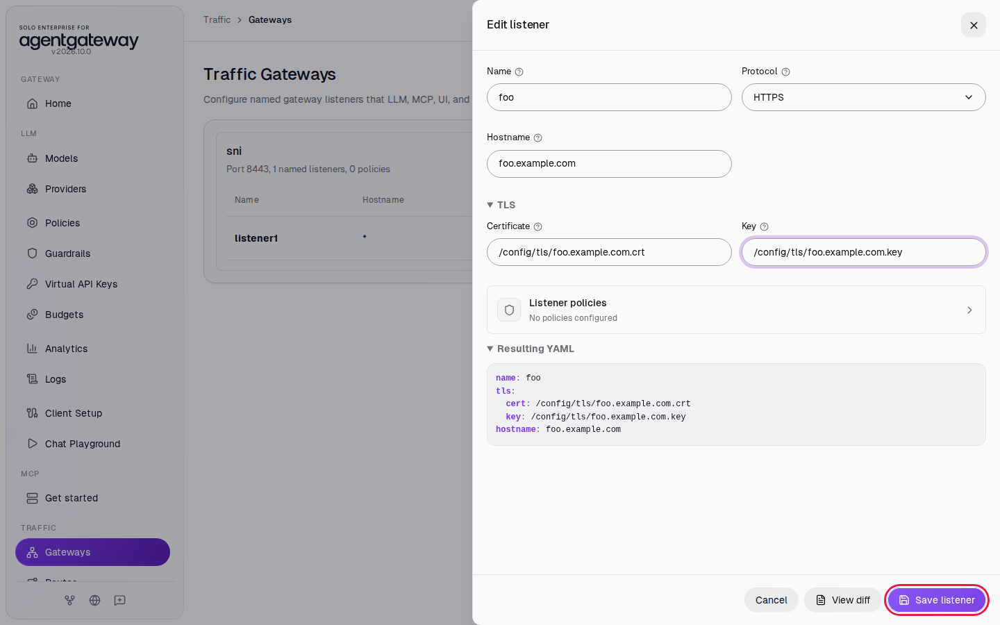
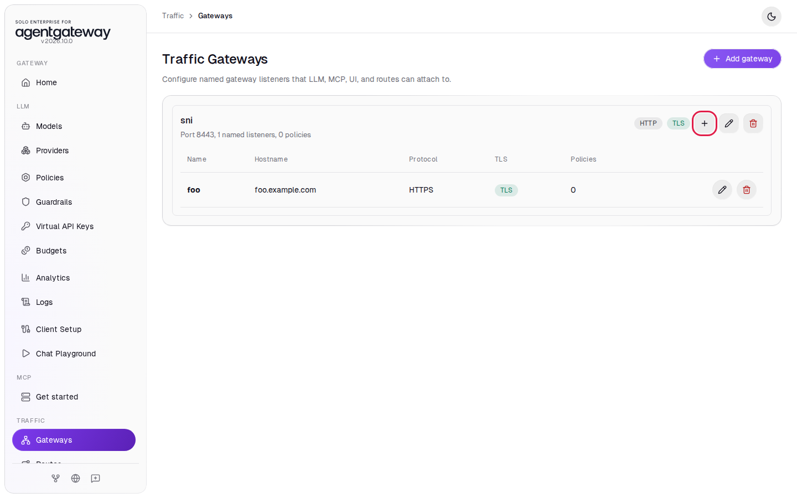
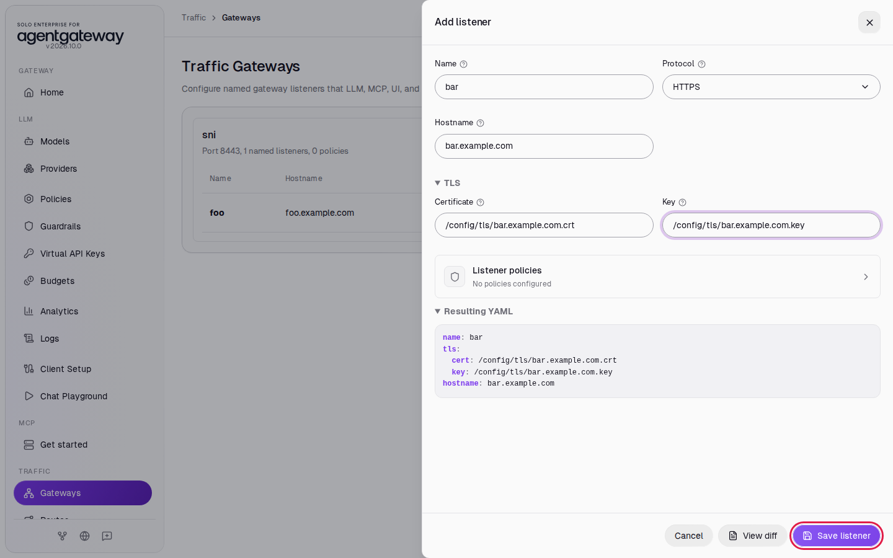
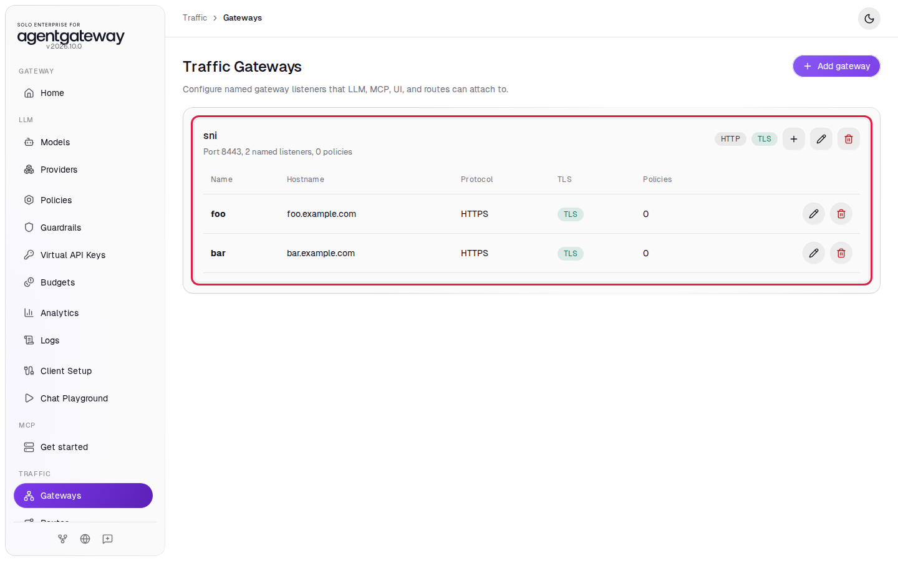
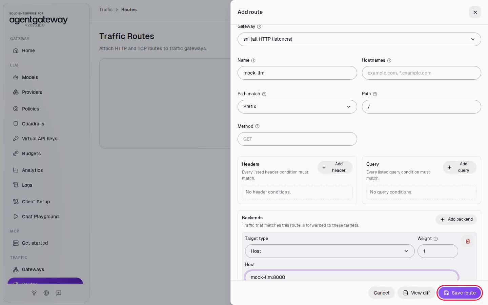

# Serve Several Hostnames with Their Own Certificates

## Before you start

- Complete [Connect LLM Providers](../llm/connect-llm-providers.md). [Serve Traffic over HTTPS and Require Client Certificates](tls-termination.md) explains the HTTPS basics this lab builds on.
- Pull the latest workshop files. The `setup/tls/` folder holds a workshop certificate authority (CA) and certificates for `foo.example.com` and `bar.example.com`. The gateway reads them at `/config/tls/`, because the `setup/` folder is mounted at `/config`.
- Start the mock LLM server that this lab sends requests to. From the `setup/` folder, run:

  ```bash
  env UID=$(id -u) GID=$(id -g) docker compose --profile mock-llm up -d
  ```

  The command also restarts the gateway if it does not publish port `8443` yet. The mock serves a model named `mock-gpt` on port `8000` and costs nothing to call.

## What you'll do

- Make a gateway on port `8443` with one listener for `foo.example.com` and one for `bar.example.com`
- Give each listener its own certificate
- Route the gateway to the mock LLM
- Call both hostnames, and see a third hostname fail

## Why this matters

One port can serve many domains. When a client opens a TLS connection, it sends the hostname it wants in the first message, called Server Name Indication (SNI). The gateway uses that name to pick the listener and the certificate. You can add a team's domain to the gateway without a new port or IP address, and a client that asks for an unknown hostname gets no certificate.

## Step 1: Turn on Traffic

1. In the sidebar, under **Traffic**, click **Get started**.

   

2. Click **Enable**. The UI adds a gateway named `public` on port `8080` and opens **Traffic Gateways**.

## Step 2: Give the gateway listeners on port 8443

1. On the `public` card, click the pencil icon (**Edit gateway**).
2. In **Name**, enter `sni`.
3. In **Port**, enter `8443`.
4. Select **Multiple listeners**.
5. Click **Save gateway**.

   

The gateway now has one listener, `listener1`, for any hostname over plain HTTP.

## Step 3: Make the first listener serve foo.example.com

1. In the `listener1` row, click the pencil icon (**Edit listener**).

   

2. In **Name**, enter `foo`.
3. In **Protocol**, select **HTTPS**.
4. In **Hostname**, enter `foo.example.com`.
5. Click **TLS** to open the TLS fields.
6. In **Certificate**, enter `/config/tls/foo.example.com.crt`.
7. In **Key**, enter `/config/tls/foo.example.com.key`.
8. Click **Save listener**.

   

## Step 4: Add a listener for bar.example.com

1. On the `sni` card, click the plus icon (**Add listener**).

   

2. In **Name**, enter `bar`.
3. In **Protocol**, select **HTTPS**.
4. In **Hostname**, enter `bar.example.com`.
5. Click **TLS** to open the TLS fields.
6. In **Certificate**, enter `/config/tls/bar.example.com.crt`.
7. In **Key**, enter `/config/tls/bar.example.com.key`.
8. Click **Save listener**.

   

The `sni` card lists both listeners, each with its hostname and the **TLS** label:



## Step 5: Route the gateway to the mock LLM

1. In the sidebar, under **Traffic**, click **Routes**.
2. Click **Add route**.
3. In **Gateway**, select **sni (all HTTP listeners)**. The route then serves both hostnames.
4. In **Name**, enter `mock-llm`.
5. Leave **Path match** on **Prefix** and **Path** on `/`.
6. Under **Backends**, click **Add backend**.
7. Leave **Target type** on **Host**. In **Host**, enter `mock-llm:8000`.
8. Click **Save route**.

   

## Check it

Requests on port `8443` go through a traffic route, so they do not appear on the **Logs** page. Check them with curl. Wait two seconds after saving, then run each command from the `setup/` folder.

The hostnames do not exist in DNS. `--resolve` tells curl to connect to `127.0.0.1` for that hostname, and curl still sends the hostname in SNI. You do not have to edit `/etc/hosts`.

1. Call `foo.example.com`:

   ```bash
   curl -sS -o /dev/null -w '%{http_code}\n' --cacert tls/ca.crt \
     --resolve foo.example.com:8443:127.0.0.1 https://foo.example.com:8443/v1/chat/completions \
     -H 'Content-Type: application/json' \
     -d '{"model":"mock-gpt","messages":[{"role":"user","content":"Hello"}]}'
   ```

   Expected output:

   ```
   200
   ```

   curl accepts a certificate only if it names the hostname you called, so the `200` shows that the gateway sent the `foo.example.com` certificate.

2. Call `bar.example.com`:

   ```bash
   curl -sS -o /dev/null -w '%{http_code}\n' --cacert tls/ca.crt \
     --resolve bar.example.com:8443:127.0.0.1 https://bar.example.com:8443/v1/chat/completions \
     -H 'Content-Type: application/json' \
     -d '{"model":"mock-gpt","messages":[{"role":"user","content":"Hello"}]}'
   ```

   Expected output:

   ```
   200
   ```

   This time the gateway sent the `bar.example.com` certificate, on the same port.

3. Call `baz.example.com`, which has no listener:

   ```bash
   curl -sS -o /dev/null -w '%{http_code}\n' --cacert tls/ca.crt \
     --resolve baz.example.com:8443:127.0.0.1 https://baz.example.com:8443/v1/chat/completions \
     -H 'Content-Type: application/json' \
     -d '{"model":"mock-gpt","messages":[{"role":"user","content":"Hello"}]}'
   ```

   Expected output (the error text depends on your curl version):

   ```
   curl: (35) OpenSSL SSL_connect: SSL_ERROR_SYSCALL in connection to baz.example.com:8443
   000
   ```

   Error `35` means the TLS handshake failed. The gateway closed the connection because no listener matches `baz.example.com`, so no request reached the route.

<details>
<summary>Optional: see which certificate the gateway sent</summary>

Add `-v` to the `foo.example.com` call and keep only the certificate subject:

```bash
curl -sv -o /dev/null --cacert tls/ca.crt \
  --resolve foo.example.com:8443:127.0.0.1 https://foo.example.com:8443/v1/models 2>&1 | grep 'subject:'
```

Expected output:

```
*  subject: O=agentgateway workshop; CN=foo.example.com
```

Change `foo` to `bar` in both places to see `CN=bar.example.com`.

</details>

## What the UI wrote

In the sidebar, scroll down to **Tools** and click **Raw Configuration**. The UI added a gateway with two listeners and a route at the top level:

```yaml
gateways:
  sni:
    listeners:
      - name: foo
        tls:
          cert: /config/tls/foo.example.com.crt
          key: /config/tls/foo.example.com.key
        hostname: foo.example.com
      - name: bar
        hostname: bar.example.com
        tls:
          cert: /config/tls/bar.example.com.crt
          key: /config/tls/bar.example.com.key
    port: 8443
routes:
  - gateways: sni
    matches:
      - path:
          pathPrefix: /
    backends:
      - host: mock-llm:8000
    name: mock-llm
```

The listeners have no `protocol: HTTPS` line, because a listener with `tls` uses HTTPS unless you set another protocol.

## Clean up

1. In the sidebar, under **Traffic**, click **Routes**.
2. In the `mock-llm` row, click **Delete route**. The route is deleted right away.
3. In the sidebar, under **Traffic**, click **Gateways**.
4. On the `sni` card, click the trash icon (**Delete gateway**).
5. In the sidebar, scroll down to **Tools** and click **Raw Configuration**.
6. Delete the two lines `gateways: {}` and `routes: []` near the end, then click **Save**. If a confirmation appears, click **Save** again. While `gateways: {}` is there, the sidebar shows **Gateways** and **Routes** under **Traffic** instead of **Get started**.
7. Stop the mock LLM servers. From the `setup/` folder, run:

   ```bash
   docker compose --profile mock-llm stop mock-llm mock-llm-429
   ```

The gateway is back to the state [Connect LLM Providers](../llm/connect-llm-providers.md) left it in.
