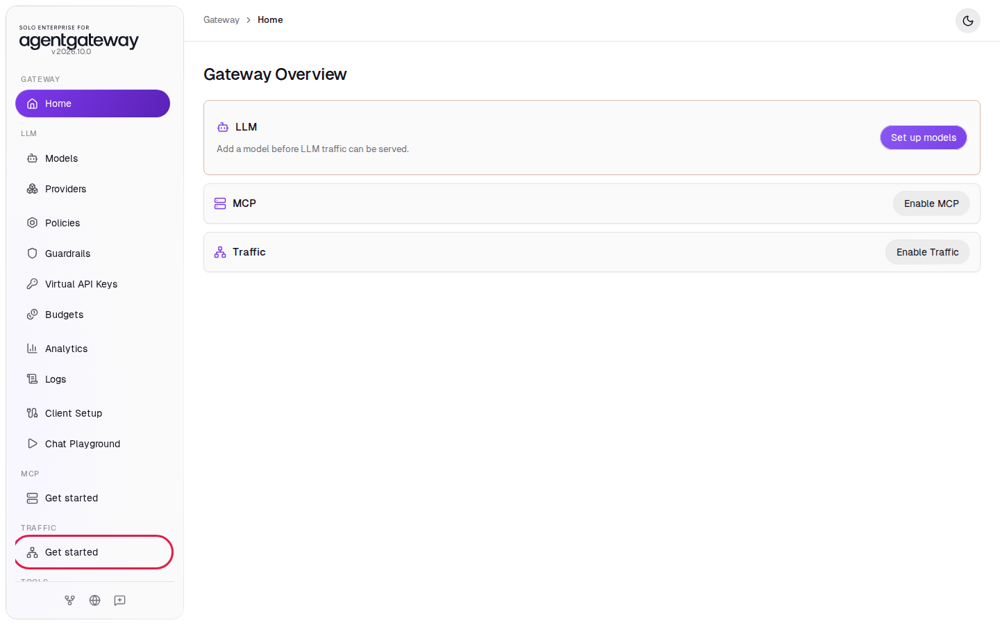
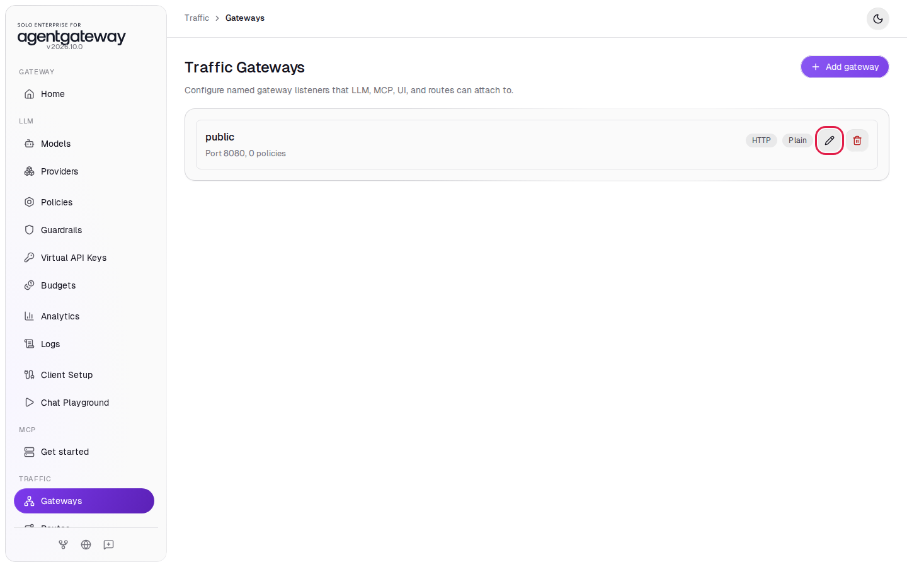
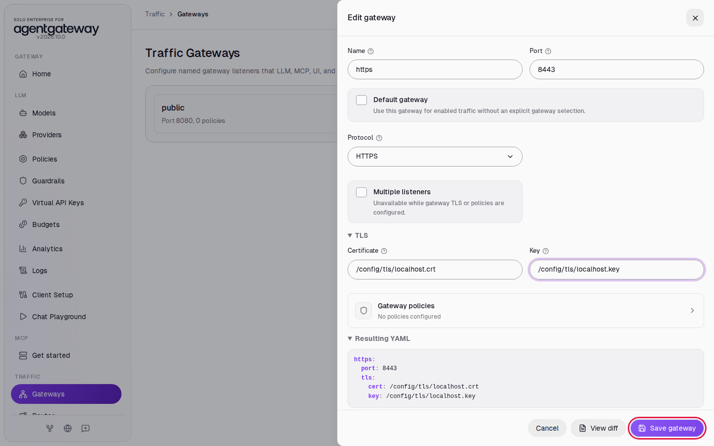
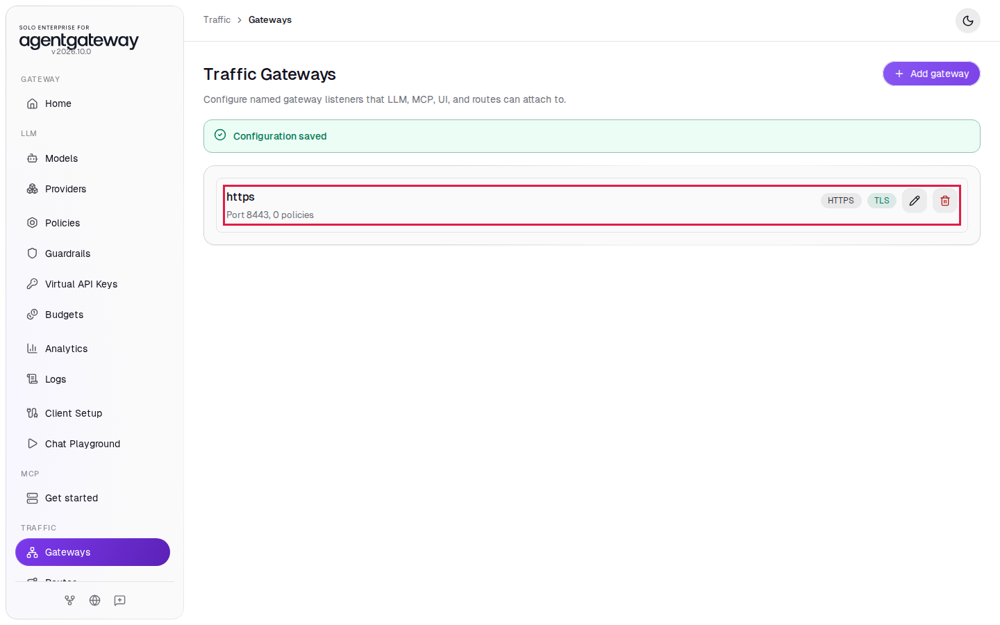
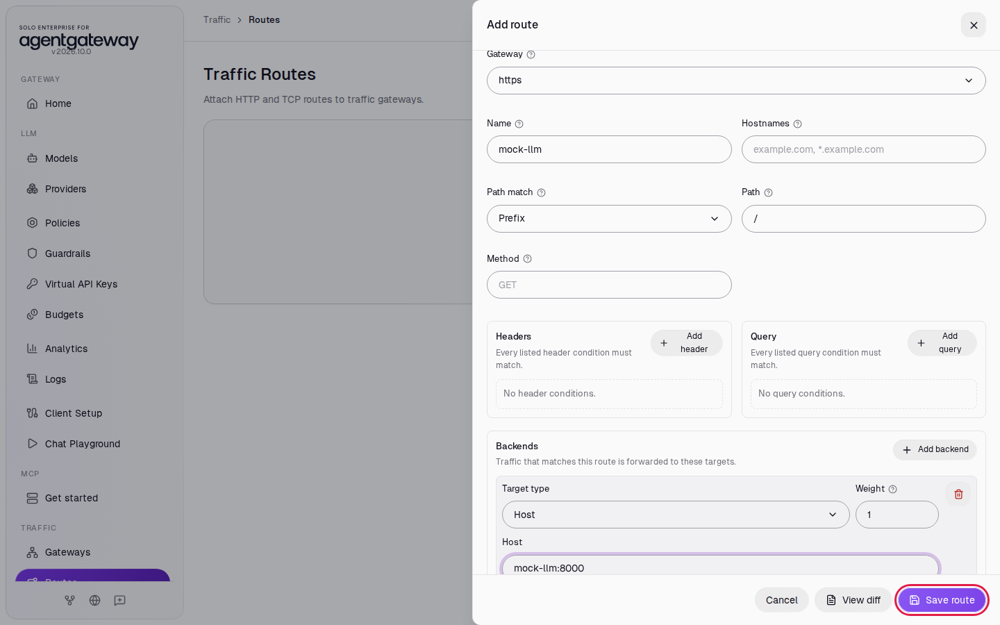
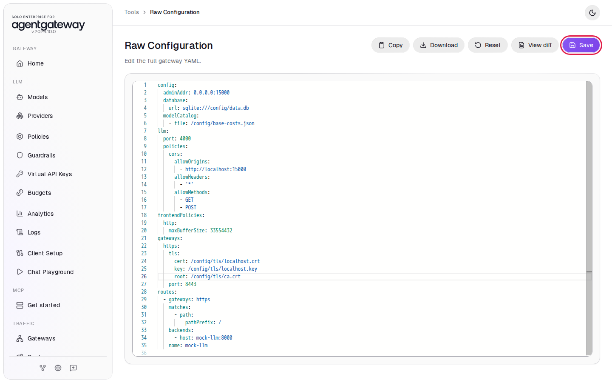
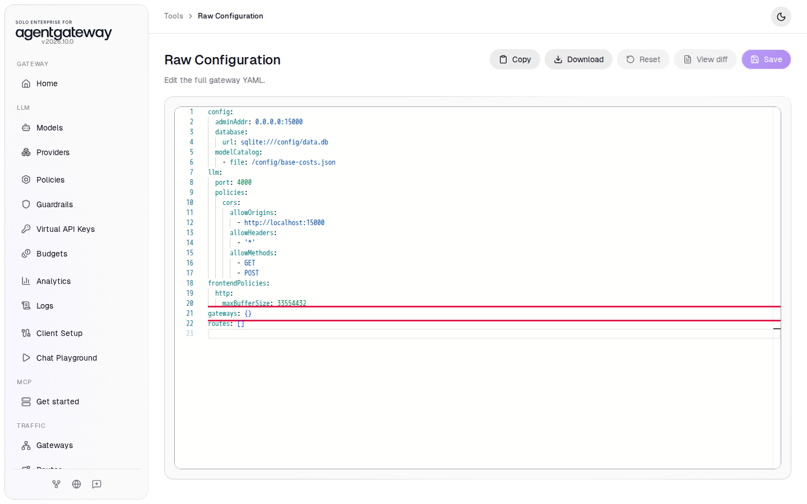

# Serve Traffic over HTTPS and Require Client Certificates

## Before you start

- Complete [001: Set Up Standalone Agentgateway](../../001-set-up-standalone-agentgateway.md).
- Pull the latest workshop files. The `setup/tls/` folder holds a workshop certificate authority (CA) and the certificates this lab uses. The gateway reads them at `/config/tls/`, because the `setup/` folder is mounted at `/config`. To make new ones, run `setup/tls/make-certs.sh` (needs `openssl`).
- Start the mock LLM server that this lab sends requests to. From the `setup/` folder, run:

  ```bash
  env UID=$(id -u) GID=$(id -g) docker compose --profile mock-llm up -d
  ```

  The command also restarts the gateway if it does not publish port `8443` yet. The mock serves a model named `mock-gpt` on port `8000` and costs nothing to call.

## What you'll do

- Turn on Traffic and make its gateway an HTTPS gateway on port `8443`
- Route the HTTPS gateway to the mock LLM
- Call it over HTTPS, and see plain HTTP and an untrusted certificate fail
- Require a client certificate (mutual TLS, or mTLS) and call it with one

## Why this matters

Over plain HTTP, anyone on the network path can read prompts, replies and API keys. With HTTPS, the gateway encrypts the connection with TLS and proves its identity with a certificate. Your clients only need to trust the CA that signed it.

Mutual TLS also checks the client. The gateway accepts a connection only from a client that shows a certificate signed by a CA you trust, before any request reaches a route.

## Step 1: Turn on Traffic

1. In the sidebar, under **Traffic**, click **Get started**.

   

2. Click **Enable**.

The UI adds a gateway named `public` on port `8080` and opens **Traffic Gateways**:



## Step 2: Make it an HTTPS gateway on port 8443

1. On the `public` card, click the pencil icon (**Edit gateway**).
2. In **Name**, enter `https`.
3. In **Port**, enter `8443`.
4. In **Protocol**, select **HTTPS**.
5. Click **TLS** to open the TLS fields.
6. In **Certificate**, enter `/config/tls/localhost.crt`.
7. In **Key**, enter `/config/tls/localhost.key`.
8. Click **Save gateway**.

   

The certificate is for `localhost` and `127.0.0.1`, signed by the workshop CA. The card now shows the `https` gateway on port `8443` with the **TLS** label:



## Step 3: Route the HTTPS gateway to the mock LLM

1. In the sidebar, under **Traffic**, click **Routes**.
2. Click **Add route**.
3. In **Gateway**, select **https**.
4. In **Name**, enter `mock-llm`.
5. Leave **Path match** on **Prefix** and **Path** on `/`.
6. Under **Backends**, click **Add backend**.
7. Leave **Target type** on **Host**. In **Host**, enter `mock-llm:8000`.
8. Click **Save route**.

   

## Check HTTPS

Requests on port `8443` go through a traffic route, so they do not appear on the **Logs** page. Check them with curl. Wait two seconds after saving, then run each command from the `setup/` folder.

1. Call the gateway over HTTPS. `--cacert tls/ca.crt` tells curl to trust the workshop CA:

   ```bash
   curl -sS -o /dev/null -w '%{http_code}\n' --cacert tls/ca.crt \
     https://localhost:8443/v1/chat/completions -H 'Content-Type: application/json' \
     -d '{"model":"mock-gpt","messages":[{"role":"user","content":"Hello"}]}'
   ```

   Expected output:

   ```
   200
   ```

2. Run the same call without `--cacert`:

   ```bash
   curl -sS -o /dev/null -w '%{http_code}\n' \
     https://localhost:8443/v1/chat/completions -H 'Content-Type: application/json' \
     -d '{"model":"mock-gpt","messages":[{"role":"user","content":"Hello"}]}'
   ```

   Expected output (trimmed):

   ```
   curl: (60) SSL certificate problem: unable to get local issuer certificate
   000
   ```

   curl stops before it sends the request, because it does not trust the workshop CA. Error `60` means the server certificate failed the check. `000` means no HTTP response came back.

3. Call port `8443` over plain HTTP:

   ```bash
   curl -sS -o /dev/null -w '%{http_code}\n' \
     http://localhost:8443/v1/chat/completions -H 'Content-Type: application/json' \
     -d '{"model":"mock-gpt","messages":[{"role":"user","content":"Hello"}]}'
   ```

   Expected output (the error text depends on your curl version):

   ```
   curl: (1) Received HTTP/0.9 when not allowed
   000
   ```

   The gateway answers with TLS, which curl cannot read as HTTP. No plain HTTP request gets through on this port.

## Step 4: Require client certificates

The client CA setting (`root`) has no field in the gateway form, so you add it in Raw Configuration.

1. In the sidebar, scroll down to **Tools** and click **Raw Configuration**.
2. Find the `gateways:` section. Click at the end of the line `key: /config/tls/localhost.key`.
3. Press Enter. The new line lines up with `key:`.
4. Paste this line:

   ```yaml
   root: /config/tls/ca.crt
   ```

5. Check that `root:` lines up with `cert:` and `key:`, then click **Save**. If a confirmation appears, click **Save** again.

   

The gateway now asks each client for a certificate and accepts only one signed by the workshop CA.

## Check mTLS

Wait two seconds, then run these commands from the `setup/` folder.

1. Run the first HTTPS call from **Check HTTPS** again. It has no client certificate:

   ```bash
   curl -sS -o /dev/null -w '%{http_code}\n' --cacert tls/ca.crt \
     https://localhost:8443/v1/chat/completions -H 'Content-Type: application/json' \
     -d '{"model":"mock-gpt","messages":[{"role":"user","content":"Hello"}]}'
   ```

   Expected output (the error text depends on your curl version):

   ```
   curl: (56) OpenSSL SSL_read: OpenSSL/3.0.13: error:0A00045C:SSL routines::tlsv13 alert certificate required, errno 0
   000
   ```

   The gateway ends the TLS connection because the client showed no certificate. On macOS, curl reports the same failure as `curl: (56) LibreSSL SSL_read: ...`.

2. Call it with the workshop client certificate and its key:

   ```bash
   curl -sS -o /dev/null -w '%{http_code}\n' --cacert tls/ca.crt \
     --cert tls/client.crt --key tls/client.key \
     https://localhost:8443/v1/chat/completions -H 'Content-Type: application/json' \
     -d '{"model":"mock-gpt","messages":[{"role":"user","content":"Hello"}]}'
   ```

   Expected output:

   ```
   200
   ```

## What the UI wrote

In the sidebar, scroll down to **Tools** and click **Raw Configuration**. The UI added a gateway and a route at the top level. You added the `root` line:

```yaml
gateways:
  https:
    tls:
      cert: /config/tls/localhost.crt
      key: /config/tls/localhost.key
      root: /config/tls/ca.crt
    port: 8443
routes:
  - gateways: https
    matches:
      - path:
          pathPrefix: /
    backends:
      - host: mock-llm:8000
    name: mock-llm
```

The gateway has no `protocol: HTTPS` line, because a gateway with `tls` uses HTTPS unless you set another protocol.

## Clean up

1. In the sidebar, under **Traffic**, click **Routes**.
2. In the `mock-llm` row, click **Delete route**. The route is deleted right away.
3. In the sidebar, under **Traffic**, click **Gateways**.
4. On the `https` card, click the trash icon (**Delete gateway**).
5. In the sidebar, scroll down to **Tools** and click **Raw Configuration**.
6. Delete the two lines `gateways: {}` and `routes: []` near the end, then click **Save**. If a confirmation appears, click **Save** again.

   

   While `gateways: {}` is there, the sidebar shows **Gateways** and **Routes** under **Traffic** instead of **Get started**.

7. Stop the mock LLM servers. From the `setup/` folder, run:

   ```bash
   docker compose --profile mock-llm stop mock-llm mock-llm-429
   ```

The gateway is back to the state [001](../../001-set-up-standalone-agentgateway.md) left it in.
