# Sign In to the UI with Keycloak and Map Groups to Roles

## Before you start

- Complete [001: Set Up Standalone Agentgateway](../../001-set-up-standalone-agentgateway.md).
- Optional: do [Give Each Person the Right Access to the UI](ui-access-control.md) first. It covers the same roles with passwords instead of an identity provider.
- Start the Keycloak helper. From the `setup/` folder, run:

  ```bash
  env UID=$(id -u) GID=$(id -g) docker compose --profile keycloak up -d
  ```

  If your gateway container does not publish port `8180` yet, Docker Compose recreates it. Your configuration stays in place. Keycloak needs about a minute to start. It is ready when `http://localhost:8180/realms/workshop` shows a page with `"realm":"workshop"`.

The Keycloak helper loads a realm named `workshop` with three users. All three have the password `workshop`.

| User | Email | Keycloak group |
|---|---|---|
| `alice` | `alice@example.com` | `platform-team` |
| `bob` | `bob@example.com` | `auditors` |
| `carol` | `carol@example.com` | `developers` |

## What you'll do

- Serve the UI on port `8080` and send users to Keycloak to sign in
- Give each Keycloak group a role
- Give carol, and only carol, manage access to the `openai/*` model
- Sign in as each user and see what each one can do

## Why this matters

Your company already keeps users and teams in an identity provider (IdP) such as Okta, Entra ID or Keycloak. When the UI signs users in through that IdP, you manage access in one place. A new hire who joins the `developers` group gets developer access to the gateway UI, and someone who leaves the company loses it. Both changes happen in the IdP.

The gateway reads two claims from the IdP's token: `email` becomes the user and `groups` becomes the user's groups. Roles can match either one.

## Set up

This lab uses the `openai/*` model. [Connect LLM Providers](../llm/connect-llm-providers.md) explains these steps.

1. In the sidebar, click **Models**.
2. Click **Add model**.

   

3. In **Provider**, select **OpenAI**. The UI fills **Incoming model match** with `openai/*`.
4. Next to **Provider API key**, click **Env var** and enter `OPENAI_API_KEY`.
5. Under **Outgoing model**, click **Strip openai/**.
6. Click **Save model**.

   

The **Models** page lists `openai/*`.

## Step 1: Add a gateway on port 8080

1. In the sidebar, under **Traffic**, click **Get started**.
2. Click **Enable**.

The UI adds a gateway named `public` on port `8080`.

## Step 2: Serve the UI on the public gateway

1. In the sidebar, scroll down and click **Settings**. The **UI** page opens.
2. In **Public gateway**, select **public**.
3. Click **Save UI gateway**.

## Step 3: Send users to Keycloak to sign in

1. On the same page, under **UI access policies**, click the **OIDC** card.

   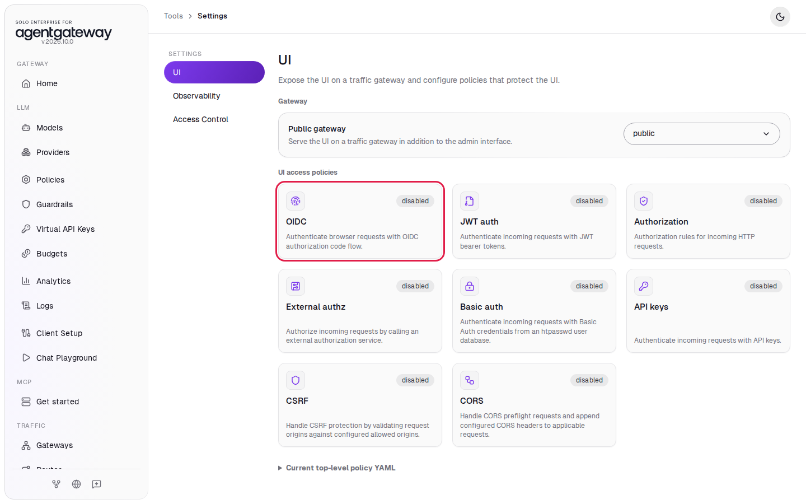

2. In **Issuer**, enter `http://localhost:8180/realms/workshop`.
3. In **Client ID**, enter `agentgateway-ui`.
4. In **Client secret**, enter `workshop-ui-secret`.

   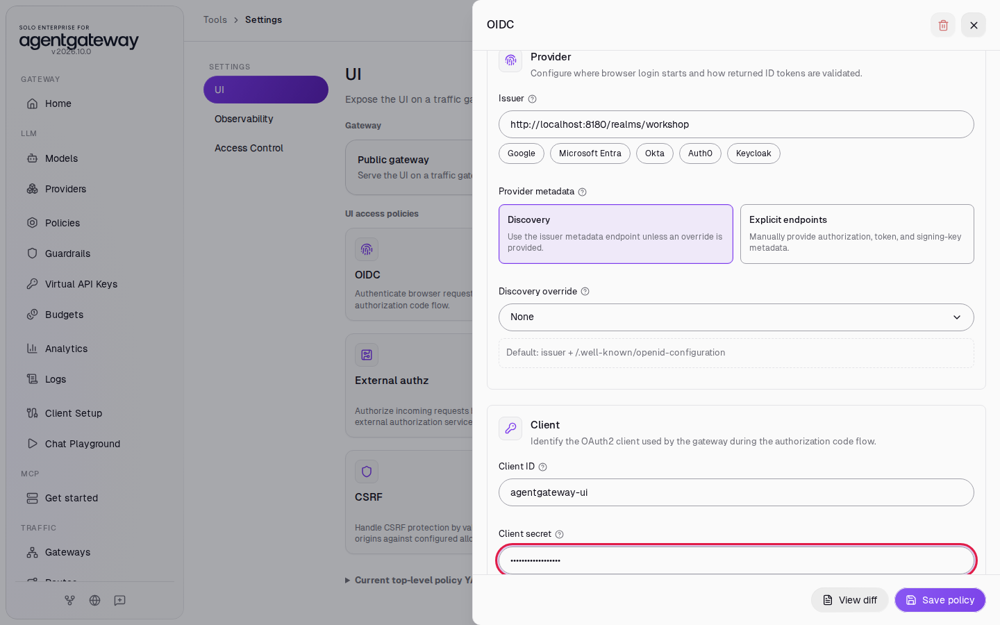

5. In **Redirect URI**, enter `http://localhost:8080/oauth/callback`.
6. Under **Additional scopes**, click **profile** and **email**.
7. Click **Save policy**.

   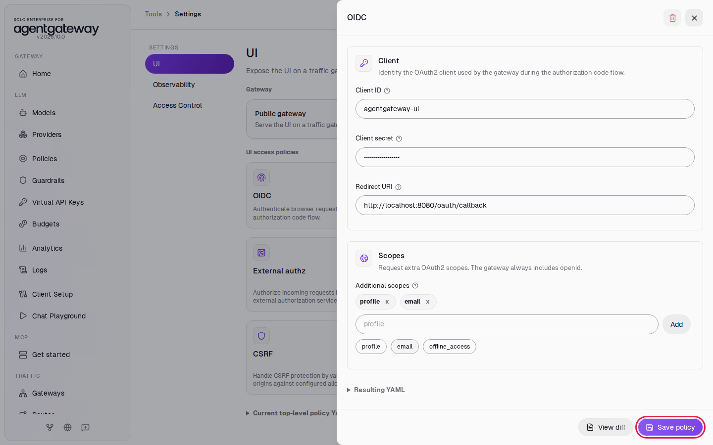

The realm file `setup/keycloak/workshop-realm.json` registers the `agentgateway-ui` client with this secret and redirect URI. It also adds a `groups` claim to the token. Your own IdP needs a client for the UI, the gateway's redirect URI, and a groups claim.

## Step 4: Add a role for each group

1. In the **Settings** menu, click **Access Control**.
2. Click **Add role**.
3. In **Name**, enter `platform-admins`.
4. Under **Subjects**, select **Group** and enter `platform-team`.
5. In **Preset**, select **Admin**.
6. Click **Create role**.

   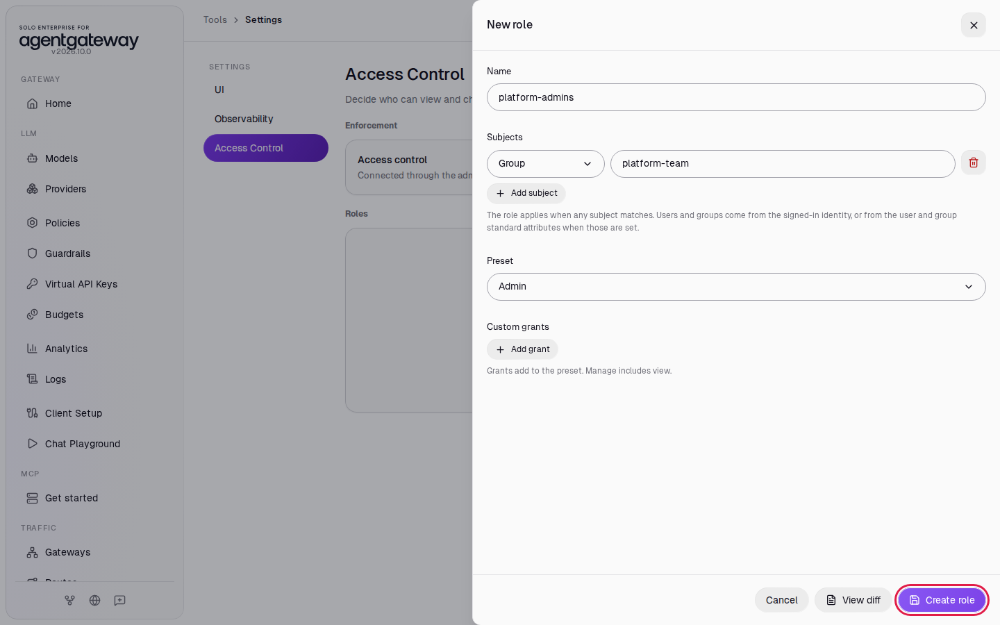

7. Add two more roles the same way:

   | Name | Group | Preset |
   |---|---|---|
   | `auditors` | `auditors` | **Viewer** |
   | `developers` | `developers` | **Self-service** |

## Step 5: Give carol one model to manage

A role can grant access to named resources instead of a preset. This role lets carol edit the `openai/*` model, on top of her **Self-service** access.

1. Click **Add role**.
2. In **Name**, enter `openai-model-owners`.
3. Under **Subjects**, leave **User** selected and enter `carol@example.com`.
4. Leave **Preset** on **None**.
5. Under **Custom grants**, click **Add grant**.
6. Leave the resource on **LLM models**. Change the access to **Manage** and the scope to **Named**.
7. In the names field, enter `openai/*`.
8. Click **Create role**.

   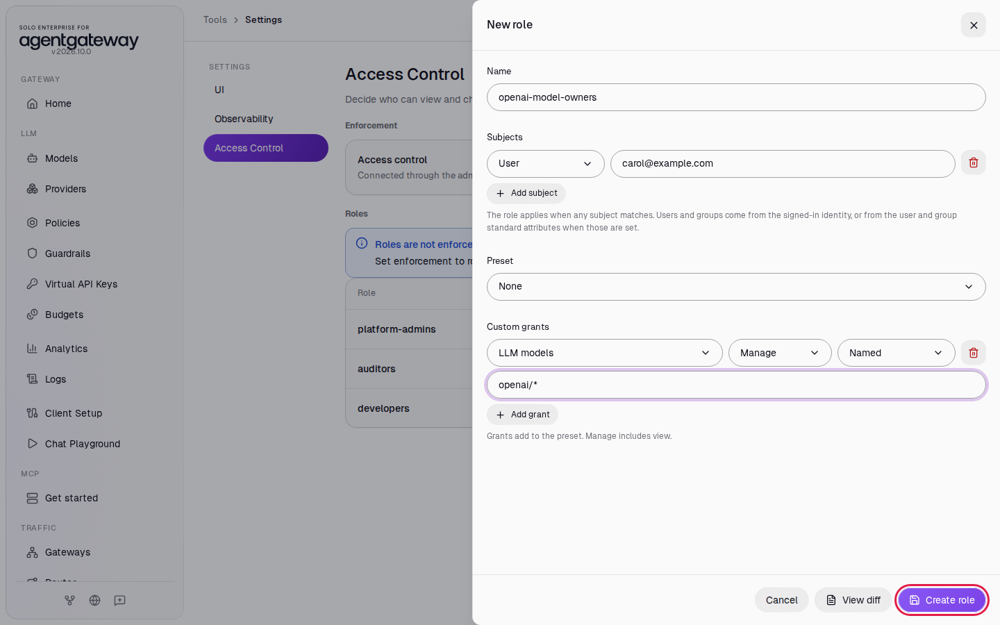

## Step 6: Turn on the roles

1. In **Access control**, select **Role-based**.
2. Click **Save**.

The page lists four roles:

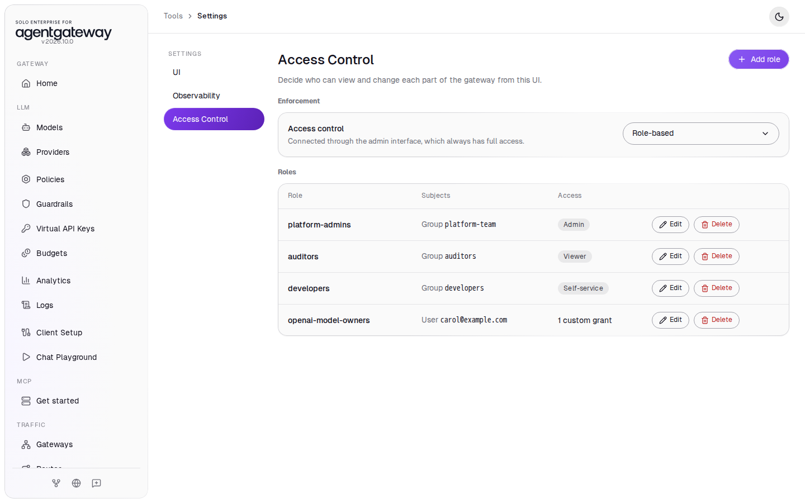

The admin interface on port `15000` keeps full access. The roles apply to the UI on port `8080`.

## Step 7: Sign in as alice

Keycloak and the gateway each keep you signed in with a cookie. To switch between users, use a private window (Chrome: **New Incognito window**). Close all private windows before you sign in as the next user.

**Sign out** in the user menu at the top right ends only your gateway session. Keycloak keeps you signed in, so **Sign in with SSO** signs you in again as the same user, with no password prompt. To switch users, close the private window.

1. Open a private window and go to `http://localhost:8080/ui/settings/access-control`.
2. The gateway shows a sign-in page. Click **Sign in with SSO**.

   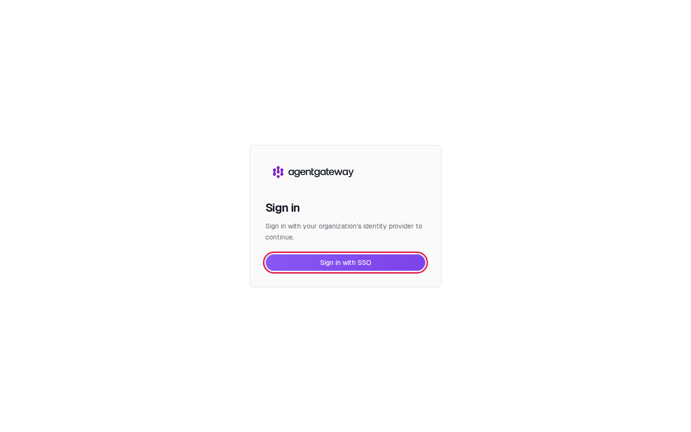

3. On the Keycloak page, enter `alice` and `workshop`, then click **Sign In**.

   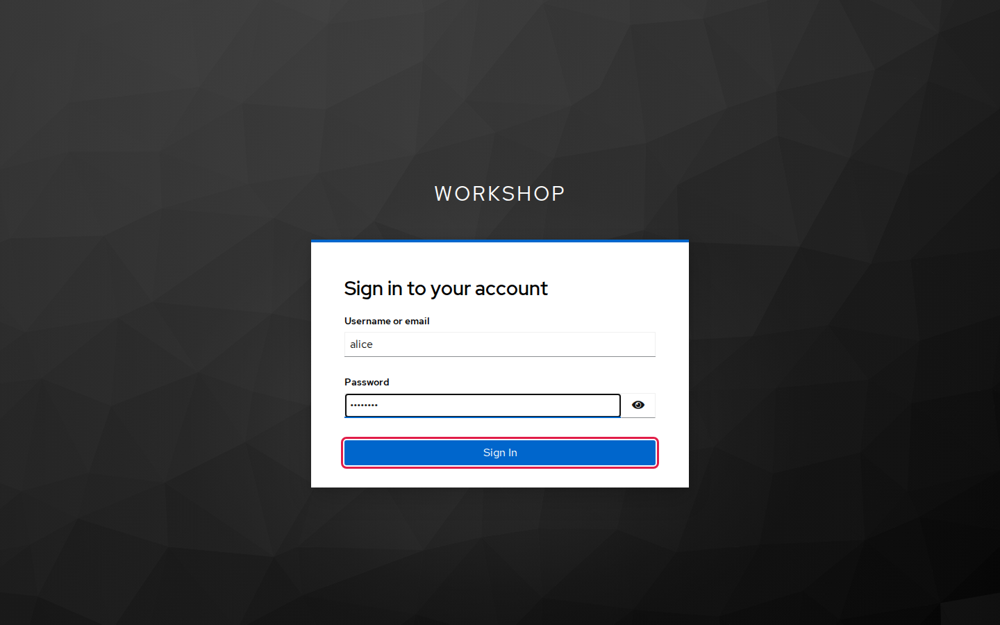

Keycloak sends you back to the UI. The top right shows **Alice Admin**, and the page says **Signed in as alice@example.com in platform-team.** alice has full access through the `platform-admins` role:

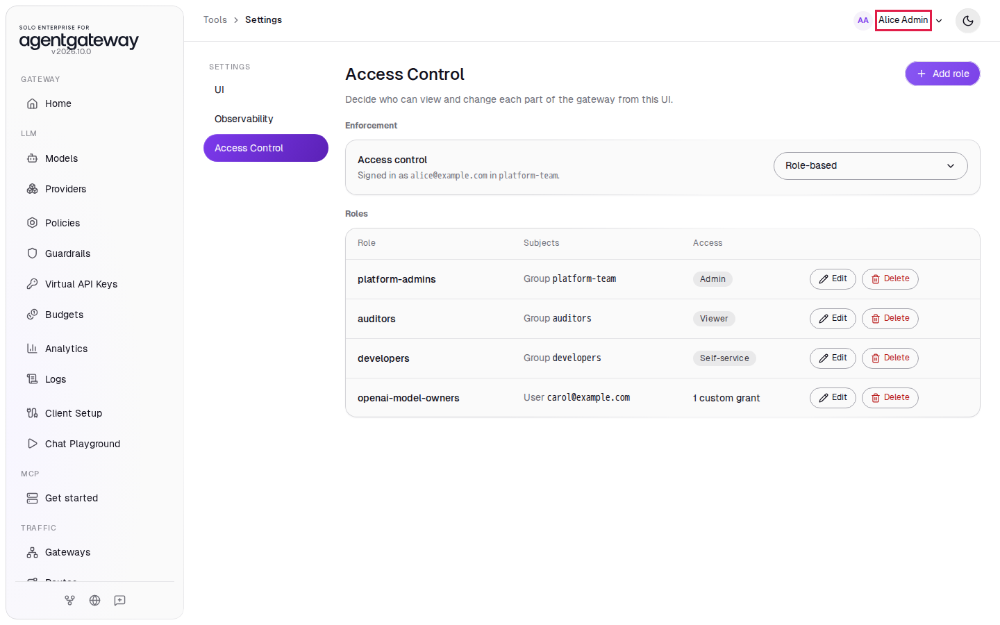

4. Close all private windows.

## Step 8: Sign in as bob

1. Open a private window and go to `http://localhost:8080/ui/llm/models`.
2. Click **Sign in with SSO** and sign in as `bob` with the password `workshop`.

bob sees the model but has no **Add model** or **Edit model** button:

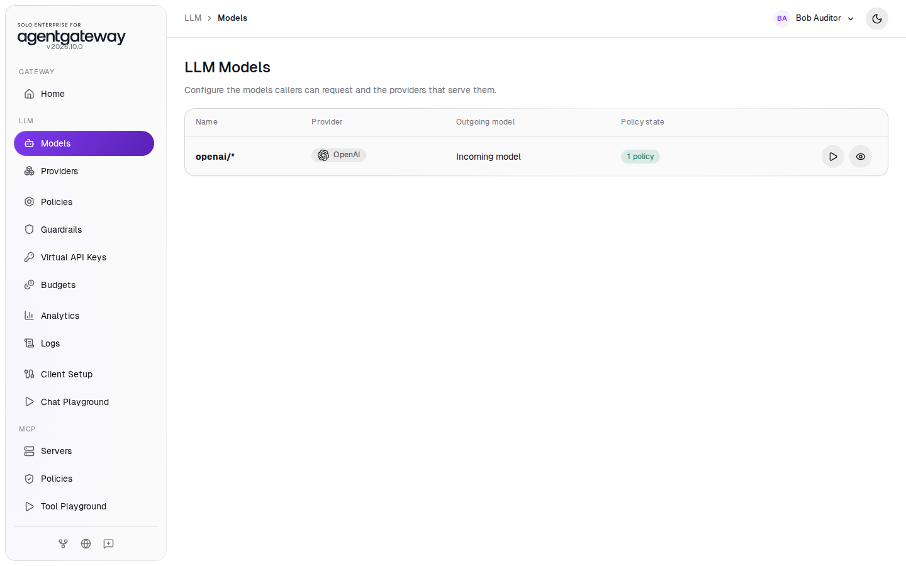

3. Go to `http://localhost:8080/ui/raw-config`. The page says **You do not have permission to view this page**.
4. Close all private windows.

## Step 9: Sign in as carol

1. Open a private window and go to `http://localhost:8080/ui/`.
2. Click **Sign in with SSO** and sign in as `carol` with the password `workshop`.

carol matches two roles: `developers` through her group and `openai-model-owners` through her email. Her sidebar combines both: the **Self-service** pages plus **Models**, **Client Setup** and **Chat Playground**.

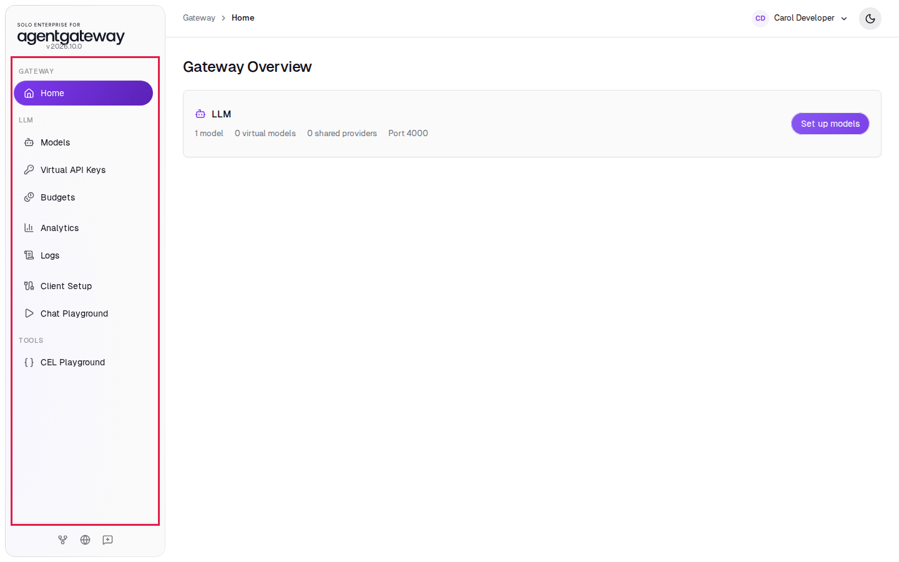

3. In the sidebar, click **Models**.

The `openai/*` row has **Edit model** and **Delete model** buttons:

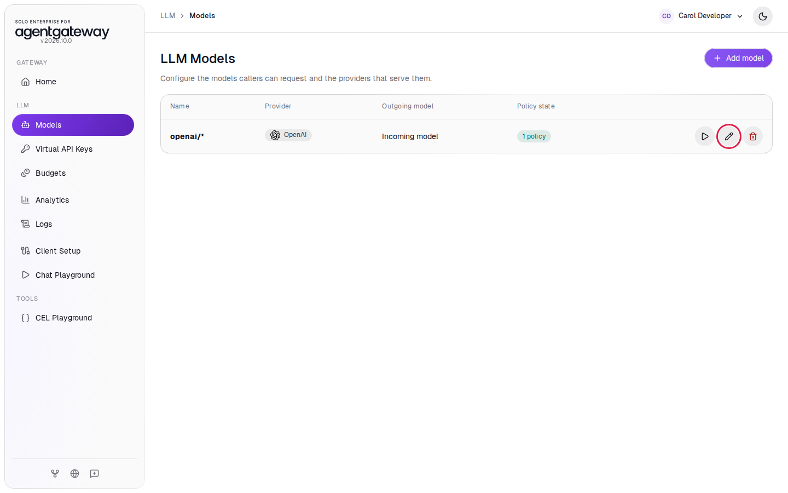

4. Close all private windows.

## Check it

Without a sign-in cookie, the gateway sends calls to the UI's API to the sign-in page:

```bash
curl -s -o /dev/null -w '%{http_code} %{redirect_url}\n' http://localhost:8080/api/config
```

Expected output:

```
302 http://localhost:8080/ui/login?returnTo=%2Fapi%2Fconfig
```

## What the UI wrote

In the sidebar, scroll down to **Tools** and click **Raw Configuration**. The UI added these sections:

```yaml
gateways:
  public:
    port: 8080
ui:
  gateways: public
  policies:
    oidc:
      issuer: http://localhost:8180/realms/workshop
      clientId: agentgateway-ui
      clientSecret: workshop-ui-secret
      redirectURI: http://localhost:8080/oauth/callback
      scopes:
      - profile
      - email
rbac:
  mode: fine-grained
  policies:
  - name: platform-admins
    subjects:
    - group: platform-team
    preset: admin
  - name: auditors
    subjects:
    - group: auditors
    preset: viewer
  - name: developers
    subjects:
    - group: developers
    preset: self-service
  - name: openai-model-owners
    subjects:
    - user: carol@example.com
    grants:
    - access: manage
      resource: llm.model
      scope:
        names:
        - openai/*
```

The gateway encrypts the sign-in cookie with the `OIDC_COOKIE_SECRET` variable that `setup/docker-compose.yml` passes to the gateway. The workshop sets a default value. Outside the workshop, generate your own with `openssl rand -hex 32` and set it in `.env`.

## Clean up

Do steps 1 to 13 on `http://localhost:15000/ui`.

1. In the sidebar, click **Settings**, then **Access Control**.
2. In **Access control**, select **Off** and click **Save**.
3. In each role row, click **Delete**, then click **Delete role** to confirm.
4. In the **Settings** menu, click **UI**.
5. Click the **OIDC** card, click the trash icon at the top right, then click **Delete policy** to confirm.
6. In **Public gateway**, select **None** and click **Save UI gateway**.
7. Click **Save UI gateway** to confirm.
8. In the sidebar, under **Traffic**, click **Gateways**.
9. In the **public** card, click the trash icon (**Delete gateway**).
10. In the sidebar, click **Raw Configuration**.
11. Delete the line `gateways: {}` and click **Save**. Deleting the gateway leaves this empty line. While it is there, the sidebar shows **Gateways** and **Routes** under **Traffic** instead of **Get started**.
12. In the sidebar, click **Models**.
13. In the `openai/*` row, click the trash icon, then click **Delete model**.
14. Close all private windows.
15. From the `setup/` folder, stop Keycloak:

    ```bash
    docker compose stop keycloak
    ```

The gateway is back to the state [001](../../001-set-up-standalone-agentgateway.md) left it in.
