# Give Each Person the Right Access to the UI

## Before you start

- Complete [001: Set Up Standalone Agentgateway](../../001-set-up-standalone-agentgateway.md).
- Pull the latest workshop files. The `setup/ui-users.htpasswd` file holds three UI users, `alice`, `bob` and `carol`. All three have the password `workshop`.

## What you'll do

- Serve the UI on port `8080` and require a user name and password there
- Give alice full access, bob read-only access, and carol access to her own API keys only
- Sign in as each user and see what each one can do
- Undo the changes on the admin port `15000`

## Why this matters

Until now, anyone who opened the UI could change any setting. Role-based access control (RBAC) lets you give each person only the access they need. A platform team manages the gateway, an auditor reads every setting without changing it, and developers issue their own API keys without seeing anyone else's.

The roles apply to the UI on a gateway port. The admin interface on port `15000` always has full access, so keep it private. It is also your way back in if a role change locks you out.

## Step 1: Use the sign-in name as the user

The gateway needs to know which user signed in. This setting has no form in the UI, so you add it in Raw Configuration.

1. In the sidebar, scroll down to **Tools** and click **Raw Configuration**.
2. Click at the start of the `llm:` line, before the `l`, and press Enter. An empty line appears above `llm:`.
3. Click the empty line and paste these two lines:

   ```yaml
     standardAttributes:
       user: basicAuth.username
   ```

4. Check that `standardAttributes:` lines up with `modelCatalog:` above it, then click **Save**.

   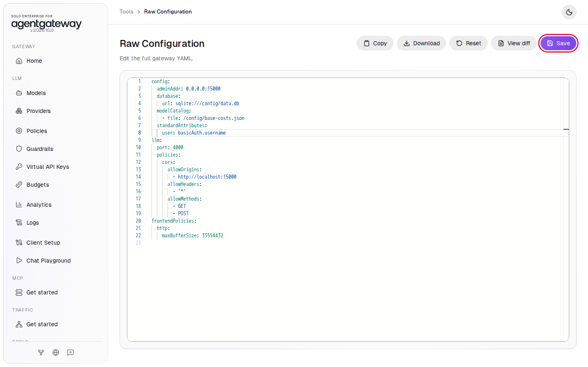

## Step 2: Add a gateway on port 8080

1. In the sidebar, under **Traffic**, click **Get started**.

   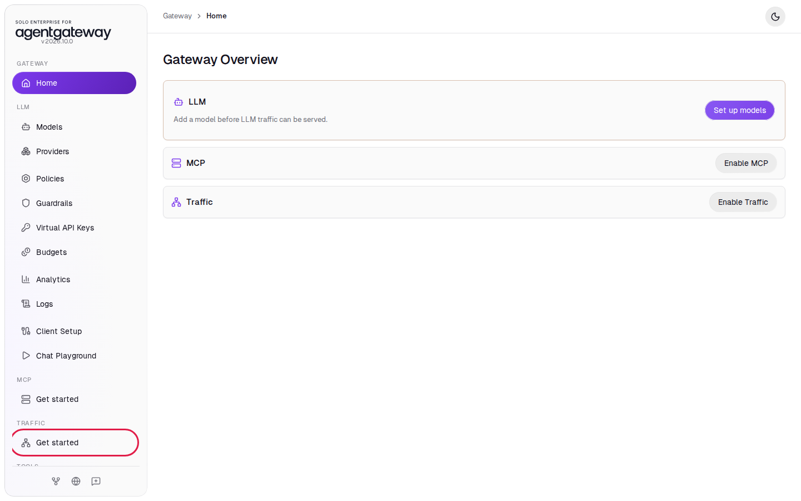

2. Click **Enable**.

The UI adds a gateway named `public` on port `8080` and opens **Traffic Gateways**:

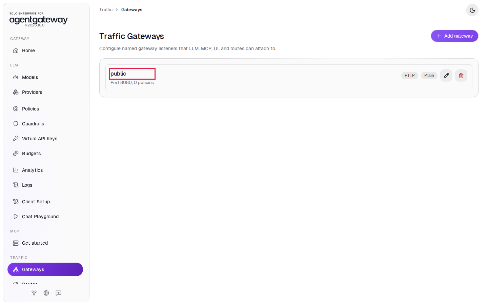

## Step 3: Serve the UI on the public gateway

1. In the sidebar, scroll down and click **Settings**. The **UI** page opens.
2. In **Public gateway**, select **public**.
3. Click **Save UI gateway**.

   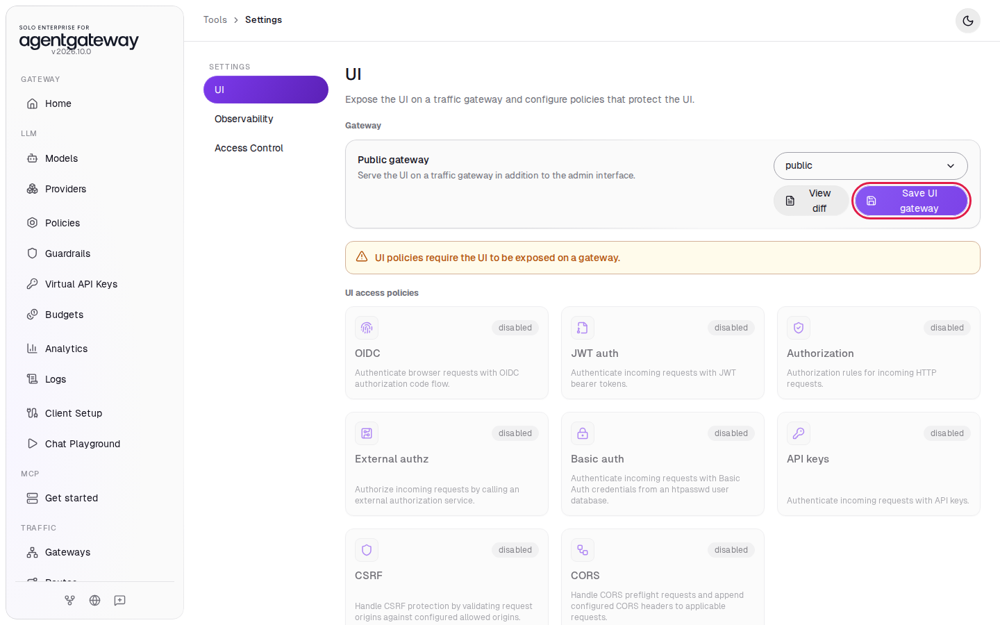

The UI now also answers on `http://localhost:8080/ui`. Anyone who opens that address has full access until you add a password in the next step.

## Step 4: Require a user name and password

1. On the same page, under **UI access policies**, click the **Basic auth** card.

   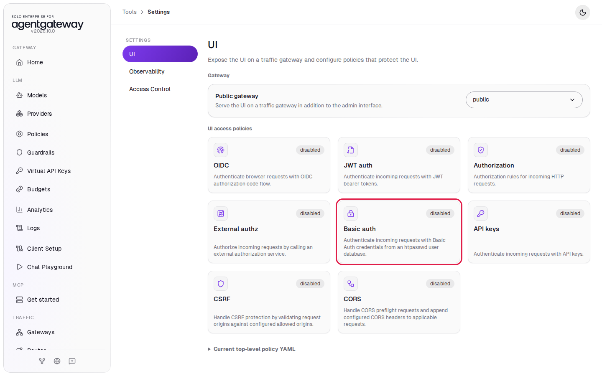

2. Click in **Policy YAML** and paste:

   ```yaml
   mode: strict
   realm: agentgateway-ui
   htpasswd:
     file: /config/ui-users.htpasswd
   ```

3. Click **Save policy**.

   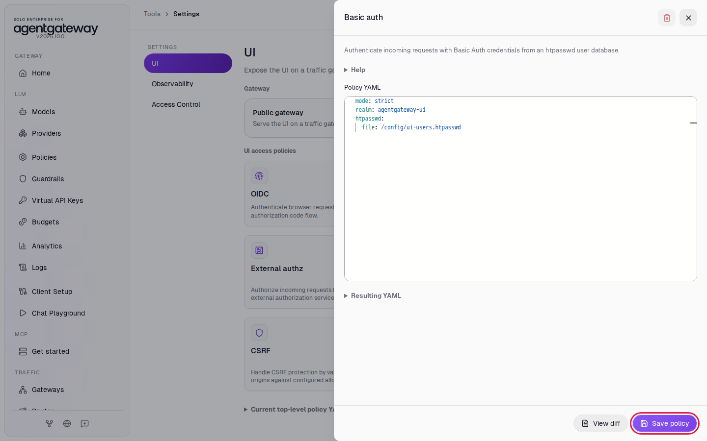

The gateway reads the users from `setup/ui-users.htpasswd`, which Docker Compose mounts at `/config`. The file stores each password as a bcrypt hash. To add your own users, run `htpasswd -nbB <name> <password>` and add the output line to the file.

## Step 5: Add a role for each user

1. In the **Settings** menu, click **Access Control**.
2. Click **Add role**.

   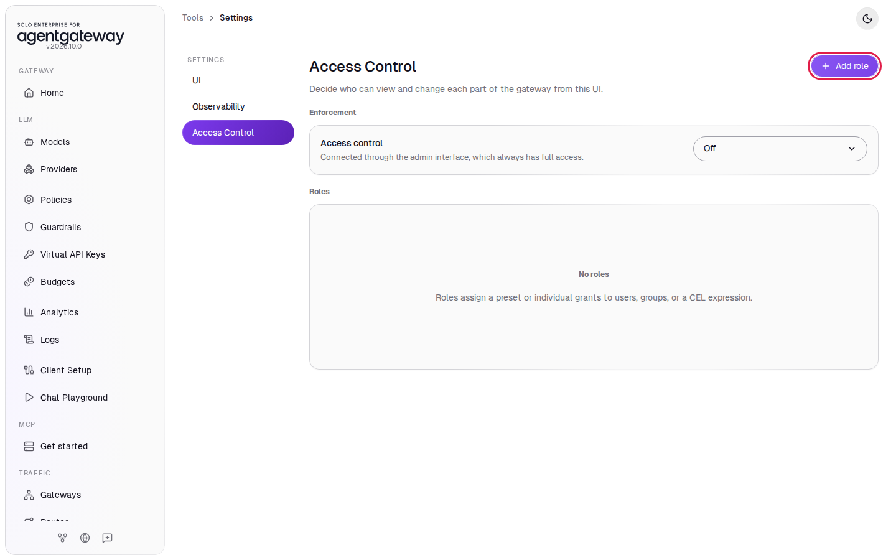

3. In **Name**, enter `platform-admins`.
4. Under **Subjects**, leave **User** selected and enter `alice`.
5. In **Preset**, select **Admin**.
6. Click **Create role**.

   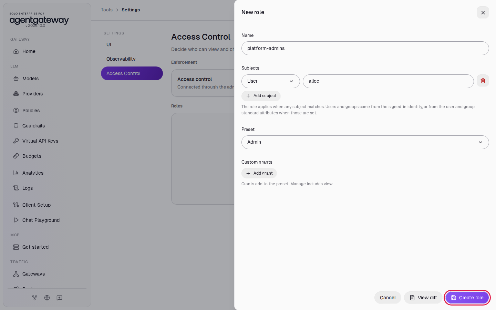

7. Add two more roles the same way:

   | Name | User | Preset |
   |---|---|---|
   | `auditors` | `bob` | **Viewer** |
   | `developers` | `carol` | **Self-service** |

| Preset | Access |
|---|---|
| **Admin** | Manage everything, including Raw Configuration and Access Control |
| **Viewer** | View every page, including all users' API keys and usage. No Raw Configuration. |
| **Self-service** | Manage your own API keys. View your own logs, analytics and budgets. |

The page lists the three roles under a **Roles are not enforced** notice:

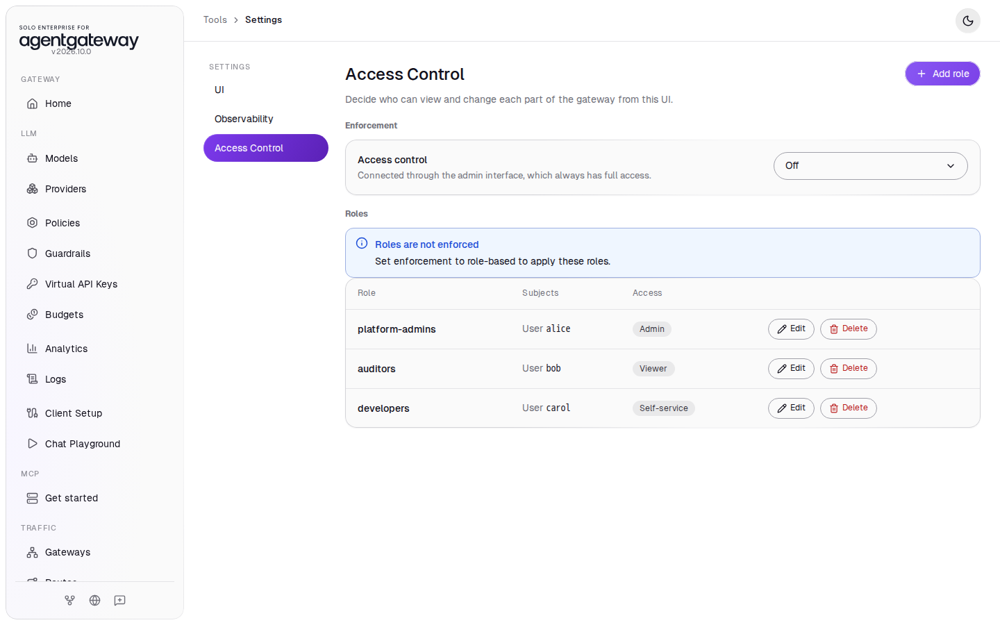

## Step 6: Turn on the roles

1. In **Access control**, select **Role-based**.
2. Click **Save**.

   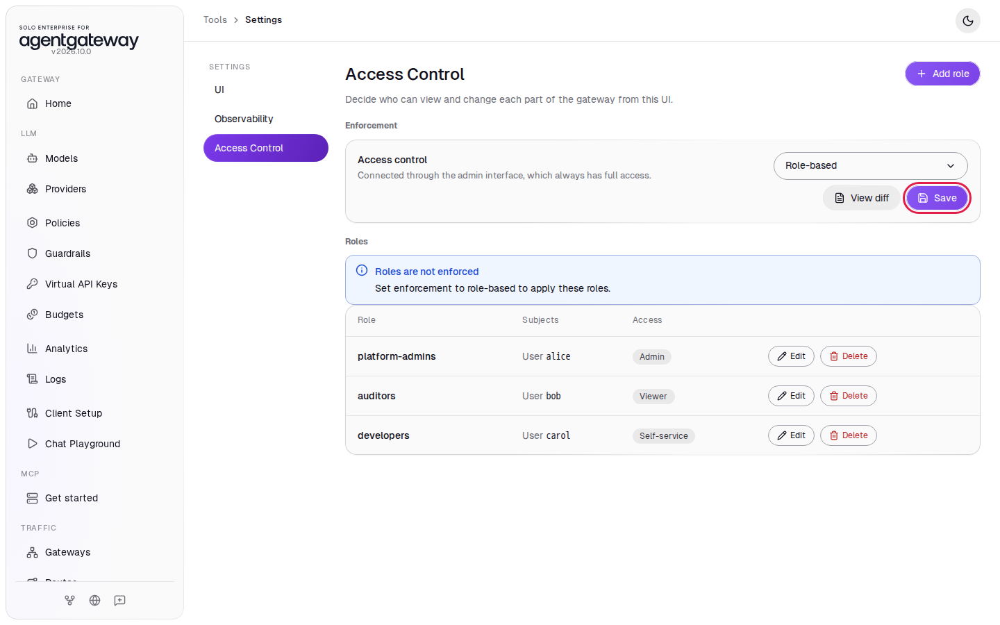

The page still says **Connected through the admin interface, which always has full access.** The roles apply to the UI on port `8080`.

## Step 7: Sign in as alice

Your browser remembers a Basic auth password until you close it. To switch between users, use a private window (Chrome: **New Incognito window**). Close all private windows before you sign in as the next user.

1. Open a private window and go to `http://localhost:8080/ui/settings/access-control`.
2. In the sign-in prompt, enter `alice` and `workshop`.

The page says **Signed in as alice.**, and alice's name appears at the top right. As an admin, alice sees the full sidebar and can change the roles:

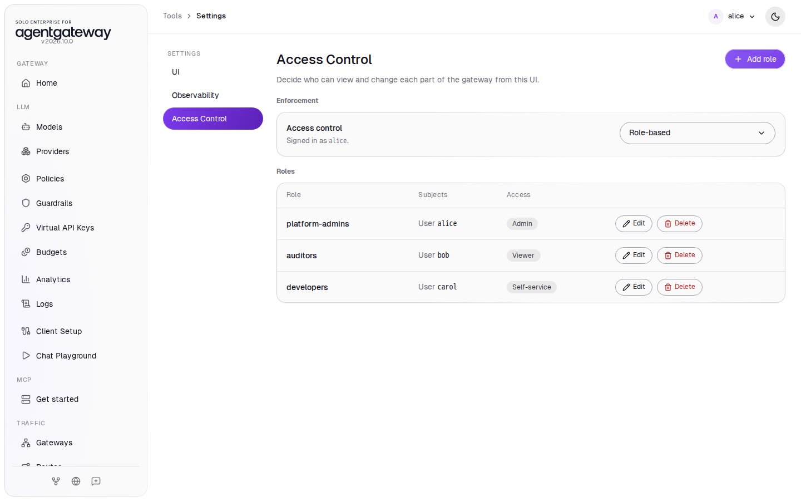

3. In the sidebar, click **Virtual API Keys**.
4. Click **Enable API key auth**, then click **Enable API key auth** again in the panel.
5. Click **New key**, enter `alice-key` in **Name**, and click **Save key**.
6. Click **Done**. You don't need the key value in this lab.
7. Close all private windows.

## Step 8: Sign in as carol

1. Open a private window and go to `http://localhost:8080/ui/`.
2. Sign in as `carol` with the password `workshop`.

carol's sidebar shows only the pages that the **Self-service** preset covers:

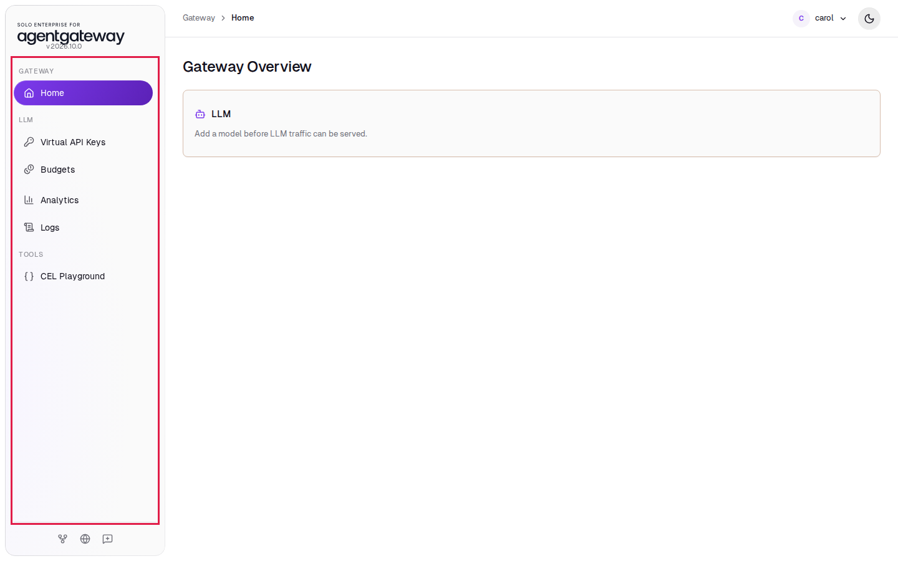

3. In the sidebar, click **Virtual API Keys**.
4. Click **New key**.

   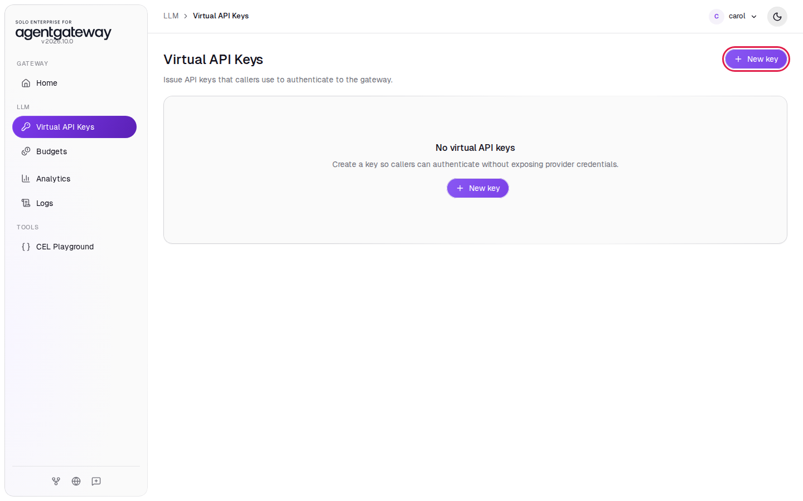

5. In **Name**, enter `carol-key` and click **Save key**.
6. Click **Done**.

The list shows only `carol-key`, the one key carol owns:

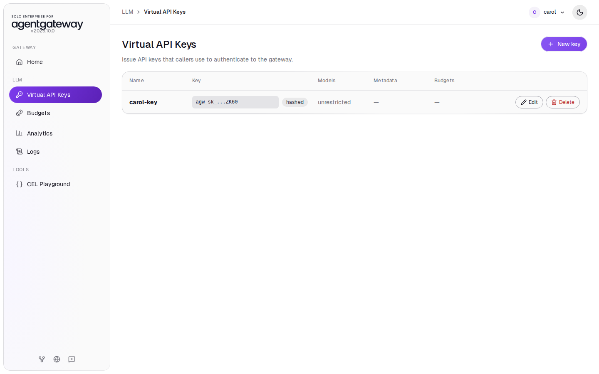

7. Close all private windows.

## Step 9: Sign in as bob

1. Open a private window and go to `http://localhost:8080/ui/llm/keys`.
2. Sign in as `bob` with the password `workshop`.

bob sees both keys, but the page has no **New key**, **Edit** or **Delete** buttons:

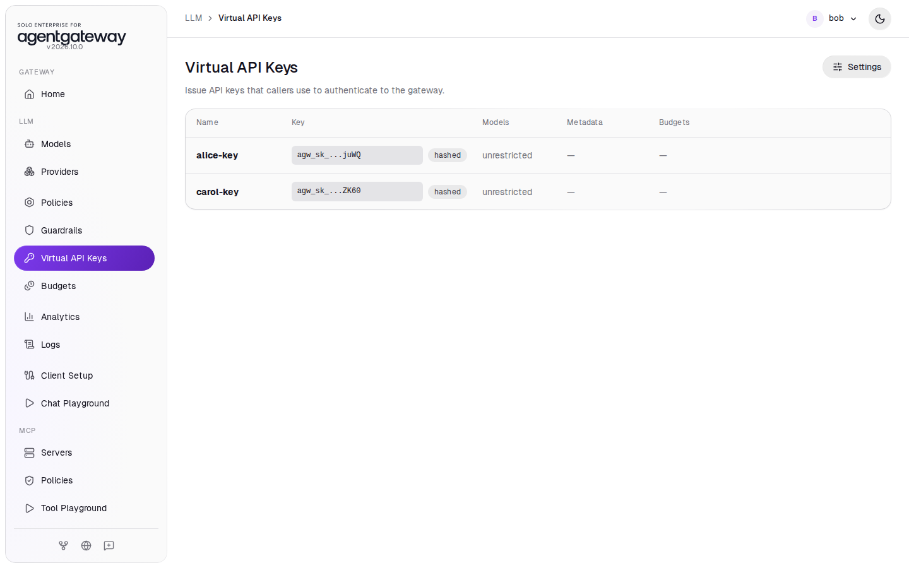

3. Go to `http://localhost:8080/ui/raw-config`.

The **Viewer** preset has no access to the raw configuration:

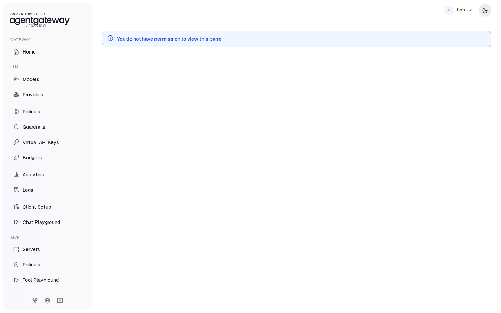

4. Close all private windows.

## Check it

1. Go back to your normal window on `http://localhost:15000/ui`.
2. In the sidebar, click **Settings**, then **Access Control**.

The admin interface still has full access, with no sign-in:

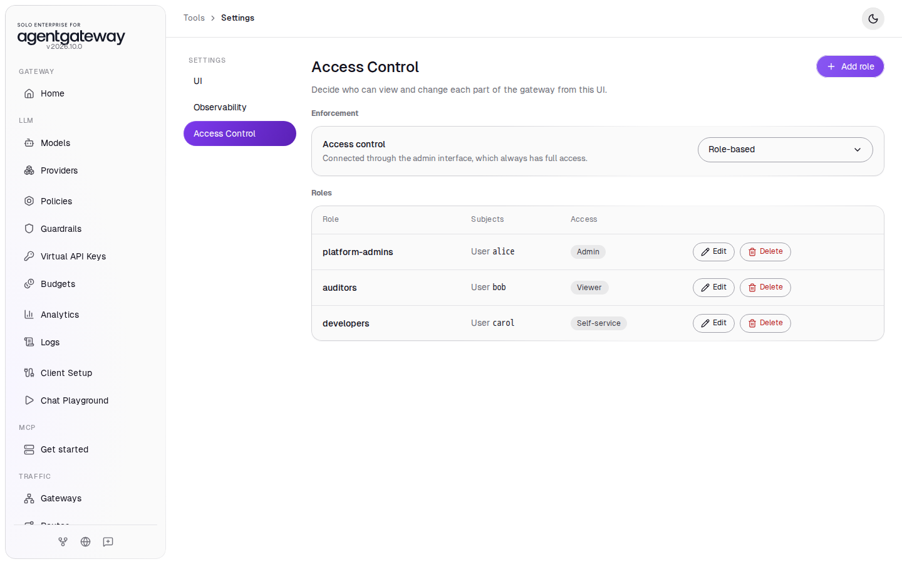

<details>
<summary>Optional: check with curl</summary>

The UI reads the gateway configuration from `/api/config`. Only the **Admin** preset can read it:

```bash
for u in alice bob carol; do
  echo "$u: $(curl -s -o /dev/null -w '%{http_code}' -u $u:workshop http://localhost:8080/api/config)"
done
echo "no password: $(curl -s -o /dev/null -w '%{http_code}' http://localhost:8080/api/config)"
```

Expected output:

```
alice: 200
bob: 403
carol: 403
no password: 401
```

</details>

## What the UI wrote

In the sidebar, scroll down to **Tools** and click **Raw Configuration**. Besides the API keys, the UI added these sections:

```yaml
config:
  ...
  standardAttributes:
    user: basicAuth.username
gateways:
  public:
    port: 8080
ui:
  gateways: public
  policies:
    basicAuth:
      mode: strict
      realm: agentgateway-ui
      htpasswd:
        file: /config/ui-users.htpasswd
rbac:
  mode: fine-grained
  policies:
  - name: platform-admins
    subjects:
    - user: alice
    preset: admin
  - name: auditors
    subjects:
    - user: bob
    preset: viewer
  - name: developers
    subjects:
    - user: carol
    preset: self-service
```

The UI calls the enforcement modes **Off** and **Role-based**. The config calls them `coarse` and `fine-grained`. Each API key also has an `agentgateway.dev/owner` entry in its `metadata`, set to the user who created it. The **Self-service** preset uses it to decide whose keys a user sees.

## Clean up

Do every clean-up step on `http://localhost:15000/ui`.

1. In the sidebar, click **Virtual API Keys**.
2. In the **alice-key** row, click **Delete**, then click **Delete key** to confirm. Do the same for **carol-key**.
3. Click **Disable API Key Policy**, then click **Disable API Key Policy** to confirm.
4. In the sidebar, click **Settings**, then **Access Control**.
5. In **Access control**, select **Off** and click **Save**.
6. In each role row, click **Delete**, then click **Delete role** to confirm.

   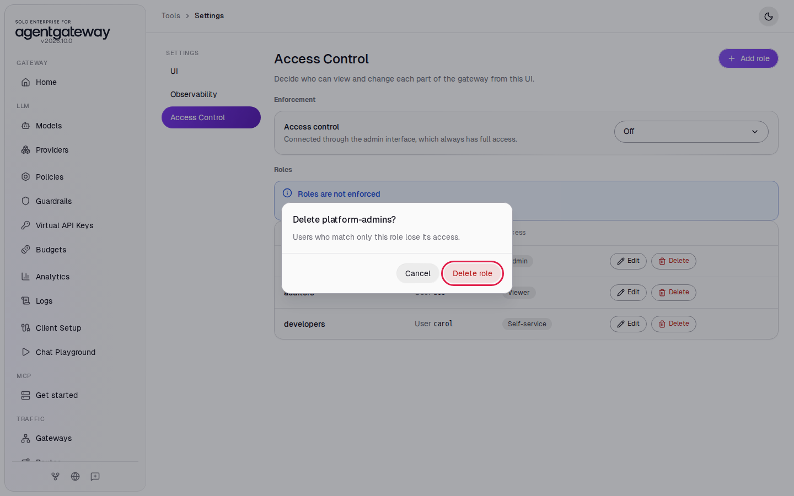

7. In the **Settings** menu, click **UI**.
8. Click the **Basic auth** card, click the trash icon at the top right, then click **Delete policy** to confirm.
9. In **Public gateway**, select **None** and click **Save UI gateway**.
10. Click **Save UI gateway** to confirm.

    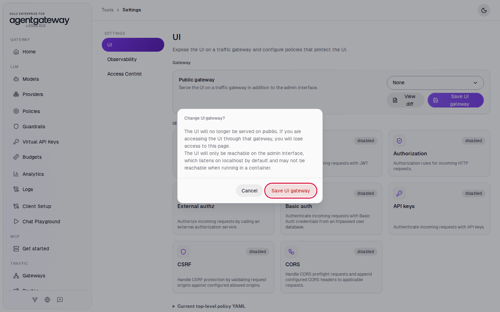

11. In the sidebar, under **Traffic**, click **Gateways**.
12. In the **public** card, click the trash icon (**Delete gateway**).
13. In the sidebar, click **Raw Configuration**.
14. Delete the two lines you added in Step 1, `standardAttributes:` and `user: basicAuth.username`.
15. Delete the line `gateways: {}` and click **Save**.

Deleting the gateway leaves an empty `gateways: {}` line. While it is there, the sidebar shows **Gateways** and **Routes** under **Traffic** instead of **Get started**.

The gateway is back to the state [001](../../001-set-up-standalone-agentgateway.md) left it in.
